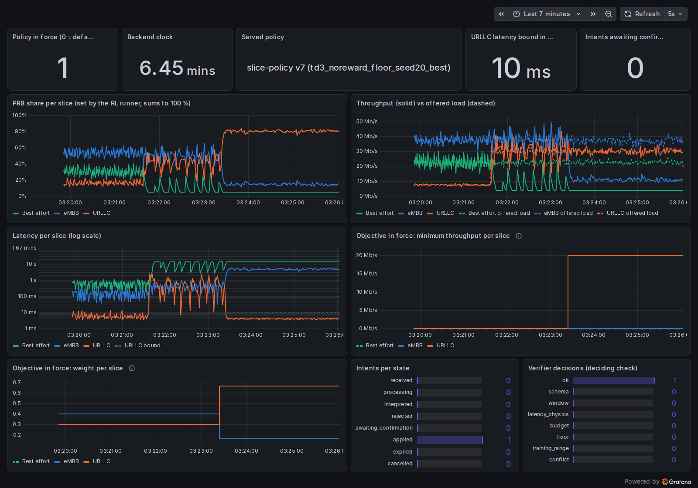
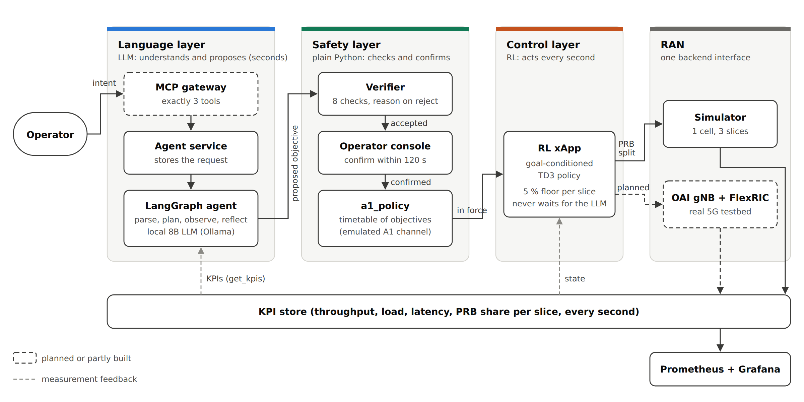
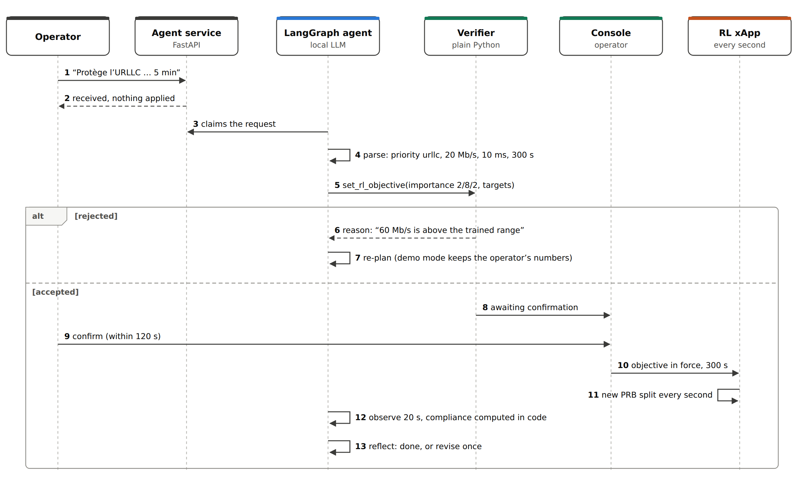
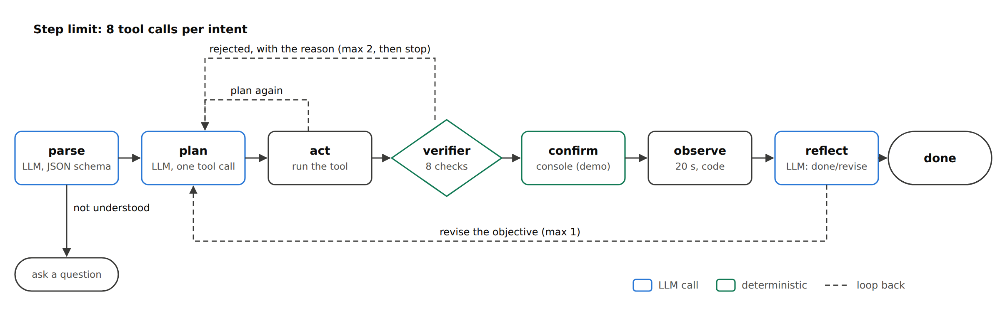
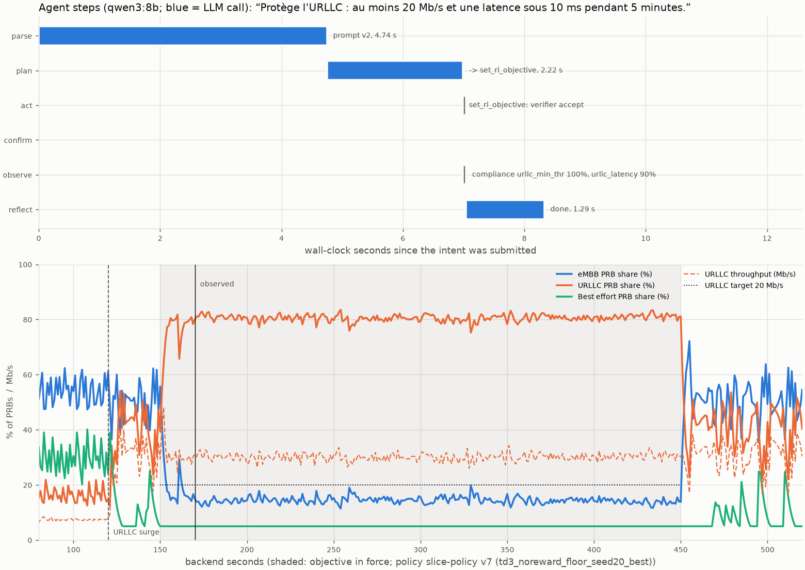
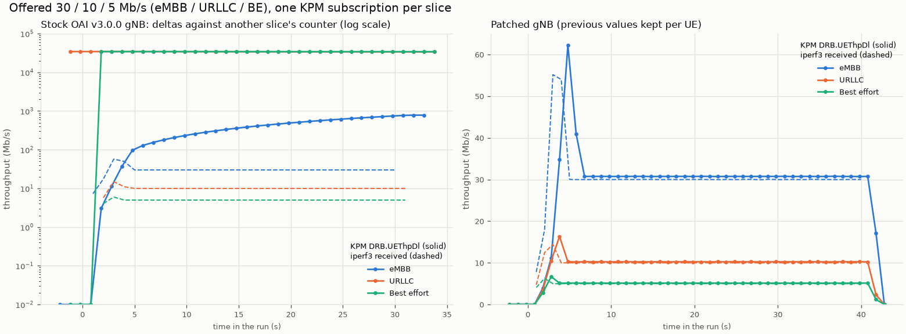
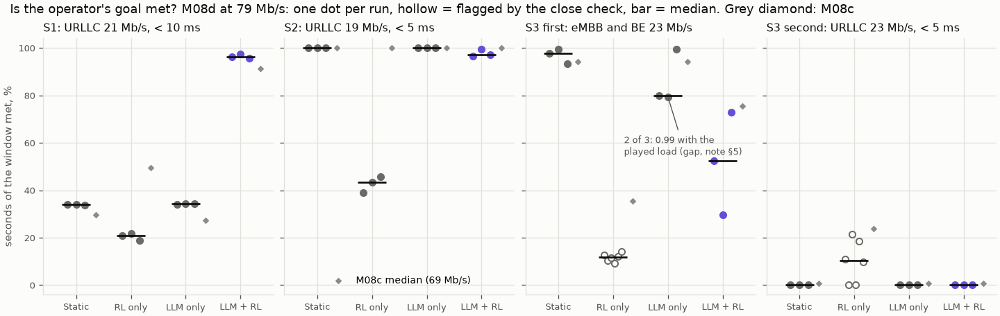

# Agentic AI for the RAN Intelligent Controller (O-RAN)

**An operator types a goal in plain French or English. A local LLM agent turns it into an
objective, a deterministic verifier checks it, and a goal-conditioned reinforcement-learning
xApp reallocates the radio resources of a 5G cell, every second.**

> "Protège l'URLLC : au moins 20 Mb/s et une latence sous 10 ms pendant 5 minutes."
>
> About five seconds later the agent has a verified objective waiting for the operator. Once it
> is confirmed, the URLLC slice gets the share of the cell it needs, its latency drops back under
> 10 ms, and the agent checks the result against the operator's numbers.

Personal research and engineering project by **Souhail Bourhim**. Everything runs on one laptop:
a simulated cell, an RL controller, an 8B LLM on the local GPU, and a real OpenAirInterface 5G
testbed (core, gNB, three UEs, FlexRIC) in Docker.


*Live run (Grafana). An intent arrives during a URLLC traffic surge: the RL xApp gives URLLC
most of the PRBs and its latency drops under the 10 ms bound. The bottom panels show the
objective the LLM chose and the verifier confirmed.*

---

## The idea: give each component only the job it is good at

LLMs let operators speak in intents instead of configuration, but they are slow,
non-deterministic and sometimes wrong. So the LLM never touches the radio:

| Component | Its job | What it is never allowed to do |
|---|---|---|
| **LLM agent** (LangGraph, qwen3:8b via Ollama) | Understand the request, choose an objective, judge whether it worked | Touch the radio, set the PRB split, or skip the verifier |
| **Verifier** (plain Python) | Accept or reject every objective, with a reason in numbers | Use an LLM, randomness, the network or the clock |
| **RL xApp** (TD3, goal-conditioned) | Split the PRBs between the eMBB, URLLC and best-effort slices every second | Wait for the LLM: it runs on its own loop |
| **Operator console** | Confirm or refuse each change, with a timeout | Be reachable from the chat interface |

These rules are six **hard invariants**, each with an automated test. For example: the chat
interface and the MCP gateway expose exactly three tools (`submit_intent`, `get_kpis`,
`get_status`), submitting an intent never writes to the policy channel, the verifier imports
nothing non-deterministic, and only the RL runner can set the PRB split.

## Architecture



Two design choices carry it:

- **The LLM changes the objective, not the actions.** The RL policy takes the objective as part
  of its input (per-slice weights, minimum throughputs, a URLLC latency bound) and was trained on
  randomly sampled objectives, so a new operator goal needs no retraining.
- **One backend interface.** The RL runner calls the same five methods whether the RAN is the
  Python simulator or the real OAI gNB through FlexRIC. Nothing above the runner knows which.

FlexRIC is a near-RT RIC only, so the A1 policy channel between the agent and the RL xApp is
emulated by a small, explicit table (`a1_policy`), and the docs say so.

<details>
<summary>One request, step by step, and the agent's state machine</summary>



The agent is an explicit LangGraph state machine, not a free-running ReAct loop: each node has
bounded retries, a step limit and a revision limit, each with a test.





</details>

## What has been shown

Every result below has a learning note in [docs/learn/](docs/learn/) with the figures, the
commands to reproduce it, and its limits. Criteria and selection rules were committed before the
runs, and failures stay on record.

### The building blocks work, on the simulator and on a real 5G cell

- **A goal-conditioned policy that passes a test it could fail** ([M02/M02b](docs/learn/M02-ddpg.md)). The test
  compares the policy with an oracle that searches 861 splits per second with the true future
  loads. On a held-out set scored once, 5 of 5 fresh training seeds pass. The first criterion
  (M02) failed and the failure is kept: it turned out even a perfect controller could fail it.
- **An LLM chosen by measurement** ([M04b](docs/learn/M04b-langgraph.md)). Five local models
  on annotated intents under a rule written first; qwen3:8b won. On 20 held-out intents scored
  once ([M08b](docs/learn/M08b-eval-interface.md)) it read 19 correctly, against 10 for a regex
  parser, and flagged all 6 ambiguous ones.
- **A chat interface that can do almost nothing** ([M05b](docs/learn/M05b-hermes.md)). Hermes
  Agent runs on an internal Docker network whose only exits are the gateway and Ollama. 73
  out-of-scope attempts changed nothing. Its *words* were not reliable (it once invented the
  output of a command it could not run), which is why safety rests on what it can reach.
- **Three slices end to end on OAI** ([M06](docs/learn/M06-testbed.md)), **per-slice KPIs over E2 after fixing
  a gNB bug** ([M07a](docs/learn/M07a-kpm.md): OAI v3.0.0 computed each slice's throughput
  against another slice's counter; a ~50-line patch fixes it, and KPM then matches iperf3 to a
  median 2.5 %), and **PRB-split control over E2**, which OAI v3.0.0 does not have
  ([M07b](docs/learn/M07b-slice-control.md): a gNB patch plus a slice-control xApp; throughput
  follows the PRBs at 0.654 Mb/s per PRB, and bad commands are refused with a reason).



### The four controllers, on three hand-made scenarios

Static split, RL only (no goals), LLM only (the LLM sets the split itself) and LLM + RL, on the
simulator ([M08a](docs/learn/M08a-eval-sim.md)) and the real cell
([M08c](docs/learn/M08c-eval-testbed.md), [M08d](docs/learn/M08d-eval-testbed-rerun.md)).
Real cell at its measured capacity (M08d), share of the operator's window in which the goal was
met, median of 3 repeats:

| Goal | Static | RL only | LLM only | LLM + RL |
|---|---|---|---|---|
| S1: URLLC ≥ 21 Mb/s, < 10 ms, before a surge | 0.34 | 0.21 | 0.34 | **0.96** |
| S2: URLLC ≥ 19 Mb/s, < 5 ms, stated mid-run | **1.00** | 0.43 | **1.00** | 0.97 |
| S3: eMBB and BE ≥ 23 Mb/s | **0.98** | 0.12 | 0.80 | 0.53 |
| S3: URLLC ≥ 23 Mb/s, < 5 ms (rejected by the verifier) | 0.00 | 0.18 | 0.00 | 0.00 |

- **Where a goal needs RL, the design works:** in S1 only LLM + RL serves the surge, on the
  simulator and on the real cell (URLLC delay 0.6 ms median).
- **Where it doesn't, it costs:** the policy over-serves URLLC, and a static split does better on
  S3. M08a's large S2 win came from the simulator's delay model and vanished on the real cell.
- **The simulator-trained policy oscillated on the real cell** (period 10–12 s) because the
  testbed shows a split's effect 2 ticks later. Stronger smoothing reduced it without retraining.



### Beyond three scenarios (M09, in progress)

Three scenarios on a 7-minute-per-run testbed cannot carry a general claim, so M09 moves the
comparison to a simulator calibrated against the testbed, with generated scenarios.

- **A calibrated, validated simulator** ([M09a](docs/learn/M09a-sim-calibration.md)): flat RLC
  delay, real buffer, measured capacity, KPIs 2 ticks late, every parameter from static testbed
  runs. Judged by replaying 72 testbed runs under a rule written first: **the first attempt
  failed**, the one allowed retry passed (controller order right in 8/8 panels). LLM only can't
  be reproduced by any simulator, since its choices turn on irrelevant input details.
- **A dev benchmark of 200 generated instances × 7 controllers**
  ([M09b](docs/learn/M09b-benchmark.md)), with three references: an oracle that knows the coming
  loads, LLM + formula (the same agent and verifier with arithmetic instead of RL), and a fairer
  LLM only. Mean intent met (dev seeds, used to build, **not a claim**):

  | | F1 adapt to load | F2 new goal | F3 fast dynamics | F4 verifier edge | F5 easy |
  |---|---|---|---|---|---|
  | **LLM + RL** (policy v7) | **0.93** | 0.94 | 0.60 | 0.61 | 1.00 |
  | Static | 0.40 | 1.00 | 0.23 | 0.73 | 1.00 |
  | RL only | 0.62 | 0.70 | 0.24 | 0.36 | 0.94 |
  | LLM only v2 | 0.79 | 1.00 | 0.68 | 0.77 | 1.00 |
  | LLM + formula | 0.97 | 1.00 | 0.92 | 0.84 | 1.00 |
  | Oracle | 1.00 | 1.00 | 0.98 | 0.95 | 1.00 |

  LLM + RL beats the controllers without goals and the LLM alone on adaptation, and repeats
  within 0.006 across plays (LLM only swings by up to 0.99). But **a simple formula behind the
  same agent and verifier matches or beats it**, most clearly on fast dynamics: the RL policy had
  no load history in its input.
- **Policy v8: retrained, not confirmed** (M09c). The training was moved to the calibrated cell
  with late KPIs, intent expiries, on/off loads and a 30 s load history in the observation. On
  the dev benchmark, LLM + RL rose from 0.79 to 0.85 mean intent met (F3 0.60 → 0.76), and a
  4-recipe ablation showed the load history is what fixes F3. On the held-out goal test, scored
  once, **the recipe failed**: one seed in five never learned, and the others missed one threshold
  by up to 0.04. By the rule set beforehand, **v7 stays the champion**.

Next: the pre-registered result on fresh test seeds (M09d), a testbed confirmation of its written
predictions (M09e), and dangerous in-scope intents (M09f). The plan is in
[docs/PLAN.md](docs/PLAN.md) §9.

### Limits to keep in mind

One cell, RF simulation (clean channel), one UE per slice, one author for the intents, bounds on
RLC delay rather than end to end, and an 8B local model. The RL policy has so far shown its value
over static splits and LLM-only control, not over a hand-written formula.

## Engineering practices

- **491 automated tests**, run by GitHub Actions on every push, with no GPU, LLM or testbed
  needed (the LLM is replaced by a scripted fake). At least one test per hard invariant.
- **Pre-registration.** Pass/fail criteria, selection rules and held-out sets are committed
  before the experiment runs; held-out sets refuse to be scored twice in code.
- **MLOps on a laptop:** MLflow tracking of every training and evaluation run, a model registry,
  and a deterministic promotion gate. A policy becomes champion only with recorded test evidence;
  the gate refused v8.
- **Decision log.** [docs/DECISIONS.md](docs/DECISIONS.md) has about 190 dated decisions with
  their reasons and the alternatives rejected.
- **A learning note per checkpoint** ([docs/learn/](docs/learn/)): what was built, how it works
  with file:line references, how to run and check it, the choices made, and questions.
- **Live observability:** a Prometheus exporter and a provisioned Grafana dashboard.

## Status

| Checkpoint | What it delivers | Status |
|---|---|---|
| M01 | Gymnasium simulator: one cell, three slices, objective schema | Done |
| M02 / M02b / M02c | Goal-conditioned TD3 policy and oracle-validated goal test; MLflow, registry, CI | Done |
| M03 | Deterministic verifier (8 checks) and multi-intent merge | Done |
| M04a / M04b | Backend interface, KPI store, A1 emulation, RL runner, console, Grafana; LangGraph agent and LLM benchmark | Done |
| M05a / M05b | MCP gateway with exactly three tools; Hermes Agent as an isolated chat interface | Done |
| M06 / M07a / M07b | OAI testbed with three slices; KPM xApp and gNB fix; PRB-split control over E2 | Done |
| M08a–d | Four-controller comparison on the simulator and the real cell; interface evaluation on held-out intents | Done |
| M09a / M09b | Calibrated and validated simulator; generated scenarios and a 7-controller dev benchmark | Done |
| M09c | Policy v8 in the calibrated setting | Trained; not confirmed, v7 stays champion (note in progress) |
| M09d / M09e / M09f | Test-seed result scored once; testbed confirmation; dangerous intents | Planned |

The original design document (in French) is
[docs/Proposition_IA_agentique_RIC_ORAN_v2.pdf](docs/Proposition_IA_agentique_RIC_ORAN_v2.pdf).

## Tech stack

**Python 3.12, uv**, pydantic, FastAPI. **gymnasium** and **stable-baselines3** (TD3) for the RL.
**LangGraph** for the agent, **Ollama** serving a local 8B LLM behind a small swappable client,
and the official **MCP** Python SDK for the gateway. **MLflow**, **SQLite** (WAL) for shared
state, **Prometheus** and **Grafana**, **matplotlib** and **marimo**. The testbed uses
**OpenAirInterface** (5G core, gNB, nrUE in RF simulation), **FlexRIC** and **Docker**, on WSL2
with an RTX 5070 laptop GPU.

## Try it

Requires [uv](https://docs.astral.sh/uv/), which installs the right Python by itself.

```bash
uv sync                               # install the locked dependencies
uv run pytest -q                      # 491 tests; no GPU, LLM or Docker needed
uv run python -m gateway.client tools # the MCP gateway's three tools
uv run python -m rl.plot_runner       # one intent through the whole chain, simulated (~10 s)
```

With [Ollama](https://ollama.com) and `qwen3:8b` installed:

```bash
uv run python -m agent.plot_trace                                  # one intent through the LLM agent
uv run python -m eval.extraction --parser qwen3:8b --split tune    # extraction score
```

- The live demo (RL runner, agent service and worker, exporter with Grafana, console):
  [M04b note](docs/learn/M04b-langgraph.md#5-how-to-run-it-and-check-it-works), and through the
  MCP gateway: [M05a note](docs/learn/M05a-gateway.md#5-how-to-run-it-and-check-it-works).
- Hermes in Docker: [M05b note](docs/learn/M05b-hermes.md#5-how-to-run-it-and-check-it-works).
- The testbed needs Docker, the SCTP kernel module and two images we build (patched gNB, KPM
  xApp): [testbed/README.md](testbed/README.md); `testbed/up.sh` starts everything in order.

## Repository layout

| Folder | Contents |
|---|---|
| [sim/](sim/) | Gymnasium environment: one cell, three slices, traffic, reward |
| [rl/](rl/) | Training, goal-conditioned policy, goal test, sweeps, RL runner (the xApp) |
| [verifier/](verifier/) | Objective schema, the eight checks, multi-intent merge (no LLM) |
| [agent/](agent/) | LangGraph agent, LLM client, internal tools, FastAPI service, worker |
| [gateway/](gateway/) | MCP gateway (exactly three tools), CLI client, isolated Hermes configuration |
| [console/](console/) | Operator confirmation console |
| [backends/](backends/) | Backend interface, simulator backend, FlexRIC (testbed) backend |
| [store/](store/) | Shared state: KPI table, `a1_policy`, intents, event log |
| [xapps/](xapps/) | KPM monitoring xApp, slice-control xApp (C, E2), RL xApp image |
| [testbed/](testbed/) | OAI and FlexRIC configurations, gNB patches and build, traffic scripts |
| [eval/](eval/) | Intents and extraction scoring, controller harness, calibration, scenario generator, benchmark, oracle |
| [mlops/](mlops/) | MLflow tracking, registry, promotion gate |
| [monitoring/](monitoring/) | Prometheus exporter, Prometheus and Grafana configuration |
| [notebooks/](notebooks/) | marimo notebooks to explore the simulator and the policy |
| [tests/](tests/) | pytest, including one test per hard invariant |
| [docs/](docs/) | Plan, decisions, learning notes, design document |

## Contact

Souhail Bourhim: [GitHub](https://github.com/SouhailBourhim)
