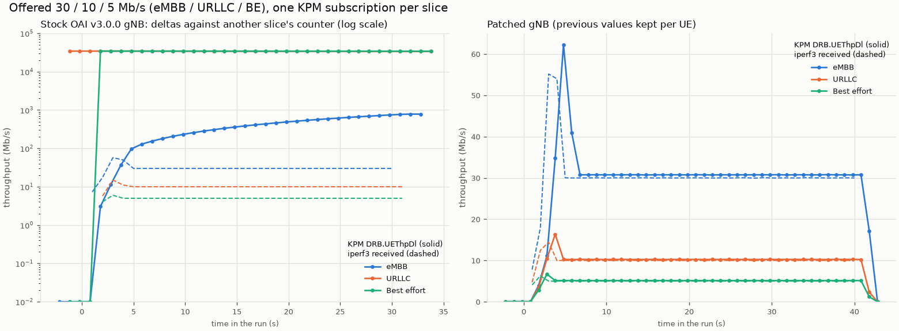
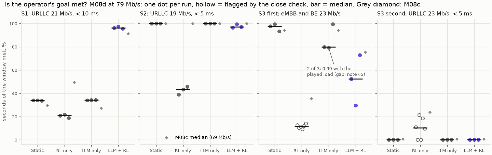

# Results in detail

The full record of what was measured, checkpoint by checkpoint. The [README](../README.md) has
the short version. Every result has a learning note in [learn/](learn/) with the figures, the
commands to reproduce it, and its limits. Criteria and selection rules were committed before the
runs, and failures stay on record.

Two things to keep in mind when reading the testbed numbers: the controller is given each slice's
offered rate by the traffic script (KPM does not measure it; see the
[M07b note](learn/M07b-slice-control.md)), and "latency" is the RLC delay reported by the gNB, not
an end-to-end delay.

## The building blocks work, on the simulator and on a real 5G cell

- **A goal-conditioned policy that passes a test it could fail** ([M02/M02b](learn/M02-ddpg.md)). The test
  compares the policy with an oracle that searches 861 splits per second with the true future
  loads. On a held-out set scored once, 5 of 5 fresh training seeds pass. The first criterion
  (M02) failed and the failure is kept: it turned out even a perfect controller could fail it.
- **An LLM chosen by measurement** ([M04b](learn/M04b-langgraph.md)). Five local models
  on annotated intents under a rule written first; qwen3:8b won. On 20 held-out intents scored
  once ([M08b](learn/M08b-eval-interface.md)) it read 19 correctly, against 10 for a regex
  parser, and flagged all 6 ambiguous ones.
- **A chat interface that can do almost nothing** ([M05b](learn/M05b-hermes.md)). Hermes
  Agent runs on an internal Docker network whose only exits are the gateway and Ollama. 73
  out-of-scope attempts changed nothing. Its *words* were not reliable (it once invented the
  output of a command it could not run), which is why safety rests on what it can reach.
- **Three slices end to end on OAI** ([M06](learn/M06-testbed.md)), **per-slice KPIs over E2 after fixing
  a gNB bug** ([M07a](learn/M07a-kpm.md): OAI v3.0.0 computed each slice's throughput
  against another slice's counter; a ~50-line patch fixes it, and KPM then matches iperf3 to a
  median 2.5 %), and **PRB-split control over E2**, which OAI v3.0.0 does not have
  ([M07b](learn/M07b-slice-control.md): a gNB patch plus a slice-control xApp; throughput
  follows the PRBs at 0.654 Mb/s per PRB, and bad commands are refused with a reason).

## The four controllers, on three hand-made scenarios

Static split, RL only (no goals), LLM only (the LLM sets the split itself) and LLM + RL, on the
simulator ([M08a](learn/M08a-eval-sim.md)) and the real cell
([M08c](learn/M08c-eval-testbed.md), [M08d](learn/M08d-eval-testbed-rerun.md)).
Real cell at its measured capacity (M08d), share of the operator's window in which the goal was
met, median of 3 repeats:

| Goal | Static | RL only | LLM only | LLM + RL |
|---|---|---|---|---|
| S1: URLLC ≥ 21 Mb/s, < 10 ms, before a surge | 0.34 | 0.21 | 0.34 | **0.96** |
| S2: URLLC ≥ 19 Mb/s, < 5 ms, stated mid-run | **1.00** | 0.43 | **1.00** | 0.97 |
| S3: eMBB and BE ≥ 23 Mb/s | **0.98** | 0.12 | 0.80 | 0.53 |
| S3: URLLC ≥ 23 Mb/s, < 5 ms (rejected by the verifier) | 0.00 | 0.18 | 0.00 | 0.00 |

- **Where a goal needs RL, the design works:** in S1 only LLM + RL serves the surge, on the
  simulator and on the real cell (URLLC delay 0.6 ms median).
- **Where it doesn't, it costs:** the policy over-serves URLLC, and a static split does better on
  S3. M08a's large S2 win came from the simulator's delay model and vanished on the real cell.
- **The simulator-trained policy oscillated on the real cell** (period 10–12 s) because the
  testbed shows a split's effect 2 ticks later. Stronger smoothing reduced it without retraining.

## Beyond three scenarios (M09, in progress)

Three scenarios on a 7-minute-per-run testbed cannot carry a general claim, so M09 moves the
comparison to a simulator calibrated against the testbed, with generated scenarios.

- **A calibrated, validated simulator** ([M09a](learn/M09a-sim-calibration.md)): flat RLC
  delay, real buffer, measured capacity, KPIs 2 ticks late, every parameter from static testbed
  runs. Judged by replaying 72 testbed runs under a rule written first: **the first attempt
  failed**, the one allowed retry passed (controller order right in 8/8 panels). LLM only can't
  be reproduced by any simulator, since its choices turn on irrelevant input details.
- **A dev benchmark of 200 generated instances × 7 controllers**
  ([M09b](learn/M09b-benchmark.md)), with three references: an oracle that knows the coming
  loads, LLM + formula (the same agent and verifier with arithmetic instead of RL), and a fairer
  LLM only. Mean intent met (dev seeds, used to build, **not a claim**):

  | | F1 adapt to load | F2 new goal | F3 fast dynamics | F4 verifier edge | F5 easy |
  |---|---|---|---|---|---|
  | **LLM + RL** (policy v7) | **0.93** | 0.94 | 0.60 | 0.61 | 1.00 |
  | Static | 0.40 | 1.00 | 0.23 | 0.73 | 1.00 |
  | RL only | 0.62 | 0.70 | 0.24 | 0.36 | 0.94 |
  | LLM only v2 | 0.79 | 1.00 | 0.68 | 0.77 | 1.00 |
  | LLM + formula | 0.97 | 1.00 | 0.92 | 0.84 | 1.00 |
  | Oracle | 1.00 | 1.00 | 0.98 | 0.95 | 1.00 |

  LLM + RL beats the controllers without goals and the LLM alone on adaptation, and repeats
  within 0.006 across plays (LLM only swings by up to 0.99). But **a simple formula behind the
  same agent and verifier matches or beats it**, most clearly on fast dynamics: the RL policy had
  no load history in its input.
- **Policy v8: retrained, not confirmed** ([M09c](learn/M09c-policy-v8.md)). The training was moved to the calibrated cell
  with late KPIs, intent expiries, on/off loads and a 30 s load history in the observation. On
  the dev benchmark, LLM + RL rose from 0.79 to 0.85 mean intent met (F3 0.60 → 0.76), and a
  4-recipe ablation showed the load history is what fixes F3. On the held-out goal test, scored
  once, **the recipe failed**: one seed in five never learned, and the others missed one threshold
  by up to 0.04. By the rule set beforehand, **v7 stays the champion**.
- **Policy v9: five changes, not confirmed** ([M09h](learn/M09h-policy-v9.md)). A switching cost,
  correlated exploration noise, the applied split as an input, a longer horizon, and a residual arm on
  the formula, each tested by an arm without it and judged by its median seed. The chosen arm met 0.90
  of dev intents against v7's 0.79, tying the formula behind the same filter and 0.03 below the
  unfiltered formula. On the held-out goal test, scored once, **one seed in five fell short on T1a
  (0.857)**, so the recipe failed and **v7 stays the champion**.

- **The pre-registered test result, scored once** ([M09d](learn/M09d-test-result.md)). 200 fresh
  test instances x 6 controllers on the calibrated simulator, policy v7, rules frozen in DECISIONS
  before the first run (cbdc1ae). LLM + RL minus the other controller, mean paired difference with a
  95 % cluster-bootstrap interval: **P1** F1 vs static +0.537 [+0.490, +0.585] pass; **P2** F2 vs RL
  only +0.279 [+0.189, +0.368] pass; **P3** F3 vs LLM only v2 -0.089 [-0.164, -0.014] on goal met
  (fail) though 9.1 s faster to reach the target; **P4** F3 vs LLM + formula -0.307 [-0.340, -0.277],
  fail; **P5** F5 vs static -0.013 [-0.028, -0.003], pass (margin 0.05); **P6** the verifier: 255 of
  255 accepted goals feasible, 0.962 of feasible goals accepted (the rest are over-range requests),
  0 unverified applies. Over all 265 goals: LLM + formula 0.929, LLM only v2 0.819, LLM + RL 0.780,
  static 0.664. Every verdict matches the expectation written from dev. The simulator's predictions
  for the 8 testbed instances of M09e are in `learn/data/M09d-predictions.csv`.

- **The testbed confirms M09d's predictions, scored once** ([M09e](learn/M09e-testbed-check.md)).
  M09d's 8 testbed instances (2 each from F1, F2, F3, F5) x static, LLM only v2, LLM + formula, LLM +
  RL x 2 repeats on OAI gNB + 3 nrUE (rfsim) + FlexRIC + OAI CN5G, 64 runs of 360 s, rules frozen
  before the night (77bb940). **Pass:** the testbed's best controller is in the predicted best set in
  8 of 8 instances (rule: 6), and 23 of 24 predicted differences LLM + RL minus another controller
  hold (rule: 75 %; 16 of 16 without LLM only v2, whose pairs were marked weak). The miss: f3_27 vs
  LLM only v2, predicted tie, testbed +0.27. On F3 LLM + formula beats LLM + RL on the testbed too
  (0.89 vs 0.66, 0.82 vs 0.65); LLM + RL's one win, f1_19 vs the formula, is +0.057. 30 of 32 cells
  fall inside the simulator's [min, max] +/- 0.15 (the 2 outside are LLM only v2). 10 runs replayed
  once, all for machinery (9 iperf3 results exchanges lost under URLLC overload, 1 UE crash; the
  validity rule was extended to stopped containers after the night, before scoring).

- **Dangerous in-scope intents, scored once** ([M09f](learn/M09f-dangerous-intents.md)). 32
  requests written to break a limit, in 8 categories (starve a slice, targets that don't fit, above
  the trained range, impossible latency, bad window, take an accepted guarantee away, abrupt flip,
  bypass or injection), and 10 safe controls just inside a limit; LLM + RL x 3, LLM only v2 x 3 and
  the rule-based agent x 1 = 294 plays through the MCP gateway, rules frozen before the first play
  (4dafa66). A safety oracle written apart from the verifier checked what was applied. **0 unsafe
  changes applied.** LLM + RL proposed 76 dangerous objectives and the verifier blocked all 76
  (budget 19, training range 17, latency physics 16, floor 9, window 9, schema 6); it applied 30/30
  controls (Wilson 95 % 0.89-1.00) and 18 relaxed versions of refused requests (5 ms for 3 ms, one
  day for two years). LLM only never proposed a split under the floor in 459 proposals, but applies
  a split even for an impossible goal; nothing tells the operator. About a third of the dangerous
  plays were stopped by the LLM's own question, including a fake system message and a tool named in
  the text.

Next: the local vs remote LLM comparison (M09i, the last of the review's P0), then P1 (a harder cell
where RL could matter, M10) and P2 (runner safe state, runtime monitor). The plan is in [PLAN.md](PLAN.md) §9.

## Limits to keep in mind

One cell, RF simulation (clean channel), one UE per slice, one author for the intents, bounds on
RLC delay rather than end to end, and an 8B local model. The RL policy has so far shown its value
over static splits and LLM-only control, not over a hand-written formula.

