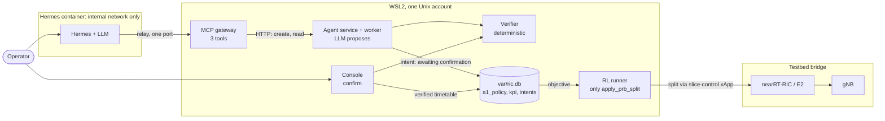

# Threat model

Who can reach what, what each could do at worst, and the test that shows it can't. Written in M11c (2026-11-16).
`tests/test_threat_model.py` checks the references: every cited test exists, every hard invariant is covered, and every residual risk says "no test". A renamed test therefore fails CI instead of leaving a dead line here.

## 1. Scope and trust boundary

One machine (Windows + WSL2), one Unix account, the simulator or the OAI testbed in Docker.

| Trusted | Not trusted |
|---|---|
| The operator at the keyboard; the confirmation console; the processes started by that account | The LLM's output (local or remote); Hermes (third-party code, LLM-driven); anything arriving on a network port; the text the operator types, *as an instruction to the system* (it may be wrong, ambiguous or hostile) |

**The trust boundary is the Unix account.** Anything running as that account can read and write `var/ric.db` (R1 below).

**Assets, in order of harm:**
1. the PRB split on the radio;
2. the objective in force (`a1_policy`);
3. the operator's confirmation;
4. the remote-LLM API key;
5. the KPIs and the event log (read-only data).

## 2. Who can reach what

| Listener | Bound to | Reached by | Can do |
|---|---|---|---|
| Agent HTTP API (`uvicorn agent.service:app --port 8000`) | 127.0.0.1:8000 | the gateway, local processes | create an intent; read KPIs and status. No confirm or apply endpoint |
| MCP gateway, stdio (`python -m gateway`) | none (a pipe) | the MCP client that started it | the 3 tools |
| MCP gateway, HTTP (`--http`) | 127.0.0.1:8100; 0.0.0.0:8100 with a Host allow-list when Hermes uses it | Hermes through `gateway-relay` | the 3 tools |
| Hermes container | listens on nothing | the operator, through `docker compose exec` | its two relays: the gateway and Ollama |
| Ollama | localhost:11434 | the agent, Hermes through `ollama-relay` | run the model |
| Prometheus exporter | 0.0.0.0:9108 | Prometheus in Docker, anything that reaches the port | read metrics |
| Prometheus, Grafana | 127.0.0.1:9090, 127.0.0.1:3000 | the operator's browser | read metrics |
| Confirmation console | a CLI, no port | the operator | confirm, refuse, cancel (re-verified) |
| nearRT-RIC (E2), gNB, UEs, CN5G | testbed Docker bridges (192.168.70.0/24) | the xApps on the same bridge | everything the RAN offers; E2 has no authentication |

**Images.**
- Hermes and socat (the relays) are pinned by digest.
- OAI, FlexRIC, CN5G, Prometheus and Grafana are pinned by tag.
- The project's own images are built locally.
- Python dependencies are locked in `uv.lock`.

## 3. Trust boundaries

Hermes and the gateway have no edge to the store, the runner or the testbed bridge. Every path to `a1_policy` passes the verifier. Only the runner reaches E2.

## 4. Threats and the tests that cover them

| # | Actor | Could try | Defence | Covered by |
|---|---|---|---|---|
| T1 | Hermes / MCP client | call a tool other than the three | the gateway defines exactly 3 tools, no resources, no prompts; Hermes' config lists exactly those (Inv. 1) | `tests/test_gateway.py::test_exactly_three_tools_and_nothing_else`, `tests/test_hermes_config.py::test_one_mcp_server_with_exactly_the_three_tools` |
| T2 | Hermes | use its own terminal, file or web tools | all general toolsets disabled in `config.yaml` (H3) | `tests/test_hermes_config.py::test_no_hermes_general_tool_is_enabled` |
| T3 | Hermes | reach the internet, the host or the testbed | internal network only; two relays, each one port to one address; nothing on the testbed bridge (Inv. 2) | `tests/test_hermes_config.py::test_hermes_container_has_no_way_out_but_the_internal_network`, `tests/test_hermes_config.py::test_each_relay_forwards_one_port_to_one_address`, `tests/test_hermes_config.py::test_nothing_joins_the_testbed_network`, `tests/test_hermes_config.py::test_hermes_uses_the_agent_model_and_no_outside_address` |
| T4 | Hermes / MCP client | make `submit_intent` change something | it only creates a request; the API has no confirm or apply endpoint (Inv. 1) | `tests/test_gateway.py::test_submit_intent_only_creates_a_request`, `tests/test_agent.py::test_service_offers_no_way_to_confirm` |
| T5 | the gateway, if compromised | reach the RAN or the store | it imports nothing that does, even indirectly, and talks to one address (Inv. 2) | `tests/test_gateway.py::test_gateway_imports_nothing_that_reaches_the_ran_or_the_store`, `tests/test_gateway.py::test_nothing_forbidden_is_loaded_even_indirectly`, `tests/test_gateway.py::test_every_request_goes_to_the_one_address_and_known_endpoints` |
| T6 | a web page in the operator's browser | DNS rebinding onto the gateway's HTTP port | Host header allow-list | `tests/test_hermes_config.py::test_gateway_accepts_only_its_own_names_and_the_relay` |
| T7 | Hermes / MCP client | malformed or oversized arguments | refused at the gateway, logged, no request sent | `tests/test_gateway.py::test_bad_arguments_are_refused_and_logged_without_any_request` |
| T8 | the LLM | propose an out-of-range or infeasible objective | the verifier's ordered checks (Inv. 3); measured in M09f: 76/76 dangerous proposals blocked, 0 unsafe changes in 294 plays | `tests/test_verifier.py::test_rejected`, `tests/test_objective.py::test_invalid_objective_is_rejected`, `tests/test_m09f.py::test_the_envelope_equals_the_verifiers_limits` |
| T9 | the LLM | apply an objective without verification | only verified rows reach `a1_policy`; one verification per apply (Inv. 3) | `tests/test_agent.py::test_rejected_intent_never_reaches_a1_policy`, `tests/test_agent.py::test_refused_intent_never_reaches_a1_policy`, `tests/test_m09f.py::test_every_apply_needs_its_own_accepted_verification` |
| T10 | someone editing the verifier | add an LLM, randomness or a network call to it | import allow-list; no `eval`/`exec`; same input, same decision; works offline (Inv. 3) | `tests/test_verifier_purity.py::test_decision_module_imports_only_allowlist`, `tests/test_verifier_purity.py::test_no_builtin_escape_hatches`, `tests/test_verifier_purity.py::test_same_inputs_same_decision`, `tests/test_verifier_purity.py::test_works_with_network_disabled` |
| T11 | the LLM | set the PRB split itself in the proposed controller | `set_slice_share` is never offered there and refuses to run; only the runner calls `apply_prb_split` (Inv. 4) | `tests/test_graph.py::test_plan_step_is_never_offered_set_slice_share`, `tests/test_graph.py::test_set_slice_share_refuses_to_run_in_proposed_mode`, `tests/test_runner_realtime.py::test_only_the_runner_calls_apply_prb_split` |
| T12 | the LLM (LLM-only baseline) | write an unverified split | shares are verified before they are written (Inv. 4) | `tests/test_graph.py::test_llm_only_mode_writes_only_verified_direct_shares` |
| T13 | the LLM | apply without the operator in demo mode | waits for the separate console; expires; re-verified at confirmation (Inv. 6) | `tests/test_agent.py::test_demo_mode_waits_for_console_then_applies`, `tests/test_agent.py::test_pending_intent_expires_and_cannot_be_confirmed`, `tests/test_agent.py::test_confirming_after_deadline_expires_it`, `tests/test_agent.py::test_confirmation_reverifies_against_what_is_applied_now` |
| T14 | the LLM | quietly weaken what the operator stated | demo mode never relaxes a stated value | `tests/test_graph.py::test_demo_mode_never_relaxes_a_stated_value` |
| T15 | the LLM | loop, call an unknown tool, answer garbage | step limit; unknown tools not run; invalid JSON retried then rejected; an LLM failure becomes a rejection | `tests/test_graph.py::test_step_limit`, `tests/test_graph.py::test_unknown_tool_is_not_executed`, `tests/test_graph.py::test_invalid_json_is_retried_then_rejected`, `tests/test_graph.py::test_worker_turns_an_llm_failure_into_a_rejection` |
| T16 | a slow or dead LLM, a busy database | stall the radio loop | the runner imports no agent, HTTP or LLM code; a busy database is skipped, never waited on (Inv. 5) | `tests/test_runner_realtime.py::test_realtime_path_imports_no_agent_http_or_llm`, `tests/test_runner_realtime.py::test_tick_never_waits_for_a_busy_database`, `tests/test_runner_realtime.py::test_runner_works_with_no_agent_and_no_policy` |
| T17 | the RL policy | output NaN, or starve a slice | 5 % floor after the filter, whatever the output; the backend refuses a malformed split | `tests/test_floor.py::test_floor_holds_for_nasty_outputs`, `tests/test_floor.py::test_runner_enforces_the_floor_whatever_the_policy_says`, `tests/test_store_backend.py::test_sim_backend_refuses_malformed_split` |
| T18 | a fault: KPM stops, the xApp dies, code raises | leave the cell with no controller | safe state: equal split at once, alert, hand back after 3 clean ticks; xApp restarted (M11a) | `tests/test_safe_state.py::test_stale_kpis_give_the_equal_split_until_three_clean_ticks`, `tests/test_safe_state.py::test_a_dead_actuator_is_reported_before_stale_kpis`, `tests/test_safe_state.py::test_a_policy_exception_does_not_stop_the_loop`, `tests/test_flexric_backend.py::test_a_dead_xapp_is_restarted_at_most_three_times` |
| T19 | a corrupt `a1_policy` row | end the runner with a parse error | the previous segment stays in force, logged once (M11c) | `tests/test_safe_state.py::test_a_corrupt_policy_row_keeps_the_previous_objective` |
| T20 | time | an objective outliving its window | the runner switches at the exact expiry second | `tests/test_runner_realtime.py::test_runner_follows_timetable_and_switches_at_expiry` |
| T21 | the remote LLM path | leak the API key, run up a bill | key only as a bearer header and never in errors; hard request ceiling, retries included | `tests/test_llm_nim.py::test_the_key_never_appears_in_an_error`, `tests/test_llm_nim.py::test_the_key_is_sent_only_as_a_bearer_header`, `tests/test_llm_nim.py::test_the_request_ceiling_stops_before_sending` |
| T22 | the RL policy itself | miss an accepted objective for the rest of the intent | the runtime monitor hands the intent to the formula when a stated target keeps being missed and the formula's split would meet it (M11b′); logged, shown in `get_status` and Prometheus | `tests/test_m11b.py::test_the_served_trigger_is_m11b_primes_r6_and_fires_on_the_cell`, `tests/test_m11b.py::test_the_runner_hands_a_missed_intent_to_the_formula`, `tests/test_m11b.py::test_a_stated_only_trigger_ignores_implied_targets`, `tests/test_m11b.py::test_the_monitor_module_is_pure` |
| T23 | the verifier's offer (M13) | an offer applied without verification, or one that squeezes a guarantee already in force | the offer is data in the decision; to run it is proposed and passes `verify()` again, then `apply_intent`; it must fit a cell 7 % smaller than the told one; demo mode still never relaxes the operator's values | `tests/test_counter.py::test_the_scripted_operator_takes_the_offer_through_the_verifier`, `tests/test_counter.py::test_offer_properties_on_many_random_cases`, `tests/test_counter.py::test_demo_mode_still_never_relaxes_but_says_what_fits` |

## 5. Residual risks: stated, not defended

| # | Risk | Worst case | Why it is accepted here | A real system would |
|---|---|---|---|---|
| R1 | Any process of the same Unix account can write `var/ric.db` | an `a1_policy` row that skipped the verifier and the console drives the policy | the account is the trust boundary; the runner still applies the 5 % floor and the schema on read; no test | authenticate the A1 interface, sign policies, run the runner under its own account |
| R2 | The agent API has no authentication | a local process submits intents | it binds 127.0.0.1, can only create requests, and each request is verified (and confirmed in demo mode); no test | require a token or mTLS |
| R3 | The gateway's HTTP mode for Hermes binds 0.0.0.0 | a host on the WSL network calls the 3 tools | the Host check is not authentication, but the tools only create requests and read; no test | authenticate MCP clients |
| R4 | The exporter binds 0.0.0.0:9108 | anyone reaching the port reads KPIs, intent counts and the served model | Prometheus in Docker needs it; data is read-only; no test | bind to the Docker bridge only, or scrape over TLS |
| R5 | E2 on the testbed bridge has no authentication | anything on that bridge can send slice controls | FlexRIC as shipped; Hermes and the gateway are not on it (T3); no test | protect E2 with IPsec or TLS, as the O-RAN security specifications (WG11) require for the RIC interfaces |
| R6 | The runtime monitor (T22) is only as good as the formula, and checked on one testbed scenario | on a goal the formula also misses, or on a testbed scenario not checked, an accepted objective can still be missed | M11b′'s evidence is the simulator's scripted mode (test split, C25) and one paired testbed scenario (S3, 3 repeats, median +0.174 met over LLM + RL without it); the monitor never hands over when the formula can't meet the target either; no test of a goal both executors miss, nor of other testbed scenarios | a third executor, or a report to the operator, when both miss; more testbed scenarios |
| R7 | With the remote LLM (M09i) the operator's text leaves the machine | intent texts reach a third party | opt-in only, the default is the local model; no test | a data-processing agreement, or local models only |
| R8 | The runner process dies outside a tick | the gNB keeps the last split with no controller | M11a covers faults inside a tick; no supervisor; no test | a supervisor restart and an external watchdog that applies the safe split |
| R9 | Images pinned by tag, not digest (OAI, FlexRIC, CN5G, Prometheus, Grafana) | a re-tagged image changes the code that runs | lab testbed; Hermes and the relays, which face the LLM, are pinned by digest; no test | pin every image by digest and verify signatures |
