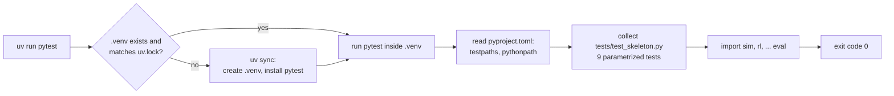

# M00 — Repository and tooling

## 1. What we built

We turned the repository into a Python project managed by `uv`. It has one folder per component
of the architecture: `sim/`, `rl/`, `verifier/`, `agent/`, `gateway/`, `console/`, `backends/`,
`xapps/`, `eval/`, plus `tests/`, `testbed/` and `docs/learn/`. Each Python folder is an empty
package. Its docstring says what will go there and which box of the design it is. One smoke test
checks that every package imports, so `uv run pytest` passes. We also added a quickstart to the
README and started `docs/DECISIONS.md`.

## 2. Why it exists in the architecture

M00 is not a box of figure 2. It is the frame that holds all the boxes. The folder layout maps
almost one to one onto figure 2:

| Figure 2 box | Folder |
|---|---|
| Hermes Agent → Passerelle MCP | `gateway/` (Hermes is configured, not coded) |
| Service LangGraph | `agent/` |
| Vérificateur | `verifier/` |
| Confirmation opérateur | `console/` |
| xApp RL (DDPG) | `rl/` (training) + `xapps/` (deployment) |
| xApp KPM | `xapps/` |
| RAN et cœur 5G | `testbed/` (real) or `sim/` (simulated) |
| — (swap sim ↔ testbed) | `backends/` |
| Section 7, evaluation | `eval/` |

Keeping one folder per box makes the safety rules easy to check later. For example,
"the gateway never imports anything that talks to FlexRIC" becomes a test on `gateway/`.

## 3. How it works

1. **`pyproject.toml:1-7`** describes the project: its name, version, and
   `requires-python = ">=3.11"`. `dependencies = []` is empty for now because no runtime library
   is needed yet.
2. **`pyproject.toml:9-10`** declares a *dev* dependency group with `pytest`. Dev dependencies
   are tools for developers, not things the services need at run time.
3. **`pyproject.toml:12-15`**, `package = false`, tells uv that this repo is an application. uv
   creates `.venv/` and installs the dependencies, but it does not build our own code into a
   package.
4. **`pyproject.toml:17-21`** configures pytest. It looks for tests in `tests/`, and
   `pythonpath = ["."]` adds the repo root to `sys.path`. That is why `import sim` works inside
   a test even though we never installed `sim`.
5. **`.python-version`** contains `3.12`. uv reads it and picks a Python 3.12 interpreter. On
   this machine it chose its own managed CPython 3.12.14 rather than Ubuntu's `/usr/bin/python3`
   (3.12.3), so an `apt upgrade` can't change our interpreter.
6. **`uv.lock`** is written by `uv sync`. It records the exact version and hash of every
   package, including indirect ones such as `pluggy` and `iniconfig`. It is committed, so you
   both install exactly the same versions.
7. **`sim/__init__.py` … `eval/__init__.py`** contain only a docstring. A folder with an
   `__init__.py` is a regular Python package and can be imported.
8. **`tests/test_skeleton.py:12-29`** has a list of package names and one test function.
   `@pytest.mark.parametrize` turns it into 9 tests, one per package. Each test imports the
   package with `importlib.import_module(name)` and checks that the docstring is not empty.

## 4. Flow of `uv run pytest`



## 5. How to run it and check it works

```bash
cd ~/projects/Agentic_AI_For_RIC_in_O_RAN
uv sync
uv run pytest
```

Expected end of output:

```
collected 9 items

tests/test_skeleton.py .........                                         [100%]

============================== 9 passed in 0.01s ===============================
```

`echo $?` right after it prints `0`.

Why we did not stop at "zero tests": we ran pytest with the smoke test excluded and got

```
collected 0 items
============================ no tests ran in 0.00s =============================
```

and exit code **5**. pytest uses code 5 to mean "no tests collected", and any script or CI job
reads a non-zero code as failure. The smoke test fixes this and also checks the layout.

Other useful commands:

```bash
uv run python -c "import sys; print(sys.executable)"   # shows .venv/bin/python
uv add gymnasium            # adds a runtime dependency (M01 will do this)
uv add --dev ruff           # adds a dev-only tool
```

## 6. Choices and simplifications

- **uv instead of pip + venv (or poetry/conda).** One tool creates the virtual environment,
  installs Python itself, resolves dependencies, writes a lock file and runs commands
  (`uv run`). Rejected: pip + `requirements.txt`, because it has no real lock of indirect
  dependencies. Also rejected: conda, which is heavy and slow, and we don't need non-Python
  packages from it.
- **Flat layout, not `src/` layout.** Libraries published to PyPI often use `src/` so the tests
  run against the installed package. We never publish this code, so the flat layout is simpler
  to explain. Cost: running `python -m agent...` only works from the repo root. We accept that.
- **Dependencies added per checkpoint.** torch, stable-baselines3, LangGraph, the MCP SDK and the
  others come in when a checkpoint needs them. That way each one has a reason we can explain.
- **No linter, CI or pre-commit.** A real team project would add `ruff` and a CI pipeline
  (GitHub Actions running `uv run pytest` on every push). We skip them for now to keep the
  number of concepts small.
- **What a real system would do differently:** a separate package and container image per
  service (agent, gateway, xApps), versioned releases, and CI that also builds the Docker images.

All of these are logged in `docs/DECISIONS.md`.

## 7. Five questions the supervisor could ask

1. **What do `uv`, `pyproject.toml` and `pytest` each do, in one sentence?**
   `uv` manages Python, the virtual environment and dependencies and runs commands inside that
   environment. `pyproject.toml` is the standard file that describes the project, its
   dependencies and its tool settings. `pytest` finds and runs the test functions and reports
   pass or fail through its exit code.

2. **What is `uv.lock` and why commit it?**
   It pins the exact version and hash of every package, including indirect ones. Committing it
   means both of us, and the evaluation machine, run the same code. That makes results
   reproducible.

3. **Why is there a test when there is no code yet?**
   pytest exits with code 5 when it finds no tests, and scripts read that as a failure. The smoke
   test makes the command succeed and checks that every package of the layout can be imported.

4. **How does `import sim` work in a test if the project is not installed?**
   `pythonpath = ["."]` in the pytest section of `pyproject.toml` adds the repo root to
   `sys.path`. Python then finds the `sim/` folder, and `sim/__init__.py` makes it a package.

5. **Why one folder per component instead of a single module?**
   Each folder matches one box of figure 2. Some boxes have strict rules: the verifier has no
   LLM and no network, and the gateway exposes three tools and has no route to FlexRIC. Separate
   packages let us test those rules one package at a time, for example by checking what
   `gateway/` imports.
