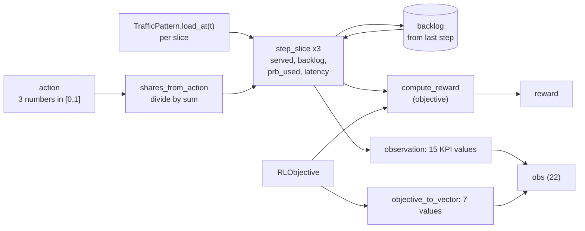

# M01 — Simulator of one cell with three slices

## 1. What we built

We built a gymnasium environment, `SlicingEnv`. It simulates one 5G cell whose PRBs are shared
by three slices: eMBB, URLLC and best effort (BE). Every step, the policy chooses a PRB share per
slice. The simulator turns the shares into throughput, PRB use and latency, using a simple
queue model, and computes a reward. The traffic of each slice follows a pattern (steady, spike
or ramp) with some noise. The observation also contains the current **objective**. The objective
is defined by a pydantic schema, `RLObjective`, which we also built in this checkpoint. Because
of it, the same policy can follow different goals.

## 2. Why it exists in the architecture

In figure 2 of the proposal, this is the **"RAN et cœur 5G"** box, simulated. The real RAN (OAI
gNB + nrUE + CN5G) arrives in M06. Until then, this simulator lets us build everything above it:
- the DDPG policy is trained on it (M02, "xApp RL" box);
- the verifier checks objectives against its capacity (M03);
- the agent drives it through the `SimBackend` (M04).

Proposal §6 says the RL is trained in simulation because training on the emulated platform
would be too slow.

`RLObjective` is the data that flows along the "politique A1" arrow of figure 2: from the
verifier to the RL xApp. The LLM proposes one, the verifier accepts or rejects it, and the policy
reads it in its observation.

## 3. How it works

1. **The objective**: [verifier/objective.py](../../verifier/objective.py).
   - `SLICES` (line 16) fixes the slice order used everywhere: `embb`, `urllc`, `be`.
   - `SliceValues` (line 21) holds one non-negative number per slice.
   - `RLObjective` (line 35) has `weights`, `min_thr_mbps`, `max_latency_ms` (URLLC only),
     `valid_from` and `valid_until`.
   - The validator (line 51) checks that each weight is in [0, 1], that the weights sum to 1
     (±1e-6), and that the window is not empty.
   - The model is *frozen*: a verified objective can't be modified, only replaced.
   - `DEFAULT_OBJECTIVE` (line 66) applies when no intent is active.

2. **The cell parameters**: `CellConfig` in [sim/cell.py:16](../../sim/cell.py#L16).
   - 106 PRBs (40 MHz at 30 kHz SCS, the usual OAI rfsim setup).
   - 100 Mb/s total capacity. This is a placeholder until M06 measures rfsim.
   - 1 s per step.
   - Base latency per slice: eMBB 10 ms, URLLC 2 ms, BE 20 ms.
   - Buffer of 50 Mb per slice.
   - `max_utilisation = 0.95` (line 29).

3. **From action to shares**: `shares_from_action` ([sim/cell.py:48](../../sim/cell.py#L48)).
   - The policy outputs 3 numbers in [0, 1].
   - We clip them, then divide by their sum: `share_s = a_s / (a_embb + a_urllc + a_be)`.
   - If all three are 0, we use an equal split instead of dividing by zero.
   - The shares therefore always sum to 1.

4. **One slice, one step**: `step_slice` ([sim/cell.py:61](../../sim/cell.py#L61)). It is a
   "fluid queue": traffic is treated like water poured into a bucket and drained at the speed
   the PRBs allow.

   | Step | Formula | Meaning |
   |---|---|---|
   | capacity | `cap = share × C` | Mb/s this slice can send (C = 100 Mb/s) |
   | arrivals | `A = load × dt` | Mb that arrived during the step |
   | served | `S = min(backlog + A, cap × dt)` | send what is waiting, up to what the PRBs carry |
   | throughput | `thr = S / dt` | Mb/s actually delivered |
   | backlog | `B' = min(backlog + A − S, B_max)` | what is left in the queue |
   | dropped | `backlog + A − S − B'` | did not fit in the buffer |
   | PRB use | `S / (cap × dt)` | fraction of the slice's own PRBs that carried data |

   Throughput can never decrease when the share grows: a larger `cap` can only make the `min`
   larger. A test checks this.

5. **Latency**: `slice_latency_ms` ([sim/cell.py:99](../../sim/cell.py#L99)).

   `latency = base / (1 − ρ) + 1000 × B' / cap`,  with `ρ = min(load / cap, 0.95)`

   - **First term: M/M/1 queue.** In queueing theory, a single server with random arrivals
     (M/M/1) has a mean time in system `T = (1/μ) / (1 − ρ)`. Here `1/μ` is the service time and
     `ρ` is the utilisation. Our `base` plays the role of `1/μ`. So an almost empty slice has
     latency ≈ `base`, a half-full slice has 2 × `base`, and a 90 % full slice has 10 × `base`.
     Latency rises smoothly *before* overload, which gives the policy a signal early.
   - **Why cap ρ at 0.95.** `1/(1 − ρ)` explodes near 1. With a cap of 0.99, BE latency
     jumped between 150 ms and 1.7 s from noise alone, whenever BE's load came near its capacity.
     With 0.95, the first term is at most 20 × `base`. Overload then shows up through the second
     term.
   - **Second term: drain time.** The leftover backlog `B'` needs `B'/cap` seconds to be sent.
     While a slice is overloaded, `B'` grows every step, so latency keeps rising until the
     buffer is full. A test checks this.
   - A slice with share 0 gets a tiny capacity (1e-6 Mb/s), so its latency is huge but finite.

6. **Traffic**: `TrafficPattern` ([sim/traffic.py:34](../../sim/traffic.py#L34)).
   - `mean_load_at` (line 44) gives the shape:
     - `steady`: `base`
     - `spike`: `peak` during [start, end), `base` otherwise
     - `ramp`: `base`, then linear up to `peak`, then `peak`
   - `load_at` (line 60) multiplies by `1 + 0.05 × N(0, 1)` noise and never goes below 0.
   - The noise comes from the env's seeded generator, so a run can be repeated exactly.
   - `sample_traffic` (line 71) draws a random shape, level and timing per slice, for training.
   - Default loads are 50 / 10 / 30 Mb/s, 90 % of the cell, so any spike causes overload.

7. **Reward**: `compute_reward` ([sim/reward.py:23](../../sim/reward.py#L23)).

   `r = Σ w_s·thr_s/C − 2·Σ max(0, min(target_s, load_s) − thr_s)/C − 1·min(1, max(0, lat_urllc − bound)/bound)`

   - **Weighted throughput.** Each Mb/s delivered counts as much as the slice's weight. A slice
     cannot deliver more than it is offered, so extra PRBs on a slice that is already served earn
     nothing. They should go to another slice.
   - **Shortfall penalty**, ×2 (line 19). It is the missing throughput below each minimum
     target. We use `min(target, load)`: a 10 Mb/s target on a slice that only offers 4 Mb/s is
     met at 4 Mb/s. Without this, the policy would be punished for something no allocation can
     fix. The factor 2 makes missing a target cost more than what the same PRBs would earn
     elsewhere (a weight is at most 1).
   - **Latency penalty**, ×1 (line 20). It is the relative excess of URLLC latency over the
     bound, clipped to 1 so a huge latency doesn't dominate everything. It only applies if the
     objective has a bound.
   - Everything is divided by C, so the reward keeps the same scale if the capacity changes.

8. **The environment**: `SlicingEnv` ([sim/env.py:60](../../sim/env.py#L60)).
   - **Spaces.** Action: `Box(0, 1, (3,))`. Observation: `Box(0, 10, (22,))`.
   - **`reset`** (line 79): takes the objective and traffic from `options` if given, otherwise
     samples them (`sample_objective`, line 40, and `sample_traffic`). The first observation
     shows empty queues and zero throughput.
   - **`step`** (line 98): shares → loads at the current time → `step_slice` for each slice →
     reward → time += 1 s. After `episode_steps` (200) it returns `truncated=True`. A cell
     never "terminates", so the episode is only cut for training.
   - **The observation** (`_observation`, line 122) is 22 numbers:
     - Per slice, 5 KPI features: `load/C`, `thr/C`, `latency/100 ms`, `share`, `prb_used`
       (15 in total).
     - Then 7 objective features (`objective_to_vector`, line 29): 3 weights, 3 `target/C`,
       `bound/100 ms`. 0 means "no bound", which is safe because the schema forbids a bound ≤ 0.
     - Everything is clipped to [0, 10].
   - **`sample_objective`** draws weights from a flat Dirichlet distribution, so every split of
     importance is equally likely. Each minimum target, and the latency bound, is present half
     of the time. M02 calls `reset()` with no options, so every episode gets a new random goal.
   - **`set_objective`** (line 118) replaces the objective mid-episode. M04a uses it when an
     intent is applied, and so does the M08 "new intent mid-run" scenario.
   - **`_info`** (line 137) returns the raw values in real units (Mb/s, ms). The demo uses
     them, and the KPI store will later.

## 4. One step of the simulator



## 5. How to run it and check it works

```bash
uv sync
uv run pytest -q
```

Expected: `73 passed`. That is the 9 smoke tests, plus `test_objective.py`, `test_cell.py`,
`test_traffic.py` and `test_env.py`.

```bash
uv run python -c "from sim.env import SlicingEnv; e=SlicingEnv(); print(e.observation_space, e.action_space)"
```

Expected: `Box(0.0, 10.0, (22,), float32) Box(0.0, 1.0, (3,), float32)`

```bash
uv run python -m sim.demo
```

The demo applies an **equal split** (33.3 Mb/s per slice) while URLLC spikes from 10 to 40 Mb/s
between t = 10 s and t = 20 s. The objective is: URLLC weight 0.5, URLLC ≥ 10 Mb/s, URLLC latency
≤ 20 ms. Real output, excerpt:

```
   t | load Mb/s (eMBB URLLC BE) | thr Mb/s (eMBB URLLC BE) | latency ms (eMBB URLLC BE) | reward
  10 |          47.7   9.8  30.3 |         33.3   9.8  30.3 |     1700.0     2.8   222.0 |  0.210
  11 |          47.5  39.6  29.8 |         33.3  33.3  29.8 |     1700.0   227.4   186.6 | -0.674
  12 |          51.4  40.4  30.5 |         33.3  33.3  30.5 |     1700.0   440.3   238.1 | -0.672
  13 |          48.4  39.7  31.2 |         33.3  33.3  31.2 |     1700.0   632.6   309.0 | -0.671
  20 |          51.7  37.6  29.0 |         33.3  33.3  29.0 |     1700.0  1540.0   154.1 | -0.675
  21 |          48.9   9.4  32.6 |         33.3  33.3  32.6 |     1700.0   785.2   400.0 | -0.668
  22 |          48.8  10.2  29.6 |         33.3  33.3  29.6 |     1700.0    90.3   179.2 | -0.674
  23 |          54.0  10.7  31.0 |         33.3  13.6  31.0 |     1700.0     2.9   279.7 |  0.230
```

How to read it:
- **Before the spike**, URLLC is light (ρ ≈ 0.3), so its latency is about 2.8 ms ≈ 2 / (1 − 0.3).
- **During the spike**, URLLC throughput is capped at 33.3 Mb/s, its share of the cell. Its
  queue grows by about 7 Mb/s, so latency climbs every step until the buffer is full (1540 ms).
  The latency term costs the full −1, so the reward drops from ≈ 0.21 to ≈ −0.67.
- **After the spike**, URLLC still sends at 33.3 Mb/s to drain its queue. By t = 23 it is back
  to 2.9 ms.
- **eMBB** offers about 50 Mb/s against 33.3 for the whole run, so it sits at a full buffer
  (1700 ms). The equal split is simply bad here, which is what M02's policy should fix.

## 6. Choices and simplifications

- **1 s per step.** This is the RL decision period: inside the Near-RT range (10 ms–1 s) and
  close to a usual KPM reporting period. Rejected: 10 ms steps. They are closer to the MAC
  scheduler, but the testbed's KPM reports can't follow that pace, and training would need
  100 times more steps for the same simulated time.
- **Fluid queue + M/M/1-shaped latency**, not a packet-level simulator. Every formula fits on
  one line and the tests can check its properties. Rejected: ns-3 or a packet-level model. They
  are more realistic, but much heavier, and the RL would need far longer to train.
- **ρ capped at 0.95**, as explained in §3 step 5. The cost: between 95 % and 100 % utilisation,
  latency stops rising until a backlog appears.
- **Shares by dividing by the sum.** Rejected: softmax. It also guarantees a sum of 1, but
  "share = my number / total" is easier to explain, and softmax can never give exactly 0.
- **Reward penalties 2 and 1.** Chosen so missing a target always costs more than the same PRBs
  could earn elsewhere. M02 may retune them, and we will log that if it does.
- **100 Mb/s capacity is a placeholder.** Everything the policy sees is divided by C, so we can
  change it after M06 without changing the policy's input.
- **`sim` imports the schema from `verifier.objective`.** The objective is shared by sim,
  verifier, agent and policy. Rejected: a new `common/` package that isn't in the planned layout.
- **The env ignores `valid_from` / `valid_until`.** Applying an objective at the right time is
  the RL runner's job (M04a), not the simulator's.

What a real system does differently:
- There is a radio channel per UE (SINR → MCS → bits per PRB), HARQ retransmissions, and a
  per-UE MAC scheduler inside each slice.
- URLLC normally uses a more robust MCS, so fewer bits per PRB. Here every PRB carries the same
  rate.
- Latency comes from real packet queues, scheduling delays and RLC/PDCP buffers, not a formula.
- A new PRB split takes effect after an E2 control message and some delay, not instantly.

## 7. Questions to check understanding

1. **What are the observation and the action, and why is the objective inside the observation?**
   The action is 3 numbers in [0, 1], turned into PRB shares that sum to 1. The observation has
   22 numbers:
   - per slice: load, throughput, latency, share and PRB use (15 values);
   - the objective: 3 weights, 3 minimum targets, a latency bound (7 values).

   The objective is inside because the reward depends on it. The same traffic calls for
   different splits under different goals, so the policy has to see the goal to act right
   without retraining.

2. **Why can more PRBs never lower a slice's throughput?**
   Throughput is `min(backlog + arrivals, share × C × dt) / dt`. A bigger share can only make the
   second argument larger, so the `min` stays the same or grows.

3. **Why does latency keep rising while a slice is overloaded, and why does it rise before
   overload too?**
   - When the load is above capacity, the backlog grows every step, and the drain-time term
     `B'/cap` grows with it.
   - Before overload, the M/M/1 term `base / (1 − ρ)` already grows as utilisation ρ goes up.

4. **Why does the shortfall penalty use `min(target, load)` and not just the target?**
   A slice can't deliver more than it is offered. If URLLC only sends 4 Mb/s, a 10 Mb/s target
   can't be reached by any allocation, and punishing it would teach the policy nothing useful.

5. **Why are throughput and targets divided by the capacity C?**
   The policy is trained before we know what rfsim really delivers. With fractions of C, we can
   recalibrate C to the testbed and the policy's input keeps the same meaning and scale. The
   same goes for the reward.
