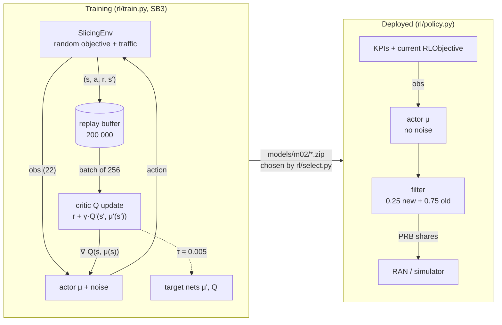
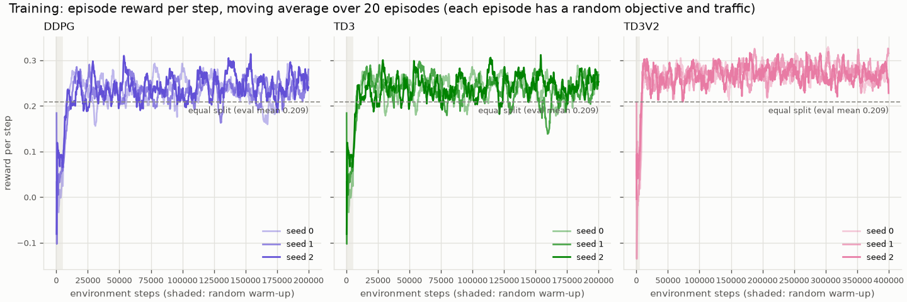
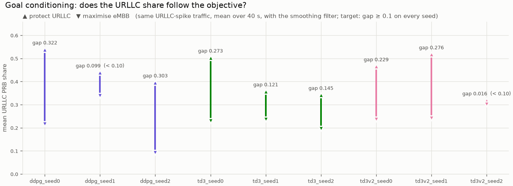
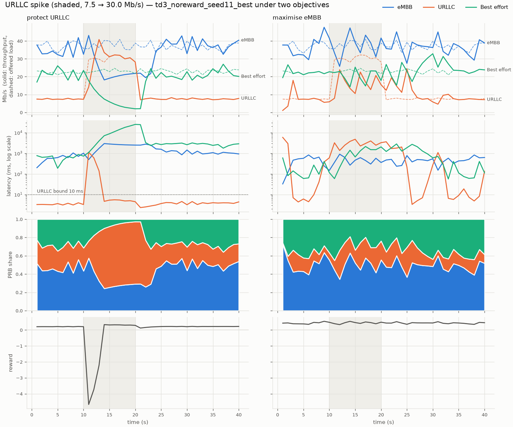
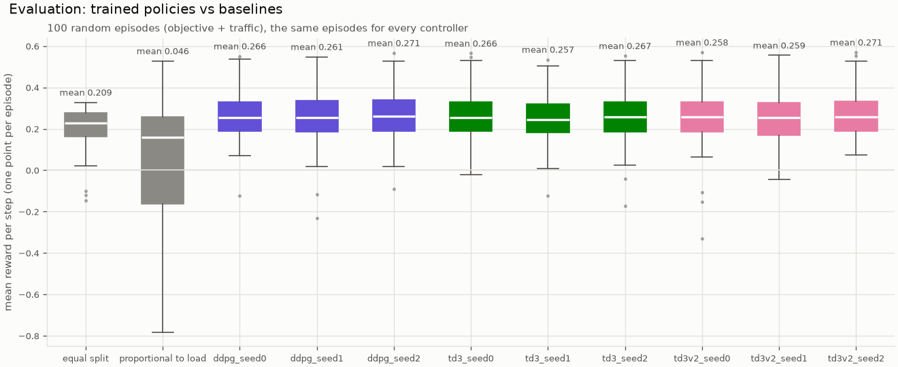
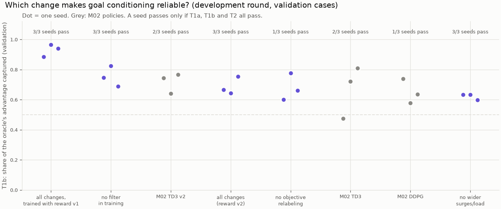
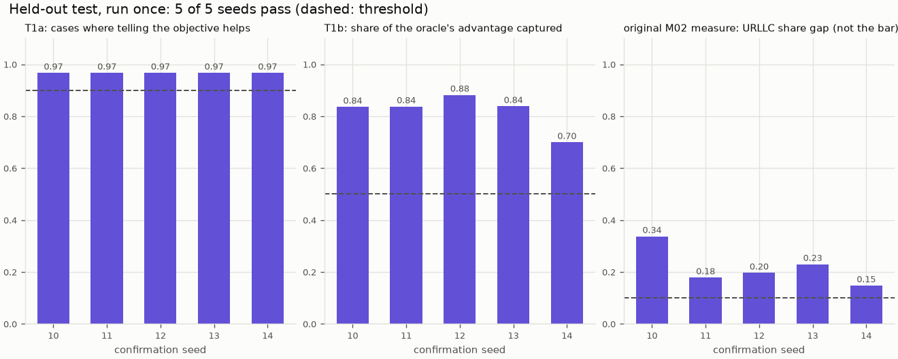

# M02 — Goal-conditioned DDPG / TD3 policy

> **Update, M02b (2026-11-01): goal conditioning now passes a valid test.** Sections 1–7 below
> are the M02 record and stay as written: the M02 criterion failed in all three rounds, and
> `td3_seed2` was deployed by a fallback rule. M02b found that the criterion itself was flawed,
> built a better one, and trained a new recipe that passes it on every seed, including 5 fresh
> seeds on a held-out test run once. **The deployed policy is now `td3_noreward_seed11_best`**
> (registry version 3, see M02c). Read the part **M02b** at the end of this note.

## 1. What we built

We trained a reinforcement-learning policy that decides the PRB split between eMBB, URLLC and
best effort every second, on the M01 simulator. The policy is **goal-conditioned**: the current
objective (weights, minimum throughputs, URLLC latency bound) is part of its input, so the same
network should behave differently when the LLM changes the objective, without retraining. We
trained 9 policies (DDPG, TD3, and a second TD3 round, 3 seeds each), added an output
smoothing filter, and compared them with two baselines on 100 paired episodes. Every policy
beats the equal split by about 0.05 reward per step. **The pre-registered goal-conditioning
criterion failed in both training rounds**: on every round, at least one seed barely changes
its split between the two test objectives. We keep that FAIL on record, chose the deployed
policy (`td3_seed2`) by a rule fixed in advance on separate validation episodes, and will
re-check it in M08.

## 2. Why it exists in the architecture

In figure 2 of the proposal this is the **"xApp RL (DDPG)"** box: the fast loop, and the only
component that sets the PRB split in the proposed controller (invariant 4). It reads the KPIs
and the current `RLObjective` (the "politique A1" arrow) and outputs shares. The LLM never
touches the split; it can only propose a new objective, which the verifier (M03) checks. That
is why the policy must be goal-conditioned: the LLM's only lever is the objective, so the
objective has to change what the policy does.

In M04a the RL runner calls `SlicePolicy.action(obs)` every step; in M07b the same object drives
the testbed.

## 3. How it works

### The ideas, in plain words

- **Actor**: a neural network μ(s) that maps the 22-value observation to 3 numbers in [0, 1]
  (the action). It is the policy. Deployed, only the actor runs.
- **Critic**: a second network Q(s, a) that predicts the discounted sum of future rewards if we
  take action `a` in state `s` and then follow the actor. It is only used in training.
- **How they learn**: the critic learns from transitions (s, a, r, s′) to satisfy
  Q(s, a) ≈ r + γ·Q(s′, μ(s′)) (the Bellman equation). The actor learns by gradient ascent on
  Q(s, μ(s)): "move the action in the direction the critic says is better". That is the
  "deterministic policy gradient" in DDPG (Deep Deterministic Policy Gradient).
- **Replay buffer**: every transition is stored (here up to 200 000, i.e. the whole run). Each
  update uses a random batch of 256 past transitions, which breaks the correlation between
  consecutive steps and reuses data many times (off-policy learning).
- **Target networks**: slow copies of the actor and critic, used in the right-hand side of the
  Bellman equation, so the target does not move every update. After each update they move
  0.5 % of the way towards the trained networks (τ = 0.005).
- **Exploration**: the actor is deterministic, so during training we add Gaussian noise to
  its action. Without noise it would never try anything new.
- **TD3** (Twin Delayed DDPG) is DDPG with three fixes for the critic over-estimating Q:
  two critics and the smaller of their two predictions, actor updated every 2nd critic update,
  and noise on the target action. In stable-baselines3, DDPG is literally TD3 with these
  three switched off, so both use exactly the same hyperparameters here.

### The code path

1. **Environment** ([sim/env.py](../../sim/env.py)). `reset()`
   ([sim/env.py:94](../../sim/env.py#L94)) samples a random objective and random traffic, so
   each training episode (200 steps of 1 s) asks for a different goal. `step()`
   ([sim/env.py:115](../../sim/env.py#L115)) applies the shares, runs the queue model, computes
   the reward of the current objective ([sim/reward.py:23](../../sim/reward.py#L23)) and returns
   the observation: 15 KPI values then the 7 objective values
   ([sim/env.py:143](../../sim/env.py#L143)). Two training-only options were added for round 2:
   `load_scale` (heavier traffic) and `objective_switch_prob` (a new random objective
   mid-episode, [sim/env.py:130-133](../../sim/env.py#L130-L133)). Both are off by default, and
   the code only touches the random generator when they are on, so the evaluation episodes are
   unchanged.
2. **Training** ([rl/train.py](../../rl/train.py)). `HYPERPARAMETERS`
   ([rl/train.py:37](../../rl/train.py#L37)) holds every setting (table in section 6).
   `make_model()` ([rl/train.py:55](../../rl/train.py#L55)) builds the SB3 `DDPG` or `TD3` model
   with Gaussian action noise. `train()` ([rl/train.py:84](../../rl/train.py#L84)) wraps the env
   in `Monitor` (one CSV line per episode), runs `model.learn()`, and saves the model plus a
   JSON of the exact settings. SB3 does the rest: 5 000 random steps to fill the buffer, then
   one critic/actor update per environment step.
3. **The policy as a controller** ([rl/policy.py](../../rl/policy.py)). `SlicePolicy.load()`
   reads the zip. `raw_action()` ([rl/policy.py:49](../../rl/policy.py#L49)) is the actor's
   output without noise. `action()` ([rl/policy.py:54](../../rl/policy.py#L54)) adds the
   **smoothing filter** a_t = 0.25·actor(obs_t) + 0.75·a_{t−1}; `reset()` clears it at the
   start of an episode. A `SlicePolicy` is callable, so it fits anywhere a baseline function
   fits.
4. **Baselines** ([rl/baselines.py](../../rl/baselines.py)): equal split, and proportional to
   load ([rl/baselines.py:22](../../rl/baselines.py#L22)), which gives each slice its share of
   the offered load.
5. **Evaluation** ([rl/evaluate.py](../../rl/evaluate.py)), with two criteria fixed before any
   result:
   - goal conditioning: `goal_conditioning()` ([rl/evaluate.py:110](../../rl/evaluate.py#L110))
     runs the M01 URLLC-spike scenario under "protect URLLC" and under "maximise eMBB"; the
     mean URLLC share must differ by ≥ 0.10 on every seed;
   - reward: `episode_metrics()` ([rl/evaluate.py:64](../../rl/evaluate.py#L64)) on 100 random
     episodes (env seeds 1000–1099, the same for every controller); the policy must beat the
     equal split on every seed.

   `CRITERION_VARIANT` ([rl/evaluate.py:49](../../rl/evaluate.py#L49)) records which variant
   each round registered its criteria on: raw actor for round 1, filtered for round 2.
6. **Selection of the deployed policy** ([rl/select.py](../../rl/select.py)): the fallback after
   the FAIL. `validation_gaps()` ([rl/select.py:49](../../rl/select.py#L49)) measures the URLLC
   share gap on 50 new random traffic patterns, `select()`
   ([rl/select.py:63](../../rl/select.py#L63)) applies the rule (section 5). The result goes to
   `runs/m02/selection.json`, which the figures, the notebook and later the RL runner read.

## 4. Training loop and deployment path



## 5. How to run it and check it works

Tests (no real training, about 10 s):

```bash
uv run pytest -q          # 96 passed
```

`tests/test_rl.py` runs a 300-step DDPG and TD3 training, checks the policy outputs valid
shares, the filter's arithmetic, the paired episodes, and the selection rule.

**Training** (long: run it yourself, one terminal per seed, about 12 min per 200 000 steps with
2 threads):

```bash
uv run python -m rl.train --algo ddpg --seed 0                       # round 1, also seeds 1, 2
uv run python -m rl.train --algo td3  --seed 0                       # round 1 TD3
uv run python -m rl.train --algo td3 --tag v2 --seed 0 --timesteps 400000 \
    --load-scale 1.2 --objective-switch-prob 0.02                    # round 2 (~24 min)
```

Each ends with `saved models/m02/<name>.zip`. Watch it live with TensorBoard:

```bash
uv run tensorboard --logdir runs/m02/tb      # then open http://localhost:6006 in Windows
```

`rollout/ep_rew_mean` (episode reward) rises within ~20 000 steps and then wobbles around a
plateau; `train/critic_loss` and `train/actor_loss` show the updates.

**Evaluation, selection, figures** (fast, run in this order):

```bash
uv run python -m rl.evaluate    # ~1 min; tables + PASS/FAIL, writes runs/m02/eval.json
uv run python -m rl.select      # ~40 s; validation table, writes runs/m02/selection.json
uv run python -m rl.plot        # writes the 4 figures below
uv run marimo edit notebooks/M02_policy.py   # sliders for the objective, live episode
```

### Results (numbers from `runs/m02/eval.json` and `selection.json`)

**Reward on the 100 test episodes** (mean reward per step; equal split 0.209, proportional to
load 0.046). With the filter: DDPG 0.266 / 0.261 / 0.271, TD3 0.266 / 0.257 / 0.267, TD3 v2
0.258 / 0.259 / 0.271. Raw actor: 0.250–0.266. **"Beats the equal split": PASS on every seed of
every round.**

**Goal conditioning: URLLC share gap on the spike scenario** (protect URLLC − maximise eMBB,
threshold 0.10 on every seed):

| Round | Judged on | seed 0 | seed 1 | seed 2 | Verdict |
|---|---|---|---|---|---|
| 1 DDPG (200k) | raw | 0.253 | **0.048** | 0.319 | **FAIL** |
| 1 TD3 (200k) | raw | 0.251 | **0.092** | **0.087** | **FAIL** |
| 2 TD3 v2 (400k, load ×1.2, objective switches) | filtered | 0.229 | 0.276 | **0.016** | **FAIL** |

For information only (not a criterion), round 1 with the filter: DDPG 0.322 / 0.099 / 0.303,
TD3 0.273 / 0.121 / 0.145.

**The history, in order** (each step was decided before seeing its result):

1. DDPG, 3 seeds: reward PASS, goal conditioning FAIL on seed 1.
2. TD3, the fallback named in the plan: same outcome, two seeds just under 0.10.
3. The figures showed every policy **jittering**: it moved 13–17 % of the cell's PRBs every
   second, flipping between two splits (the "split change" column). Nothing in the reward
   charges for moving. We added the output filter (α = 0.25): the movement dropped to
   1.3–2.0 % per second and the reward did not drop (it rose slightly, e.g. TD3 seed 0
   0.262 → 0.266), because flipping wastes PRBs on queues that have just drained.
4. Round 2, one more training round aimed only at goal conditioning, with no penalty on
   moving (a penalty could make the policy slower to follow a new objective):
   - 400 000 steps instead of 200 000;
   - training traffic ×1.2, so 58 % of steps are overloaded instead of 35 % (an objective only
     changes the best action when slices compete for PRBs);
   - a new random objective with probability 0.02 per step (≈ 4 per episode), so the policy sees
     the same traffic and queues under different objectives and has to read the objective to
     predict its reward.

   Result: two seeds clearly pass (0.229, 0.276), seed 2 ignores the objective on this scenario
   (0.016). FAIL.
5. Fallback (option A): keep the FAIL, choose the deployed policy by a rule on separate
   validation episodes, re-check in M08.

**Why it fails, as far as we can tell.** A diagnostic over 2 000 real states (swap only the
objective part of the observation, raw actor) shows every policy reacts to the objective in
many states: gap ≥ 0.10 in 60–97 % of them. So no policy ignores the objective; each one
follows it **in some states and not in others**, and which states differs from seed to seed.
The spike scenario is a single 40 s episode, so one seed can fall in a blind spot. The training
signal is weak: when the cell is not congested, every objective is served by almost any split,
so most transitions say nothing about the objective.

**The selection rule** ([rl/select.py](../../rl/select.py), committed before it was run):
validation reward on env seeds 2000–2099; goal gap on 50 random traffic patterns (seeds
2100–2149), each run under both objectives with the filter. (1) Eligible if validation reward >
equal split (0.212). (2) Highest share of patterns with gap ≥ 0.10. (3) Ties: higher reward.

| Policy | validation reward | mean gap | patterns with gap ≥ 0.10 |
|---|---|---|---|
| ddpg seeds 0/1/2 | 0.256 / 0.257 / 0.258 | 0.129 / 0.120 / −0.006 | 56 % / 70 % / 40 % |
| td3 seeds 0/1/2 | 0.255 / 0.257 / 0.257 | 0.090 / 0.168 / **0.226** | 50 % / 76 % / **100 %** |
| td3v2 seeds 0/1/2 | 0.258 / 0.252 / 0.253 | 0.084 / 0.180 / 0.029 | 52 % / 74 % / 16 % |

**Deployed: `td3_seed2`**, the only policy that follows the objective on all 50 validation
patterns. On the test episodes: reward 0.267, targets met 97 %, URLLC latency bound met 97 %;
on the spike scenario its gap is 0.145 with the filter but 0.087 raw. Every test number of every
policy was already known when the rule was written, so these are **not** an unbiased estimate.
M08 re-measures it on fresh episodes.

### Figures

**Training curves** (`rl/plot.py` → `docs/learn/img/M02-training.png`):



One panel per round, one line per seed (episode reward per step, moving average over 20
episodes). The grey band is the 5 000 random warm-up steps; the dashed line is the equal split's
evaluation mean. All seeds pass the equal split within ~20 000 steps and then wobble on a
plateau: each episode has a different objective and traffic, so the curve is noisy by design.
TD3 v2 sits higher because its training traffic is 20 % heavier, so there is more
throughput to earn; its curve is not comparable to the others. Compare policies on the
evaluation, not here.

**Goal conditioning** (`docs/learn/img/M02-goal-gap.png`):



For each policy, ▲ is the mean URLLC share under "protect URLLC" and ▼ under "maximise eMBB",
same spike traffic, with the filter. A long bar means the policy follows the objective. Bars
marked "(< 0.10)" miss the threshold. Remember round 1 was judged on the raw actor (table
above), so its bars here are information.

**The deployed policy under the two objectives** (`docs/learn/img/M02-objectives.png`):



Same layout as M01, same traffic, two objectives. Left ("protect URLLC"): the orange band
(URLLC share) is wide from the start and grows during the spike; eMBB and BE get less. Right
("maximise eMBB"): URLLC gets less, eMBB more. Read also what goes wrong: under "protect URLLC"
the URLLC latency is above 10 ms for the whole spike, and eMBB and BE latencies stay at 1–7 s all episode
because URLLC is given more PRBs than its 7.5 Mb/s needs. The raw actor (no filter) does no
better in the spike (bound met 0 % of spike seconds, reward −0.657 vs −0.652), so the filter's
4 s lag is not the cause; the policy simply does not give URLLC enough headroom to drain the
queue built in the first spike second.

**Evaluation** (`docs/learn/img/M02-eval.png`):



One box per controller, one point per test episode (same episodes for all). The policies are
all ~0.05 above the equal split and close to each other. Proportional to load is far worse and
very spread: it gives each slice exactly its share of the load, so near full load every slice
runs at utilisation ≈ 1 and its latency explodes (URLLC bound met only 53 % of the time).

**Notebook**: `uv run marimo edit notebooks/M02_policy.py`. Choose a policy (the deployed one is
preselected), move the objective sliders (weights, URLLC minimum, latency bound) and the spike
size: the right column (policy) changes its split, the left column (equal split) does not. The
table gives reward, mean URLLC share and % of time within the bound. Toggle the filter to see
the jitter it removes.

## 6. Choices and simplifications

**Hyperparameters** ([rl/train.py:37](../../rl/train.py#L37)):

| Parameter | Value | Why (alternative rejected) |
|---|---|---|
| Algorithm | SB3 DDPG, then TD3 | Continuous 3-share action, as the design says. DQN/Double DQN would need a discrete list of splits (10 levels per slice is already 1 000 actions) and cannot interpolate between them. TD3 was the planned fallback |
| Networks | actor and critic MLP [256, 256] | 22 inputs, 3 outputs; bigger nets only train slower on CPU |
| γ | 0.95 | An allocation's effect shows within seconds (~20-step horizon). 0.99 would make the critic predict 100 steps ahead for no benefit |
| Learning rate | 1e-3 | SB3 default for DDPG |
| Replay buffer | 200 000 | Holds the whole 200k run, nothing forgotten |
| Batch | 256 | Common for small off-policy problems |
| τ | 0.005 | SB3 default; slow targets, stable Bellman targets |
| Warm-up | 5 000 random steps | Varied data before the first update |
| Exploration | Gaussian, σ = 0.1 | Added in SB3's internal [−1, 1] action scale, so 0.05 in share units. Simpler than the Ornstein-Uhlenbeck noise of the DDPG paper; the TD3 paper showed Gaussian works as well |
| Updates | 1 gradient step per env step | SB3 default |
| Length | 200 000 steps (round 2: 400 000) | Curves plateau after ~40 000; more steps did not fix goal conditioning |
| Seeds | 3 per round | Results depend a lot on the seed, which is exactly what we saw |
| Threads | 2 per seed | Measured as fast as 4 (~270 steps/s); seeds run side by side |
| Observation normalisation | none (no `VecNormalize`) | The env already scales values by capacity, so no running statistics need saving with the model |
| Torch | CPU build | The GPU stays free for the Ollama LLM; these nets are too small to gain from a GPU |

**Other choices:**

- **Objective in the observation** (goal-conditioning) instead of one policy per objective or
  retraining: the LLM changes the objective at run time, and retraining would put an LLM-driven
  hours-long step in the loop.
- **Output smoothing filter (α = 0.25) instead of a penalty on split changes.** A penalty in the
  reward would also make the policy slower to follow a new objective, which is the property we
  are trying to get. The filter acts after the actor, does not touch training, and can be turned
  off (α = 1). Cost: a ~4 s time constant, measured not to be the cause of the spike miss. A real
  RAN also cannot follow a split that flips every second.
- **Pre-registered criteria, judged per round on the variant fixed for it.** Round 1 was judged
  on the raw actor because the filter did not exist yet; re-judging round 1 with the filter
  after seeing it pass would be moving the goalposts.
- **Proportional-to-load baseline** added (not one of M08's four controllers): it checks the
  policy beats something smarter than the equal split. It turned out worse than equal split,
  which says something useful: matching shares to loads leaves no headroom.
- **Deployed policy chosen on validation episodes**, not on the test scenario, with the rule
  written and committed before it was run. Candidates include all 9 policies, because
  validation data, not the round, decides.

**What a real system would do differently:**

- Train much longer, on much more varied traffic, with curriculum or prioritised sampling of
  congested states, and with many more seeds; select checkpoints during training on a validation
  set rather than taking the last one.
- Use a reward shaped per objective constraint (or constrained RL, e.g. Lagrangian methods) so
  minimum-throughput and latency constraints are enforced, not just penalised.
- Check goal conditioning on many scenarios, not one; our criterion uses a single 40 s scenario.
- Use a shorter control interval than 1 s for URLLC, or a scheduler-level priority, because a
  1 s step cannot react within the first second of a spike.

**Limitation on record**: goal conditioning is **not reliable** across seeds (criterion FAIL in
both rounds). The deployed `td3_seed2` follows the objective on all validation patterns, but its
raw spike gap is under 0.10 and its test numbers were seen before it was chosen. M08 re-checks
it on fresh episodes and scenarios; if it fails there, the comparison in M08 reports it.

## 7. Questions to check understanding

1. **Why does the policy need the objective in its observation?**
   Because the LLM changes the objective at run time. Without it, the policy would always do the
   same thing whatever the operator asks, and a new objective would need retraining.

2. **What do the actor and the critic each learn, and which one runs in the xApp?**
   The critic learns Q(s, a), the expected discounted future reward of action a in state s; the
   actor learns the action that maximises the critic's Q. Only the actor runs in the xApp; the
   critic is only needed for training.

3. **Why did we add a smoothing filter rather than a penalty on split changes?**
   A penalty changes the reward, so the policy would also become reluctant to move when the
   objective changes. The filter only smooths the output after the actor, removing the
   flip-flopping (13–17 % → ~2 % of PRBs moved per second) without changing what the actor
   learned, and it did not lower the reward.

4. **Why can't we pick the deployed seed by looking at the spike-scenario gaps?**
   The spike scenario is the test of the criterion. Selecting on it would turn the test into a
   training/selection step and its result would no longer measure anything. We selected on
   separate validation episodes (seeds 2000–2149) with a rule fixed before running it.

5. **Why is the proportional-to-load baseline worse than the equal split?**
   It gives each slice exactly its share of the offered load, so when the cell is nearly full
   every slice runs at utilisation close to 1; with latency ≈ base/(1 − ρ), every slice's latency
   explodes. The equal split leaves headroom for small slices like URLLC.

---

# Part M02b — making goal conditioning legitimately pass

## M02b.1 What we found

The M02 failure had **five causes**: one in the test, four in the training. Each was measured
before it was fixed.

| # | Finding | Fix |
|---|---|---|
| 1 | **The test could not separate a perfect policy from a bad one.** A reward-optimal controller (greedy over all splits) gets a URLLC share gap anywhere from 0.034 to 0.120 on the M02 test, depending only on how it breaks ties: under "maximise eMBB" URLLC and BE weigh the same (0.1 each), so the URLLC share is undetermined. | A new test, grounded in the reward (M02b.2) |
| 2 | **The real deficit was under constraints.** Under "protect URLLC" on the spike, the optimum earns 0.252 reward per step; the M02 deployed policy earned −0.015. | Relabeling (B2) |
| 3 | **A reward cliff.** The latency penalty `min(1, (lat − bound) / bound)` is flat beyond twice the bound: 20 ms and 1 700 ms cost the same. After a surge, URLLC shares 0.30 to 0.60 earned −0.68 to −0.56, then 0.65 earned +0.46. Nothing led the policy towards the drain point. | Reward v2: `log(1 + excess / bound)` |
| 4 | **The test surge was never seen in training.** The test has a ×4 URLLC surge; training surges were ×1.5–3 (0.0 % of episodes reached ×3). | Surges up to ×5, load ×1.2, 50-step episodes |
| 5 | **Train ≠ deploy.** The smoothing filter was applied only at deployment, so the actor never learned to act through its lag. | The filter inside the training environment |

## M02b.2 The new test (fixed before any training)

[rl/goal_test.py](../../rl/goal_test.py). The idea: **telling the policy objective A must help it
do well on A.** For a scenario and two objectives A and B:

- policy advantage = reward under A when the policy was told A, minus reward under A when it was
  told B;
- oracle advantage = the same for a reference controller (below).

A case is **material** if the oracle advantage is at least 0.02 reward per step (the objectives
really demand different actions, which removes the URLLC/BE tie of finding 1). Per seed, **every
seed must pass**:

- **T1a**: the policy advantage is positive in at least 90 % of material cases;
- **T1b**: the mean captured share of the oracle advantage, clipped to [−1, 1], is at least 0.5;
- **T2**: mean reward on 100 random episodes beats the equal split.

**The oracle** ([rl/oracle.py](../../rl/oracle.py)) is evaluation-only. Every second it tries 861
splits on a 0.025 grid, passes each through the same smoothing filter, predicts the next second
with the simulator's own equations and the *true* next loads, and applies the best one. It is a
demanding reference no real controller could match. A first version that assumed "loads stay the
same" lost to a fixed split under "protect URLLC", which would have made the test too easy, so we
strengthened it.

Two disjoint case sets: **validation** (8 scenarios × 6 sampled objectives, for development) and
a **held-out test** (4 scenarios: the M02 spike, an eMBB surge, a BE ramp, steady overload; ×
4 objectives: the two M02 ones, "guarantee eMBB", "protect BE"), used once at the end. Objective-
blind controllers (equal split, proportional to load, a policy with its objective input frozen)
have advantage 0 in every case, so they fail by construction (tested: 89 and 30 material cases
in validation and test).

## M02b.3 The training changes

- **B1 Reward v2** ([sim/reward.py](../../sim/reward.py)): the latency term becomes
  `log(1 + max(0, lat − bound) / bound)`, zero at the bound, 0.69 at twice the bound, 5.1 at 170×,
  with a slope everywhere. The test always scores with v2; v1 is kept for the record.
- **B2 Objective relabeling** ([rl/relabel.py](../../rl/relabel.py)): the objective does not
  change how the cell behaves, only how a step is scored. So a stored transition is equally real
  under any other objective. For 80 % of every training batch we replace the objective part of
  the observation and recompute the reward from the stored KPIs (the same function as the
  environment; a test checks it). Every congested state then teaches what many objectives want.
  It is the idea of hindsight experience replay, applied to objectives instead of goals.
- **B3 Coverage**: surge factor ×1.5–5, training load ×1.2, 50-step episodes (four times as many
  surge onsets per training step).
- **B4 Filter in the loop**: `SlicingEnv(action_filter_alpha=0.25)` applies the deployed filter
  inside training, through the same function (`smooth_split`) as `SlicePolicy`.
- **B5 Validation checkpoints**: every 25 000 steps the policy is scored on the validation cases
  and the best checkpoint is kept (rule: beats equal split, then highest T1b, then reward).

## M02b.4 The protocol, and what it found

1. **Development round** (validation only): the full recipe and four versions each missing one
   change, 3 seeds each, 400 000 steps. Recipe rule, fixed before: every seed passes, then the
   highest mean T1b; if none passes, stop and report.
2. **Confirmation round**: 5 fresh seeds (10–14) of the chosen recipe.
3. **Held-out test**, run once (`--final`; the script refuses a second run).



Reading the ablation (`uv run python -m rl.plot_m02b`): each dot is one seed, the label above says
how many seeds pass all three criteria.

- **Removing relabeling breaks reliability** (1 of 3 seeds pass, the lowest of the new recipes).
  It is the change that matters.
- The M02 policies (grey) pass 1 or 2 of 3 seeds in every round: the training recipe was the
  problem, not luck.
- **Recipe "noreward"** (every M02b change except reward v2 in training) passes 3 of 3 with a mean
  T1b of 0.93, far above the rest, and was chosen by the rule. Reward v2 stays the *yardstick*
  of the test, but as a training signal its very large penalties (down to about −5) seem to make
  learning noisier. That is a hypothesis; we did not isolate why.
- The full recipe, the one without the filter and the one without wider surges also pass 3 of 3,
  with lower margins.

**Held-out test result** ([docs/learn/data/M02b-test-result.json](data/M02b-test-result.json)):



| Seed | T1a | T1b | reward per step | verdict |
|---|---|---|---|---|
| 10 | 0.97 | 0.84 | 0.279 | PASS |
| 11 | 0.97 | 0.84 | 0.286 | PASS |
| 12 | 0.97 | 0.88 | 0.283 | PASS |
| 13 | 0.97 | 0.84 | 0.285 | PASS |
| 14 | 0.97 | 0.70 | 0.283 | PASS |

The equal split earns 0.183 on the same cases. **All 5 seeds pass.** The original M02 measure (URLLC
share gap on the spike, threshold 0.10) is also above 0.10 on every seed (0.15–0.34), although it
was no longer the bar.

**What the deployed policy does.** `td3_noreward_seed11_best` was chosen among the five passing
versions because it has the highest *validation* T1b (0.990), the deployment rule fixed before the
test. On the original spike scenario:


Under "protect URLLC" (left) the URLLC share rises within about 3 s of the surge to take most of
the PRBs, and URLLC latency is back under the 10 ms bound by t = 14 s (the M02 policy never
got there). The cost is visible: BE throughput is squeezed to ~2 Mb/s during the spike and its latency
grows, which is what "protect URLLC" asks for. Under "maximise eMBB" (right) URLLC gets little
and eMBB keeps the capacity. The first second of the surge still costs a big reward drop (−4.7),
because the policy sees the load only after it has arrived.

## M02b.5 How to run it

```bash
uv run pytest -q                                          # 123 tests
uv run python -m rl.goal_test --check                     # validity of both case sets
uv run python -m rl.sweep dev                             # development round, about 80 min on 15 runs
uv run python -m rl.goal_test --split validation          # choose the recipe (rule printed)
uv run python -m rl.sweep confirm --recipe noreward       # confirmation round, 5 fresh seeds
uv run python -m rl.goal_test --split test --final        # held-out test, run once
uv run python -m rl.plot_m02b                             # the two figures above
```

## M02b.6 Choices, limits, and what a real system would do differently

- **We changed the pass bar, and say so.** The M02 criterion stays on record as a FAIL; it was
  replaced because it was shown unable to measure goal conditioning, not because it failed. The
  new bar was fixed, with every threshold, in code and in DECISIONS before any M02b training. The
  old test is still reported for each policy.
- **The oracle knows the next second's traffic.** That makes T1b demanding; a real system could
  not do this. Because T1b is clipped at 1 per case, a policy can reach 1 on a case without
  being better than the oracle in general.
- **Training reward ≠ test reward.** The chosen recipe trains with reward v1 and is judged by v2.
  We report both and do not claim v2 is a better *training* reward.
- **Checkpoint selection uses T1b only** (not T1a). On the dev round it dropped a checkpoint that
  passed everything for one that failed T1a. Since the rule was fixed in advance we did not change
  it mid-round; the chosen recipe reached T1a 0.99–1.00, so it did not matter here.
- **Same simulator for training and test.** Every number here is on the Python simulator. The
  sim-to-real check on the OAI testbed is M08c.
- **The first second of a surge is still lost.** The policy reacts to observed KPIs, one step late.
  A real system would add a faster loop or a traffic predictor.
- **Five test scenarios of 40 s** is a small test; a real system would use many more, with
  confidence intervals.

## M02b.7 Questions to check understanding

1. **Why could the M02 test fail a perfect policy?**
   Under "maximise eMBB" URLLC and BE have equal weights, so many splits earn the same reward and the
   URLLC share is undetermined: an optimal controller's gap ranged from 0.034 to 0.120 depending only
   on tie-breaking.

2. **Why is objective relabeling valid?**
   The objective changes only how a step is *scored*, never what happens in the cell. So a stored
   transition (state, split, next state) is equally real under any other objective, as long as the
   objective part of the observation and the reward are replaced consistently.

3. **Why does the test compare with an oracle instead of a fixed threshold?**
   The oracle shows what is achievable in each case, so the test can ignore cases where objectives
   don't demand different actions and measure how much of the possible gain the policy captures.

4. **Why was the held-out test run only once?**
   Every decision (recipe, checkpoints) used only the validation cases. A test that influenced any
   choice would no longer measure anything; the script refuses a second run.

5. **The chosen recipe trains with reward v1 but is tested with v2. Is that a contradiction?**
   No. The test's yardstick had to be the reward that does not hide queue build-up (v2). How to train
   is a separate question, and on validation v1 trained a policy that scores better under v2.
