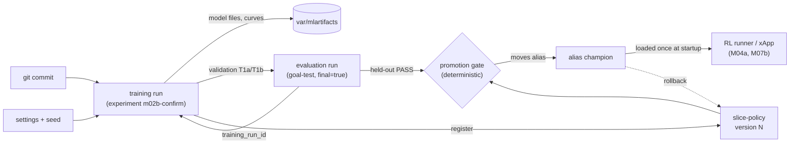

# M02c — MLOps layer: tracking, registry, promotion gate, CI

## 1. What we built

We added a small MLOps layer around the RL policy, on **local MLflow** (a SQLite file and an
artifact folder in `var/`, nothing leaves the laptop). Every training and evaluation run is
recorded with its settings, git commit, curves and files; the 24 runs made before MLflow existed
were imported from their files. The policies are stored in a **model registry** (`slice-policy`),
where the alias `champion` names the deployed one. A **promotion gate**, plain deterministic
Python, moves that alias only when the evidence is recorded: the held-out goal test passed. A
GitHub Actions workflow runs the tests on every push. Tracking never changes or stops training,
and a test proves it.

## 2. Why it exists in the architecture

It is not a box of figure 2; it supports the **"xApp RL (DDPG)"** box. M02 and M02b produced many
runs (9 + 15 + 5) whose traces were scattered over TensorBoard logs, JSON files and a field in
`runs/m02/selection.json`. Nothing tied a deployed model to the code, settings and evaluation that
justified it, and "which policy is deployed" was a file edit.

The registry is where the RL runner (M04a) will get its policy: it will load
`models:/slice-policy@champion` **once at startup**, cache it in `var/`, and **never call MLflow in
the control loop** (the real-time path must not depend on a server or the network, same spirit
as hard invariant 5). The xApp container of M07b will package the champion at build time. Neither
runner nor container exists yet, so serving is wired there, not now.

## 3. How it works

1. **Where things are stored**: [mlops/tracking.py:28-55](../../mlops/tracking.py#L28-L55).
   `RIC_MLFLOW_URI` (default `sqlite:///var/mlflow.db`) and `RIC_MLFLOW_ARTIFACTS` (default
   `var/mlartifacts`) say where; tests point them at temporary folders. `use_experiment()`
   creates an experiment (one per round: `m02-round1`, `m02-round2`, `m02b-dev`, `m02b-confirm`)
   and makes it the active one.
2. **Tracking must never hurt training**: `safe()`
   ([mlops/tracking.py:58](../../mlops/tracking.py#L58)) calls an MLflow function and, on any
   error, warns and returns `None`. Every MLflow call during training goes through it.
3. **A training run**: `training_run()` ([mlops/tracking.py:91](../../mlops/tracking.py#L91)) is a
   context manager used in `train()` ([rl/train.py:216](../../rl/train.py#L216)). It opens a run
   tagged with the git commit and a "dirty" flag, logs the settings as parameters, and at the end
   stores the model, settings, `monitor.csv` and validation history as artifacts.
4. **Curves while training**: `TrackingCallback` ([rl/train.py:148](../../rl/train.py#L148)) sends
   the mean training reward of the last 100 episodes every 25 000 steps;
   `ValidationCheckpoint` ([rl/train.py:110](../../rl/train.py#L110)) sends the validation
   T1a / T1b / reward at each check. About 16 points per run, so five parallel writers to SQLite
   stay far from lock contention. Both only *read* values training computes anyway.
5. **Evaluation runs**: `log_evaluation()` ([mlops/tracking.py:153](../../mlops/tracking.py#L153))
   records one run per (model, split) with the numbers as metrics, the verdicts as tags, and a tag
   `training_run_id` linking back to the training run. `rl/goal_test.py` calls it; the held-out
   test is tagged `final=true`.
6. **Backfill**: [mlops/backfill.py:52](../../mlops/backfill.py#L52) rebuilds a run from the files
   training already wrote (settings JSON, `monitor.csv` downsampled to one point per 10 episodes,
   validation history). Running it twice imports nothing new (each run carries a `source_path`
   tag). The commit of an old run is **inferred** (last commit before the model file's time) and
   tagged `git_sha_inferred`, never presented as a recorded fact.
7. **The registry**: `register()` ([mlops/registry.py:93](../../mlops/registry.py#L93)) stores a
   model file as an MLflow "pyfunc" model, a new numbered **version** of `slice-policy`, with
   tags (training run, validation numbers). Its **signature**
   ([mlops/registry.py:68](../../mlops/registry.py#L68)) says: input 22 float32 values (the
   observation), output 3 PRB shares. MLflow rejects any other input size, so the signature
   documents the contract every backend must respect. `predict()` is the raw actor, stateless;
   the smoothing filter keeps state, so the runner builds `SlicePolicy` from the version's file.
8. **Aliases and the gate**: `champion` is a movable name on one version.
   `gate()` ([mlops/registry.py:145](../../mlops/registry.py#L145)) refuses a version unless
   (a) a held-out goal test is recorded with verdict PASS, (b) that test recorded that its recipe
   passed on every confirmation seed, and (c) validation numbers exist; among the passing
   versions it picks the highest validation T1b, then reward (the rule fixed in M02b).
   `promote()` ([mlops/registry.py:169](../../mlops/registry.py#L169)) then moves the alias and
   records the previous champion; `rollback()` ([mlops/registry.py:187](../../mlops/registry.py#L187))
   moves it back. The evidence is read from the MLflow evaluation runs, not typed in.
9. **Consumers**: `champion()` ([mlops/registry.py:198](../../mlops/registry.py#L198)) returns the
   deployed model's name and a local file. The figures (`rl/plot.py`) and the notebook use it, and
   it returns `None` (creating nothing) when no store exists, so a fresh clone or CI still works.
10. **CI**: [.github/workflows/tests.yml](../../.github/workflows/tests.yml) installs the exact
    locked versions (`uv sync --frozen`) and runs `pytest` on every push and pull request. No
    models or MLflow store are needed.

## 4. Lineage



## 5. How to run it and check it works

```bash
uv run pytest -q                                   # 123 passed, includes tests/test_mlops.py
uv run python -m mlops.backfill                    # imports old runs; second run: "0 imported"
uv run python -m mlops.registry bootstrap          # version 1 = td3_seed2, alias champion
uv run python -m mlops.registry register "models/m02b/confirm/*_best.zip"
uv run python -m mlops.registry promote --auto     # the gate; prints why it accepts or refuses
uv run python -m mlops.registry status             # versions, held-out verdict, validation T1b
uv run python -m mlops.registry rollback           # champion back to the previous one
```

The tests ([tests/test_mlops.py](../../tests/test_mlops.py)) check, each on a temporary store:
a tracked run has params, git tag, metric steps and files; **a tracked and an untracked training
give identical actor weights**; a broken MLflow location only warns and training finishes;
backfill is idempotent; the signature rejects a 21-value input; and the gate refuses without a
held-out record, refuses on a FAIL, accepts on a PASS, and `rollback` restores the old champion.

**The MLflow UI** (a long-running server: start it yourself):

```bash
uv run mlflow ui --backend-store-uri sqlite:///var/mlflow.db      # then open http://localhost:5000
```

How to read it:

- **Experiments** (left): `m02b-dev` has the 15 ablation runs, `m02b-confirm` the 5 confirmation
  runs, `goal-test` the evaluations, `registry` one run per registered version.
- Select several runs in `m02b-dev` and click **Compare**: the metric chart
  `validation/t1b_captured` shows each recipe's goal conditioning improving during training, and
  the table lets you sort by the `recipe` tag. This is the ablation of the M02 note's figure,
  live.
- Open a run: **Parameters** are the exact settings, **Tags** hold `git_sha` (and `git_dirty`, a
  warning if uncommitted code was used), **Artifacts → files** hold the model and the curves.
  A backfilled run says `backfilled = True` and `git_sha_inferred` instead of `git_sha`.
- **Models → slice-policy**: the versions and, for each, the alias (`champion`), its tags
  (`validation_t1b`, `promotion_basis`, `previous_champion`) and the training run it came from.

Current state (from `status`): version 1 `td3_seed2` (the M02 fallback, tagged as such), versions
2–6 the five confirmation seeds, all PASS on the held-out test; **champion = version 3**
(`td3_noreward_seed11_best`, highest validation T1b 0.990).

## 6. Choices and simplifications

- **MLflow, local, rather than Weights & Biases** (cloud account; run data leaves the machine) or
  **a hand-made JSON registry** (lightest, but no UI to compare runs). MLflow gives tracking, a
  registry with aliases and serving formats in one tool. Cost: a heavy dependency, about 57 extra
  packages (pandas, pyarrow, scikit-learn, flask, sqlalchemy).
- **SQLite and a local folder** instead of a tracking server with Postgres and S3: one user, one
  laptop. A team would run a server, with a real database and object storage, and authentication.
- **The gate is deterministic checks over recorded evidence, not a human click.** A real system
  often adds a human approval after the automatic checks, and a canary or shadow phase before the
  champion takes real traffic. Here the architecture already has the operator's confirmation for
  objectives; policy promotion is an offline decision.
- **The registered model's `predict` is stateless.** The deployed policy includes a stateful smoothing
  filter, so M04a will build `SlicePolicy` from the version's file rather than calling `predict`.
- **Serving is not built now.** No runner exists yet; when it does, it loads the champion once and
  caches it. The registry is the contract, not a service in the loop.
- **Backfilled runs have an inferred commit**, and their M02 evaluation is marked reward v1. We
  labelled what was reconstructed instead of pretending it was recorded.
- **Tracking was added after most of the work**: part of its value (exact commit per run) only
  exists from the M02b confirmation round on.
- **Not done**: data and model versioning with DVC, a feature store, drift monitoring, automatic
  retraining. This project has a simulator, not production data. Monitoring of the running system
  is in M04a (Prometheus and Grafana).

## 7. Questions to check understanding

1. **What are an MLflow run, a registered model version and an alias?**
   A run is one recorded execution (training or evaluation) with its params, metrics, tags and
   files. A version is a numbered snapshot of a model in the registry. An alias is a movable name
   (here `champion`) pointing at one version.

2. **How do you deploy a new policy, and how do you roll back?**
   Deploying is moving the `champion` alias to the new version (`promote --auto`, which checks the
   gate); rolling back is moving it back to the recorded previous version. Nothing is copied or
   retrained.

3. **Why does the control loop never call MLflow?**
   The loop is real-time: it must not wait for a server or the network. The runner loads the
   champion once at startup and caches it locally; a registry outage cannot stall the RAN.

4. **How do we know tracking did not change the training results?**
   A test trains the same tiny model with and without tracking and checks the actor weights are
   identical; and every MLflow call in training is wrapped so an error only warns.

5. **Why is the promotion gate not just "pick the best validation score"?**
   Because deployment must depend on recorded evidence from data never used for choices: the
   held-out test must have passed, and its recipe must have passed on every seed. A high
   validation score alone could be luck, or a seed that the held-out test would have rejected.
