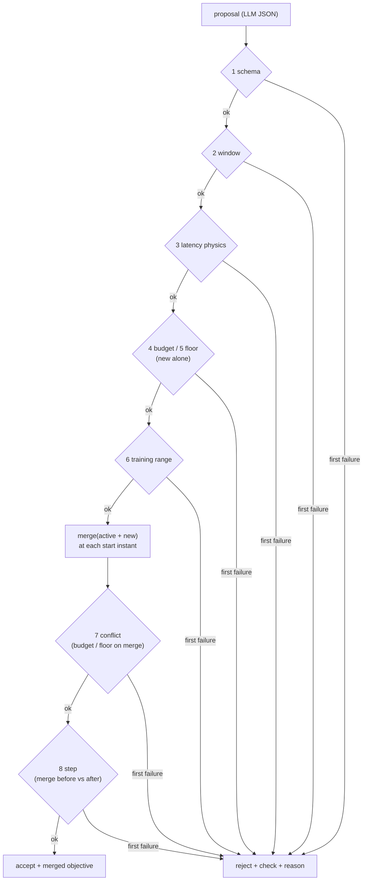
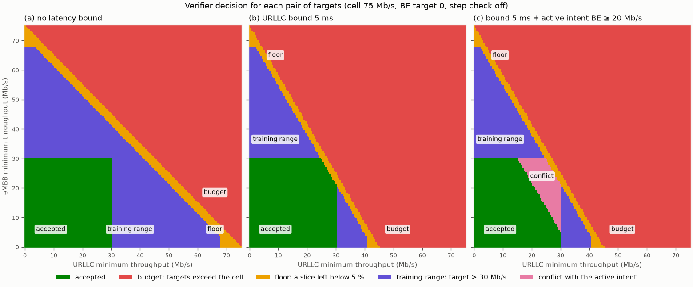

# M03 — Deterministic verifier

## 1. What we built

`verifier/` now decides, for every RL objective the LLM proposes, **accept or reject, with a
reason**. `verify(proposal, state)` runs eight checks in a fixed order and returns the first
failure as a sentence with the numbers in it: schema, validity window, latency physics, PRB
budget, per-slice floor, the policy's training range, conflicts with the intents already
active, and the size of the change. When several intents are active, `merge()` combines them
into the single objective the RL xApp follows, and the verifier checks *that merge*, so what is
verified is exactly what runs. Everything is plain Python: no LLM, no randomness, no network,
no clock read. A test enforces this (hard invariant 3).

## 2. Why it exists in the architecture

It is the **"Vérificateur — déterministe : limites, sécurité, journal"** box of figure 2,
between the LangGraph service and the RL xApp. The LLM is good at turning "guarantee 10 Mb/s to
URLLC for ten minutes" into JSON, but it can hallucinate a number, forget a slice, or propose
something the cell cannot carry. The verifier is the fixed rule between "the LLM said so" and
"the network does it". Nothing reaches `a1_policy` without its accept (and, in demo mode, the
operator's confirmation, M04a).

Why it must not be an LLM: a safety check has to give the **same answer to the same input**,
explain itself **exactly**, and be **testable exhaustively**. An LLM is none of these: its output
changes with sampling and prompt wording, its explanation is not the actual reason for its
decision, and it can be talked into things (prompt injection in the operator's text). Checking
an LLM with another LLM only moves the problem.

## 3. How it works

1. **Inputs**: [verifier/verify.py:41-77](../../verifier/verify.py#L41-L77).
   - `VerifierConfig` holds the limits (floor 5 %, steps, durations, training range).
   - `VerifierState` holds what the verifier must know about the world: `now_s` (the backend
     clock, passed in, never read), `capacity_mbps` (75 Mb/s, measured in the M06 spike),
     `urllc_base_latency_ms` (2 ms, the latency of an empty URLLC slice in `sim/cell.py`) and
     the `active` intents.
   - `Decision` is the answer: `accepted`, `check` (which check decided), `reason`, and
     `merged` (what runs now, if accepted).
   - All of them are frozen pydantic models, so a decision cannot be edited after the fact.
2. **Merge** ([verifier/merge.py:56](../../verifier/merge.py#L56)). It keeps the intents
   active at time t (`valid_from ≤ t < valid_until`: the end is excluded, so touching windows
   never overlap, [merge.py:39](../../verifier/merge.py#L39)). Then it takes:
   - per slice, the **highest** minimum throughput;
   - the **tightest** URLLC latency bound;
   - the weights of the **newest** active intent (highest `issued_at`, ties broken by
     `intent_id`, [merge.py:50](../../verifier/merge.py#L50)).

   The merged window ends at the earliest expiry among the active intents, which is the next
   moment to merge again.
3. **Check 1, schema** ([verify.py:88](../../verifier/verify.py#L88)): the raw dict from the LLM
   becomes an `RLObjective`. Pydantic enforces weights in [0, 1] summing to 1, no negative
   value, no unknown field (`"mmtc"` or `"priority"` are refused) and, new in M03, no inf/NaN.
4. **Check 2, window** ([verify.py:107](../../verifier/verify.py#L107)): every submitted intent
   must end. What counts is the part left from now, `valid_until − max(valid_from, now)`. It
   must be at least 10 s (the policy needs a few one-second steps to act) and at most a day.
   The intent must start within an hour.
5. **Check 3, latency physics** ([verify.py:134](../../verifier/verify.py#L134)): a bound at or
   below 2 ms can never be met, because an empty URLLC slice already takes 2 ms.
6. **Checks 4 and 5, budget and floor** ([verify.py:146-185](../../verifier/verify.py#L146-L185)).
   `required_shares` turns each minimum target into the PRB share it needs:
   - `need = target / C`, because every PRB carries the same rate in our cell model.
   - For URLLC with a bound B, the cell's latency is `base / (1 − ρ)`. Staying under B needs
     `ρ ≤ 1 − base/B`, so carrying the target needs `target / (C · (1 − base/B))`. Example: 30 Mb/s
     within 3 ms needs 30 / (75 × ⅓) = 120 % of the cell.

   Then **budget**: `Σ need ≤ 1`. **Floor**: `Σ max(need, 5 %) ≤ 1`, i.e. the targets must leave
   every slice at least 5 % of the PRBs. The reason names the starved slice.
7. **Check 6, training range** ([verify.py:188](../../verifier/verify.py#L188)): targets ≤ 40 %
   of capacity and bounds within 5–50 ms. That is the range `sample_objective` draws from in
   training. The constants now live in `verifier/objective.py` and `sim/env.py` imports them, so
   the two can never disagree.
8. **Check 7, conflict** ([verify.py:213-243](../../verifier/verify.py#L213-L243)): budget and
   floor again, on `merge(active + new)`. The merge is checked at the start of the new
   objective, and at every start of another intent inside its window. Constraints only get
   tighter when an intent starts (an expiry only removes constraints), so those instants are
   enough. If the merge fails, the **newer** intent is rejected, and the reason names the
   intents it conflicts with.
9. **Check 8, step** ([verify.py:246](../../verifier/verify.py#L246)): it compares the merged
   objective before and after the new intent. Per slice, a weight may move at most 0.5 and a
   target at most 30 % of capacity. A wild LLM output cannot swing the cell in one go; a big
   change takes two intents, each verified.
10. **`verify`** ([verify.py:270](../../verifier/verify.py#L270)) runs 1–6 on the new objective
    alone (line 286), then 7–8 on the merge (line 300). On acceptance it returns
    `merge(active + new, now)` (line 312).
11. **`reverify_after_removal`** ([verify.py:316](../../verifier/verify.py#L316)) is for M04a,
    after an expiry or a cancellation. It re-runs budget, floor and conflict on the remaining
    intents and skips the step check, because an expiry cannot be refused. With an unchanged
    cell it always accepts; it can reject only if the state changed, for example a
    recalibrated capacity.

## 4. Flow of one decision



## 5. How to run it and check it works

```bash
uv run pytest tests/test_verifier.py tests/test_merge.py tests/test_verifier_purity.py -q
# expected: 67 passed
uv run pytest -q          # whole suite, expected: 191 passed
uv run python -m verifier.plot
```

What the tests cover:
- `test_verifier.py`: 13 accepted and 24 rejected table cases, each rejection with its expected
  check and a word of its reason. Edge cases include: targets exactly on the budget, a weight
  step of exactly 0.5 (in floats 0.8 − 0.3 = 0.5000000000000001, hence a 1e-9 tolerance), a
  weight sum within 1e-7 of 1, an expired intent ignored, touching windows, a future intent
  conflicting at its start, and a number sent as a string.
- `test_merge.py`: the merge table, including the expiry of the newest intent (its weights
  give way to the previous intent's).
- `test_verifier_purity.py` (hard invariant 3):
  - an import allowlist read from the source with `ast` (only `pydantic`, `math`, `typing`,
    `collections`, `dataclasses`, `verifier`);
  - no `eval`/`exec`/`open`/`__import__`;
  - 100 identical runs give identical decisions;
  - `verify()` works with `socket.socket` replaced by a function that fails;
  - every file in `verifier/` must be listed as a decision module or as the viewer.

To try one proposal by hand:

```bash
uv run python -c "
from verifier.verify import VerifierState, verify
s = VerifierState(now_s=0, capacity_mbps=75)
print(verify({'weights': {'embb': 0.2, 'urllc': 0.6, 'be': 0.2}, 'min_thr_mbps': {'urllc': 30},
              'max_latency_ms': 3, 'valid_until': 600}, s).reason)"
# the minimum targets need 120% of the PRBs (urllc 120%), more than the cell has
```

### Visualization

`uv run python -m verifier.plot` (about 2 s) writes the feasibility map and prints the
decision table.



How to read it:
- Each pixel is one proposal: URLLC minimum throughput on x, eMBB on y, BE target 0, a
  10-minute window. Its colour is the check that decided. The step check is switched off for
  the map, because it depends on what runs now, not on the targets.
- **(a)** The accepted square stops at 30 Mb/s on both axes: the training range (40 % of 75).
  Above the diagonal `eMBB + URLLC = 75` the budget rejects. The thin yellow band just below it
  is the floor: those targets fit, but they would leave BE under 5 %.
- **(b)** With a 5 ms URLLC bound, URLLC needs `1 / (1 − 2/5) = 1.67×` its target in PRBs. The
  diagonal tilts and cuts a corner off the accepted square: 30 Mb/s eMBB plus 25 Mb/s URLLC no
  longer fits.
- **(c)** The same, with an intent "BE ≥ 20 Mb/s" already active. Everything that fits alone but
  not together with BE's 27 % is now pink: **conflict**. The new intent is the one rejected.

The decision table (`uv run python -m verifier.plot`) shows one example per check:

```
case                                    decision  check            reason
protect URLLC 10 Mb/s / 10 ms / 10 min  ACCEPT    ok               accepted; once applied, the RL xApp follows the merge of new
weights sum to 1.1                      reject    schema           invalid objective: weights must sum to 1, got sum=1.100000
no end time                             reject    window           the objective has no end (valid_until); every intent must expire
lasts 5 s                               reject    window           the objective lasts 5 s, less than the minimum 10 s the policy needs to act
URLLC bound 1.5 ms                      reject    latency_physics  URLLC latency bound 1.5 ms is not above the latency of an empty URLLC slice (2 ms)
30 + 30 + 16 Mb/s                       reject    budget           the minimum targets need 101% of the PRBs (embb 40%, urllc 40%, be 21%), more than the cell has
URLLC 30 Mb/s within 3 ms               reject    budget           the minimum targets need 120% of the PRBs (urllc 120%), more than the cell has
eMBB 30 + URLLC 26 within 5 ms          reject    floor            the minimum targets need 98% of the PRBs (embb 40%, urllc 58%), which leaves 2.2% for be, below the floor of 5% per slice
URLLC bound 60 ms                       reject    training_range   URLLC latency bound 60 ms is outside 5-50 ms, the range the policy was trained on
eMBB 30 + URLLC 22, BE 20 active        reject    conflict         together with active intent(s) be20 at t=100 s, the minimum targets need 103% of the PRBs (embb 40%, urllc 37%, be 27%), more than the cell has
eMBB 20, BE 20 active                   ACCEPT    ok               accepted; once applied, the RL xApp follows the merge of be20, new
URLLC weight 0.3 -> 0.81                reject    step             urllc weight would change by 0.51 (0.30 -> 0.81), more than the maximum step 0.50
```

## 6. Choices and simplifications

- **Merge instead of "newest replaces"** (your rule). An accepted intent never silently drops
  an older guarantee. Price: an intent issued earlier but starting later is *not* the "newest"
  (its weights lose to any intent issued after it). When the newest intent expires, the weights
  jump back to the previous one's, without a step check.
- **First failure, fixed order.** One clear reason instead of a list. Physics checks come
  before the training range, so "impossible" is reported in preference to "untrained".
- **Feasibility uses the simulator's model** (linear PRB → throughput, M/M/1 latency). It is
  only as true as that model. On the testbed, capacity and base latency come from the state and
  are recalibrated, but the latency formula stays an approximation. A real system would use
  measured per-slice spectral efficiency and a learned or measured latency curve.
- **The floor is on targets, not on the actual split.** The verifier cannot guarantee what the
  policy does; a hard clamp in the runner is open for M04a (PLAN §8).
- **Training range as a safety check.** Rejected alternative: let the policy extrapolate.
  Outside the range its inputs are new to the network and nothing tells us what it does.
- **`valid_until` required.** Under the merge, an open-ended intent would hold forever. The
  agent (M04a) can add a default duration when the operator gives none.
- **Lax pydantic mode** (`"10"` → 10.0) kept; inf/NaN now refused. Rejected strict mode: a
  quoted number is a formatting slip, not a danger.
- **Step check on the merged objective**, before vs after. Rejected checking the raw new
  objective against the old one: the merge is what moves the cell.
- **Not in M03:** writing the `a1_policy` row and logging re-merges (M04a), `verify_shares`
  for the LLM-only baseline's `set_slice_share` (M04b), the event log (M04a).
- **Palette:** the five decisions use categorical slots 4–8 (slots 1–3 always mean the
  slices), plus direct labels and a legend. The palette validator needs Node.js, which is not
  installed (same as M01).

## 7. Questions to check understanding

1. **Why is the verifier not an LLM, and how do the tests prove it isn't one?**
   A safety gate must give the same answer to the same input and explain its actual reason;
   an LLM is stochastic, can be prompt-injected and rationalises after the fact. The purity
   tests scan the imports (only pydantic, math, typing… allowed), rerun 100 times for
   identical decisions, and run with the network disabled.
2. **A proposal asks URLLC ≥ 25 Mb/s within 5 ms. What PRB share does that need, and why more
   than 25/75?** 25 / (75 × (1 − 2/5)) ≈ 56 %. To keep latency `base/(1 − ρ)` under 5 ms the
   slice must stay at most 60 % full, so it needs 1/0.6 = 1.67× the capacity of its target.
3. **Intent A (BE ≥ 20 Mb/s, weights 0.3/0.3/0.4) is active. Intent B asks eMBB ≥ 20 Mb/s with
   weights 0.1/0.8/0.1 and is accepted. What does the RL xApp follow, and what changes when B
   expires?** The merge: targets eMBB 20 / URLLC 0 / BE 20 Mb/s with B's weights (B is newest).
   When B expires, A alone: BE 20 Mb/s with weights 0.3/0.3/0.4, re-verified without a step
   check (an expiry cannot be refused).
4. **Why is it enough to check the merge only at the start instants inside the new window?**
   The merged constraints (max targets, min bound) only get tighter when an intent starts;
   expiries remove constraints. If the merge is feasible right after every start, it is
   feasible at every instant.
5. **A target of 31 Mb/s fits easily in a 75 Mb/s cell. Why is it rejected?** It is above 40 %
   of capacity (30 Mb/s), the largest target the policy was trained on. A goal-conditioned
   policy has never seen that input, so its behaviour is unknown, even though the cell could
   carry it.
