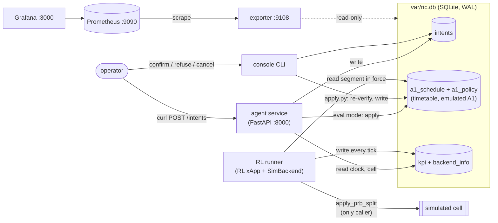
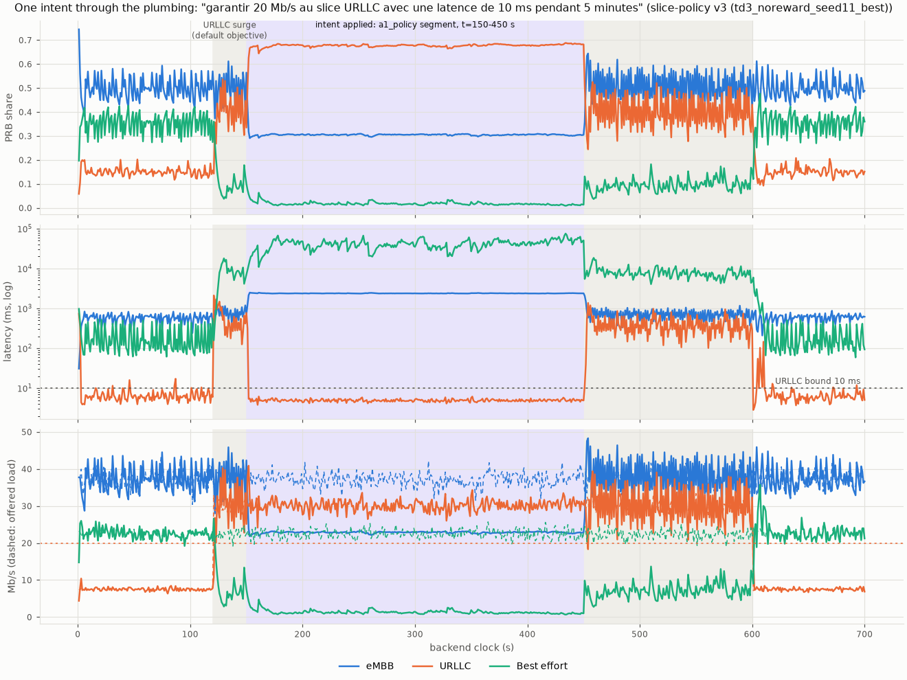

# M04a — Plumbing: backend, store, a1_policy, RL runner, agent service, console, monitoring

## 1. What we built

The pieces of M01–M03 now run as **separate processes that talk only through one SQLite file**
(`var/ric.db`) and one event log (`var/events.jsonl`):

- the **RL runner** (the "RL xApp"), with the simulated cell inside it;
- the **agent service** (FastAPI), with a rule-based parser standing in for the LLM;
- the **operator console**;
- a **Prometheus exporter**, read by Prometheus and Grafana in Docker.

An operator's sentence travels: HTTP → parser → verifier → console confirmation → `a1_policy`
timetable → RL runner → PRB split → KPI table → `get_kpis` and Grafana. No LLM anywhere yet;
M04b replaces only the parser.

## 2. Why it exists in the architecture

M04a draws the arrows of figure 2. The boxes and arrows it builds:
- **"xApp RL (DDPG)"**: the runner;
- **"A1 policy"**: `a1_policy`, emulated, because FlexRIC has no Non-RT RIC;
- **"Service LangGraph"** and **"Vérificateur"**: the agent service and the apply step;
- the **confirmation console**;
- the **KPM → KPI store** arrow: the `kpi` table, which the KPM xApp will also write in M07a.

The **Backend** interface is the seam between the two halves of the project. The simulator now,
FlexRIC in M07b: the runner calls the same five methods, and nothing above the runner knows
which RAN is behind it.

## 3. How it works

1. **The store** ([store/](../../store/)). One module per table, plain `sqlite3` in WAL mode
   (readers never wait for a writer) ([store/db.py](../../store/db.py)):
   - `kpi`: one row per slice per tick, plus `policy_id`, the timetable row that was in force;
   - `backend_info`: the cell and the served model, written by the runner at startup;
   - `a1_schedule` + `a1_policy`: the timetable;
   - `intents`: each request and its state.

   Every decision is also appended to the JSONL log ([store/events.py](../../store/events.py)).
2. **SimBackend** ([backends/sim.py:36](../../backends/sim.py#L36)). It implements the
   `Backend` protocol ([backends/base.py](../../backends/base.py)).
   - `sleep(1)` advances the cell one tick with the M01 formulas, in the same random-draw order
     as `SlicingEnv.step`. A test checks they give identical KPIs.
   - `speed` paces it against the wall clock: 1 = real time, 0 = as fast as possible.
3. **The runner** ([rl/runner.py](../../rl/runner.py)). At startup, `load_policy`
   ([:41](../../rl/runner.py#L41)) loads `slice-policy@champion` once from MLflow and caches it in
   `var/policy_cache/`; without MLflow it uses the cache. Each `tick()`
   ([:122](../../rl/runner.py#L122)):
   1. reads the segment in force with `a1_policy.in_force(now)`;
   2. builds the observation with `build_observation` (the function the env uses, so the policy
      sees exactly what it saw in training);
   3. gets the smoothed split from the policy;
   4. calls `apply_prb_split`, then `sleep(1)`;
   5. writes the KPI records tagged with the `policy_id`, and logs a `policy_switch` when it changes.

   The database is opened with a **zero busy-timeout**: if another process holds the lock, the
   read keeps the last segment and the KPI rows wait in memory for the next tick (`flush`, :148).
4. **Submitting** ([agent/intents.py:34](../../agent/intents.py#L34), called by
   `POST /intents` in [agent/service.py:52](../../agent/service.py#L52)):
   1. store the intent (`received`);
   2. parse it ([agent/parser.py](../../agent/parser.py)): `interpreted`, or `rejected` with
      "not understood";
   3. run `verify()` against the applied intents: `rejected` with the verifier's reason, or
      `awaiting_confirmation` with a wall-clock deadline (demo mode). In eval mode it goes
      straight to apply.
5. **Confirming** (`python -m console confirm i0001` → `apply_intent`,
   [agent/apply.py:105](../../agent/apply.py#L105)). Everything happens in one transaction:
   1. check the state and the deadline;
   2. re-verify against what is applied **now**, since another intent may have been applied
      meanwhile;
   3. build the timetable (`build_timetable`, :65). Time is cut at every start and end of an
      applied intent, and each piece gets `merge()` of the intents active in it;
   4. check the whole timetable with `reverify_after_removal`;
   5. write it as a new schedule, and set the intent to `applied`.
6. **The timetable in action** ([store/a1_policy.py:115](../../store/a1_policy.py#L115)).
   `in_force(now)` returns the segment of the newest schedule that covers now. When an intent
   ends, the clock simply enters the next segment, or none (default objective). No process has
   to notice the expiry, so even a run at 100× speed has no gap.
7. **Lazy expiry** ([agent/intents.py:65](../../agent/intents.py#L65)). A pending intent past
   its deadline is marked `expired` the next time anyone reads it, and also at confirmation.
   No background task.
8. **Reading back.**
   - `GET /intents/{id}` (`status`, :88) adds `in_effect` and `merged_with`. An older intent
     shows it is still running inside the merge.
   - `GET /kpis` gives mean / p95 / last over a window ([store/kpi.py](../../store/kpi.py)).
   - The exporter ([monitoring/exporter.py](../../monitoring/exporter.py)) reads the database
     read-only on every Prometheus scrape.

## 4. Diagrams

The processes, and what each reads and writes:



One intent, step by step:

```mermaid
sequenceDiagram
    participant O as operator
    participant A as agent service
    participant V as verifier
    participant C as console
    participant D as ric.db
    participant R as RL runner
    O->>A: POST /intents "garantir 20 Mb/s URLLC, latence 10 ms, 5 min"
    A->>D: intents: received → interpreted
    A->>V: verify(objective, state from kpi/backend_info/applied intents)
    V-->>A: accept
    A->>D: awaiting_confirmation (deadline now+120 s)
    O->>C: console confirm i0001
    C->>V: verify again (applied set now) + timetable check
    C->>D: a1_schedule + a1_policy segments; intent applied
    loop every tick (1 s)
        R->>D: in_force(now)?
        R->>R: policy(observation + objective) → split
        R->>D: kpi rows with policy_id
    end
```

## 5. How to run it and check it works

```bash
uv run pytest -q                    # expected: 241 passed
uv run python -m rl.plot_runner     # ~10 s: the figure below, plus phase averages
```

**The live demo** (five terminals; the runner empties `var/ric.db` when it starts):

```bash
# 1. RL runner: the demo scenario, one tick per second (URLLC surges at t=120..600 s)
uv run python -m rl.runner --scenario demo --speed 1
# 2. agent service
uv run uvicorn agent.service:app --port 8000
# 3. exporter, then Prometheus + Grafana
uv run python -m monitoring.exporter
docker compose -f monitoring/compose.yml up -d        # Grafana: http://localhost:3000
# 4. submit an intent (any time; during the surge the effect is the clearest)
curl -s -X POST localhost:8000/intents -H 'content-type: application/json' \
  -d '{"text": "garantir 20 Mb/s au slice URLLC avec une latence de 10 ms pendant 5 minutes"}'
# 5. the console: see it pending, confirm it within 120 s
uv run python -m console list
uv run python -m console confirm i0001
# check
curl -s localhost:8000/intents/i0001       # state applied, in_effect true
curl -s 'localhost:8000/kpis?slice=urllc&window_s=10'
# stop: Ctrl-C in 1-3, then
docker compose -f monitoring/compose.yml down
```

In Grafana ("Agentic RIC — live"):
- "Policy in force" jumps from 0 to 1;
- the URLLC PRB share rises to about 0.68;
- URLLC latency drops below the dashed 10 ms bound;
- "Intents per state" counts one `applied`.

### Visualization



How to read it. The run is fast (speed 0) but goes through exactly the code path of the demo.
- Grey band: the URLLC surge (10 % → 40 % of capacity, t = 120–600 s).
- Lilac band: the a1_policy segment of the intent (t = 150–450 s).
- Under the default objective during the surge, the champion gives URLLC about 41 % of the PRBs
  and URLLC latency is about 380 ms (median).
- Once the segment starts, URLLC gets 68 %: it carries its whole 30 Mb/s load at about 5 ms,
  under the 10 ms bound.
- At t = 450 s the segment expires, and the runner goes back to the default objective by itself.

Phase averages printed by `rl.plot_runner`:

| Phase | eMBB share / median latency | URLLC share / median latency | BE share / median latency |
|---|---|---|---|
| surge, default objective (130–150 s) | 0.50 / 742 ms | 0.41 / 380 ms | 0.09 / 8.1 s |
| surge, intent in force (200–440 s) | 0.31 / 2.4 s | 0.68 / **4.9 ms** | **0.02** / **41 s** |
| surge, after expiry (460–600 s) | 0.50 / 710 ms | 0.40 / 342 ms | 0.10 / 7.5 s |

Two findings from this run, kept as open points:
1. **Best effort is starved while the intent is in force**: 2 % of the PRBs and about 41 s of
   latency. The surge makes the cell about 120 % loaded, the objective favours URLLC (weight
   0.6), and nothing stops the policy from giving BE almost nothing. The verifier's floor
   applies to the *targets* (M03), not to the split. This is the PLAN §8 question: a hard
   minimum share in the runner, which would also have to be in the training env.
2. **Under the default objective the policy jitters.** It moves 6 % (steady) to 12 % (surge) of
   the PRBs per tick, against 0.3 % under the intent and about 2 % averaged over random
   objectives in M02. The default objective (no targets, no bound) seems to be a region where
   the policy is undecided between near-equal splits. Not a plumbing problem; to look at with
   M08a.

## 6. Choices and simplifications

- **One SQLite file as the message bus.** Simple, inspectable, survives restarts, no server.
  A real RIC uses an RMR/Kafka-like bus and a time-series database; for a handful of local
  processes at one write per second, SQLite in WAL mode is enough.
- **a1_policy as a timetable** (your choice). Expiries are verified ahead and need no process.
  Rejected a background re-merge loop: it would leave gaps in fast runs.
- **The console works directly on the database** (your choice). The agent API has no confirm
  route, and a test checks the route list. Confirmation re-verifies, because the applied set
  may have changed while the operator was reading.
- **"Newest" = applied last** (`applied_backend`, not submission time), so the weights the
  verifier checked are the ones that run.
- **The runner never waits.** It uses a zero busy-timeout, keeps the last segment on a failed
  read (until that segment's own expiry), and buffers up to 600 KPI ticks. Tested with a held
  write lock: a tick takes < 50 ms and nothing is lost.
- **The clock comes from the KPI table.** Other processes read the backend clock as the latest
  `kpi.ts`, never from the Backend, so only the runner touches the RAN.
- **Lazy expiry, wall clock for confirmations, backend clock for objectives.** The first
  measures a human, the second the network.
- **A simulated run empties `ric.db`**, because the sim clock restarts at 0. The event log is
  kept across runs.
- **Rule-based parser**: a handful of regular expressions. It extracts and never judges
  (60 Mb/s goes through, and the verifier rejects it).
- **The exporter runs in WSL, Prometheus and Grafana in Docker.** It reaches them through
  `host.docker.internal`, which I checked on this machine. Rejected running the exporter in a
  container: SQLite WAL over the Docker Desktop file share is not reliable.
- **Not yet:** the runner-side minimum share (PLAN §8), the LLM (M04b), `set_slice_share`
  (M04b; the runner already supports `direct_share`), the gateway (M05a), FlexRIC (M07b).

## 7. Questions to check understanding

1. **Trace "garantir 20 Mb/s au slice URLLC…" from HTTP to a changed PRB split: which process
   and which table at each step?** The agent writes `intents` (received → interpreted →
   awaiting_confirmation) after the parser and verifier. The console's `confirm` re-verifies
   and writes `a1_schedule` + `a1_policy`. The runner reads `in_force(now)` at its next tick,
   feeds the objective into the policy, calls `apply_prb_split`, and writes `kpi` rows tagged
   with the new `policy_id`.
2. **Two intents are applied, A until t=200 and B until t=500. Who changes what at t=200?**
   Nobody. The timetable already holds a segment for t ≥ 200 with B alone. The runner's
   `in_force` simply returns it, and the runner logs a `policy_switch`.
3. **Why can't the MCP gateway (M05a) confirm an intent, even if it is compromised?** The agent
   HTTP API it talks to has no confirm, refuse or cancel route (tested). Confirmation exists
   only in the console process, which writes the database directly.
4. **The agent holds a long write transaction. What happens to the runner?** Its read still
   works (WAL), and its KPI write fails at once (zero busy-timeout). The tick ends anyway: the
   split is applied, and the records stay in `pending` until a later tick can write them.
5. **Why does confirmation call `verify()` again instead of trusting the first decision?**
   Between submission and confirmation another intent may have been applied. The new one might
   now conflict, or exceed the step limit. Only a check against the current applied set
   guarantees that what runs was verified.
