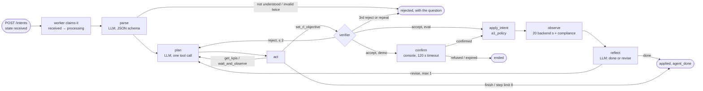
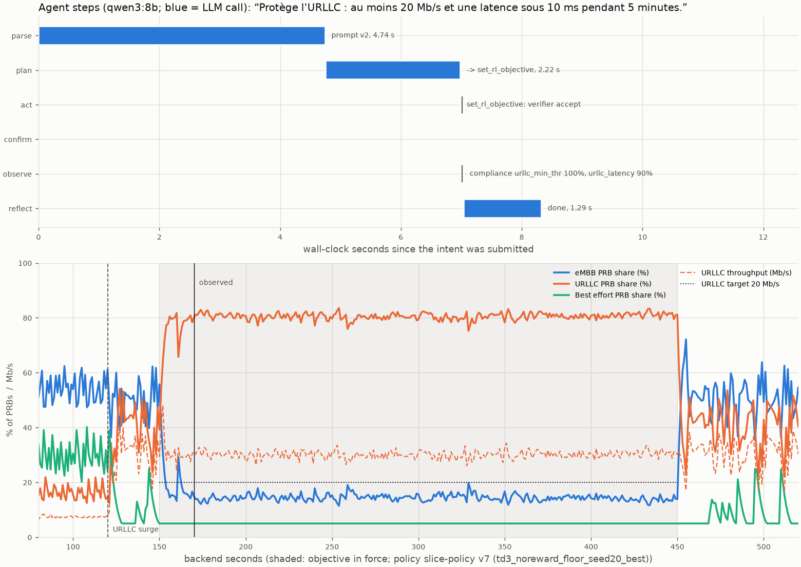

# M04b — The LangGraph agent: parse, plan, act, verify, confirm, observe, reflect

## 1. What we built

The regex parser of M04a is replaced by an **agent loop driven by a local LLM** (qwen3:8b on
Ollama), written as an explicit LangGraph `StateGraph`. The LLM extracts the *facts* of the
operator's sentence, then plans one internal tool call at a time. Every proposed objective goes
through the deterministic verifier, then the console in demo mode. After an apply, the agent
observes the cell for 20 s of backend time, a deterministic function measures compliance, and
the LLM decides "done" or "revise" (at most one revision). The loop runs in its **own worker
process**: `POST /intents` now only stores the request. The same graph also runs the "LLM only"
baseline (`set_slice_share`) that M08a compares against.

## 2. Why it exists in the architecture

This is the **"Service LangGraph"** box of figure 2, with the agent loop of figure 3 inside it:
intent → parse → plan → act (tools) → verifier → [console] → observe → reflect → loop or
finish. It sits between the gateway (M05a) and the verifier/`a1_policy` (M03, M04a). It is the
only place an LLM runs, and it never touches the RAN:
- it writes to `a1_policy` only through `apply_intent`, after the verifier (hard invariant 3);
- it never sets the PRB split in the proposed controller (hard invariant 4);
- the RL runner does not wait for it (hard invariant 5: the runner imports nothing from
  `agent`).

## 3. How it works

1. **Submit only stores** ([agent/intents.py:28](../../agent/intents.py#L28)). `POST /intents`
   creates the intent in state `received` and returns. It writes no objective: hard invariant 1
   now holds literally, and a test checks that `a1_policy` stays empty.
2. **The worker claims it** ([agent/worker.py:34](../../agent/worker.py#L34)).
   `python -m agent.worker` polls ric.db. `next_intent` moves the oldest `received` intent to
   `processing` with one atomic `UPDATE … WHERE state='received'`
   ([store/intents.py:102](../../store/intents.py#L102)), so two workers never take the same
   one. `process_one` (:42) runs the graph; an LLM failure, a timeout or a bad value rejects
   the intent with the error instead of killing the worker.
3. **The LLM client** ([agent/llm.py:52](../../agent/llm.py#L52)). Plain HTTP to Ollama's
   `/api/chat`, standard library only. Settings: temperature 0, `num_ctx` 4096 (above it the KV
   cache spills out of the 8 GB GPU), `think: false`. It has two modes:
   - `schema=` sets Ollama's `format`: the reply is constrained to that JSON schema;
   - `tools=` uses native tool calling.

   `FakeLLM` (:100) replays scripted replies, so every test runs without a GPU. The `LLMClient`
   Protocol (:38) is the seam where a cloud model can be plugged in later.
4. **The graph** ([agent/graph.py:91](../../agent/graph.py#L91)). Six nodes, each a closure
   that returns a state update plus a `route`. One conditional edge per node follows that route
   (:306–315). Every node logs an `agent_step` event (:95), which `GET /intents/{id}` returns as
   `agent_steps`.
5. **parse** (:114, `llm_parse` :62). The LLM fills a `ParsedIntent`
   ([agent/schema.py:32](../../agent/schema.py#L32)): `understood`, `clarification`,
   `priority`, `min_thr_mbps`, `max_latency_ms`, `duration_s`. Facts only, no weights.
   - An invalid reply is retried once; a second failure rejects the intent.
   - `understood=false` rejects the intent with the model's question.
   - An "understood" reply that states no priority, target or latency becomes a question too
     (`states_something`, :49). Without this check, "switch eMBB off" would come back as
     understood but empty.
6. **plan** (:130). The LLM sees the request, the facts, the backend time and a short
   "scratchpad" (the last tool results, the verifier's rejections), and must call exactly one
   tool. It only sees the tools of its mode ([agent/tools.py:64](../../agent/tools.py#L64)):
   - proposed mode: `get_kpis`, `wait_and_observe`, `set_rl_objective`, plus `finish`;
   - `llm_only` mode: `set_slice_share` instead of `set_rl_objective`.

   `set_rl_objective` takes an **importance from 0 to 10 per slice**, not weights.
   `weights_from_importance` ([agent/schema.py:69](../../agent/schema.py#L69)) normalises it,
   so 2/8/2 becomes 1/6, 2/3, 1/6.
7. **act** (:176). Executes the call.
   - `get_kpis` and `wait_and_observe` write their result to the scratchpad and go back to plan.
   - `set_rl_objective` (`set_objective` :217) builds the objective and calls `verify()`
     through `propose_objective` ([agent/tools.py:139](../../agent/tools.py#L139)).
   - A **rejection** goes back to plan with the verifier's reason; a third rejection, or the
     same rejected proposal sent again (:194), ends the intent.
   - An **acceptance** in eval mode calls `apply_intent` at once; in demo mode the intent goes
     to `awaiting_confirmation` and the graph moves to confirm.
8. **confirm** (:248, demo mode only). Polls the intent until the console applies or refuses
   it, or until the timeout expires it.
9. **observe** (:265). `wait_and_observe(20)` waits until the runner's clock (the latest
   `kpi.ts`) has moved 20 s. `compliance` ([agent/tools.py:166](../../agent/tools.py#L166)) then
   computes, for each stated target and bound, the share of ticks that met it. A slice
   offering less than its target counts as met.
10. **reflect** (:280). The LLM reads the compliance and returns `{"decision", "reason"}`.
    The prompt's rule: "done" if every target was met at least 90 % of the time. "revise" goes
    back to plan once.
11. **A revision supersedes.** The new proposal becomes a new intent row with
    `supersedes=<parent>`.
    - It is verified with `verify(..., replacing=parent)`
      ([verifier/verify.py:273](../../verifier/verify.py#L273)): the parent is ignored for
      conflicts, but the step limit is measured from it, since that is what the runner follows.
    - Applying it rebuilds the timetable without the parent and cancels the parent in the same
      transaction ([agent/apply.py:105](../../agent/apply.py#L105)).
12. **The LLM-only baseline.** `set_slice_share` ([agent/tools.py:156](../../agent/tools.py#L156))
    refuses to run outside `llm_only` mode and outside eval mode.
    - `verify_shares` ([verifier/verify.py:349](../../verifier/verify.py#L349)) checks it: finite
      values, a sum of 1, at least 5 % per slice, and a change of at most 0.3 from the current split.
    - `apply_shares` writes a `direct_share` segment that the runner already knows how to follow.
    - The loop repeats split → observe until the intent's duration is over.

### One intent, node by node (from [data/M04b-trace.json](data/M04b-trace.json))

"Protège l'URLLC : au moins 20 Mb/s et une latence sous 10 ms pendant 5 minutes.", sent at
backend t = 150 s, during the URLLC surge. Eval mode, qwen3:8b, champion v7:

| wall s | node | what happened |
|---|---|---|
| 4.75 | parse | priority urllc, urllc ≥ 20 Mb/s, latency 10 ms, 300 s (1 attempt; 4.7 s because the model was loading) |
| 6.99 | plan | `set_rl_objective(importance embb 2 / urllc 8 / be 2, urllc 20, 10 ms, 300 s)`, 2.2 s |
| 6.99 | act | verifier: accepted → applied for t = 150–450 s |
| 7.04 | observe | 20 backend seconds later: URLLC throughput target met 100 %, latency bound met 90 % |
| 8.33 | reflect | "done", 1.3 s |

The model's reflection says the bound was met "à 100 %", while the measured value is 90 %. The
decision is right under the 90 % rule, but the wording isn't faithful. That is why the
numbers come from code and the LLM only decides.

## 4. Diagram



## 5. How to run it and check it works

```bash
uv run pytest -q                                    # expected: 292 passed (no GPU, no Ollama)
uv run python -m eval.extraction --parser qwen3:8b --split tune   # 20/20 with prompt v2, ~1.3 s per parse
uv run python -m eval.benchmark_models              # ~5 min: the model choice (runs/m04b/model_benchmark.json)
uv run python -m agent.plot_trace                   # ~1 min with Ollama: the figure and trace below
```

Ollama runs on Windows and is reached at `localhost:11434` (`RIC_OLLAMA_URL` overrides it).
The model is `RIC_LLM_MODEL`, default `qwen3:8b`.

**The live demo** (six terminals: the five of M04a plus the worker):

```bash
# 1. RL runner, demo scenario, real time (URLLC surges at t=120..600 s)
uv run python -m rl.runner --scenario demo --speed 1
# 2. agent service (stores intents, serves status and KPIs)
uv run uvicorn agent.service:app --port 8000
# 3. agent worker (the LangGraph loop; demo mode = console confirmation)
uv run python -m agent.worker
# 4. exporter, then Prometheus + Grafana (http://localhost:3000)
uv run python -m monitoring.exporter
docker compose -f monitoring/compose.yml up -d
# 5. submit an intent, after t=120 s
curl -s -X POST localhost:8000/intents -H 'content-type: application/json' \
  -d '{"text": "Protège l'\''URLLC : au moins 20 Mb/s et une latence sous 10 ms pendant 5 minutes."}'
# 6. the console: the intent shows up a few seconds later (parse + plan); confirm within 120 s
uv run python -m console list
uv run python -m console confirm i0001
# check: state applied, then about 20 s later agent_steps ends with a reflect step
curl -s localhost:8000/intents/i0001
```

Set `RIC_AGENT=rules` on the worker to run the rule-based agent instead, with no LLM (the M04a
behaviour through the same graph).

### Visualization



Produced by `uv run python -m agent.plot_trace`. How to read it:
- **Top panel:** the agent on the wall clock. Blue bars are LLM calls (parse, plan, reflect);
  grey marks are code (act, observe). The LLM part takes about 8 s, most of it the first
  call, which loads the model. The confirm row is empty because eval mode skips the console.
- **Bottom panel:** the cell on the backend clock. The URLLC surge starts at t = 120 s.
  - At t = 150 s the objective applies (shaded until t = 450 s): the URLLC share goes to about
    80 %, and URLLC throughput (dashed) stays above the 20 Mb/s target (dotted).
  - The vertical line at t = 170 s is where the agent observed and reflected.
  - Best effort stays at the 5 % floor.
- At speed 0 the 20 s observation costs almost no wall time; in the live demo it takes 20 s.

### Choosing the model and tuning the prompt

The rule was written in [DECISIONS](../DECISIONS.md) before the run:
1. a model must sit entirely in GPU memory at `num_ctx` 4096;
2. it is ranked by full-intent accuracy on the **tuning** split, with prompt v1;
3. scores within one intent are a tie, broken by the lower median latency.

| model | tune (v1) | median | on GPU | outcome |
|---|---|---|---|---|
| qwen3.5:9b | 19/20 | 2.1 s | 87 % | excluded |
| ministral-3:8b | 19/20 | 1.4 s | 89 % | excluded |
| **qwen3:8b** | **19/20** | **1.3 s** | **100 %** | **chosen** |
| llama3.1:8b | 17/20 | 0.9 s | 100 % | 2 behind |
| granite4.2:8b | 6/20 | 0.4 s | 100 % | dropped the number fields |

The misses all had the same cause: a reply saying "understood" with nothing in it. Prompt v2
fixes it as a rule, not with an example of the failing item:
- every field is required in the schema;
- a new prompt rule 7, plus the code check in point 5.

qwen3:8b went from 19/20 to 20/20 on the tuning split. That number is optimistic by
construction, because the prompt was tuned on those items. The held-out 20 are scored once,
in M08b.

## 6. Choices and simplifications

- **Facts vs decisions.** The parse step only extracts what was said, and the plan step decides
  the weights. So the extraction can be scored against hand annotations (H8), and a wrong
  decision can be told apart from a wrong reading.
  - *Rejected:* one LLM call writing the objective directly. It is faster, but its errors
    cannot be attributed.
- **Importance 0–10 instead of weights.** An 8B model is bad at three decimals that sum to 1.
  The normalisation is code, and the verifier still checks the result.
- **The verifier stays outside the LLM's reach.** The model proposes; `verify()` decides, and
  its reason goes back into the next prompt. A model that repeats a rejected proposal (seen
  with llama3.1) is stopped instead of asked again.
- **Compliance in code, judgement in the LLM.** The trace shows why: the model's wording was
  off (100 % instead of 90 %) while its decision was right.
- **A separate worker, one intent at a time.** Only one model fits in VRAM, and an agent loop
  takes seconds to minutes (the confirmation, the 20 s observation). Intents queue in
  `received`.
  - *Rejected:* running the loop inside the FastAPI request, which would block it and make
    `submit_intent` do more than create a request.
- **Revision as a superseding intent.** Each objective has its own row, verdict and
  confirmation, and the history stays readable. At most one revision, so one intent cannot
  turn into an unbounded control loop.
- **Ollama through plain `urllib`.** One function, no SDK, and the request is visible in a test.
  - *Rejected:* `langchain-ollama`, which hides the request and pulls in a large dependency
    tree.
- **LangGraph used minimally:** a `StateGraph`, closures as nodes, one `route` field. No
  checkpointer, no prebuilt ReAct agent, so the loop's limits stay in our code, where the tests
  can reach them.
- **The intent set and its review.** All 40 intents were written by one author (Claude). The
  held-out half was committed before the prompt existed. The review was delegated to four
  Claude subagents: two annotated blind and agreed with every label, and two checked the
  labels against the rules. The M08b accuracy will still be optimistic
  ([eval/intents/README.md](../../eval/intents/README.md)).
- **What a real system would do differently:**
  - a chat turn for clarifications, instead of rejecting and asking the operator to resubmit;
  - several workers and a larger model on a server GPU;
  - per-tool timeouts and tracing (OpenTelemetry or MLflow tracing);
  - a held-out set written by operators rather than by the system's own author.

## 7. Questions to check understanding

1. **Why does `POST /intents` no longer run the parser?**
   Hard invariant 1: `submit_intent` only creates a request. The LLM loop takes seconds and
   may wait for the console, so it runs in the worker. The HTTP call returns `received` at
   once, and a test checks that it writes no `a1_policy` row.
2. **The plan step proposes 60 Mb/s for URLLC. What happens, step by step?**
   `propose_objective` builds the objective and calls `verify()`, which rejects it (above the
   training range) with a reason. The reason goes into the scratchpad as "VERIFIER REJECTED: …"
   and the graph returns to plan. If the model sends the identical proposal again, the intent
   ends at once. After a third distinct rejection it ends too. Nothing reaches `a1_policy`.
3. **Why is compliance computed in Python and not by the LLM?**
   It is a count over KPI rows: deterministic, testable and exact. The LLM is used only for
   the judgement (done or revise). In the trace it misquoted the number but took the right
   decision.
4. **A revision is verified with `replacing=parent`. Why not just verify it like a new intent?**
   As a new intent it would conflict with its own parent, which is still active. Measured
   against the default objective, the step would look larger than it is. `replacing` ignores
   the parent for conflicts but measures the step from it, which is what the runner actually
   follows.
5. **Why can granite score 6/20 while answering in valid JSON, and what changed?**
   Its replies left out the number fields. With defaults in the schema, a missing field read
   as "not stated", so the reply validated but was empty. Since prompt v2 every field is
   required (null allowed, absence not), and an "understood" reply that states nothing becomes
   a clarification.
