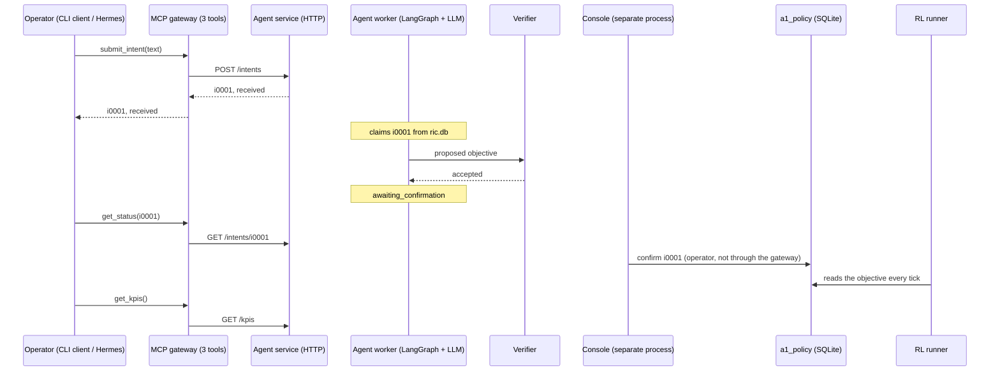
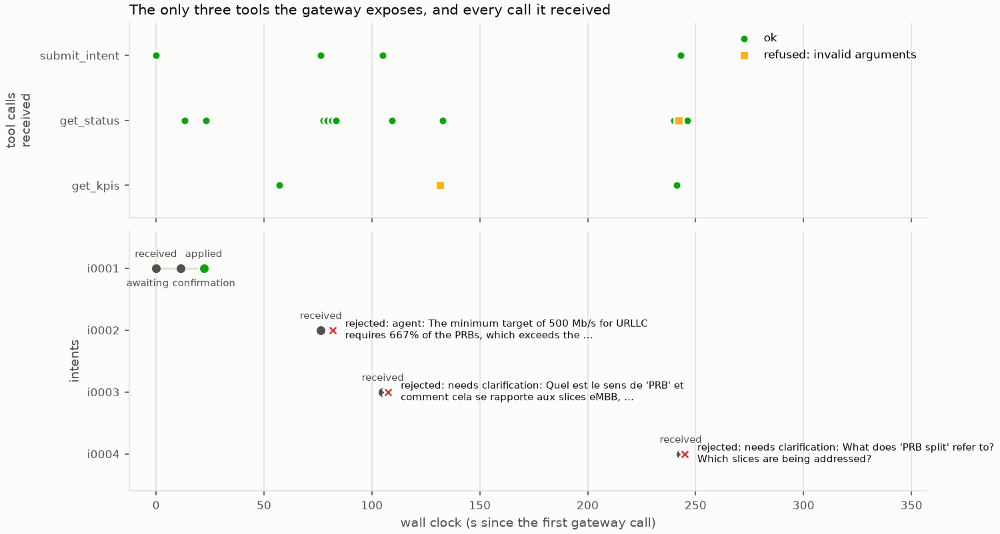
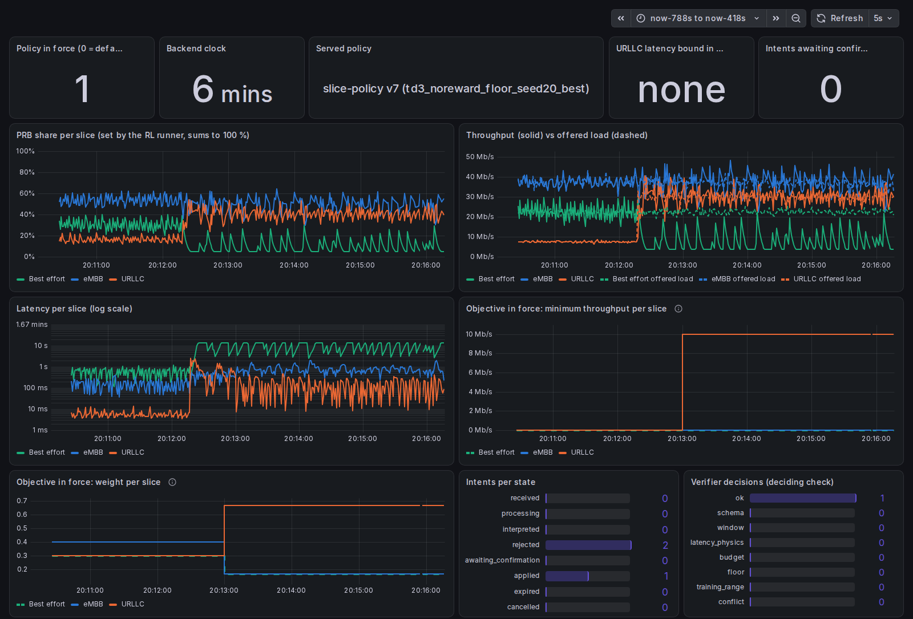
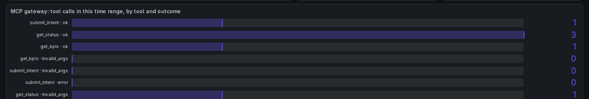

# M05a — The MCP gateway: three tools, nothing else

## 1. What we built

An **MCP server** (`gateway/`, official Python SDK, mcp 2.3.0) that exposes exactly three tools:
`submit_intent`, `get_kpis` and `get_status`. Each tool is one HTTP call to the agent service
of M04b; the gateway has no other address, no other tool, no MCP resource and no MCP prompt.
Every call, accepted or refused, is one `tool_call` event in `var/events.jsonl`. A small
**CLI MCP client** (`gateway/client.py`) speaks MCP to it the way Hermes will in M05b. It is also
the fallback if Hermes is cut. We ran the demo of the proposal (§5.4) through it, live on the
simulator: an accepted intent confirmed in the console, an out-of-bounds intent rejected with
its reason, and "set the PRB split to 90/5/5" producing no change to the objective in force.

## 2. Why it exists in the architecture

This is the **"Passerelle MCP"** box of figure 2, between Hermes (or any MCP client) and the
LangGraph service. It is where the operator's world meets the RIC, so it is kept as small as
possible: hard invariant 1 (exactly three tools; `submit_intent` only creates a request) and
hard invariant 2 (no route or client to FlexRIC or OAI) are properties of this box. It also
writes the log the interface evaluation of M08b reads (proposal table "Mesures de
l'interface": calls per tool, refusals, timestamps, the text received).

## 3. How it works

1. **The client starts the gateway** ([gateway/client.py:33](../../gateway/client.py#L33)).
   By default it launches `python -m gateway` as a subprocess and talks MCP over its
   stdin/stdout (the *stdio* transport). The SDK passes only a few safe environment variables
   to the subprocess, so the client passes the `RIC_*` settings on explicitly. With `--url` it
   connects to a gateway already serving HTTP instead.
2. **The gateway announces three tools** ([gateway/server.py:50](../../gateway/server.py#L50)).
   `MCPServer` (FastMCP in mcp 1.x) builds each tool's JSON schema from the Python signature
   and docstring of the functions decorated with `@mcp.tool()`. The `instructions` text tells
   a chat model what the tools do and what they cannot do.
3. **Arguments are checked in the gateway** ([gateway/server.py:98](../../gateway/server.py#L98),
   [:115](../../gateway/server.py#L115), [:132](../../gateway/server.py#L132)). Text 1–2000
   characters and not blank, slice in `embb/urllc/be`, `0 < window_s <= 3600`, intent id like
   `i0001`. A bad argument makes **no HTTP request**: `refuse()`
   ([:71](../../gateway/server.py#L71)) logs `invalid_args` and returns an MCP error.
4. **One HTTP call per tool** (`call_agent`, [gateway/server.py:77](../../gateway/server.py#L77)).
   It uses the gateway's single `httpx.Client` ([:48](../../gateway/server.py#L48)), bound to
   `RIC_AGENT_URL`. The mapping is fixed: `submit_intent` → `POST /intents`, `get_kpis` →
   `GET /kpis`, `get_status` → `GET /intents/{id}` (or `GET /status` without an id). The text is
   forwarded verbatim (H2).
5. **One log line per call** (`log_call`, [gateway/server.py:62](../../gateway/server.py#L62)).
   It records the tool, the arguments, the outcome (`ok`, `invalid_args`, `http_<code>`,
   `unreachable`), the intent id and the duration, through `store.events.log_event`, which
   only appends JSON lines. An unreachable agent service is an MCP error and a log line, not
   a crash.
6. **Behind the gateway nothing new happens.** The agent service stores the intent
   (`received`), the M04b worker parses, plans and calls the verifier, the console confirms (demo
   mode), and the RL runner reads `a1_policy`. The gateway can only *ask*: the service has no
   endpoint to confirm, apply or set a split
   ([agent/service.py:9](../../agent/service.py#L9), checked by
   `test_service_offers_no_way_to_confirm`).
7. **Monitoring** ([monitoring/exporter.py:94](../../monitoring/exporter.py#L94)). The exporter
   counts the gateway events into `ric_gateway_tool_calls_total{tool,outcome}`, and the Grafana
   dashboard has one panel for it.

**The tests** ([tests/test_gateway.py](../../tests/test_gateway.py)):
- **Invariant 1:** over a real MCP session the tool list is exactly the three names, and
  resources and prompts are empty (line 89). `submit_intent` makes exactly one
  `POST /intents` (line 98). The text is forwarded verbatim (line 105).
- **Invariant 2:**
  - an AST scan of every file in `gateway/` refuses `backends, xapps, rl, sim, verifier,
    agent, console, monitoring, sqlite3, store` (except `store.events`) and LLM clients
    (line 131), and another test checks that no file escapes the scan (line 126);
  - a subprocess imports the gateway and checks `sys.modules`, so an indirect import (through
    the SDK, for example) is caught too (line 138);
  - every request goes to the one configured host, to one of the four endpoints (line 148).
- **The §5.4 scenario:** replayed through the gateway against the real agent service
  in-process, with the rule-based agent standing in for the LLM (line 206).
- **Both kinds of check can fail.** A fourth tool added to the server shows up in the listing,
  and an `import sqlite3` shows up in the probe; both were tried by hand.

## 4. Diagram



The gateway's arrows all go to the agent service. The only arrow into `a1_policy` comes from
the console, which the gateway cannot reach.

## 5. How to run it and check it works

```bash
uv run pytest -q tests/test_gateway.py      # 20 passed (no LLM, no processes)
uv run pytest -q                            # 325 passed (319 at the end of M05a)
uv run python -m gateway.client tools       # the 3 tools and their descriptions
```

The live demo is the six terminals of [M04b §5](M04b-langgraph.md#5-how-to-run-it-and-check-it-works)
(runner `--scenario demo --speed 1`, agent service, worker, exporter, Prometheus + Grafana). The
gateway needs no terminal of its own: the client starts it. After t = 120 s (URLLC surge):

```bash
uv run python -m gateway.client submit "Garantis 10 Mb/s au slice URLLC pendant 10 minutes."
uv run python -m console confirm i0001       # in its own terminal, within 120 s
uv run python -m gateway.client watch i0001  # get_status every 2 s until a final state
uv run python -m gateway.client kpis --window 20
uv run python -m gateway.client submit "Garantis 500 Mb/s au slice URLLC."
uv run python -m gateway.client watch i0002  # rejected, with the reason
uv run python -m gateway.client submit "Fixe le partage des PRB à 90/5/5."
uv run python -m gateway.client watch i0003  # rejected; a1_policy unchanged
grep '"source": "gateway"' var/events.jsonl | grep -o '"tool": "[a-z_]*"' | sort | uniq -c   # only 3 names
```

For Hermes (M05b), the same server serves HTTP: `uv run python -m gateway --http`, giving
`http://127.0.0.1:8100/mcp`.

### The live demo, as it ran (2026-11-02, real time, qwen3:8b, champion v7)

The client transcript is in [data/M05a-transcript.txt](data/M05a-transcript.txt) and the
run's events in [data/M05a-events.jsonl](data/M05a-events.jsonl). Times are wall seconds since
the first gateway call; `b` is the cell's (backend) clock.

| s | b (s) | what happened |
|---|---|---|
| 0 | 139 | `submit_intent` "Garantis 10 Mb/s au slice URLLC pendant 10 minutes." → i0001 `received` |
| 9–12 | 148–151 | worker: parse (8.7 s, the model loading), plan (2.5 s), verifier accepts → `awaiting_confirmation` |
| 22 | 161 | console `confirm i0001` (not through the gateway) → `applied`; the runner switches policy at b = 162 |
| 43 | 182 | agent observes 20 s and reflects: URLLC target met 100 % of the time (30.6 Mb/s for 10 asked) |
| 57 | — | `get_kpis`: URLLC 30.7 Mb/s, 41 % of the PRBs |
| 76 | 216 | `submit_intent` "Garantis 500 Mb/s au slice URLLC." → i0002 |
| 82 | 221 | the verifier rejects the proposal (`budget`: "the minimum targets need 667 % of the PRBs"); in demo mode the agent may not lower a stated value, so it ends → `rejected` |
| 105 | 244 | `submit_intent` "Fixe le partage des PRB à 90/5/5." → i0003 |
| 108 | 247 | parse: `understood: false` → `rejected` (needs clarification). No plan, no verifier call |
| 132 | — | `get_kpis(slice="mmtc")` → refused by the gateway, `invalid_args`, no HTTP request |
| 240–246 | 382–384 | after the exporter fix (§6): `get_status`, `get_kpis`, `get_status("i0001; DROP")` (refused), and "Set the PRB split to 90/5/5 now." → i0004 `rejected` the same way |

**Out-of-scope check, before and after i0003** (read-only queries on `var/ric.db`):
- before: one `a1_policy` row (i0001's objective), PRB shares embb/urllc/be = 0.30 / 0.48 / 0.22;
- after: the same single row; the policy in force on every tick since b = 245 is still id 1;
  the shares are the RL policy's own, 0.52 / 0.43 / 0.05, not 90/5/5.

**The gateway log** of the run: 4 `submit_intent`, 11 `get_status`, 2 `get_kpis` with outcome
`ok`, and 2 `invalid_args`. No other tool name appears, and none could.

### Visualization



Produced by `uv run python -m gateway.plot_demo` (reads `var/events.jsonl`), or from the saved
events: `uv run python -m gateway.plot_demo --events docs/learn/data/M05a-events.jsonl`.
How to read it:
- **Top panel:** one row per tool, one marker per call the gateway received. Green dots are
  calls it forwarded; yellow squares are calls it refused itself (bad arguments: no request
  left the gateway). The clusters of `get_status` are the client's `watch` polling every 2 s.
- **Bottom panel:** one row per intent. Grey dots are state changes logged by the agent and the
  console; the last marker is the outcome. i0001 goes received → awaiting confirmation →
  applied in 22 s. The other three are rejected, and the reason is printed next to them.
- The two panels share the wall clock, so each `submit_intent` dot sits above the intent
  it created.



Grafana over the first part of the run (20:09:50–20:16:00). At 20:12 the URLLC surge starts;
at 20:13 the objective of i0001 applies ("minimum throughput" steps to 10 Mb/s for URLLC, its
weight to 0.67), and the URLLC share (orange) rises to about 40 % while best effort drops to the
5 % floor. The intent counters show 1 applied and 2 rejected, and the verifier panel shows 1
accepted. The tiny gap in the objective panels near 20:16 is the exporter restart.



The gateway panel over the second pass (from 20:16:20). It matches the log exactly: 1
`submit_intent`, 3 `get_status`, 1 `get_kpis`, and 1 `get_status` refused for invalid
arguments.

## 6. Choices and simplifications

- **mcp 2.3.0, `MCPServer`.** uv resolved the current SDK, a new major version. The class
  known as FastMCP in 1.x is `mcp.server.mcpserver.MCPServer` here, and the client side has a
  unified `mcp.Client` that accepts a URL, a stdio command or, in tests, the server object
  itself (an in-process session, used by every test). Rejected: pinning `mcp<2` to follow
  older tutorials; the 2.x API is smaller and the in-process client makes the invariant tests
  simple.
- **Plain `str`/`float` parameters, checked by our code.** With `Literal["embb","urllc","be"]`
  the SDK rejects a bad value before the function runs, and nothing is logged. The proposal
  counts "calls rejected by the gateway", so the checks are ours. The cost: the tool schema shows
  the allowed slices in the description, not as an enum. (A non-number `window_s` is still
  rejected by the SDK unlogged; acceptable.)
- **stdio by default, streamable HTTP with `--http`.** stdio needs no port and the client
  owns the gateway's lifetime. Hermes in M05b runs in a container that may only reach the
  gateway's port, so HTTP is there too (`127.0.0.1:8100/mcp`). It is the same server object.
- **`store.events` is the one module from `store/` allowed.** It only appends JSON lines (json,
  os, time, pathlib), so the gateway logs in the same file as every other process without
  any route to `ric.db`. Rejected: a separate `var/gateway.jsonl`. It would mean a second
  format and a second reader for M08b.
- **The gateway answers with the agent service's JSON as is.** No renaming or filtering, so
  what Hermes shows is what the API says. A real product would shape a shorter answer for a
  chat window.
- **Found live: Prometheus `increase()` misses the first event of a new series.** In the first
  pass, the gateway panel showed 2 submits for 3. A counter series that appears for the first
  time already at 1 has no earlier sample, so `increase()` starts from 1. The fix: publish every
  tool × outcome series from the start at 0. That needs a fixed set of outcomes, so the exporter
  groups `http_*` and `unreachable` as `error` (the log keeps the exact one). The first-pass
  screenshot was not kept; the panel shown above is from the second pass, after the fix.
- **Observed in the demo, M04b behaviour:**
  - *i0003 and i0004 were rejected at parse,* with a poor clarification question ("what does
    PRB mean?"). The right answer would be "the split is the RL xApp's decision; state a goal
    instead". **Fixed in code** right after M05a: every "needs clarification" reply now ends with
    a fixed sentence saying what can be asked and that the PRB split is the RL controller's
    (`SCOPE_HINT`, [agent/schema.py](../../agent/schema.py)). The parse prompt is unchanged; a
    prompt change (with a tune re-score) is considered in M05b only if the model's own question
    still reads badly through Hermes.
  - *For i0002, which stated no duration, the planner proposed `duration_s: 217`,* the current
    backend clock. **Fixed** right after M05a: an unstated duration now always gets the default
    ([M04b note, "Fixed after the M05a live demo"](M04b-langgraph.md#fixed-after-the-m05a-live-demo-2026-11-02)).
  - *The `verifier` field of i0002's status was `null`,* so the dashboard's verifier panel
    above shows no `budget` rejection. **Fixed** the same way: a rejected intent now keeps the
    verifier's last decision.
- **What a real deployment would add:** authentication on the HTTP transport (the SDK
  supports OAuth; we bind to 127.0.0.1 instead), rate limiting, and the network isolation
  test of M07b (the gateway's container has no route to FlexRIC/OAI). The import tests here
  show the code *has no client* to the RAN; only M07b shows there is *no route*.

## 7. Questions to check understanding

1. **Why can nothing behind the gateway change except by submitting an intent?**
   The gateway has three tools, and each one maps to a single fixed HTTP call to the agent
   service. Two are reads. The third, `POST /intents`, only stores a request in state
   `received`. The agent service itself has no endpoint to confirm, apply or set a split.
   The gateway imports no database or RAN code, and knows one address. The only path to
   `a1_policy` runs through the worker, the deterministic verifier and, in demo mode, the
   console, a separate process the gateway cannot reach.
2. **Why are the tool parameters `str` and `float` and not `Literal` types?** So that a bad
   argument reaches our code, which logs it as `invalid_args` before refusing it. With a
   `Literal`, the SDK refuses first and the gateway log never sees the call.
3. **What does `test_nothing_forbidden_is_loaded_even_indirectly` catch that the AST scan
   does not?** Modules pulled in indirectly. The scan reads our files only; the subprocess
   imports the gateway and lists everything in `sys.modules`, including what the MCP SDK and
   httpx import.
4. **"Set the PRB split to 90/5/5": what are the two layers that stop it?** First, there is no
   tool or endpoint that sets a split, so the request can only arrive as intent text. Second, as
   text it went through the agent: here the parser rejected it (`understood: false`). Had the LLM
   turned it into an objective, the verifier would have checked it and the console would still
   have had to confirm it. Even then it would be an *objective* for the RL policy, not a split.
5. **Why did the Grafana panel undercount in the first pass, and what fixed it?**
   `increase()` computes growth between samples. A series that first appears with value 1 has
   no earlier sample, so that first call is lost. Publishing every tool × outcome series at 0
   from the exporter's start gives Prometheus the earlier sample.
