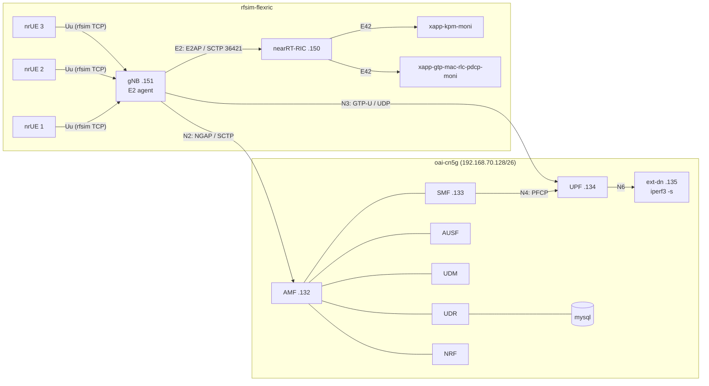
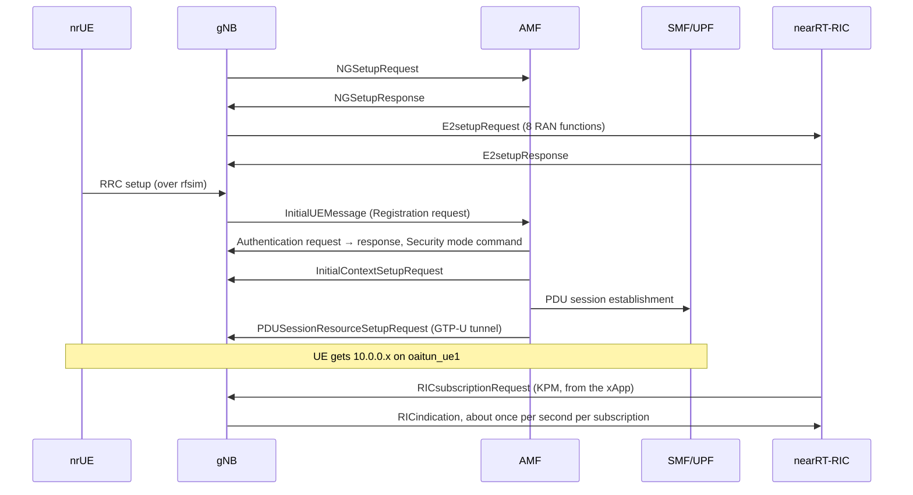
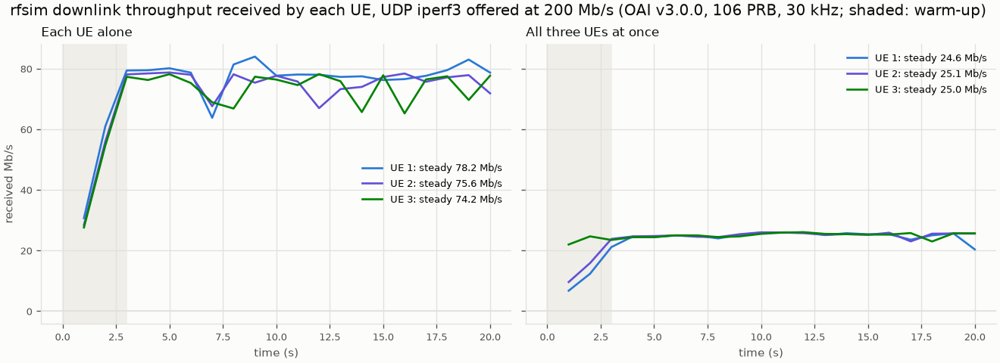
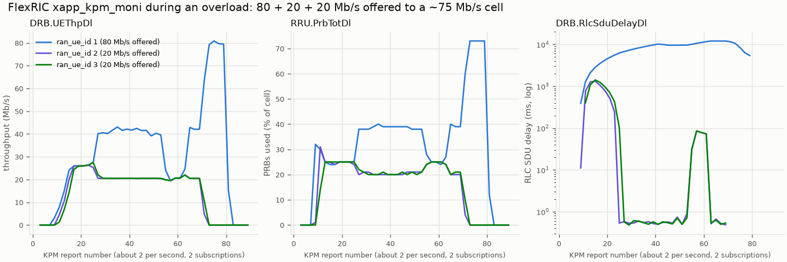

# M06-spike — OAI + FlexRIC reconnaissance

## 1. What we built

We brought up a real 5G testbed on the laptop for the first time, from the official Docker
images only. It has the OAI 5G core (CN5G v2.2.1), an OAI gNB in RF-simulator mode with its E2
agent, the FlexRIC near-RT RIC, and 3 OAI nrUE (all OAI/FlexRIC v3.0.0). All 3 UEs attached,
got an IP and pinged through the core. We measured the downlink capacity with iperf3: **about
75 Mb/s**. We also read the per-UE KPM reports through a FlexRIC xApp, during normal load and
during an overload. Then we calibrated the M01 simulator to the measured capacity. The spike's
main finding: **monitoring works out of the box, but PRB-split control over E2 does not exist
in OAI v3.0.0**, so a decision is needed before M07b.

## 2. Why it exists in the architecture

This is the **"RAN et cœur 5G open source"** box of figure 2. It also tests the **"xApp KPM"**
box and the "rapports E2" arrow. The spike runs right after M01 for three reasons:
- M04a will freeze the KPI record and the Backend interface. Before that, we need to know what
  the real gNB can report and control.
- The RL policy (M02) should be trained on a simulator calibrated to the real cell.
- It tests the riskiest part of the project (OAI + FlexRIC on WSL2 + Docker Desktop) first.

## 3. How it works

1. **Where things come from.** OAI and FlexRIC moved from GitLab to GitHub
   (`github.com/duranta-project`). GitLab is now a rate-limited mirror. We follow tag **v3.0.0**
   of both. Every config in `testbed/` is copied from that tag, and each file's header names its
   source path and any change we made.

2. **The core**: [testbed/oai-cn5g/docker-compose.yaml](../../testbed/oai-cn5g/docker-compose.yaml).
   - Containers: mysql (subscriber database), NRF, UDR, UDM, AUSF, AMF (line 85), SMF, UPF
     (line 120), and `oai-ext-dn` (line 142). The ext-dn plays "the Internet" behind the UPF and
     runs an `iperf3` server (line 148).
   - They all share the Docker bridge `oai-cn5g-public-net`, 192.168.70.128/26 (line 164).
   - The only change from the original: we removed the IMS (voice) service.

3. **RAN + RIC**: [testbed/rfsim-flexric/docker-compose.yml](../../testbed/rfsim-flexric/docker-compose.yml).
   - `nearRT-RIC` (line 8) and the `xapp-kpm-moni` xApp (line 21) come from the `oai-flexric`
     image. A second monitor xApp reads the MAC/RLC/PDCP/GTP statistics.
   - The gNB (line 55) runs with `--rfsim`. Instead of a radio, it talks to the UEs over a
     TCP socket that carries the I/Q samples.
   - Three UEs (lines 75–132) with IMSIs 001010000000002–04, which already exist in the
     database. They join the core's network (line 135: `external: true`).
   - The gNB config [conf/gnb.conf](../../testbed/rfsim-flexric/conf/gnb.conf):
     - PLMN 001/01, a single slice SST=1;
     - 106 PRB at 30 kHz (40 MHz), TDD with 7 downlink and 2 uplink slots per 10;
     - an `e2_agent` section (line 235) pointing at the RIC, 192.168.70.150.

4. **Which interface carries what.** There is no F1, because the gNB is monolithic (CU and DU
   in one process).

   | Interface | Between | Protocol (transport) | What it carries |
   |---|---|---|---|
   | Uu (simulated) | nrUE ↔ gNB | rfsim TCP socket | the radio link: I/Q samples |
   | N2 | gNB .151 ↔ AMF .132 | NGAP (SCTP 38412) | control: NG Setup, UE registration, PDU session setup |
   | N3 | gNB .151 ↔ UPF .134 | GTP-U (UDP 2152) | user data, one tunnel (TEID) per PDU session |
   | N4 | SMF .133 ↔ UPF .134 | PFCP (UDP 8805) | the SMF programs forwarding rules in the UPF |
   | N6 | UPF ↔ ext-dn .135 | plain IP | traffic to and from the data network |
   | SBI | core NFs | HTTP/JSON | NRF registration, AMF↔SMF, UDM/AUSF authentication |
   | E2 | gNB .151 ↔ RIC .150 | E2AP (SCTP 36421) | E2 Setup, subscriptions, RIC indications (reports), control |
   | E42 | xApp ↔ RIC .150 | E2AP-like (SCTP 36422) | FlexRIC's internal xApp ↔ RIC protocol |

5. **What the gNB offers the RIC.** At E2 Setup, the gNB advertises 8 RAN functions: KPM (ID 2),
   RC (3), MAC (142), RLC (143), PDCP (144), **SLICE (145)**, TC (146) and GTP (148). Advertised
   does not mean implemented:
   - **KPM works.** It sends per-UE reports with the S-NSSAI (1, 0xffffff) condition (REPORT
     style 4).
   - **RC control** only supports radio-bearer control (QoS flow → a new DRB) and handover. It
     has no PRB-quota control.
   - **SLICE is a stub.** In the v3.0.0 source (`openair2/E2AP/RAN_FUNCTION/CUSTOMIZED/ran_func_slice.c`),
     reads return random test data, and a control message only prints "SLICE CONTROL ADD rx"
     without touching the scheduler. The OAI README agrees: SLICE and TC are "not supported in
     OAI RAN".
   - **There is a hook.** The v3.0.0 downlink scheduler calls the PRB allocation through a
     function pointer, `mac->dl_rb_alloc`, and every scheduling candidate carries its `nssai`.
     A slice-aware policy could plug in there, as C code in a custom gNB build.

6. **Measuring throughput**: [testbed/measure_throughput.sh](../../testbed/measure_throughput.sh).
   - The ext-dn sends UDP at an offered 200 Mb/s to each UE (`iperf3 -R`). Each UE first gets
     20 s alone, then all three run at once.
   - The iperf3 client runs in a throwaway `nicolaka/netshoot` container that shares the UE's
     network namespace (`--net container:…`, line 40), so we don't touch the UE image.
   - UE IPs are read at run time (line 28), because the SMF hands them out in attach order.
     The static IPs in the database are not used.
   - One extra iperf3 server per concurrent UE is started on the ext-dn (line 35).

7. **Reading the results**: [testbed/plot_spike.py](../../testbed/plot_spike.py).
   - `load_run` (line 40) reads **`end.sum_received`** and the per-second intervals. With
     `-R`, `end.sum` describes the *sender*, so it always shows the offered 200 Mb/s. Our first
     summary printed exactly that by mistake, and we caught it because every run showed 200.0.
   - Loss is computed as received/sent bytes. iperf3's `lost_percent` only counts the gaps the
     receiver noticed.
   - `parse_kpm_log` (line 64) turns the xApp's text output into per-UE series, and `plot_kpm`
     (line 80) draws them.

8. **Calibration.** In [sim/cell.py:22](../../sim/cell.py#L22), the capacity is now 75 Mb/s.
   Traffic levels are fractions of capacity (`DEFAULT_LOAD_FRACTION`,
   [sim/traffic.py:24](../../sim/traffic.py#L24)), so every scenario keeps its meaning: 90 %
   load, and a URLLC spike from 10 % to 40 % of the cell.

## 4. The testbed, and one UE attaching

## 5. How to run it and check it works

Bring up and tear down: [testbed/README.md](../../testbed/README.md). It needs about 5 GB of
images and the `sctp` kernel module (`lsmod | grep sctp`). Checks, with what we saw:

| Check | Command | What we got |
|---|---|---|
| Core healthy | `docker compose -f oai-cn5g/docker-compose.yaml ps` | all `healthy` after ~40 s |
| NG Setup | `docker logs rfsim5g-oai-gnb \| grep NGSetup` | `Send NGSetupRequest` / `Received NGSetupResponse` |
| E2 Setup | `docker logs rfsim5g-oai-gnb \| grep "E2 SETUP"` | `E2 SETUP-REQUEST tx` / `E2 SETUP RESPONSE rx` |
| UE attached | `docker exec rfsim5g-oai-nr-ue ip -4 addr show oaitun_ue1` | 10.0.0.2–.4, one per UE |
| Data path | `docker exec rfsim5g-oai-nr-ue ping -c 4 -I oaitun_ue1 192.168.70.135` | 0 % loss, RTT ≈ 29 ms, on all 3 UEs |
| Capacity | `./testbed/measure_throughput.sh 200M 20` then `uv run python testbed/plot_spike.py` | see below |

**Throughput** (single runs; `steady` = mean after a 3 s warm-up):

| Run | per UE (steady) | cell total |
|---|---|---|
| each UE alone | 78.2 / 75.6 / 74.2 Mb/s | — |
| three at once | 24.6 / 25.1 / 25.0 Mb/s | **74.8 Mb/s** |

- **One UE alone and three UEs together get the same total, about 75 Mb/s.** The cell has a
  fixed capacity, and the default proportional-fair scheduler splits it equally between UEs
  whose channels are identical.
- **What limits it is the radio configuration, not the laptop.**
  - Under load, every UE runs at MCS 28 (64-QAM, the top of MCS table 1) with BLER 0. The SNR
    is about 22 dB.
  - The gNB used about 2.2–2.8 CPU threads and each UE 1–2, which is ~10 % of the 32 threads.
    RAM was about 4 GiB in total.
  - (The plan expected a CPU limit. That expectation was wrong.)

**KPM during an overload** (80 + 20 + 20 Mb/s offered to the ~75 Mb/s cell):

- **`DRB.UEThpDl`** (kbps) matches what each UE receives. In the normal-load run (40/20/10
  offered) it reported 41.0 / 20.5 / 10.2 Mb/s.
- **`RRU.PrbTotDl`** is the % of the cell's PRBs used by each UE. It tracks throughput at about
  1 Mb/s per 1 %. Odd detail: one UE never went above ~73–79 %, even alone. That's why
  ~75 Mb/s is the *practical* capacity, while 100 % of PRBs would be about 100 Mb/s. The gNB
  log shows many "CCE fail" events (the control channel can't schedule every UE in every
  slot), which may explain this. **Not verified.**
- **`DRB.RlcSduDelayDl`** (µs) **is a usable latency signal.**
  - Below capacity it is ~0.5 ms.
  - For the overloaded UE it climbed 1.3 → 4.9 → 7.8 → 10.2 → 11.6 s as its RLC buffer
    filled.
  - After the other flows stopped, that UE jumped to 80 Mb/s and drained the buffer.
  - This is the same behaviour as our simulator's latency (drain time grows during overload),
    with a much deeper buffer.
- **Not usable:**
  - The **first report** after a subscription is cumulative since attach (e.g. "2.8 Gb/s").
  - `L1M.SS-RSRP` and `MR.NRScSSSINR` give impossible values (83 583 "dBm"). We dropped those
    lines from the stored logs to keep them small.
- The reporting period is ~1 s per subscription, which matches our 1 s RL step.

**Protocol messages**: tshark on the capture excerpts in `testbed/captures/` (not in git).
- N2, at the AMF: `NGSetupRequest`, `NGSetupResponse`, then for each UE `InitialUEMessage
  (Registration request)` → `Authentication request/response` → `Security mode command` →
  `InitialContextSetupRequest/Response` → `PDUSessionResourceSetupRequest/Response`. All
  three UEs were registered within 1.5 s.
- E2, at the RIC: `E2setupRequest` → `E2setupResponse` at start-up. Then
  `RICsubscriptionRequest/Response` when the xApps start, then `RICindication` (944 in a
  3000-packet excerpt).
- N3, at the UPF: GTP-U packets from 192.168.70.151 (gNB) to .134 (UPF), with TEIDs 1, 2, 3
  (one per UE).

To open them in Wireshark on Windows: `\\wsl$\Ubuntu-24.04\home\souhail\projects\Agentic_AI_For_RIC_in_O_RAN\testbed\captures\`.
For the E2 file, use *Decode As…* → SCTP port 36421 → E2AP.

## 6. Choices, findings and what changes in the plan

**Answers to the spike's questions**

| Question | Answer |
|---|---|
| Does the official gNB image have the E2 agent? | Yes: built with `--build-e2`, E2AP v3, KPM v3.00. The SM libraries are in `/usr/local/lib/flexric` |
| Which FlexRIC matches? | `oai-flexric:v3.0.0`, same E2AP/KPM versions. No source build and no Ubuntu 22.04 needed |
| Does it run on WSL2 + Docker Desktop? | Yes. SCTP loaded in WSL is visible inside the containers, and nothing needed patching |
| Which KPM measures, per what? | Per UE: throughput, PRB %, RLC SDU delay, PDCP volume (+ UL). Per-slice values must be aggregated from the UEs of each slice |
| Is there a slice-control path? | **Not in v3.0.0.** SLICE is a stub and RC has no PRB quota. A custom `dl_rb_alloc` policy is possible |
| rfsim capacity? | ~75 Mb/s downlink (MCS 28, 64-QAM, TDD 7/2, 106 PRB) |

**Applied to `docs/PLAN.md`** (KPI record mapping, risks, capacity):
- `dl_thr_mbps` = sum of `DRB.UEThpDl` / 1000 over the slice's UEs.
- `prb_used` = (sum of `RRU.PrbTotDl` / 100) / `prb_share_alloc`. KPM gives the share of the
  *cell*, while our field is the share of the slice's own PRBs.
- `latency_ms` = max over the slice's UEs of `DRB.RlcSduDelayDl` / 1000. The worst UE matters
  for URLLC.
- `offered_load_mbps` comes from the traffic script (KPM doesn't measure it). `buffer_bytes`
  stays null.
- Discard the first report after each subscription.

**To decide before M07b: how the RL xApp sets the PRB split on the real gNB.** The options:

1. **Custom gNB build with real E2 control** (recommended, timeboxed). Two pieces of C code:
   - a slice-aware `dl_rb_alloc` policy that caps each slice's PRBs at its share;
   - a real handler for the SLICE service model's control message, in place of the stub, that
     sets those shares.

   This keeps the project's claim that "the RL xApp controls the RAN over E2". The cost: C code
   inside OAI, and building our own gNB image (OAI's `docker/Dockerfile.build.ubuntu` exists for
   that).
2. **Same custom policy, but the shares arrive through a side channel** (a file or OAI's telnet
   server) instead of E2. This is simpler, but it is no longer E2 control, which weakens the
   claim.
3. **Fallback from proposal §9:** keep real KPM on the testbed and run the control loop on the
   simulator only (meeting point #1 only).

**Choices made in the spike**
- Official images and compose files rather than source builds: matching versions are
  guaranteed, and that held.
- Captures at the AMF, UPF and RIC rather than in the gNB: the gNB's namespace doesn't exist
  before it starts, and we wanted the setup messages.
- Calibration to the *delivered* 75 Mb/s, not to "100 % PRB ≈ 100 Mb/s": what the cell actually
  delivers is what the policy will face.
- Loads as fractions of capacity, so recalibration doesn't change what scenarios mean.

**Operational lessons (they go into M06 and M07)**
- **E2 state is fragile.** A second KPM xApp started after the first one was removed got no
  reports, even from a new IP. Restarting only the RIC left the gNB sending reports for
  subscriptions the RIC no longer knew ("no xApp associated"). What worked was a clean restart
  of RIC → gNB → UEs. So M07 needs one long-lived xApp and an ordered restart script.
- **Full-payload captures explode.** 13.7 GB at the UPF in a few minutes. Use `tcpdump -s 128`
  (headers only).
- **UE IPs are dynamic**, so scripts must read them from `oaitun_ue1`.
- A small shell trap: `pgrep -f` inside `sh -c` matches the `sh -c` command line itself, so a
  "start if not running" guard never started anything.

**Simplifications and limits**
- One slice (SST=1) for all three UEs. M06 proper must configure 3 S-NSSAIs in the core
  (`config.yaml`, database), the gNB (`snssaiList`) and the UEs. **Risk:** the OAI KPM style-4
  report filters UEs on the S-NSSAI (1, 0xffffff) condition, so with three slices the xApp
  will probably need one subscription per slice. To check in M06/M07a.
- Identical AWGN channels for all UEs (rfsim), so there's no channel diversity, and the
  scheduler splits equally.
- Downlink only, and **single runs**: no repetitions and no spread. That's fine for a
  reconnaissance, but the evaluation (M08) must repeat runs.
- The simulator's 50 Mb buffer (≤ ~2 s of delay) is much shallower than the gNB's (~12 s seen).
  We kept 50 Mb because the latency penalty is clipped anyway.

**What a real deployment does differently:** real radios and channels (per-UE MCS and HARQ), a
split CU/DU with F1, slices configured end to end with per-slice QoS, and a RIC platform with
xApp lifecycle management, so restarting an xApp doesn't confuse the RIC.

## 7. Questions to check understanding

1. **Which interface carries the UE's registration, and which carries its data?**
   Registration (NAS messages inside NGAP) goes over **N2**, from the gNB to the AMF, on SCTP.
   User data goes over **N3** in GTP-U tunnels, from the gNB to the UPF, one TEID per PDU
   session. Then it goes over N6 to the data network.

2. **What is the difference between an E2 report and E2 control? Which ones worked in the
   spike?**
   A report (RIC indication) flows from the gNB to the RIC, after a subscription. KPM reports
   worked, about once per second per UE. Control flows from the RIC to the gNB and changes RAN
   behaviour. The control we need (a PRB quota per slice) has no working implementation in OAI
   v3.0.0: the SLICE handler is a stub.

3. **Why is the cell capacity about 75 Mb/s, whether one UE or three are active?**
   The capacity is set by the radio configuration (106 PRB, 64-QAM at MCS 28, 7 of 10 slots for
   downlink), not by the number of UEs. With three UEs, the proportional-fair scheduler gives
   each about a third. The CPU was far from saturated.

4. **Why did iperf3 first report 200 Mb/s for every run, and how did we know it was wrong?**
   With `-R` the server sends, and `end.sum` describes the sender, so it shows the offered rate.
   Every run showing exactly 200.0, and a "40 % loss" that didn't match the 66 Mb/s seen in the
   probe, gave it away. The receiver-side numbers are in `end.sum_received`.

5. **How will a per-slice KPI record be built from OAI's per-UE KPM reports?**
   Map each UE to its slice (one UE per slice on our testbed), then aggregate:
   - throughput: sum of `DRB.UEThpDl`;
   - PRB use: sum of `RRU.PrbTotDl`, divided by the slice's allocated share;
   - latency: maximum `DRB.RlcSduDelayDl`.

   Throw away the first report after each subscription.
