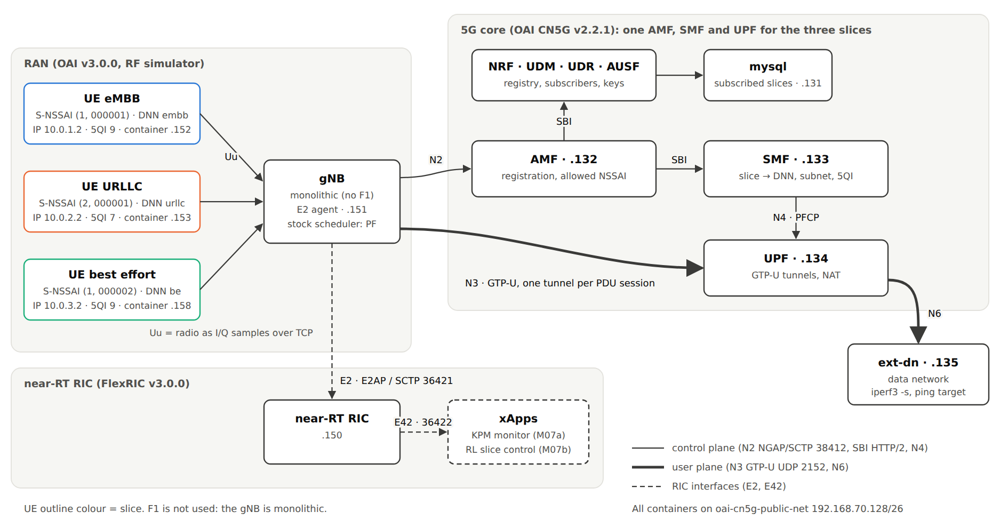
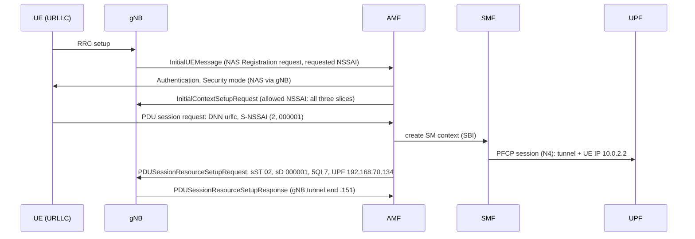
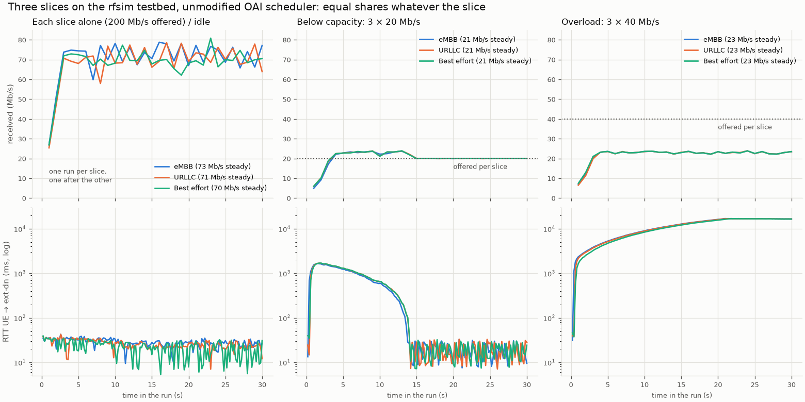
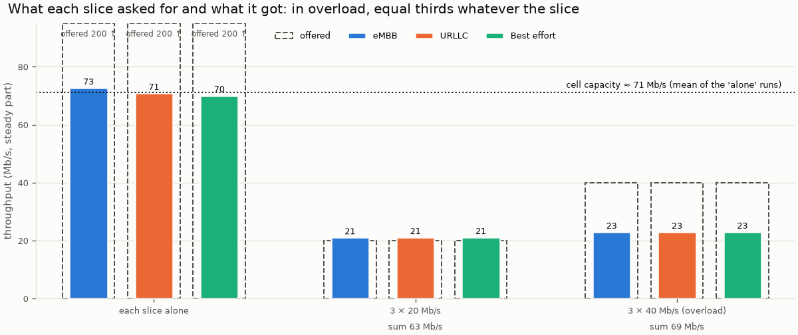
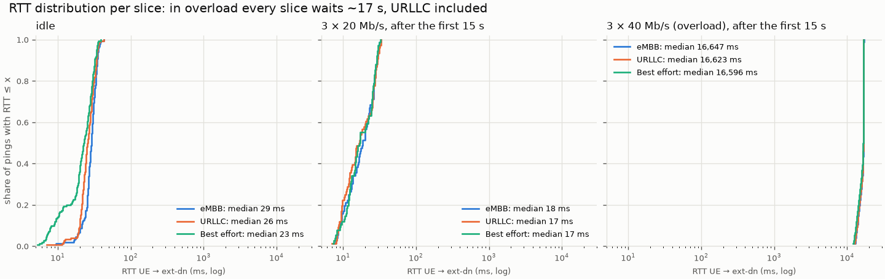
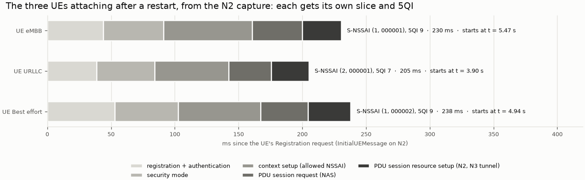
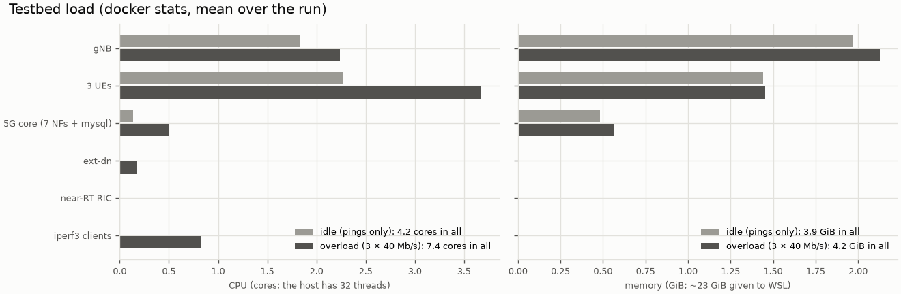

# M06 — The testbed: three slices end to end on OAI in rfsim

## 1. What we built

The M06 spike ran OAI's 5G core, gNB and three UEs with **one** slice for everyone. Now the
testbed has **three real slices**, eMBB, URLLC and best effort, configured the same way in every
layer: the core (AMF, SMF, UPF), the subscriber database, the gNB and the UEs. There is one UE
per slice, and each slice has its own DNN and IP subnet. `testbed/up.sh` starts everything in
the order that works and checks each UE. `testbed/traffic.py` runs per-slice traffic and records
throughput, round-trip time and CPU/RAM. A test checks that all configuration files agree. The
main result: the slices exist in the signalling, but **the stock OAI scheduler ignores them**.
In overload every slice gets the same share and the same 16 s delay, URLLC included. That is the
gap M07b fills.

## 2. Why it exists in the architecture

This is the **"RAN et cœur 5G open source"** box of figure 2: OAI gNB + nrUE (rfsim) + OAI CN5G,
with the slices eMBB / URLLC / best effort. It is the second backend behind the `Backend`
interface: what the RL xApp will control in M07b, and what the KPM xApp will measure in M07a.
Both need slices the RAN can tell apart:
- **M07a** maps KPM reports to slices by S-NSSAI;
- **M07b's** custom scheduler caps each slice's PRBs by the `nssai` of each scheduling candidate.

## 3. How it works

### Containers and interfaces

| Container | Role | Address | Image |
|---|---|---|---|
| `mysql` | Subscriber database (keys, subscribed slices) | 192.168.70.131 | mysql:9.6 |
| `oai-nrf` | Registry: the other NFs find each other here | .130 | oai-nrf:v2.2.1 |
| `oai-udr`, `oai-udm`, `oai-ausf` | Subscriber data and authentication | .136, .137, .138 | v2.2.1 |
| `oai-amf` | Access and mobility: registration, NAS, slice check | .132 | oai-amf:v2.2.1 |
| `oai-smf` | Sessions: picks DNN, IP and QoS per slice, programs the UPF | .133 | oai-smf:v2.2.1 |
| `oai-upf` | User plane: GTP-U tunnels to the gNB, NAT to the data network | .134 | oai-upf:v2.2.1 |
| `oai-ext-dn` | "The Internet": the traffic source (`iperf3 -s`) | .135 | trf-gen-cn5g |
| `nearRT-RIC` | FlexRIC near-RT RIC | .150 | oai-flexric:v3.0.0 |
| `rfsim5g-oai-gnb` | gNB, monolithic, with E2 agent, radio simulated over TCP | .151 | oai-gnb:v3.0.0 |
| `rfsim5g-oai-nr-ue-{embb,urllc,be}` | One UE per slice | .152, .153, .158 | oai-nr-ue:v3.0.0 |

All of them are on one Docker bridge network, `oai-cn5g-public-net` (192.168.70.128/26).

| Interface | Between | Protocol (transport) | Carries |
|---|---|---|---|
| Uu (rfsim) | UE ↔ gNB | the radio, simulated as I/Q samples over TCP | everything the UE sends or receives |
| N1 | UE ↔ AMF, through the gNB | NAS, inside N2 | registration, authentication, PDU session requests (DNN, S-NSSAI) |
| **N2** | gNB ↔ AMF | NGAP over **SCTP** (port 38412) | UE contexts, PDU session setup with S-NSSAI and QoS (5QI) |
| **N3** | gNB ↔ UPF | GTP-U over UDP (2152) | user data, one tunnel per PDU session |
| N4 | SMF ↔ UPF | PFCP over UDP (8805) | the rules telling the UPF which tunnel and IP belong together |
| N6 | UPF ↔ ext-dn | plain IP (NAT) | user data to and from the data network |
| SBI | between the core NFs | HTTP/2 + JSON | NF registration (NRF), subscriber data, session management |
| **E2** | gNB ↔ near-RT RIC | E2AP over **SCTP** (36421) | KPM reports now; slice control in M07b |
| F1 | — | — | **not used**: the gNB is monolithic, with no CU/DU split |

N2 and E2 need the SCTP kernel module. WSL has it as a module, `CONFIG_IP_SCTP=m`, which is
lost after `wsl --shutdown`.

### The slices

| Slice | S-NSSAI (SST, SD) | DNN | UE subnet | 5QI | UE (IMSI) |
|---|---|---|---|---|---|
| eMBB | 1, 000001 | `embb` | 10.0.1.0/24 | 9 | 001010000000002 |
| URLLC | 2, 000001 | `urllc` | 10.0.2.0/24 | 7 | 001010000000003 |
| Best effort | 1, 000002 | `be` | 10.0.3.0/24 | 9 | 001010000000004 |

SST is the 3GPP slice/service type (1 = eMBB, 2 = URLLC). SD (slice differentiator) tells apart
two slices of the same type, so best effort is an eMBB-type slice with its own SD.

### The code path

1. **The core announces the slices** ([config.yaml:106](../../testbed/oai-cn5g/conf/config.yaml#L106)).
   - Three YAML anchors (`&embb_slice`...) define the S-NSSAIs once.
   - Each anchor is reused in:
     - the AMF's supported NSSAI (line 140), which it checks at registration;
     - the SMF info (line 172), which says which DNN serves which slice;
     - the SMF's per-slice QoS profile (line 186; 5QI 7 for URLLC);
     - the UPF info (line 213).
   - The `dnns` (line 240) give each DNN its subnet.
   - This follows oai-cn5g-fed v2.2.1 `docker-compose/conf/basic_nrf_config.yaml`: one SMF and
     one UPF serving several slices.
2. **Each subscriber has its slice**
   ([oai_db.sql:157](../../testbed/oai-cn5g/database/oai_db.sql#L157)).
   `AccessAndMobilitySubscriptionData.nssai` lists the subscribed S-NSSAI per IMSI, as in
   oai-cn5g-fed v2.2.1 `database/oai_db2.sql`. **What the N2 capture shows, though:** every UE's
   InitialContextSetupRequest carries an *Allowed NSSAI* with all three slices, and the UEs'
   Registration requests carry no Requested NSSAI. So in this setup the subscription rows do not
   narrow anything. The slice a UE uses comes from its own PDU session request (step 4). Why the
   AMF does not restrict it (its own logic, or the UDM data it fetches) was not investigated.
3. **The gNB announces the three slices to the AMF** in its NG Setup
   ([gnb.conf:21](../../testbed/rfsim-flexric/conf/gnb.conf#L21)). The AMF rejects a gNB or a UE
   whose slices it does not support.
4. **Each UE asks for its slice** ([nrue-urllc.conf:9](../../testbed/rfsim-flexric/conf/nrue-urllc.conf#L9)):
   one PDU session with its DNN, `nssai_sst` and `nssai_sd`. Each UE has its own config file, so
   the compose file no longer passes `--uicc0.imsi`.
5. **Ordered start** ([up.sh](../../testbed/up.sh)):
   - it checks that SCTP is loaded (line 24) and Docker is reachable; it never runs sudo;
   - it starts core → RIC → gNB → UEs, waiting for healthy containers between steps (line 33);
   - it waits for each UE's tunnel `oaitun_ue1`, then prints slice, IP and a ping to ext-dn.
   `down.sh` stops in reverse order.
6. **Traffic and measurements** ([traffic.py](../../testbed/traffic.py)):
   - **Downlink iperf3 (UDP) per slice** (line 68). ext-dn sends to the UE's address, and the
     iperf3 client runs in a throwaway netshoot container sharing the UE's network namespace,
     so the UE image stays unchanged.
   - **Pings from each UE** every 0.2 s (line 76). The echo reply queues in the gNB behind that
     UE's downlink data, so the RTT shows the slice's downlink queueing.
   - **`docker stats`** sampled in a thread (line 83).
   - The UE ↔ slice mapping is one dict (line 36); M07a reuses it.
7. **Consistency test** ([tests/test_testbed_config.py](../../tests/test_testbed_config.py)).
   - It checks that the same three (SST, SD) and DNNs appear in the core config, gNB, UE configs,
     compose file and database.
   - It reads values as text: PyYAML's default loader turns `sd: 000001` into the integer 1 (and
     `000010` into octal 8), while OAI reads a hex string.
   - Putting the BE UE on the eMBB SD makes it fail (tried by hand).

## 4. Diagram



The source is [img/M06-topology.svg](img/M06-topology.svg), drawn by hand like the README's
figures. The PNG is a headless-browser export. UE outlines carry the slice colours. Thin lines are
control plane, thick lines user plane, dashed lines the RIC interfaces.

One PDU session, as captured on N2 ([results/m06/n2_pdu_session_setup.txt](../../testbed/results/m06/n2_pdu_session_setup.txt)):



## 5. How to run it and check it works

```bash
sudo modprobe sctp                          # once after each WSL restart (needs your password)
testbed/up.sh                               # ~45 s; expected:
#   slice  container                 UE IP        ping ext-dn
#   embb   rfsim5g-oai-nr-ue-embb    10.0.1.2     ok
#   urllc  rfsim5g-oai-nr-ue-urllc   10.0.2.2     ok
#   be     rfsim5g-oai-nr-ue-be      10.0.3.2     ok
uv run python testbed/traffic.py idle                       # baseline RTT per slice
uv run python testbed/traffic.py alone --rate 200M          # capacity, one slice at a time
uv run python testbed/traffic.py together 20M 20M 20M       # below capacity
uv run python testbed/traffic.py together 40M 40M 40M       # overload
uv run python testbed/plot_m06.py                           # the two figures below
testbed/down.sh
uv run pytest -q tests/test_testbed_config.py               # 11 passed, no testbed needed
```

**Proof that the slices are per UE** (the saved files in `testbed/results/m06/`):
- **SMF log** ([attach_evidence.txt](../../testbed/results/m06/attach_evidence.txt)): one PDU
  session per UE, for example `imsi-001010000000003 dnn=urllc sNssai=(sst 2, sd 000001)`.
- **N2 capture**: each `PDUSessionResourceSetupRequest` carries the UE's own S-NSSAI and 5QI:
  `sST 02 / sD 000001 / fiveQI 7` for URLLC, `01/000001/9` for eMBB, `01/000002/9` for best
  effort. To open it in Wireshark: `testbed/captures/m06_n2_ngap.pcap` (not in git, regenerated
  by the capture in §6).

### Measurements (2026-11-02, single runs of 30 s)

| Run | eMBB | URLLC | Best effort |
|---|---|---|---|
| Idle: RTT median (p95) | 29 (36) ms | 26 (35) ms | 23 (34) ms |
| Alone, 200 Mb/s offered: received (steady) | 73 Mb/s | 71 Mb/s | 70 Mb/s |
| 3 × 20 Mb/s: received, delivered | 21.1 Mb/s, 100 % | 21.1 Mb/s, 100 % | 21.1 Mb/s, 100 % |
| 3 × 20 Mb/s: RTT after the first 15 s, median (p95) | 18 (30) ms | 17 (32) ms | 17 (30) ms |
| 3 × 40 Mb/s: received, delivered | 22.9 Mb/s, 54 % | 22.9 Mb/s, 54 % | 23.0 Mb/s, 55 % |
| 3 × 40 Mb/s: RTT after the first 15 s, median | 16.7 s | 16.6 s | 16.6 s |

- **Capacity: ~71 Mb/s** (70–73) from any slice alone, close to the spike's ~75 Mb/s that the
  simulator is calibrated to. In overload the three slices together get 68.8 Mb/s.
- **The scheduler splits equally, whatever the slice.** At 3 × 40 Mb/s each slice gets a third,
  and every queue grows until the RTT reaches ~16.6 s, the URLLC slice's too. The v3.0.0 default
  allocator (`nr_dl_proportional_fair` in
  `openair2/LAYER2/NR_MAC_gNB/gNB_scheduler_dlsch_default_policies.c`) never reads the 5QI,
  the priority or the `nssai` that each scheduling candidate carries. The slices and the 5QI 7 are
  signalling only. Making the split follow the slices is exactly what M07b's policy will do.
- **A start-up transient.** After an idle period, the first seconds deliver only 6, 10, then
  19 Mb/s while link adaptation raises the MCS. With 60 Mb/s offered, a queue builds, and it takes
  about 15 s to drain (RTT up to 1.6 s, then back to ~17 ms). `traffic.py` reports the RTT
  after the first 15 s separately. M08 should start measuring after a warm-up.
- **Under load, the RTT (~17 ms) is lower than idle (~26 ms).** A likely explanation: a UE with
  continuous traffic is scheduled every slot, while an idle UE must first send a scheduling
  request. Not checked further.
- **Resources:** about **4.2 GiB** and **4.3 cores** idle, **7.4 cores** in overload, of 32
  threads. The gNB (~2 cores, 2.2 GiB) and the UEs (~1.2 cores and 0.5 GiB each) dominate. The
  core uses about 0.6 GiB and the RIC almost nothing. That leaves plenty for FlexRIC xApps, the RL
  runner, the agent and Grafana.

### Visualization



All figures in this section are produced by `uv run python testbed/plot_m06.py` from
`testbed/results/m06/` (no testbed needed). How to read the first one:
- **Columns:** one slice at a time (and the idle RTT), three slices below capacity, three slices
  in overload.
- **Top row:** received throughput per second. In overload the three lines are on top of each
  other at ~23 Mb/s, far below the dotted 40 Mb/s offered: equal shares.
- **Bottom row:** RTT, on a log scale.
  - Below capacity, the start-up hump (link adaptation) drains by 15 s.
  - In overload, all three slices climb together to ~17 s. Nothing protects URLLC.



**What each slice asked for and what it got** (steady part of each run). Dashed outlines are the
offered rate, filled bars what arrived.
- Alone, every slice is capped by the cell, at about 71 Mb/s (dotted line).
- At 3 × 20 Mb/s everything fits (sum 63 Mb/s).
- At 3 × 40 Mb/s the sum stays at the capacity (69 Mb/s) and is cut into **equal thirds**. URLLC
  gets the same 23 Mb/s as best effort. This is the picture M07b should change: once the RL
  xApp sets the split, the URLLC bar should reach its target and best effort should absorb the
  shortfall.



**RTT distributions** (empirical CDFs; the y value is the share of pings at or below the x value).
- Idle and below capacity, all slices sit between ~10 and ~40 ms (medians 17–29 ms).
- In overload the three curves jump together to ~16.6 s. The vertical line at the right means
  every ping waited about the same time: a full queue, the same for every slice.
- The x axis is logarithmic. The overload curves are three orders of magnitude to the right.



**The three attaches, from the N2 capture.** One row per UE, in ms since its Registration request.
Each phase is a stretch between two NGAP messages, from
[n2_events.tsv](../../testbed/results/m06/n2_events.tsv) (extracted from the pcap with tshark).
- Registration + authentication, security mode, the initial context setup (where the AMF sends
  the allowed NSSAI), the PDU session request in NAS, then the PDU session resource setup that
  creates the N3 tunnel.
- Each attach takes about 205–240 ms. The UEs attached one after another (URLLC first, at
  t = 3.90 s, after the restart).
- The label on the right is read from that UE's PDU session setup in the capture: its own
  S-NSSAI and 5QI.



Mean CPU (cores) and memory per group, idle and in overload. "iperf3 clients" are the throwaway
netshoot containers that receive the traffic.

### The KPM check for M07a

With the three slices, FlexRIC's stock `xapp_kpm_moni` still gets reports, but only **cell-level**
ones: `RRC.ConnMean` and the MCS histograms
([xapp_kpm_moni_3slices.log](../../testbed/results/m06/xapp_kpm_moni_3slices.log)). There is no
per-UE `DRB.UEThpDl`, `RRU.PrbTotDl` or `DRB.RlcSduDelayDl`, which the spike's single-slice run
had. This matches the risk noted in the spike: the stock xApp's per-UE subscription filters
on the S-NSSAI (1, 0xFFFFFF), "SST 1, no SD", which no UE has any more. I have not read the
xApp's source to confirm, so this is the likely cause. **For M07a:** our own xApp subscribes once
per slice, with that slice's S-NSSAI in the filter.

## 6. Choices and simplifications

- **One AMF, one SMF, one UPF for all three slices.** The official slicing tutorial
  (`DEPLOY_SA5G_SLICING.md`) uses an NSSF, several SMFs and UPFs and one gNB per slice. That shows
  core-side slice selection, which this project does not study, and costs RAM. Our model is the
  basic deployment's config, where one SMF/UPF serves several S-NSSAIs.
- **One DNN and subnet per slice.** A UE's IP shows its slice (10.0.1/2/3.x), so traffic scripts
  and captures need no lookup table.
- **Standard SSTs + SD** (your choice). eMBB (1, 000001) and URLLC (2, 000001) use the standard
  types. Best effort is (1, 000002), an eMBB-type slice told apart by its SD. The OAI slicing
  tutorial notes that "rf-simulator only supports SST values 1,2,3,4", which ours respect.
  Rejected: SST 128 for best effort, a non-standard type for no gain.
- **Per-slice QoS from the SMF's `local_subscription_infos`**
  (`use_local_subscription_info: yes`, kept from the tutorial). The QoS rows in the database are
  then unused; we updated their slice and DNN anyway so nothing contradicts.
- **One config file per UE** instead of a shared file plus a `--uicc0.imsi` override, so each
  file states its slice.
- **Found and fixed:** `mysql-healthcheck.sh` had been committed in the spike without its
  executable bit. The healthcheck failed with "Permission denied", so mysql never became
  healthy, and the first `up.sh` timed out after 5 minutes. The spike never waited for
  "healthy", so it went unnoticed.
- **Captures stay out of git** (as in the spike): the N2 pcap is small, but `testbed/captures/`
  is ignored. The decoded excerpt is committed. To regenerate it, with the testbed up:
  `docker run -d --rm --net container:oai-amf -v $PWD/testbed/captures:/cap nicolaka/netshoot
  timeout 60 tcpdump -i eth0 -w /cap/m06_n2_ngap.pcap sctp`, then restart the three UE services.
- **Limits:**
  - single runs, no repetitions, so no spread; fine for checking the setup, but M08 repeats runs;
  - identical AWGN channels for all UEs, so there is no channel diversity;
  - downlink only;
  - ping RTT includes the uplink and the core, not only the downlink queue;
  - the stock `xapp-kpm-moni` was started once with traffic, then removed by `down.sh` (E2 state
    is fragile across xApp restarts, spike lesson).
- **What a real network does differently:** a slice-aware scheduler (or per-slice PRB quotas
  configured from the OAM), separate UPFs and often separate SMFs per slice, NSSF-based slice
  selection, per-slice QoS enforced at the UPF (AMBR, GBR) and the gNB, and real radio channels.

## 7. Questions to check understanding

1. **Which interfaces need SCTP, and what happens if the module is missing?** N2 (gNB ↔ AMF)
   and E2 (gNB ↔ RIC). Without the module the gNB cannot open them: no NG Setup, no UE can
   register, and no KPM. `up.sh` checks `/proc/modules` and stops before starting anything.
2. **Where does the AMF learn which slices exist, and which a UE may use?** Which slices exist:
   its own `plmn_support_list.nssai`, checked against the gNB's NG Setup. Which a UE may use: in
   principle its subscription in the UDM (the `AccessAndMobilitySubscriptionData.nssai` row),
   checked against the slices the UE requests, giving the Allowed NSSAI of the
   InitialContextSetupRequest. In our capture the Allowed NSSAI lists all three slices for every
   UE, and the UEs request none. So here the slice is set by the UE's PDU session request, and the
   core's per-slice DNN, subnet and 5QI follow from it.
3. **In the N2 capture, how do you tell which UE is URLLC?** In its
   `PDUSessionResourceSetupRequest`: `sST 02, sD 000001` and `fiveQI 7`. The other two have
   SST 01, with SD 000001 or 000002, and 5QI 9.
4. **Why does the URLLC slice reach a 16 s RTT in overload, although it has 5QI 7?** The 5QI
   and the S-NSSAI travel in signalling, but the v3.0.0 default scheduler (proportional fair)
   reads neither. All three UEs get equal shares, every queue grows the same way, and nothing
   tells the gNB to protect URLLC. Controlling the per-slice PRB split is what M07b adds.
5. **Why did the stock KPM xApp stop giving per-UE reports, and what does M07a do about it?** Its
   per-UE subscription filters on the S-NSSAI (1, no SD), and every UE now has an SD, so no UE
   matches. Only cell-level reports remain (the likely cause; the source was not read). M07a's
   xApp subscribes once per slice with that slice's S-NSSAI.
