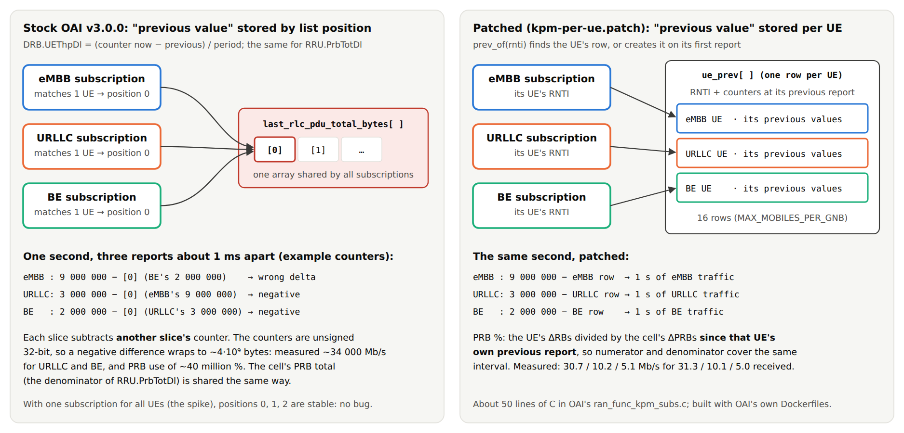
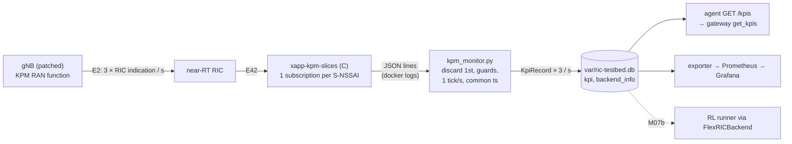
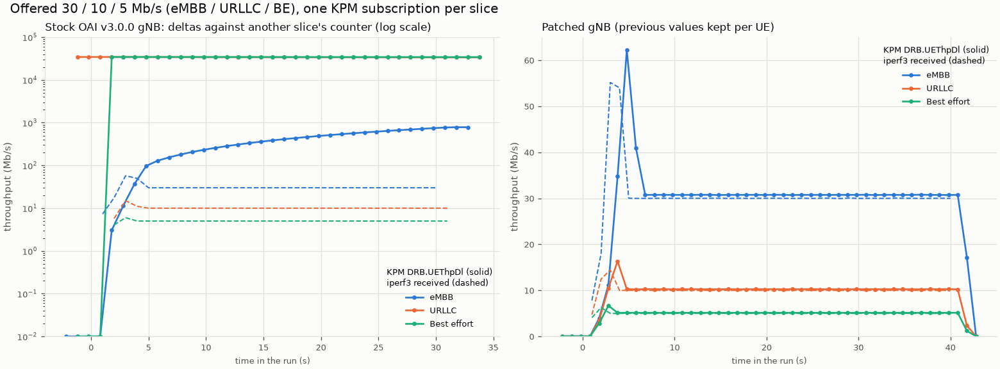
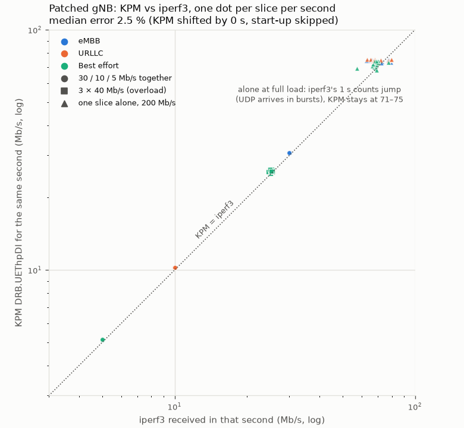
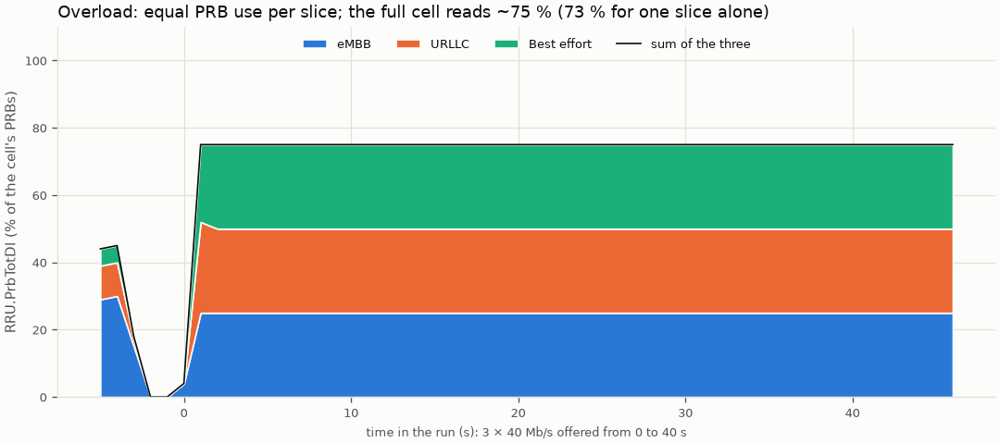
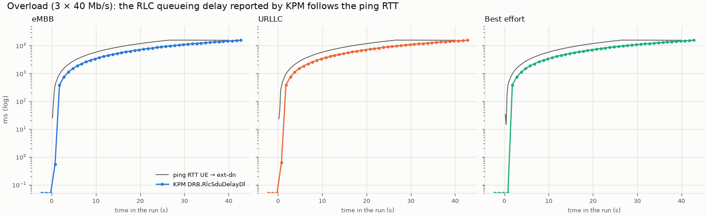
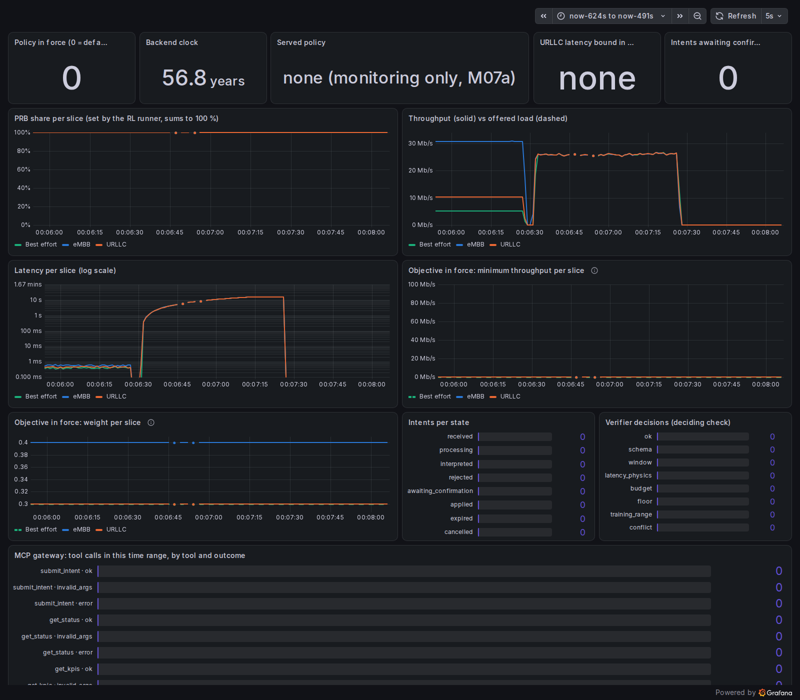
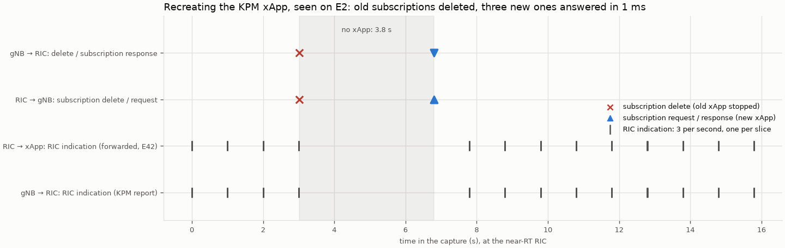
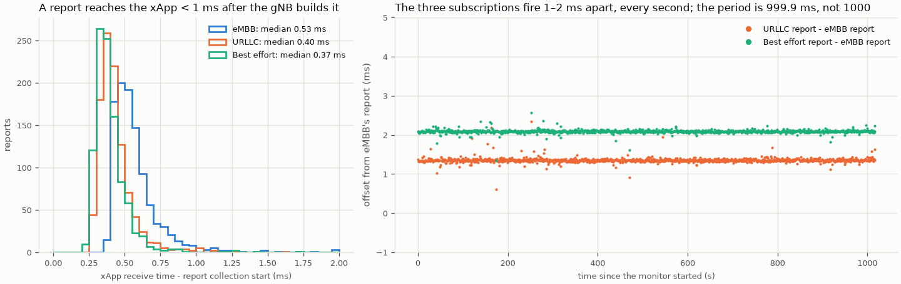

# M07a: the KPM monitoring xApp (testbed KPIs into the KPI store)

## 1. What we built

We built an xApp that reads per-slice measurements from the real gNB over E2 and writes them
into the KPI store. It produces one record per slice per second, the same `KpiRecord` the
simulator writes. The xApp has two halves:

- a small C program on the near-RT RIC. It holds one KPM subscription per slice and prints one
  JSON line per UE per report;
- a Python process that turns those lines into KPI rows.

The agent's `GET /kpis`, the MCP gateway's `get_kpis` and the Grafana dashboard read testbed
data without a single change. Getting there took two fixes:

- **a bug in OAI's gNB** (v3.0.0) that makes per-slice subscriptions report nonsense. We patch it
  and build our own gNB image;
- **a measurement-order trap** that made the latency always read 0.

## 2. Where it sits in the architecture

This is the **"xApp KPM"** box of the proposal's figure 2, together with the arrow into the
**KPI store**. In CLAUDE.md's diagram:
`KPM monitoring xApp → KPI store → read by the RL xApp, the LangGraph service and get_kpis`.

It is **meeting point #1** in `docs/PLAN.md` §2. Real measurements land in the same table, with
the same record, as the simulator's, so everything above the store works on both. It is also
the fallback of proposal §9: real KPM on the testbed, even if control stays on the simulator.

KPM only *reports*; nothing here changes the radio. Control over E2 (the PRB split) is M07b.

## 3. How it works

**Two words first.** An **E2 service model (SM)** is a contract between the RIC and the gNB
about one kind of data or control. It says what can be asked for, how a request is encoded, and
what comes back. E2AP is only the envelope; the SM defines the content. The gNB advertises its
SMs ("RAN functions") at E2 Setup (we saw 8 in the spike).

**KPM** (Key Performance Measurement, O-RAN E2SM-KPM v3.00) is the standard SM for counters. An
xApp *subscribes* with three things:

- an **event trigger**: report every 1000 ms;
- a **report style**:
  - style 1 gives cell-level counters;
  - style 4 gives per-UE counters for the UEs that match a condition, for example
    "S-NSSAI = (2, 000001)";
- the **measurement names**, from 3GPP TS 28.552.

The gNB then sends one *RIC indication* per period, carrying values measured over that period
(the *granularity period*).

The walk-through:

1. **One subscription per slice.** `main`
   ([xapp_kpm_slices.c:184](../../xapps/kpm/xapp_kpm_slices.c#L184)) finds the gNB's KPM RAN
   function and checks it offers style 4. It then sends three subscriptions
   ([xapp_kpm_slices.c:213](../../xapps/kpm/xapp_kpm_slices.c#L213)), one per row of the slice
   table ([xapp_kpm_slices.c:40](../../xapps/kpm/xapp_kpm_slices.c#L40)).
2. **The condition is the full S-NSSAI.** `snssai_condition`
   ([xapp_kpm_slices.c:117](../../xapps/kpm/xapp_kpm_slices.c#L117)) encodes 4 bytes: SST, then
   SD (big-endian).
   - The stock FlexRIC xApp sends one byte (SST 1). OAI matches a 1-byte condition only against
     UEs whose SD is `0xFFFFFF` ("no SD").
   - That is why M06's stock xApp got no per-UE reports once our slices had SDs.
   - The capture shows the three conditions on the wire:
     [e2_subscriptions.txt](../../testbed/results/m07a/e2_subscriptions.txt).
3. **Three measurements, delay first**
   ([xapp_kpm_slices.c:50](../../xapps/kpm/xapp_kpm_slices.c#L50)): `DRB.RlcSduDelayDl` (µs),
   `DRB.UEThpDl` (kb/s), `RRU.PrbTotDl` (% of the cell's PRBs). The order matters: see §6.
4. **One callback per slice.** FlexRIC's callback type has no "user data" argument, so the
   callback cannot be told which subscription a report belongs to. Three one-line functions
   (`cb_embb`, `cb_urllc`, `cb_be`,
   [xapp_kpm_slices.c:110](../../xapps/kpm/xapp_kpm_slices.c#L110)) each call `on_report` with
   their slice index. The slice of a report is known from the subscription, never guessed from
   the UE.
5. **JSON lines out.** `print_ue`
   ([xapp_kpm_slices.c:68](../../xapps/kpm/xapp_kpm_slices.c#L68)) prints for example
   `{"slice":"urllc","collect_start_us":…,"amf_ue_ngap_id":3,"DRB.RlcSduDelayDl":440.0,"DRB.UEThpDl":10180.3,"RRU.PrbTotDl":10}`.
   The C part does no arithmetic: everything that can be tested lives in Python.
6. **Python reads the lines.** `kpm_monitor` follows `docker logs -f xapp-kpm-slices`
   ([kpm_monitor.py:229](../../xapps/kpm_monitor.py#L229)). `parse_line`
   ([kpm_monitor.py:64](../../xapps/kpm_monitor.py#L64)) keeps our JSON and ignores FlexRIC's
   own log lines.
7. **Guards** in `SliceAggregator.add`
   ([kpm_monitor.py:152](../../xapps/kpm_monitor.py#L152)):
   - the first report after each subscription is discarded, because it covers "since the
     counters started", not one period;
   - a value that cannot be real is refused and logged (`implausible`,
     [kpm_monitor.py:91](../../xapps/kpm_monitor.py#L91)): over 100 % of the cell, or over twice
     its capacity.
8. **One KPM report becomes one KPI row** (`to_record`,
   [kpm_monitor.py:106](../../xapps/kpm_monitor.py#L106)), for the slice's UEs in one period:
   - `dl_thr_mbps` = Σ `DRB.UEThpDl` / 1000;
   - `prb_used` = (Σ `RRU.PrbTotDl` / 100) / `prb_share_alloc`;
   - `latency_ms` = max `DRB.RlcSduDelayDl` / 1000 (the worst UE counts, as for URLLC);
   - `n_ue` = the number of UEs;
   - `prb_share_alloc` = 1.0 (no per-slice cap yet, §6);
   - `offered_load_mbps` and `buffer_bytes` = NULL (KPM does not measure them).
9. **One tick per second, one timestamp** (`tick`,
   [kpm_monitor.py:173](../../xapps/kpm_monitor.py#L173)).
   - The three subscriptions report about 1 ms apart, but each with its own timer. Each tick
     writes every slice's newest report (sample and hold) with a **common `ts`**, because the
     exporter reads a tick as "the rows at `MAX(ts)`"
     ([exporter.py:116](../../monitoring/exporter.py#L116)).
   - A slice with no report for 2 s is left out and logged as `slice_stale`.
10. **The store.** The rows go to `var/ric-testbed.db`, never to the simulator's `var/ric.db`:
    the two clocks differ (wall time vs. simulated time). At startup, `cell_info`
    ([kpm_monitor.py:190](../../xapps/kpm_monitor.py#L190)) publishes the cell in `backend_info`
    (source `flexric`, 106 PRB, the calibrated 75 Mb/s), so `/status` and the verifier work.

**The gNB patch** ([kpm-per-ue.patch](../../testbed/gnb/kpm-per-ue.patch), about 50 lines in
OAI's `ran_func_kpm_subs.c`).
- **The problem.** `DRB.UEThpDl` and `RRU.PrbTotDl` are *differences*: the counter now, minus
  its value at the previous report. Stock OAI keeps the "previous value" in file-level arrays
  indexed by the UE's *position in one subscription's match list*.
  - With one UE per slice, all three subscriptions use position 0. Each overwrites the others'
    previous value, so every delta is taken against another slice's counter. The counters are
    unsigned 32-bit, so a negative difference wraps around to about 4·10⁹.
  - The cell's PRB total, the denominator of `RRU.PrbTotDl`, is shared the same way.
- **The fix.** `prev_of(rnti)` (patch line 26) keeps the previous values **per UE, by RNTI**,
  including the cell's PRB total at that UE's previous report. Each UE's PRB % is then its own
  ΔRBs over the cell's ΔPRBs for the same interval.



The diagram above is hand-drawn: [M07a-kpm-bug.svg](img/M07a-kpm-bug.svg), exported to PNG with a
headless browser. Its counter values are an illustration; the measured consequences are in the
captions.

## 4. Diagram

The data path, from the gNB's counters to the readers of the store. Every hop is checked on the
real testbed in §5.



## 5. How to run it and check it works

Build once (both builds are long; the gNB one takes most of an hour):

```bash
testbed/gnb/build.sh                                            # -> agentic-ric/oai-gnb:v3.0.0-kpmfix
docker build -t agentic-ric/xapp-kpm-slices:v3.0.0 xapps/kpm    # FlexRIC v3.0.0 from source + our xApp
```

Run (SCTP loaded, `sudo modprobe sctp`, as in M06):

```bash
testbed/up.sh                     # step 5/5 prints three {"event":"subscribed",...,"ok":true}
uv run python -m xapps.kpm_monitor --raw-out testbed/results/m07a/patched_monitor_raw.jsonl &
uv run python testbed/traffic.py together 30M 10M 5M --results testbed/results/m07a
RIC_DB=var/ric-testbed.db uv run uvicorn agent.service:app --port 8000 &
curl -s 'localhost:8000/kpis?window_s=10'      # slices embb/urllc/be, "source" in /status: flexric
uv run python -m gateway.client kpis           # the same through the MCP gateway
uv run python testbed/plot_m07a.py             # the figures below (data plots)
testbed/down.sh
```

Expected: `/status` shows `"backend": {"source": "flexric", "n_prb": 106, ...,
"model_version": "none (monitoring only, M07a)"}`. `get_kpis` returns about 30 / 10 / 5 Mb/s
for this traffic.

Tests (CI, no testbed): `uv run pytest -q tests/test_kpm_monitor.py tests/test_testbed_config.py`.
- They replay JSON lines through the aggregation and through the agent's `GET /kpis`.
- One replays a real recording from the testbed (`tests/data/kpm_lines.jsonl`).
- One checks that the xApp's slice table matches the testbed configs.

**Figure 1: the bug and the fix**
([M07a-stock-vs-patched.png](img/M07a-stock-vs-patched.png)).



The same traffic (30 / 10 / 5 Mb/s) runs on both gNBs. Solid lines are KPM `DRB.UEThpDl`,
dashed lines are what iperf3 received.
- **Left (stock gNB, log scale):**
  - URLLC and BE read about 34 000 Mb/s, which is a wrapped counter;
  - eMBB climbs steadily to about 800 Mb/s;
  - none of them is close to the dashed truth.
- **Right (patched gNB):** each solid line sits on its dashed line.
  - From 10 to 30 s, KPM gives 30.7 / 10.2 / 5.1 Mb/s against iperf3's 31.3 / 10.1 / 5.0.
  - The spike at the start is the link-adaptation transient seen in M06; iperf3 sees it too.
  - KPM lags iperf3 by about one report, because a report describes the period that just ended.

| Run (patched gNB) | iperf3 received (Mb/s) | KPM `DRB.UEThpDl` (Mb/s) | KPM `RRU.PrbTotDl` | KPM RLC delay |
|---|---|---|---|---|
| 30 / 10 / 5 Mb/s | 31.3 / 10.1 / 5.0 | 30.7 / 10.2 / 5.1 | 29 / 10 / 5 % | median 0.56 / 0.44 / 0.38 ms |
| 3 × 40 Mb/s (overload) | 25.2 / 25.2 / 25.1 | 25.8 / 25.8 / 25.8 | 25 / 25 / 25 % | up to 15.5 s (ping: 15.7 s) |
| one slice alone, 200 Mb/s | 70.0 / 70.6 / 68.1 | 73.5 / 74.6 / 70.9 | 73 % | |

KPM counts RLC PDU bytes, so it reads a little above iperf3 when the cell is full: headers and
retransmissions count too.

**Figure 2: KPM against iperf3, second by second** ([M07a-parity.png](img/M07a-parity.png)).



Each dot is one slice during one second of a patched run. Colour is the slice, shape is the run;
both axes are logarithmic so 5 Mb/s and 75 Mb/s fit on one plot. A perfect monitor puts every dot
on the dotted diagonal.
- **Median error: 2.5 %**, with the first 6 s of each run skipped (link adaptation).
- The script tries shifting KPM by 0, 1 and 2 s and keeps the best fit; here 0 s fits best.
- Below capacity the dots sit on the line.
- For one slice alone at full load, iperf3's one-second counts scatter from 57 to 80 Mb/s while
  KPM stays at 71–75. UDP arrives at the receiver in bursts, so a 1 s count at the receiver is
  noisier than the gNB's own byte counter.

**Figure 3: who uses the PRBs** ([M07a-prb.png](img/M07a-prb.png)).



In overload the unmodified scheduler gives each slice exactly the same share (25 %): the equal
split M06 measured in throughput. **A full cell reads about 75 %, not 100 %** (73 % for one
slice alone at 200 Mb/s).
- **Likely cause.** The gNB's denominator adds all 106 PRBs of *every* slot with downlink
  symbols (`gNB_scheduler_dlsch.c`, `total_prb_aggregate += bw`), including the TDD mixed slot,
  which data never fills completely. I have not proved this in the MAC code; it is a
  hypothesis that fits.
- **What it means for us.** On the testbed `prb_used` saturates near 0.74, where the simulator
  reaches 1.0. M07b must decide whether to rescale it before the policy sees it.
- **Reading the figure.** Before 0 s you see the end of the previous run. The plateau lasts
  after 40 s while the queues built during the overload drain.

**Figure 4: KPM latency vs ping** ([M07a-delay-vs-rtt.png](img/M07a-delay-vs-rtt.png)).



During the overload, `DRB.RlcSduDelayDl` (how long a packet waited in the gNB's RLC queue,
averaged over 100 ms) grows like the ping RTT and peaks at 15.5 s, against 15.7 s for ping. The
ping reply waits in the same queue, so the two should match, and they do. Below capacity the
RLC delay is about 0.5 ms, while ping says about 22 ms. Ping also counts the radio's TDD
pattern, the core and the return path; RLC delay is only the gNB queue. So **`latency_ms` on
the testbed is queueing delay, not end-to-end latency**.

**Grafana, unchanged** ([M07a-grafana.png](img/M07a-grafana.png)).



The M04a dashboard, with the exporter pointed at `var/ric-testbed.db`
(`RIC_DB=var/ric-testbed.db uv run python -m monitoring.exporter`). The throughput panel shows
30 / 10 / 5 Mb/s, then about 25.8 Mb/s per slice in overload. The latency panel goes from about
0.5 ms to about 16 s.

Three panels were designed for the simulator and read oddly here:
- "Backend clock 56.8 years": wall-clock seconds since 1970, shown as a duration;
- PRB share at 100 % for every slice: there is no cap yet;
- the objective panels show the default objective, although nothing applies it on the testbed.

**E2 on the wire** ([e2_subscriptions.txt](../../testbed/results/m07a/e2_subscriptions.txt),
from `testbed/captures/m07a_e2.pcap` at the RIC). Recreating the xApp container produced this
sequence:
1. the RIC sends three `RICsubscriptionDeleteRequest`s to the gNB for the old xApp;
2. the new xApp's three `RICsubscriptionRequest`s each get a `RICsubscriptionResponse` within
   1 ms.

Inside each request is the 4-byte S-NSSAI: `01 00 00 01`, `02 00 00 01`, `01 00 00 02`.
Wireshark cannot decode the KPM payload itself here: it learns which SM a RAN function uses from
the E2 Setup, which happened before the capture started.



The same capture as a timeline ([M07a-e2-timeline.png](img/M07a-e2-timeline.png), data in
[e2_events.tsv](../../testbed/results/m07a/e2_events.tsv)). Each row is one direction of one
link, as seen at the RIC.
- **Bottom two rows:** the gNB sends three RIC indications per second (one per slice, ~1 ms apart,
  so the three marks overlap), and the RIC forwards each one to the xApp over E42.
- **At 3.0 s:** the old xApp stops. The three subscription deletes and their responses go out
  together.
- **3.8 s with no xApp** (grey): the gNB sends nothing, so no report piles up anywhere.
- **At 6.8 s:** the new xApp's three subscription requests are each answered within 1 ms, and
  indications resume one period later.
- The xApp's own requests to the RIC travel over E42, FlexRIC's own extension of E2AP, which
  Wireshark does not decode, so they are not on the plot.

**How fast and how regular the reports are**
([M07a-report-timing.png](img/M07a-report-timing.png), from all patched runs, about 1000 s).



- **Left:** the time from "the gNB starts the report" (`collectStartTime`) to "our xApp has it"
  is 0.4–0.5 ms in the median. E2 and E42 transport add almost nothing next to the 1 s period.
- **Right:**
  - **Timers:** each subscription has its own 1000 ms timer, started when it was accepted. The
    URLLC report comes 1.3 ms after eMBB's and BE's 2.1 ms after, for the whole run.
  - **Writer:** this is why `kpm_monitor` collects per tick instead of waiting for "the three
    reports of a second", which never arrive at the same instant.
  - **Clock:** the timers run at 999.9 ms, not 1000. It shows up as a slow drift of where in the
    wall-clock second the reports fall (about 0.1 s over 1000 s). The 1 s ticks are wall-clock
    based, so this is harmless.

## 6. Choices and simplifications

- **We patched the gNB instead of avoiding the bug** (your choice). One alternative was to use
  FlexRIC's own MAC/RLC service models for throughput, since their counters are cumulative and
  the xApp could take differences itself. That is not standard O-RAN, and joining their RNTIs
  to KPM's UE IDs was unclear.
  - We confirmed the bug live first: `stock_gnb_3subs.jsonl` and Figure 1, left.
  - The patch is built with OAI's own Dockerfiles. M07b adds the slice scheduler to the same
    image.
  - The PDCP volume measurements keep the stock indexing; we do not subscribe to them.
- **The measurement-order trap.** OAI resets the RLC delay average every time it reads RLC
  statistics for *any* measurement (`get_rlc_stats_per_drb` → `nr_rlc_activate_avg_time_to_tx`).
  - With `DRB.UEThpDl` before `DRB.RlcSduDelayDl`, the delay was read microseconds after a reset:
    always 0, even with 13 s of queueing (`stock_gnb_3subs_overload.jsonl` before the fix).
  - Asking for the delay first fixes it, and needs no gNB change. The stock xApp happens to ask
    in that order, which is why the spike saw real values.
- **C for E2, Python for the meaning.** FlexRIC's Python bindings are not in the official image
  and their KPM support is unclear. The C part stays a thin adapter (about 230 lines). All rules
  live in tested Python.
- **We build the xApp from FlexRIC v3.0.0 source** (the official image has no SDK).
  - The builder repeats `docker/Dockerfile.flexric.ubuntu`'s steps without SWIG, and fetches
    only the pinned asn1c commit (the full clone failed on a flaky link).
  - The runtime layer *is* the official image, so the SM libraries match the RIC's.
- **`prb_share_alloc` = 1.0.** The stock scheduler has no per-slice cap, so each slice may use
  the whole cell. Any fixed number would be invented. M07b replaces it with the applied split.
- **`offered_load_mbps` is NULL.** KPM cannot see what the sender offered. The agent's summary
  then shows a load of 0 on the testbed (`agent/tools.py`), so read it as "unknown".
- **A separate testbed database.** Simulator rows use a simulated clock and testbed rows use
  wall time. In one table, `MAX(ts)` would always pick the testbed and hide the sim. M07b
  decides how the runner shares this store.
- **Sample and hold at 1 tick/s.** This keeps three rows per tick at one `ts`. The cost is that
  a slice's value can repeat once when its report arrives just after a tick.
- **The capacity in `backend_info` is the simulator's calibrated 75 Mb/s**, measured on this
  testbed in the spike, not a new number. The verifier then judges an intent the same way on
  both backends.
- **What a real system would do differently:**
  - use a KPM implementation that keeps state per subscription and per UE identity, as the
    spec intends;
  - push the measurements to a time-series database or a message bus instead of `docker logs`;
  - use one subscription with several matching conditions where the gNB supports that. OAI's
    style 4 overwrites the result for each condition, so several conditions in one subscription
    do not work here.

**Operational notes**
- **The xApp restarts cleanly** (recreated twice, plus one full `down.sh` / `up.sh`). The RIC
  deletes the old subscriptions at the gNB first (the capture above). This is better than in
  the spike, where the stock xApp was removed while the gNB still had its subscriptions.
- **The UEs' AMF IDs change from one attach to the next** (1 / 2 / 3 in a different order). That
  does not matter, because a report's slice comes from its subscription.
- **Grafana headless screenshots** need a locale. With `LANG=C.UTF-8`, headless Chromium
  reports `en-US@posix`, which Grafana 13 rejects ("Invalid language tag"). Use
  `LANG=en_US.UTF-8` and screenshot with `animations="disabled"`.

## 7. Questions to check understanding

1. **How does one KPM report become one row of the KPI store?**
   1. The gNB sends a RIC indication for a slice's subscription, with one entry per matching
      UE.
   2. The xApp prints one JSON line per UE.
   3. `kpm_monitor` groups the lines of one period, drops the first period after a
      subscription, refuses impossible values, and builds the record: throughput summed (kb/s →
      Mb/s), PRB % summed then divided by the slice's allocated share, delay as the worst UE
      (µs → ms).
   4. At the next 1 s tick it writes the three slices' records with one common `ts`.
2. **Why did the stock xApp get no per-UE reports after M06, and how does ours?** The stock
   xApp's condition is one byte, SST 1. OAI matches a 1-byte condition only against UEs with SD
   `0xFFFFFF`, and all our slices have an SD. Ours sends SST plus the 3-byte SD, which OAI
   matches exactly, and makes one subscription per slice.
3. **What was wrong with per-slice subscriptions on the stock gNB?** Throughput and PRB % are
   differences against the previous report's counter. That previous value was stored by
   position in one subscription's list, so all three one-UE subscriptions shared position 0 and
   subtracted another slice's counter. Unsigned arithmetic turned the negative results into
   about 34 000 Mb/s and 40 million %. The patch keys the previous values by RNTI.
4. **Why does the xApp ask for `DRB.RlcSduDelayDl` first?** Every RLC measurement the gNB fills
   resets the delay average after reading it. If throughput is read first, the delay read that
   follows sees an empty average and returns 0.
5. **On the testbed, what does `latency_ms` measure, and why is a full cell's `prb_used` about
   0.74?** It is the queueing delay in the gNB's RLC buffer (100 ms average, worst UE), not
   end-to-end latency: about 0.5 ms below capacity against about 22 ms for ping. The PRB % is
   relative to every PRB of every slot with downlink symbols, and the scheduler never fills all
   of them (likely the TDD mixed slot), so the full cell reads about 73–75 %.
