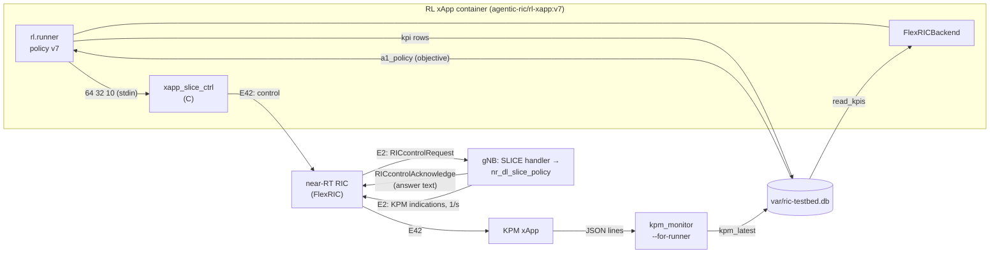
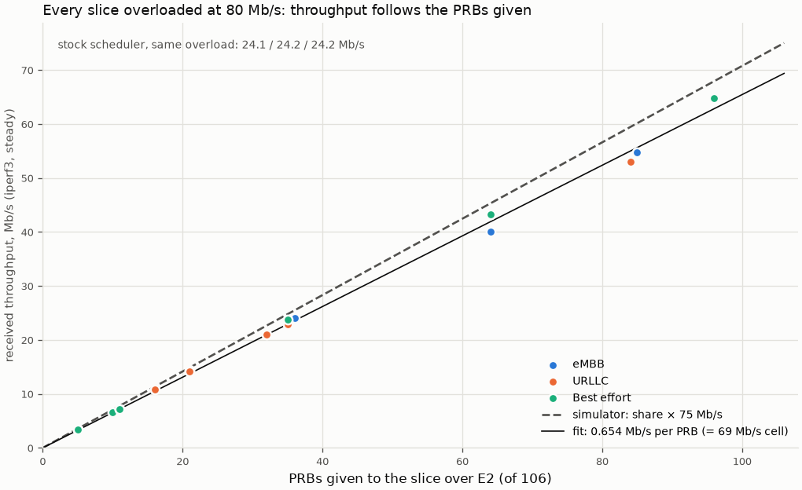
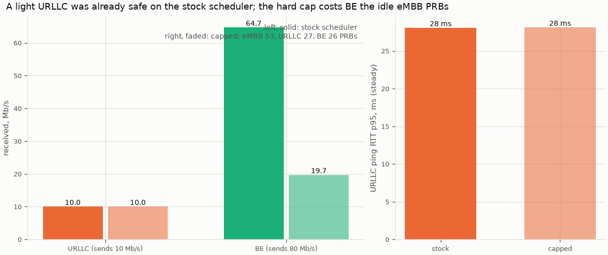
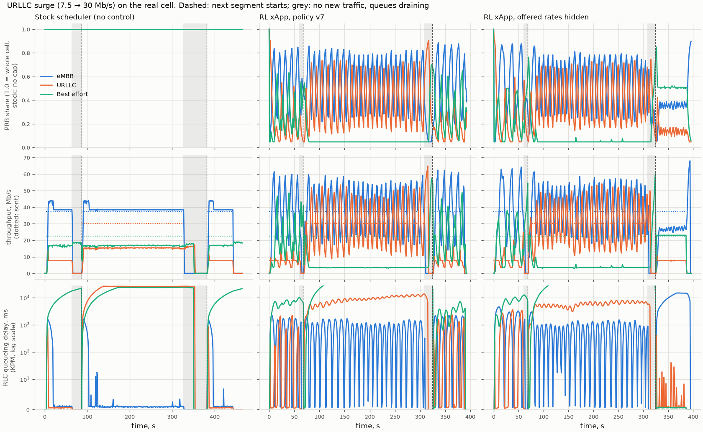
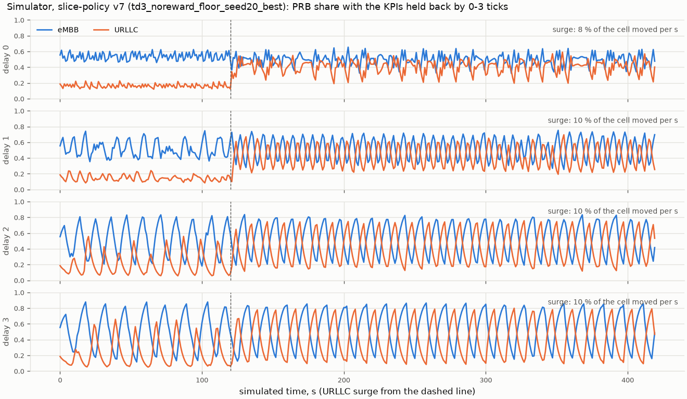
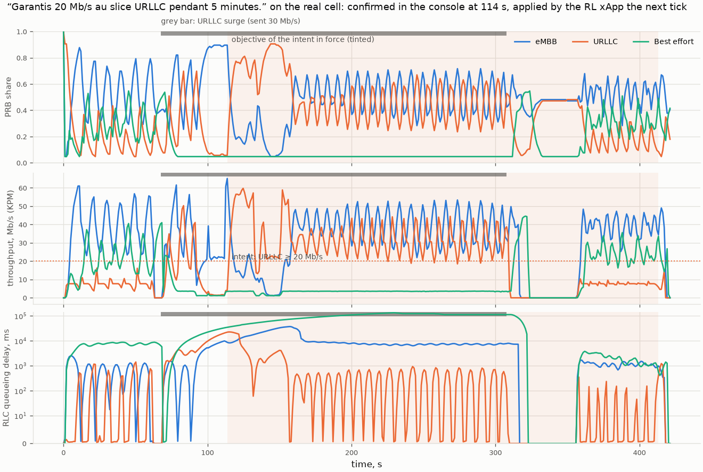

# M07b: PRB-split control on the real gNB (slice-control xApp and FlexRICBackend)

## 1. What we built

The RL xApp now sets the PRB split of the real OAI gNB over E2, so the control loop closes on the
testbed and not only on the simulator. OAI v3.0.0 had no way to do this (its SLICE service model was
a stub that only printed a line). So we patched the gNB: a slice-aware scheduler that keeps each
slice inside its own PRB range, and a real handler for the SLICE control message that sets those
ranges. A small C xApp turns "PRBs per slice" lines into E2 control messages, and `FlexRICBackend`
puts the testbed behind the same `Backend` interface as the simulator. The RL runner, the policy,
the verifier, the agent and the gateway run unchanged; the runner, the policy and the C xApp are
packaged in one container image labelled with the model version.

## 2. Why it exists in the architecture

It is the arrow from **"xApp RL (DDPG)"** to the **RAN** in figure 2 of the proposal, through the
near-RT RIC: the only place where anything changes the radio. Two xApps now talk to the same gNB
through the RIC, in opposite directions:

| | KPM xApp (M07a) | Slice-control xApp (M07b) |
|---|---|---|
| E2 procedure | RIC Subscription, then RIC Indication (reports) | RIC Control Request, then RIC Control Acknowledge |
| Who starts each message | the gNB, every second, for as long as the subscription lives | the xApp, once per decision |
| Direction of the data | gNB → RIC → xApp | xApp → RIC → gNB (the answer comes back) |
| Service model | E2SM-KPM (O-RAN standard): measurements per UE | SLICE (FlexRIC's own): PRB ranges per slice |
| Effect on the radio | none: it only reads counters | the scheduler uses the new ranges from the next slot |

**E2 report vs E2 control, in one sentence:** a report is the gNB telling the RIC what happened,
on a schedule the xApp asked for once; a control is the xApp telling the gNB what to do, one
message at a time, each acknowledged. Hard invariant 4 is about the second kind: only the RL
runner causes control messages (`FlexRICBackend.apply_prb_split` is called from `rl/runner.py`
only, checked by `tests/test_runner_realtime.py`).

The FlexRIC example we started from is `examples/xApp/c/slice/xapp_slice_moni_ctrl.c` (the SLICE
control message and the call); the E42 connection code comes from our own KPM xApp, itself adapted
from `examples/xApp/c/monitor/xapp_kpm_moni.c`. The scheduler reuses OAI's
`nr_dl_proportional_fair` unchanged.

## 3. How it works

One decision, from the policy to the radio and back:

1. **The runner decides.** `Runner.tick` builds the observation from `backend.read_kpis()`
   ([rl/runner.py:140](../../rl/runner.py#L140)), asks the policy for shares, applies the 5 %
   floor and calls `backend.apply_prb_split` ([rl/runner.py:143](../../rl/runner.py#L143)). The
   only new code in the runner is the `--backend flexric` branch
   ([rl/runner.py:206](../../rl/runner.py#L206)).
2. **Shares become whole PRBs.** `shares_to_prbs` ([backends/flexric.py:44](../../backends/flexric.py#L44))
   floors each share × 106, gives the PRBs left over to the largest remainders, and tops any
   slice up to 5 PRBs: (0.6, 0.3, 0.1) → 64 / 32 / 10.
3. **One line to the xApp, no waiting.** `apply_prb_split` ([backends/flexric.py:100](../../backends/flexric.py#L100))
   writes `64 32 10` to the xApp's stdin and returns. If the split is unchanged nothing is sent;
   if the xApp has died the call returns without error (the gNB keeps the last ranges) and the
   reader thread has logged `xapp_exited` ([backends/flexric.py:79](../../backends/flexric.py#L79)).
   The tick never waits on E2 (invariant 5).
4. **The xApp sends an E2 control.** `xapp_slice_ctrl` ([xapps/slice_ctrl/xapp_slice_ctrl.c:104](../../xapps/slice_ctrl/xapp_slice_ctrl.c#L104))
   reads the line, builds a SLICE `ADD` message with three STATIC ranges laid end to end
   (eMBB [0,63], URLLC [64,95], BE [96,105]) in `add_request`
   ([:49](../../xapps/slice_ctrl/xapp_slice_ctrl.c#L49)), and calls `control_sm_xapp_api`
   ([:117](../../xapps/slice_ctrl/xapp_slice_ctrl.c#L117)), which blocks until the RIC Control
   Acknowledge. It prints `{"event":"ack", "prbs":[...], "rtt_ms":0.8}`.
5. **The RIC forwards it to the gNB** (E42 → E2), as a `RICcontrolRequest`.
6. **The gNB's handler checks and stores the ranges.** `write_ctrl_slice_sm` and `add_slices`
   ([testbed/gnb/slice-control.patch:54](../../testbed/gnb/slice-control.patch#L54), [:83](../../testbed/gnb/slice-control.patch#L83))
   accept exactly three STATIC slices with ids 0, 1, 2; `nr_slice_policy_set`
   ([:143](../../testbed/gnb/slice-control.patch#L143)) refuses ranges outside the cell, overlapping
   or under 5 PRBs, and otherwise publishes all six bounds as **one 64-bit atomic word**. The
   answer ("OK: PRBs eMBB [0,63] …" or "REFUSED: slice 0: 3 PRBs, fewer than 5") goes back in the
   acknowledge and into the gNB log. `DEL` removes the ranges (stock scheduler again).
7. **The scheduler uses them from the next slot.** OAI's downlink scheduler calls the replaceable
   stage `mac->dl_rb_alloc`; our `main.c` change points it to `nr_dl_slice_policy`
   ([:256](../../testbed/gnb/slice-control.patch#L256)). Every slot (0.5 ms) it reads the word once
   ([:186](../../testbed/gnb/slice-control.patch#L186)); with no ranges it is plain PF. Otherwise it
   sorts the candidates by slice (matching each UE's S-NSSAI), schedules UEs with no known slice
   first over the whole cell (signalling during attach), then for each slice calls the stock
   `nr_dl_proportional_fair` with a copy of the PRB map where every PRB outside the slice's range
   is marked busy ([:221](../../testbed/gnb/slice-control.patch#L221)), and merges what it allocated back.
8. **KPM reports the effect.** The KPM xApp (M07a) reports per UE every second; `xapps.kpm_monitor
   --for-runner` aggregates per slice and writes the newest values into `kpm_latest`
   ([xapps/kpm_monitor.py:246](../../xapps/kpm_monitor.py#L246), [store/testbed.py:32](../../store/testbed.py#L32)).
9. **The backend turns them into KPI records.** `read_kpis` ([backends/flexric.py:125](../../backends/flexric.py#L125))
   adds what only it knows: the split in force while that report was measured (`share_in_force`,
   [:115](../../backends/flexric.py#L115)), hence `prb_share_alloc` and `prb_used` (the share of the
   slice's own PRBs it used), and the offered rate written by the traffic script
   ([store/testbed.py:45](../../store/testbed.py#L45)). The runner writes them to `kpi` with the
   policy in force, as on the simulator, so `kpi` keeps one writer and the agent, `get_kpis` and
   Grafana see the testbed exactly like the simulator.



## 4. Results on the testbed

### The cap works and is linear

Every slice was sent 80 Mb/s (each alone can take ~71), at six splits sent over E2
(`testbed/measure_m07b.py cap`):



**How to read it:** each dot is one slice in one run (iperf3, received, steady part). They lie on
one line: **0.654 Mb/s per PRB** (69 Mb/s for the whole cell), from 5 PRBs (3.3 Mb/s) to 96 PRBs
(64.8 Mb/s). The simulator assumes share × 75 Mb/s (dashed): the shape is right, the testbed is
about 8 % lower. The gNB accepted all seven commands; the cell total stayed 67–72 Mb/s (stock
scheduler under the same load: 72.4, split equally, 24 Mb/s each).

### Isolation: what the cap costs



URLLC sends 10 Mb/s, BE 80 Mb/s, eMBB nothing (`measure_m07b.py isolation`). **The stock
scheduler already protects a light URLLC** (10.0 Mb/s, ping p95 29 ms): proportional fairness
serves the UE that asks little. M07a's 16.6 s RTT happened only when all three slices were
overloaded. The hard cap keeps URLLC the same (10.0, 28 ms) but **BE drops from 64.7 to 19.7 Mb/s**,
because eMBB's 53 PRBs sit idle. That is the price of a non-work-conserving cap.

### Not a stub: the E2 capture

Captured at the RIC while a valid split, a bad one (3 PRBs for eMBB) and a `DEL` were sent
(`testbed/captures/m07b_e2_control.pcap`, excerpt in
[e2_control_excerpt.tsv](../../testbed/results/m07b/e2_control_excerpt.tsv)):

| Frame | Time (s) | From → to | Message |
|---|---|---|---|
| 48 | 3.9346 | xApp .139 → RIC | E42 control (procedure 20) |
| 49 | 3.9347 | RIC → gNB .151 | `RICcontrolRequest` |
| 50 | 3.9349 | gNB → RIC | `RICcontrolAcknowledge`, carrying "PRBs eMBB [0,63] URLLC [64,95] BE [96,105]" |
| 51 | 3.9352 | RIC → xApp | `RICcontrolAcknowledge` (108 bytes, no answer text) |
| 75 | 5.3724 | gNB → RIC | acknowledge carrying "slice 0: 3 PRBs, fewer than 5" |
| 101 | 7.3739 | gNB → RIC | acknowledge carrying "ranges removed, stock scheduler over the whole cell" |

The gNB answers within 0.25 ms; the xApp sees its acknowledge ~0.8 ms after sending. **FlexRIC
drops the gNB's answer at the RIC**: the acknowledge it forwards to the xApp has no outcome, and the
xApp API returns "success" either way. So the xApp cannot tell "accepted" from "refused"; the gNB
log and the capture can. The bad message did not crash the gNB.

`prb_used` also got its explanation: `RRU.PrbTotDl` averages over every slot, uplink ones
included. The TDD pattern repeats every 10 slots (7 downlink, 1 mixed with 6 of 14 symbols
downlink, 2 uplink), so a full downlink reads (7 + 6/14) / 10 = **0.743**; measured 0.73–0.75 for
each slice inside its range. `FlexRICBackend` divides by it (`PRB_FULL_CELL`,
[backends/flexric.py:41](../../backends/flexric.py#L41)), a test re-derives it from `gnb.conf`.

### The loop on the real cell

The simulator's demo surge in real time (`testbed/run_loop_m07b.sh`): eMBB 37.5 and BE 22.5 Mb/s
throughout, URLLC 7.5 → 30 Mb/s for 240 s (90 Mb/s offered to a ~71 Mb/s cell).



**How to read it:** one column per run; rows: PRB share, throughput (dotted: what is sent),
RLC queueing delay (log scale). Grey: no new traffic, queues draining (the next segment waits
until every iperf3 run has closed, which waits behind the queues; so the runs are not aligned in
time beyond the segment starts). Received during the surge (iperf3):

| Run | eMBB | URLLC | BE |
|---|---|---|---|
| sent | 37.5 | 30 | 22.5 |
| stock scheduler | 37.5 | **14.7** | 16.2 |
| RL xApp, policy v7 | 37.5 | **28.4** | **3.8** |
| RL xApp, offered rates hidden | 37.4 | 29.3 | 4.0 |

The policy moves PRBs to URLLC (28.4 Mb/s of 30, against 14.7 on the stock scheduler) and pays
with BE, pushed to its 5 % floor. Three things are wrong with how it does it:

- **It oscillates.** eMBB's share swings 0.22 ↔ 0.84 with a period of 10–12 s, the whole surge
  (11 % of the cell moved per second; on the simulator, without delay, 7.5 %). Throughput swings
  with it (eMBB 17–57 Mb/s second by second, 37.5 on average).
- **URLLC gets its throughput, not its latency:** its RLC queue stays at 5–10 s through the
  surge.
- **Without the offered rates, it freezes after the surge** at 0.37 / 0.13 / 0.50, which leaves
  eMBB 24.9 of its 37.5 Mb/s: it sees only what eMBB receives, which never shows unmet demand.

### Why it oscillates: the late view (tested)

On the testbed a split's effect shows in KPM **one tick later** than on the simulator (correlation
of the eMBB share sent with the eMBB PRB use KPM reports: 0.85 same tick, **0.94 one tick
later**). `testbed/sim_delay_m07b.py` runs the same policy on the simulator's surge with its KPI
records held back by 0–3 ticks:



| Delay | eMBB share in the surge | Period | Before the surge |
|---|---|---|---|
| 0 ticks (training) | 0.32–0.65, irregular | none | steady |
| 1 tick | 0.25–0.75 | 7 s | small swings |
| 2 ticks | 0.19–0.83 | 11 s | swinging |
| 3 ticks | 0.15–0.87 | 14 s | swinging |
| **testbed** | **0.22–0.84** | **10–12 s** | **swinging** |

A late view alone turns the policy's jitter into a steady swing that grows with the delay, and the
testbed matches 2 ticks. One tick is measured; the second is not explained yet (candidates: how
KPM report windows fall against the runner's ticks, or the gNB's queues draining for seconds). The
policy was never trained on a delayed view. Fixes (not applied, a decision for later): train with a
random 0–3 tick delay, smooth more, or tick every 2 s.

### An intent on the real cell

"Garantis 20 Mb/s au slice URLLC pendant 5 minutes." submitted through the gateway 20 s into the
surge (run `loop_intent2`; parse 8.5 s, plan 11.9 s, verifier accepts, confirmed in the console
24 s after submission). The runner switched to the new objective on the next tick.



| Surge, same run | URLLC share | URLLC (KPM) | seconds ≥ 20 Mb/s | URLLC queue (median) |
|---|---|---|---|---|
| before the intent (36 s) | 0.25 | 14.2 Mb/s | 28 % | 6.3 s |
| intent in force (184 s) | 0.49 | 31.8 Mb/s | **95 %** | **0.36 s** |

After 20 s the agent measured 85 % compliance (its rule is 90 %), decided to revise and proposed
a new plan; that revision waited for a console confirmation nobody gave, so the first objective
stayed. Earlier, "Garantis 25 Mb/s…" was **rejected by the verifier**: a 25 Mb/s change exceeds
its 30 % step limit (22.5 Mb/s). BE stayed at its floor (queue ~100 s) and the split still swung.
Before the intent, this run's policy had starved URLLC (share 0.06 for ~20 s): **two runs of the
same policy on the same scenario behaved quite differently**, which one run each cannot settle.

### The gateway still cannot reach the RAN (invariant 2)

`testbed/check_gateway_route.py`, testbed up: all 7 RAN addresses (AMF, SMF, UPF, ext-dn, RIC E2
and E42, gNB) time out from WSL, where the gateway runs, and all 7 answer from a container on the
testbed network. WSL has no route to `192.168.70.0/24`; Docker Desktop's networks live in its own
VM.

### Soak: 30 minutes, one crash, and three FlexRIC bugs

`testbed/soak_m07b.sh`: the RL xApp controlling the gNB for 30 minutes under 30 / 15 / 20 Mb/s
(eMBB / URLLC / BE), then a restart of the RL xApp container
([soak_summary.txt](../../testbed/results/m07b/soak_summary.txt)).

| | Result |
|---|---|
| traffic received (iperf3) | 30.0 / 14.8 / 18.8 Mb/s (100 / 99 / 94 %) |
| controls acknowledged | 1,441, round trip median 0.90 ms, max 2.03 ms |
| gNB | 1,442 `SLICE CONTROL OK`, 0 refused, 0 assertions, 0 restarts, 0 HARQ retransmissions waiting |
| KPM | never stale; 5,778 KPI rows |
| memory over 31 min | gNB 2,179 → 2,180 MiB, RIC 11 → 14, RL xApp 270 → 271, KPM xApp 7 → 10: no leak visible |
| **slice-control xApp** | **crashed (SIGSEGV, exit −11) at 23.9 min, after its 1,425th command** (cause found and fixed below) |

**Finding the cause.** The crash reproduces in seconds without traffic: the same xApp fed 3,000
random splits as fast as it can take them crashed in 3 of 4 runs (after 452 to 2,538 controls).
Under `gdb`, in a throwaway debug image, it crashed in `rm_pending_event_ev`, called from the
acknowledge handler, while the main thread was still in `add_pending_event` for the same control.
**FlexRIC v3.0.0's xApp library sends a control first and registers its timeout second**
(`msg_handler_xapp.c`); our gNB answers in under 1 ms, so now and then the acknowledge arrives
first, tries to remove a timeout that does not exist yet, and reads a null pointer. A second race
sits next to it: the "answer arrived" flag was cleared when the wait started, after the request was
out, so an answer faster than that was wiped and the caller waited the full 6 s (seen twice in
17,500 controls).

**Fix.** [flexric-control-ack-race.patch](../../xapps/slice_ctrl/flexric-control-ack-race.patch)
(27 lines, applied to FlexRIC when the RL xApp image is built): register the timeout before
sending, and clear the flag before sending (`reset_sync_ui`). Checked with 54,000 controls in 18
runs: **0 crashes, 0 stalls**, acknowledge median 0.56 ms, max 2.7 ms (unpatched, the same load
would have given about 35 crashes and 6 stalls).

**A third problem, in the RIC, not fixed: its request id counter wraps after 65,536 requests.**
The near-RT RIC numbers every subscription and control from one counter stored as 16 bits. After
65,536 requests a control reuses the id of a still-active KPM subscription, the RIC forwards KPM
reports to the slice-control xApp, and the xApp crashes (caught under gdb at the 65,534th control
since the RIC started: a NULL callback in the report dispatcher). FlexRIC checks for duplicate ids
with an `assert`, which the Release build compiles out. At ~1 control per second that is about 18
hours, far beyond any run here; the rule is to restart the testbed before ~60,000 controls, and a
RIC patch is listed as a possible continuation (docs/PLAN.md §8).

The failure also showed that **a crash costs more than the crash**: after it, the next xApp's E42
setup kept timing out until the RIC was restarted (the fragile E2 state seen in the M06 spike), so a
supervisor that only restarts the xApp would not be enough.

## 5. How to run it and check it works

```bash
uv run pytest -q                       # 367 passed; no testbed needed
testbed/gnb/build.sh                   # once: agentic-ric/oai-gnb:v3.0.0-slice (both patches)
xapps/rl/build.sh                      # agentic-ric/rl-xapp:v<champion> and :latest, model labels
docker image inspect agentic-ric/rl-xapp:latest --format '{{json .Config.Labels}}'
sudo modprobe sctp                     # after a WSL restart
testbed/up.sh                          # gNB starts on the stock scheduler (no ranges yet)

uv run python testbed/measure_m07b.py cap         # ~10 min: 7 splits, all slices overloaded
uv run python testbed/measure_m07b.py isolation   # ~3 min
testbed/run_loop_m07b.sh loop_rl rl               # ~8 min: KPM writer + RL xApp + surge scenario
uv run python testbed/check_gateway_route.py      # exit 0: no route from the gateway's side
uv run python testbed/sim_delay_m07b.py           # ~1 min, no testbed: the delay test
uv run python testbed/plot_m07b.py                # the figures above
docker logs rfsim5g-oai-gnb 2>&1 | grep "SLICE CONTROL"   # every command, OK or REFUSED with the reason
```

Expected: the gNB log shows `SLICE CONTROL OK: PRBs eMBB [a,b] …` for each command;
`grep xapp_ack var/events.jsonl` shows one acknowledge per changed split, ~1 ms each; `get_kpis`
through the gateway returns `source: flexric` with `prb_share_alloc` below 1.

For the intent demo, start the agent service and worker with `RIC_DB=var/ric-testbed.db` (the
commands of [M04b §5](M04b-langgraph.md#5-how-to-run-it-and-check-it-works)) during a loop run,
then `uv run python -m gateway.client submit "…"` and `uv run python -m console confirm i0001`.

## 6. Choices and simplifications

- **Hard cap, not work-conserving.** A slice's unused PRBs stay idle. Chosen because the
  simulator the policy was trained on works that way and a guarantee is easy to check. Cost
  measured above: BE lost 45 Mb/s next to an idle eMBB. A real slicing scheduler (3GPP
  `rRMPolicyMaxRatio` / `MinRatio` / `DedicatedRatio`) separates a guaranteed share from a
  maximum and lends idle PRBs.
- **Contiguous ranges, frequency only.** Each slice gets a block of adjacent PRBs in every slot.
  Simple to check (`pos_low`/`pos_high` already exist in FlexRIC's SLICE message). Real schedulers
  also share in time (slots) and per UE weight.
- **Reuse the stock PF inside each range** rather than write a scheduler: about 80 lines of C,
  and the behaviour inside a slice is OAI's.
- **One atomic 64-bit word between the E2 thread and the scheduler**, no lock: the scheduler runs
  every 0.5 ms and must never wait.
- **The xApp is a stdin pipe**, not FlexRIC's SWIG Python bindings (which tie us to Python 3.10
  and add a build step). It is testable in CI with a fake program
  ([tests/test_flexric_backend.py](../../tests/test_flexric_backend.py)).
- **The runner stays the only writer of `kpi`.** `kpm_monitor --for-runner` writes `kpm_latest`
  instead; rejected: letting the KPM writer write `kpi` and the runner skip its write, which would
  change the runner and lose the `policy_id` of each row.
- **The offered rate is an oracle.** KPM does not measure it; the traffic script writes its
  iperf3 rate to `traffic_target`. A real gNB would estimate demand from buffer occupancy. The
  `blind` run shows what hiding it costs (eMBB frozen at 24.9 of 37.5 Mb/s after the surge).
- **`prb_used` rescaled by the TDD downlink fraction (0.743)**, derived from `gnb.conf`, not fitted.
- **No retraining in M07b.** The policy was trained on the simulator, which has no measurement
  delay; on the testbed it oscillates. Reported as is.
- **The xApp cannot see the gNB's answer.** FlexRIC drops it at the RIC; we read it in the gNB log
  and the capture. A production RIC would return the control outcome to the xApp.
- **HARQ retransmissions** need their original PRB count; if a slice's range has just shrunk below
  it, the retransmission waits. The gNB counts these and logs the count with each control; it was
  0 in every run (rfsim has almost no errors).
- **No supervisor for the slice-control xApp.** If it dies, the backend logs it and stops
  sending; the gNB holds the last split. The two races that killed it are fixed; the RIC's id
  wrap remains (18 h). A real deployment would supervise the RIC and both xApps together.
- **We patch FlexRIC's xApp library** (two races, 27 lines) rather than work around them in our
  xApp: the bugs are in the library's own send/wait code, and our xApp cannot reach it.
- **Bench tests bypass the runner.** `measure_m07b.py` feeds the xApp directly to measure the
  radio; it never runs in the live stack and nothing on the operator side can reach it.

## 7. Questions to check understanding

1. **Your KPM xApp and your slice-control xApp both talk to the gNB through the RIC. What is the
   difference between what they send and receive?**
   The KPM xApp subscribes once, then the gNB sends it reports (RIC Indications) every second;
   nothing changes in the radio. The slice-control xApp sends RIC Control Requests, one per
   decision, and each is acknowledged; the gNB's scheduler changes from the next slot.
2. **Why does the scheduler read the ranges from one 64-bit atomic word instead of a struct
   protected by a mutex?**
   The scheduler runs every 0.5 ms in a real-time thread and must never wait for the E2 thread.
   One atomic load gives all three ranges from the same command at once, with no lock and no
   half-updated split.
3. **`RRU.PrbTotDl` reads 74 % when a slice uses every PRB it may. Why, and what do we do?**
   The counter averages over all slots, uplink included. The TDD pattern gives downlink
   (7 + 6/14) / 10 = 0.743 of the time. `FlexRICBackend` divides by that fraction so that 1.0
   means "every downlink PRB the slice may use is used", as in the simulator.
4. **The policy oscillates on the testbed and not on the simulator. What did we test, and what
   remains open?**
   We measured that KPM shows a split's effect one tick later than the simulator, and that the
   same policy on the simulator, with its view held back 1–3 ticks, oscillates more as the delay
   grows; 2 ticks reproduce the testbed's range and period. Open: where the second tick comes
   from, and the fix (training with a delayed view, more smoothing, or a slower tick).
5. **How do we know the gateway cannot change the split, even on the testbed?**
   Three separate walls: it exposes only three tools and imports nothing that reaches the RAN
   (tests); `submit_intent` only creates a request that the verifier and the console must pass;
   and on the network, WSL (where it runs) has no route to the testbed: every RAN address times
   out from there while answering from the testbed network.
