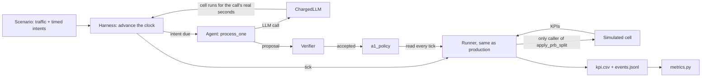
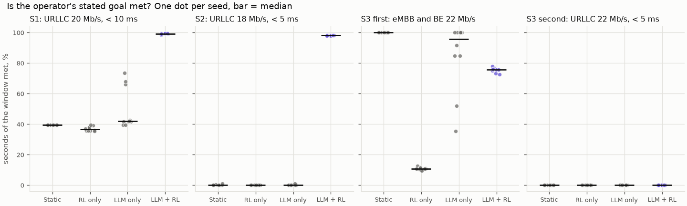
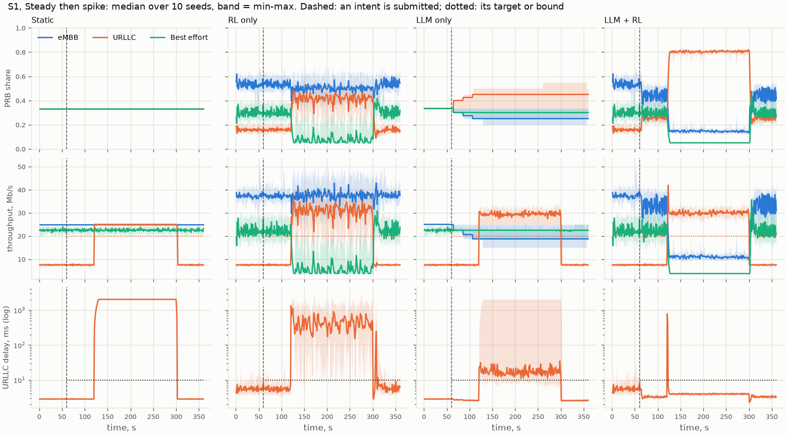
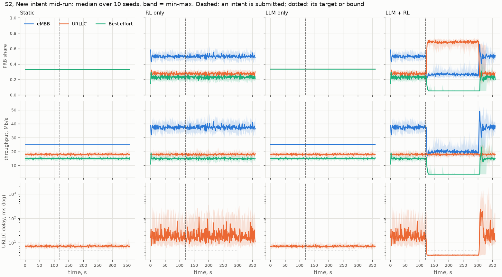
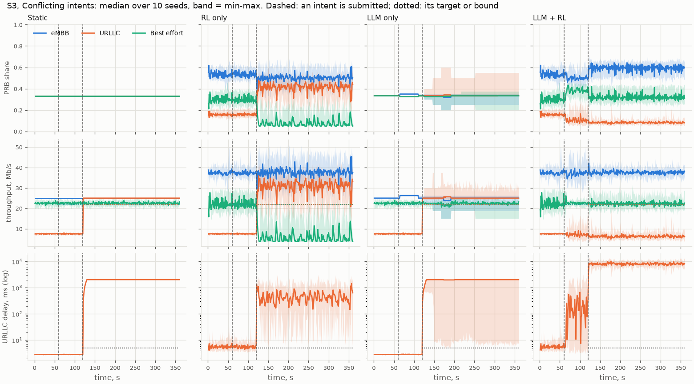
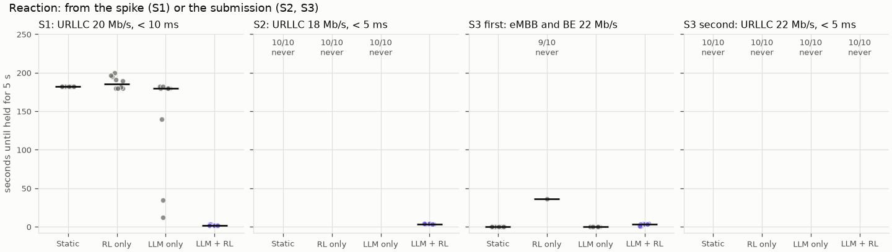
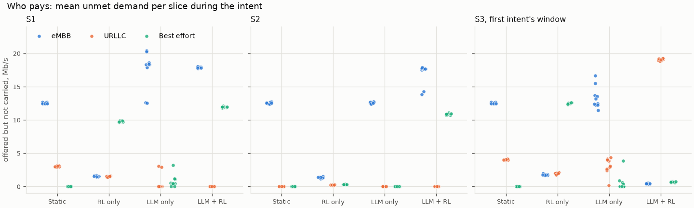
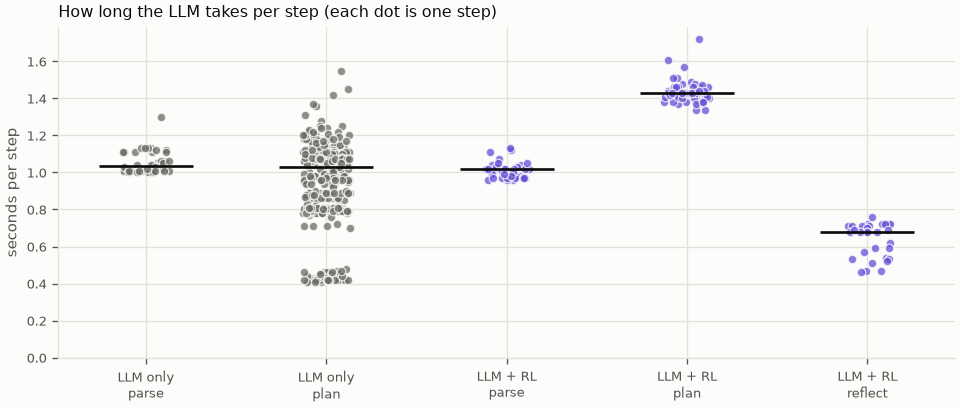
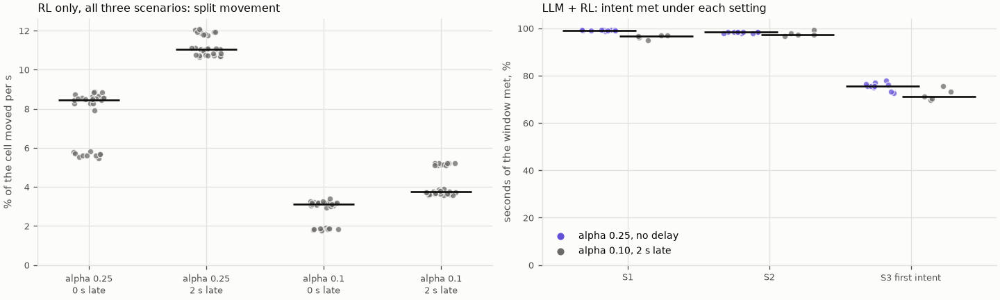

# M08a: control evaluation on the simulator

## 1. What we built

`eval/` now compares four controllers on three scripted scenarios, with 10 paired seeds: static (equal
split), RL only (default objective), LLM only (`set_slice_share`) and LLM + RL, the proposed design.
Every controller is scored against what the operator stated, so the ones that ignore intents can be
compared too. **LLM + RL met the stated goal 99 % and 98 % of the time in S1 and S2, where every other
median was 42 % or less. In S3, the conflict, it did worse than an equal split, and left URLLC worse off
than any other controller.** Its wins also have a cost: it serves the favoured slice far beyond what it
needs. No code was tuned on these results and nothing was fixed; the decisions are yours (§6).

## 2. Where it sits in the architecture

M08a isn't a box in the proposal's figure 2: it measures the whole control chain on the simulator
backend, from the LangGraph service through the verifier and `a1_policy` to the RL xApp. It settles H7
(the comparison runs without Hermes, with verified intents only). M08c replays the same scenarios and
measures through `FlexRICBackend`.

The hard invariants still hold in the evaluation: the Runner is the only caller of `apply_prb_split`
(LLM only's splits go through `verify_shares` and an `a1_policy` segment), and every objective passes
the verifier. Invariant 5 is a different matter inside the harness: see step 3 below, and §6.

## 3. How it works

1. **A run** ([control.py:34](../../eval/control.py#L34)) is a controller, a scenario and a seed. Finished
   runs are skipped, so a stopped command can be started again.
2. **The harness** ([harness.py:114](../../eval/harness.py#L114)) builds the same `Runner` as production.
   Static and LLM only get `EqualSplitPolicy` ([harness.py:133](../../eval/harness.py#L133)), so no RL
   helps them when no split is in force. Each run has its own temporary database and event log.
3. **Lockstep time.** `advance` ([harness.py:138](../../eval/harness.py#L138)) ticks the Runner and submits
   intents when they are due, through the function behind `POST /intents`
   ([harness.py:146](../../eval/harness.py#L146)). `ChargedLLM` ([harness.py:55](../../eval/harness.py#L55))
   runs the cell for each LLM call's real duration, rounded up, on the split it already had. So LLM latency
   costs the cell what it would really cost, but a run takes seconds instead of 6 minutes.
4. **The agent is the unchanged one:** `process_one` ([harness.py:158](../../eval/harness.py#L158)), in
   evaluation mode. One worker, one intent at a time.
5. **`RunOver`** ([harness.py:49](../../eval/harness.py#L49)) stops the agent when the scenario's time is up.
6. **The measures** are pure functions of `kpi.csv` and `events.jsonl`. `met_mask`
   ([metrics.py:35](../../eval/metrics.py#L35)) uses the same rule as `tools.compliance`: a throughput target
   is met at min(target, offered load). The window is the operator's: from submission, for the stated
   duration, so the agent's own delay counts against it.
7. **The table** ([control.py:52](../../eval/control.py#L52)) gets one row per run and intent:
   [M08a-runs.csv](data/M08a-runs.csv). Every number below comes from it or from the printout of
   `eval.plot_control`.

## 4. Diagram



## 5. How to run it and check it works

```bash
uv run pytest -q tests/test_eval_control.py                # no GPU or Ollama
uv run python -m eval.control --controllers static rl_only # seconds
uv run python -m eval.control --study lever                # seconds
uv run python -m eval.control --controllers llm_only proposed  # about 10 min; needs Ollama, GPU otherwise free
uv run python -m eval.control --study bridge               # about 3 min
uv run python -m eval.realtime_check                       # about 13 min; port 8000 free
uv run python -m eval.plot_control                         # the figures and every table below
```

Expected: `[12/60] headline/s2/proposed/seed5001: 4 s` lines, and `322 rows in docs/learn/data/M08a-runs.csv`
once everything has run. No held-out intent is used.

### The scenarios

Each lasts 360 s, on the 75 Mb/s cell. A target can rise by at most 22.5 Mb/s at once (the verifier's step
check), so one intent can't ask for more than an equal split's 25 Mb/s. What an equal split can't do here is
a latency bound, which is why the goals below have one.

| | Traffic, eMBB / URLLC / BE, Mb/s | Operator states |
|---|---|---|
| **S1** Steady then spike | 37.5 / 7.5 / 22.5; URLLC 30 during t=120–300 | t=60: URLLC ≥ 20 Mb/s, < 10 ms, 5 min |
| **S2** New intent mid-run | Steady 37.5 / 18 / 15 | t=120: URLLC ≥ 18 Mb/s, < 5 ms, 3 min |
| **S3** Conflicting intents | 37.5 / 7.5 / 22.5; URLLC 30 from t=120 | t=60: eMBB and BE ≥ 22 Mb/s, 5 min. t=120: URLLC ≥ 22 Mb/s, < 5 ms, 4 min (needs 49 % on top of 59 %: check `conflict`) |

### Is the goal met?



**What it shows:** the share of the stated window in which the goal was met, one dot per seed. **Why it
matters:** it's the primary measure, the same rule for all four. **How to read it:** the bar is the median;
dots far from it mean that controller's result depends on the run.

| Goal | Static | RL only | LLM only | LLM + RL |
|---|---|---|---|---|
| S1 | 0.39 | 0.36 | 0.42 (0.39–0.74) | **0.99** |
| S2 | 0.00 | 0.00 | 0.00 | **0.98** |
| S3, first | **1.00** | 0.11 | 0.96 (0.35–1.00) | 0.76 |
| S3, second | 0.00 | 0.00 | 0.00 | 0.00 |

Medians; range only where it is wide. Seed by seed, LLM + RL against LLM only: S1 +0.57 (+0.26 to +0.60),
S2 +0.98, S3 first −0.19 (−0.27 to +0.40). All 80 proposed and LLM-only parses of the 4 intents matched
their expected facts (H7).

**How much of this is by construction.** Static and RL only don't read intents, so the distance from them
is partly built in: they were bound to miss a goal they never received. S1's 0.39 is arithmetic: on an equal
split, 1.00 before the spike, 0.00 during it, 0.97 after, and the two easy minutes are 40 % of the window.
**The informative comparison is with LLM only:** the same model and intents, without RL.

### What the scenarios look like





**What they show:** per controller, the split, the throughput against its targets and URLLC's delay against
its bound (log scale), with the median and the min–max band over the seeds. **Why they matter:** they show how
a score came about. **How to read them:** dashed is a submission, dotted a target or bound. Compare the last
row's line with the dotted one.

- **S1, S2:** LLM + RL moves URLLC's share within seconds and holds it. In S2 its delay drops below the bound
  almost at once. When the intent ends, its delay jumps to about 200 ms while the queues rebalance.
- **LLM only** in S2 keeps the equal split for the whole intent, in every seed, though the KPIs it reads
  show the bound missed. In 2 of the 10 runs it called `finish` saying the 5 ms bound was met, which was false.
  In S1 it creeps up (URLLC from 0.33 to about 0.50 in seed 5000), a step every 20 s, and gets there late.
- **S3:** see below.

### Reaction time



**What it shows:** the seconds until the goal holds for 5 s in a row. **Why it matters:** a controller can
score well on average and still be late. **How to read it:** "never" counts the runs that didn't get there,
which are left out rather than given a number. LLM + RL: 2 s from the spike in S1, 3 s from the submission
in S2. LLM only's median in S1 is 180 s: only when the spike ends. S3's first panel is easy: the equal split
already meets it.

### What it costs: over-serving



**What it shows:** the traffic each slice offered and didn't get during the intent. **Why it matters:** a goal
met at someone else's expense isn't free, and the target alone hides it. **How to read it:** the colour is the
slice; a dot high up is a slice paying.

| Median, in the intent's window | Unmet eMBB / URLLC / BE, Mb/s | URLLC share | p95 delay eMBB / URLLC / BE, ms |
|---|---|---|---|
| S1, RL only | 1.5 / 1.5 / 9.8 | 0.31 | 813 / 1,303 / 13,733 |
| S1, LLM + RL | 17.9 / 0.0 / 12.0 | 0.58 | 5,361 / 4 / 13,733 |
| S2, RL only | 1.4 / 0.2 / 0.3 | 0.27 | 679 / 155 / 577 |
| S2, LLM + RL | 17.7 / 0.0 / 10.9 | 0.68 | 3,157 / 3 / 13,733 |

**Over-serving is confirmed.** In S2 the verifier computes that URLLC needs 40 % of the cell, and the policy
gives it 68 %, pushing BE to its 5 % floor and carrying 4 of its 15 Mb/s. BE's 13,733 ms appears in several
rows because it's a ceiling, not a coincidence: a full 50 Mb buffer drained at the floor's 3.75 Mb/s, plus the
slice's capped service delay.

**The lever from PLAN §8 doesn't help.** S1 with a scripted objective, 10 seeds: importance 6 gives URLLC 0.56
and leaves eMBB 16.2 Mb/s short; importance 8 gives 0.58 and 18.0. Intent met is 0.993 for both. Lowering the
importance in the plan step isn't the fix. That leaves a reward term for share above the target, which means
retraining, or a revision triggered by over-compliance.

### S3: the conflict rule works, and what follows is a problem

The verifier did its job in 10 of 10 runs: the second intent was rejected twice with check `conflict`, with the
numbers in the reason, and nothing was applied. Then:

- **The model never relaxed the target,** although evaluation mode allows it. In all 10 runs it kept the stated
  numbers, changed only the importances, then repeated its first proposal. The agent refuses a repeat, so the intent
  ended rejected. The operator does get the verifier's reason.
- **URLLC is left with the least of any controller:** 8–9 % of the cell, about 6 of its 30 Mb/s, and a median
  delay of about 8 s, against 25 Mb/s and 2 s on a plain equal split. The accepted objective favours eMBB and BE
  (importance 8 each, against 2 for URLLC), the 5 % floor holds, and so does every check. **The verifier checks the targets it was
  given; it doesn't protect a slice nobody stated a target for.** Asking for URLLC and being refused left URLLC
  worse off than asking for nothing.
- **The first intent is met only 76 % of the time,** against 100 % for an equal split. It's BE, which has to hold
  22 Mb/s, about 29 % of the cell, while its share moves between 26 % and 43 % (p5–p95, seed 5000): 75 s missed
  there, by 1.7 Mb/s on average. The eMBB target is never missed: eMBB gets 57–59 % though it needs 29 %.

**LLM only's second intent:** the plan warned that a serial worker would make it wait. In practice the model called
`finish` on the first intent in all 10 S3 runs, 46 s after submission in most, so usually it did not wait. When it
finishes, the split falls back to equal, which is why S3's first goal stays high: equal is already enough. Its second
intent took its first split after 4–5 s in 6 runs, 11 s in one, and 188 s in the one run where the first intent held
the worker until t=304. The other 2 ended rejected because the model repeated a split the verifier had refused.

### Unsafe actions blocked

| | Proposals per run (median) | Blocked, by check |
|---|---|---|
| LLM + RL, S1 and S2 | 1 (2 in the 2 S2 runs that asked for a revision) | none |
| LLM + RL, S3 | 3 | `conflict` 2, in every run |
| LLM only, S1 | 14 | `budget` 1 in 4 of 10 runs |
| LLM only, S2 | 10 | `budget` 1 in every run |
| LLM only, S3 | 10 | `budget` 1 in 4 of 10 runs |
| Static, RL only | n/a | n/a |

**Most of these aren't dangerous:** all 18 of LLM only's `budget` blocks are shares summing to 0.999 (0.333 three
times), which it usually corrected. None of the runs produced an unsafe split the verifier had to stop, so these scenarios
don't test that defence hard. M08b's out-of-scope attempts and the M03 tests do.

**A small model error in the reflect step:** in 2 of the 10 S2 runs, and in the real-time run, it asked for a revision
at 95 % compliance, although its prompt says 90 % is enough. The code computed the number correctly; the model misjudged
it. The revision did no harm here, and the limit of one per intent caps it.

### LLM latency



**What it shows:** the time of every LLM step. **Why it matters:** this is the delay lockstep charges to the cell.
**How to read it:** one dot is one step, retries included. Medians: parse 1.0 s, plan 1.0–1.4 s, reflect 0.7 s, so
3–4 s from submission to first apply for LLM + RL. These are for `qwen3:8b` alone on the GPU; on a shared GPU they would grow.

### Default-objective jitter, and the bridge to M08c



**What it shows:** left, how much the split moves with the policy alone at each filter and delay setting; right,
LLM + RL's score at simulator and testbed-like settings. **Why it matters:** it separates what the settings do from
what the real cell does, for M08c. **How to read it:** left, each cluster is one scenario.

- **Jitter is confirmed:** with no intent in force the policy moves 5.6–8.5 % of the cell per second (M04a measured
  6–12 %). With a goal in force it's a little lower in S1 and S2 (LLM + RL 6.0 and 4.8 % over the whole run).
- **Alpha 0.10 cuts it** to 1.8–3.2 %, and a 2 s delay at alpha 0.25 raises it to about 11–12 %. At the testbed's
  settings it's 3.6–5.2 %.
- **LLM + RL survives testbed-like settings:** 0.99 → 0.97 in S1, 0.98 → 0.97 in S2, 0.76 → 0.71 in S3's first goal,
  moving 2.3–4.0 % of the cell. M08c can compare with these numbers, not only with the alpha 0.25 ones.
- **An oddity, not an improvement:** RL only's S2 score rises from 0.00 to 0.23–0.33 with a delay. It never reads the
  goal, so this isn't control of it. I didn't look into the cause.

### Is lockstep fair?

`eval/realtime_check.py`: S2 as separate processes at real speed, with the intent through `POST /intents`.

| | Intent met | First apply | URLLC share | URLLC p95 delay |
|---|---|---|---|---|
| LLM + RL, real speed | 0.978 | 3 s | 0.628 | 3.66 ms |
| LLM + RL, lockstep range | 0.978–0.983 | 3–4 s | 0.629–0.681 | 3.30–3.71 ms |
| LLM only, real speed | 0.000 | 7 s | 0.333 | 8.88 ms |
| LLM only, lockstep range | 0.000–0.011 | 4–5 s | 0.333–0.334 | 8.89–9.79 ms |

The primary measure falls inside the range for both. The real-time LLM + RL run also made a revision, as 2 of the 10
lockstep runs did. Two values fall just outside, by about 0.001 and 0.006, and LLM only's
first apply was 2 s slower than any lockstep run. I didn't find out why; this check doesn't warm the model up first,
which may be it. **It's one run per controller on one scenario,** so it would catch a large distortion, not a small one.

## 6. Choices and simplifications

- **Lockstep time instead of real time for all runs.** Real latency stays, idle waiting goes. Rejected: freezing the
  clock during LLM calls (`agent/plot_trace.py`), which flatters the LLM; 120 runs at 6 minutes each, 12 hours. The
  harness makes the cell wait for the LLM's reply in *computer* time, which production must never do (invariant 5).
  In simulated time it behaves like production: the cell carries on while the LLM thinks. The real-time check is the
  evidence.
- **The spread is narrow, and that isn't proof of robustness.** The LLM runs at temperature 0, and each scenario has
  one wording of one intent: in S3 all 10 LLM + RL runs made the same proposals in the same order. Ten seeds sample
  traffic noise; they barely sample the model. 0.99 means "this intent, this
  wording", not "any intent". M08b measures the extraction side on many wordings.
- **I chose scenarios an equal split can't meet,** following from the verifier's rules. A scenario where equal is enough
  would look like S3's first goal. These three don't describe how often a real operator needs LLM + RL.
- **The policy is at home here:** it was trained on this simulator, and its latency model. M07b showed the real cell's
  delays are far longer. M08c is the test that counts.
- **LLM only is one small model and one prompt.** A larger model or a better prompt may do better; these results don't
  show that an LLM can't do it. It got one prompt fix in the dev round, explaining that a latency bound needs headroom.
  That didn't change its S2 behaviour, and I stopped there as planned.
- **The verifier's step check limits the goals** to 22.5 Mb/s at once from no target. That's why S2 changed from the
  plan's eMBB ≥ 30 Mb/s.
- **Scoring against stated values,** even if the agent relaxes them. No relaxation occurred in any run.
- **No p-values.** Ten paired seeds are shown as dots and differences instead.
- **Order of events, stated plainly.** The rules went into `docs/DECISIONS.md` at 23:58 on 2026-11-06, and the runs took
  place from 00:04 on 2026-11-07. The plan was to commit the rules first, and that didn't happen: the git history can't
  prove the order, the results were read before any commit, and `eval/results/m08a/manifest.json` names `8ce5677`, which
  doesn't contain this code. The code wasn't changed after the runs started; only the figures were written afterwards.
- **What a real system would do differently:** evaluate on many intents and wordings, measure against several traffic
  mixes, run at real speed, and protect slices with no stated target. A real RIC would also keep minimum service
  guarantees per slice (3GPP's `rRMPolicyDedicatedRatio`), not only a PRB floor.

**Open, for you to decide (not done here):** (1) the URLLC starvation after a rejected request, for example an implicit
service minimum in the merge; (2) over-serving, which needs a reward term and so retraining, with fresh test seeds; (3)
whether to use alpha 0.10 on the simulator too; (4) whether a repeated conflict should make the agent report and stop
sooner. M08b doesn't depend on any of them. M08c does, if you want it to measure a changed policy.

## 7. Questions to check understanding

1. **Why does `ChargedLLM` run the cell during an LLM call?**
   Because a real cell doesn't stop while the LLM thinks. Without it the LLM would act with no delay, flattering the two
   LLM controllers. It runs the cell for the call's real duration, on the split it already had.
2. **Static scores 0.39 on S1. Doesn't that mean it does something right?**
   No, it's arithmetic. The goal is easy before and after the spike (1.00, 0.97) and missed during it (0.00), and those two
   easy minutes are 40 % of the window. It shows why the score has to be read with the timelines.
3. **Why is LLM only the most informative comparison, not static or RL only?**
   Static and RL only never receive the intent, so they were bound to miss it. LLM only has the same model and intents, and
   only lacks RL, so the gap shows what RL adds to acting on the goal.
4. **In S3 the verifier worked correctly, and URLLC still ends up worst. Why isn't that a contradiction?**
   The verifier checks that stated targets fit and that each slice keeps a 5 % floor. URLLC had no accepted target, so its
   8–9 % share with 8 s of delay breaks no rule. The check protects what's stated, not the service of a slice nobody protected.
5. **All ten LLM + RL runs on S2 score 0.98. How much does that narrow spread tell us?**
   Little beyond traffic noise: the LLM runs at temperature 0 on one wording of one intent, so it makes the same decision each
   time. It says the result is repeatable for this intent, not that it generalises to other intents.
