# M08c: control evaluation on the testbed

## 1. What we built

The four controllers (static, RL only, LLM only, LLM + RL) on the real OAI gNB through `FlexRICBackend`, at real speed, as
separate processes: 3 scenarios, 3 repeats, 36 runs, about 4 hours, with the protocol committed before the first run. Traffic is
iperf3 UDP downlink, plus ping on each slice; KPIs are KPM.

**Main result:** LLM + RL is the only controller that holds S1 (0.91, the others 0.27–0.49), with the split steady during the surge
and URLLC's p95 RLC delay under 1 ms. **But three findings change how M08a reads:** S2 doesn't separate the controllers on the real cell
(all 1.00), the cell carried about 81 Mb/s against the 69 we gave the verifier, and with the rate actually measured S3's "conflict"
isn't a conflict by the verifier's own rule.

## 2. Where it sits in the architecture

It's the `eval/` box around figure 2, the last checkpoint, and the first time the whole chain runs on the real RAN with all four
controllers: `POST /intents` → LangGraph → verifier → `a1_policy` → RL xApp → E2 → gNB, with KPM coming back. Hermes isn't in the loop (H7);
M08b measured it. Upper layers are unchanged from M08a: only the backend and the traffic source differ.

## 3. How it works

1. **The scenarios** ([eval/testbed_scenarios.py:25](../../eval/testbed_scenarios.py#L25)) keep M08a's fractions of the cell at 69 Mb/s, rounded to 0.5 Mb/s, as segments of iperf3 rates.
2. **The guard** ([eval/testbed_control.py:80](../../eval/testbed_control.py#L80)) refuses `--final` with uncommitted code; `check_image` ([:310](../../eval/testbed_control.py#L310)) refuses an image older than the code.
3. **The order** ([:86](../../eval/testbed_control.py#L86)) rotates by 5 per repeat, so slow drift doesn't always land on the same controller. The testbed restarts at each repeat ([:320](../../eval/testbed_control.py#L320)).
4. **One run** ([`play`, :207](../../eval/testbed_control.py#L207)): clears the store, starts `kpm_monitor --for-runner`, the `rl-xapp` container with `RUNNER_ARGS` and, for LLM controllers, the service and worker; waits for the xApp and fresh KPM ([:166](../../eval/testbed_control.py#L166)).
5. **The traffic thread** ([`play_segments`, :150](../../eval/testbed_control.py#L150)) writes each segment's rates to `traffic_target` (the oracle M07b disclosed) and starts iperf3 and ping. **The next segment starts only once they have all closed.** This matters; see "The traffic gap".
6. **Intents** go to `POST /intents` on their own timer ([:241](../../eval/testbed_control.py#L241)).
7. **Stop** at `t0 + 360`, wait for the queues, then export KPIs and events rebased to `t0` and cut at 360 s ([`export`, :194](../../eval/testbed_control.py#L194)), so post-window drain isn't scored.
8. **Validity** ([`problems`, :103](../../eval/testbed_control.py#L103)): restart counts, `xapp_exited`, `kpm_stale`, iperf3 errors.
9. **The table** ([`write_table`, :283](../../eval/testbed_control.py#L283)) runs M08a's `eval.metrics` on each run, with S1's reaction clock taken from the surge as played ([:273](../../eval/testbed_control.py#L273)), and adds iperf3 received and ping.

## 4. Diagram

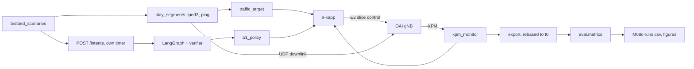

## 5. How to run it and check it works

```bash
sudo modprobe sctp                                    # after a WSL restart
xapps/rl/build.sh                                     # if the code changed
uv run python -m eval.testbed_control --final         # about 4 h, plus replays; resumes if stopped
uv run python -m eval.plot_testbed                    # figures and the tables below
testbed/down.sh
```

`--final` refuses uncommitted code. Expected: `[repeat r, i/12] testbed/sN/controller/repeatr: 400 s, valid True []` per run. The results are
in `eval/results/m08c/` (git-ignored) and [data/M08c-runs.csv](data/M08c-runs.csv). All 36 runs were recorded at commit 4bdfba4.

### Is the goal met?

Median [min–max] over 3 repeats. By the frozen rule, no difference smaller than the repeats' spread is called a difference.

| Goal | Static | RL only | LLM only | LLM + RL |
|---|---|---|---|---|
| S1: URLLC ≥ 18 Mb/s, < 10 ms | 0.30 [0.28–0.30] | 0.49 [0.42–0.54] | 0.27 [0.26–0.79] | **0.91 [0.91–0.92]** |
| S2: URLLC ≥ 16.5 Mb/s, < 5 ms | 1.00 | 1.00 | 1.00 | 1.00 |
| S3 first: eMBB and BE ≥ 20 Mb/s | **0.94 [0.94–0.95]** | 0.35 [0.34–0.41] | **0.94 [0.94–0.95]** | 0.76 [0.75–0.84] |
| S3 second: URLLC ≥ 20 Mb/s, < 5 ms | 0.01 [0.00–0.01] | **0.24 [0.22–0.25]** | 0.01 [0.00–0.01] | 0.01 [0.00–0.01] |

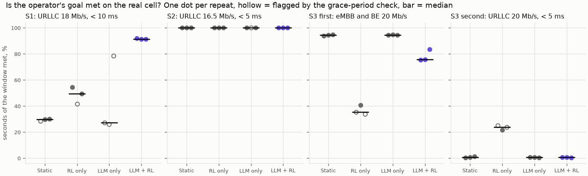

**How to read it:** each dot is a repeat; hollow ones were flagged by the grace-period check, explained below. In S1, LLM + RL is above every
other controller's range. In S2 there is nothing to separate. In S3's first goal an equal split beats LLM + RL. S3's second goal is met by no controller;
RL only's 0.24 is what's left when an oscillation happens to pass under the bound, since it never sees the goal.

### S1: where the design works

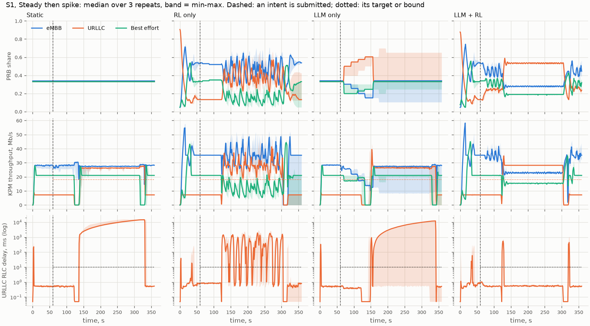

**How to read it:** rows are PRB share, KPM throughput and URLLC's RLC delay on a log scale; dashed marks a submitted intent and dotted a target or bound. LLM + RL holds
URLLC at 0.54 from the surge to its end, steady, with delay at 0.54 ms median and 0.8 ms p95. It reacts in 6.3 s, as the simulator did at the served settings (6 s). RL only
has the same policy without the goal: its split swings, and URLLC's delay passes 1 s repeatedly. Static's URLLC can't carry 27.5 Mb/s at 0.33, so a queue grows to about
14 s and stays until the end of the surge.

**The cost:** URLLC needs about 0.34 of the cell for 27.5 Mb/s and gets 0.54: still over-served, though less than the simulator's. eMBB falls to 23 Mb/s and BE to 15.4 Mb/s.
Their queues reach 18 s and 26 s of RLC delay at p95.

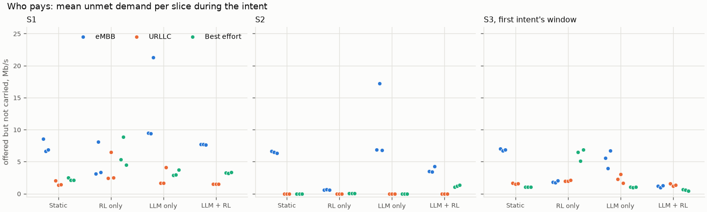

**How to read it:** the traffic each slice offered and didn't get during the intent, per run. LLM + RL carries the most in S3 (3.2 Mb/s unmet in total, against 8.9–10.2).

### S2: the simulator's separation was an artefact of its delay model

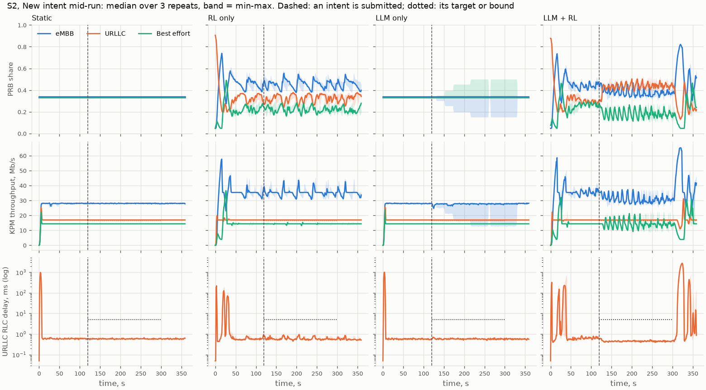

M08a's S2 gave 0.98 against 0.00. On the real cell, every controller gets 1.00. The simulator models delay as M/M/1: at an equal split in M08a, `2 / (1 − 18/25)` = 7.1 ms, over the
5 ms bound. **The real RLC delay stays flat near 0.6 ms until the slice saturates.** A goal under capacity is met by any split that carries it, so S2 has no controller effect on this cell.
What's left is cost: eMBB's unmet demand is 0.6 Mb/s for RL only, 3.5 for LLM + RL and 6.5–6.9 for static and LLM only.

**A problem the score doesn't see:** when LLM + RL's intent expires at t=300, the policy returns to the default objective with eMBB's 13 s queue standing. It gives eMBB up to 0.82 and URLLC down to 0.11–0.13,
and URLLC's delay reaches 2.7–3.1 s for 23–28 s in all three repeats. This falls outside the intent's window, so `intent_met` stays 1.00, but ping shows it: URLLC's p95 RTT is 272 ms here, against 27–29 ms for the other three.

### S3: the conflict, and the capacity it depends on

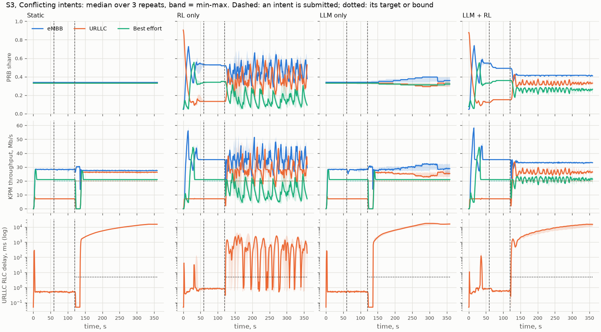

**The first goal:** LLM + RL carries the most in total, but BE gets 0.26 of the cell, about 21 Mb/s for a demand of 20.5. A slice served right at its demand fluctuates second by second (10th percentile 18–19 Mb/s),
and the rule is tick by tick, so 49–74 of the 300 s fall under 20. The simulator had the same weakness (0.79). An equal split gives BE far more than it needs, so it has no such problem.

**The second goal:** the verifier rejected it in 3 of 3 runs with `conflict`, the agent stopped after a repeated proposal, and URLLC ended with the same delay as under an equal split, 15 s at p95. M08a's fix held: 0.33 of the cell, not 0.08.

### The cell carried 81 Mb/s, not 69

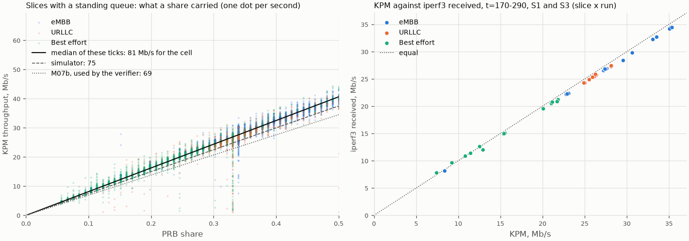

**How to read it:** left, every second where a slice had a standing queue (RLC delay over 200 ms), so it used all it was given. They follow one line: **81.3 Mb/s for the cell** (10–90 %: 78.2–84.7; n = 16,840).
The low dots at 0.33 are probably seconds around the traffic gap; I haven't checked each one. Right, iperf3 confirms KPM from outside the RAN: iperf3 received is 0.976 of KPM, about what headers account for. So about 79 Mb/s of payload, or 0.75 Mb/s per PRB.
M07b measured 0.654. **I don't know why they differ.** M07b offered 80 Mb/s per slice, 240 in total, and M08c at most 82.5; overload handling is a candidate, not tested.

What follows from it:

- **The scenarios were lighter than planned.** Quiet traffic is 76 % of the cell rather than 90 %, and the surge 102 % rather than 120 %.
- **S3's second intent:** the verifier's check needs 106 % at 69 Mb/s, so it rejects. Rerunning `verify` on the same two intents with other capacities: rejected at 69, **accepted at 75, 78 and 80**. On the rate the cell showed, the verifier's own rule would accept, so S3's result depends on a wrong input. Whether the cell can actually deliver it wasn't tested.
- **The policy's inputs are off by 17 %,** since its fractions divide by 69.

The decision to report 69 in M08c was mine, on M07b's evidence, and it's frozen for this matrix. Nothing was changed after seeing it.

### The traffic gap

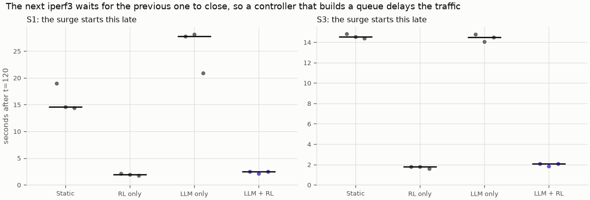

**How to read it:** the seconds the surge started after t=120, per run. `play_segments` waits for each iperf3 to close, and iperf3 closes once the slice's queue has drained. **This delay depends on the controller:** 2 s for RL only and LLM + RL, 14–28 s for static and LLM only, which leave eMBB's queue standing. The plan said "a few seconds"; that was wrong for two of the four.

During the gap URLLC and BE have no traffic while `traffic_target` still shows the old rates. Two effects:

- **Directly, on the score:** at most 4 points. Without the gap's seconds, static's S3 first goal is 0.98 instead of 0.94, and S1's values move by 1–2 points. S1's surge also typically lasted about 195 s rather than 180, for the same reason.
- **Indirectly, on LLM only, much more:** in S1 the model looked at a 20 s window with URLLC at 0 Mb/s and called `finish` ("throughput has dropped to 0 Mb/s... cannot be fulfilled") in 2 of 3 repeats. Its split stayed valid for 25 s, then the equal split returned, just after the surge arrived. The third repeat kept adjusting and reached 0.79. **So LLM only's S1 median, 0.27, is partly caused by my harness.** S1's conclusion stands regardless: LLM + RL's range (0.91–0.92) is above that 0.79 too.

The LLM's decision is still a real weakness: it took a transient for a verdict, and the log recorded `outcome: applied` next to a reason saying it can't be done.

### Flagged runs

8 of the 36 were flagged "traffic still running after the grace period" (45 s). **The flag isn't one of the frozen validity rules.** The freeze lists four reasons; the code added this one through the iperf3 error list, and I didn't notice. None of the four fired in any run: no container restart, no xApp exit, no stale KPM, and no error in any of the 216 iperf3 files. The longest KPM gap in any run was 1.09 s.

So **all 36 count**, and the table above includes them. Flags fall on static, RL only and LLM only, and none on LLM + RL, because they mark large queues, which is what a bad controller creates. Dropping them would remove S1's LLM only entirely and select on outcome. The `valid` column keeps the flag as recorded, and the figure shows them hollow.

The code's automatic replay started on the first flagged run. It was stopped with Ctrl+C at 06:59, about 2 minutes in; the partial directory was deleted and the original put back. No replay data exists.

### Simulator against testbed

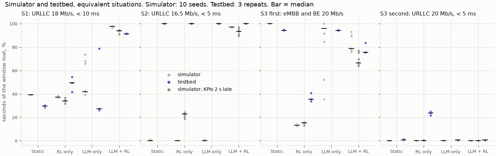

| Median intent met | Sim | Sim, KPIs 2 s late | Testbed | What explains it |
|---|---|---|---|---|
| LLM + RL, S1 | 0.98 | 0.94 | 0.91 | Suspected: the delay, and a few seconds at each change of traffic |
| LLM + RL, S2 | 0.97 | 0.93 | 1.00 | Known: real delay is flat under capacity |
| LLM + RL, S3 first | 0.79 | 0.66 | 0.76 | Same weakness; at the margin of the spread |
| RL only, S1 | 0.37 | 0.34 | 0.49 | Suspected: lighter load than intended |
| RL only, S2 | 0.00 | 0.23 | 1.00 | Known: delay model |
| RL only, S3 first | 0.13 | 0.15 | 0.35 | Suspected: lighter load |
| Static, S1 | 0.39 | – | 0.30 | Known in part: the gap and the longer surge |
| Static, S2 | 0.00 | – | 1.00 | Known: delay model |
| LLM only, S1 | 0.42 | – | 0.27 | Known: `finish` during the gap |
| LLM only, S2 | 0.00 | – | 1.00 | Known: delay model |

The S3 first-goal and S3 second-goal figures for static and LLM only barely move. M08a reran the served settings only for RL only and LLM + RL, so static and LLM only use its headline study.

**What held:** LLM + RL's S1 and S3 first-goal levels are close to the simulator's. **What didn't:** the S2 separation. Queues are also far larger than the simulator's 50 Mb cap allows: 14–15 s on eMBB and URLLC, and 38 s on BE under RL only, where S1's first repeat lost 26 % of BE's packets during the surge.

### Other measures

- **Oscillation:** movement in % of the cell per s, S1 / S2 / S3: RL only 3.5 / 2.0 / 3.9, LLM + RL 1.8 / 3.2 / 1.3. M07b's one-run figure at alpha 0.10 was 4.3. LLM + RL's split in S1 holds flat through the surge; in S2, BE shows a sawtooth with eMBB's queue. So oscillation is reduced and not gone, as M07b found.
- **The LLM, seconds per step:** parse 1.08 median for LLM + RL (p95 5.25) and 6.31 for LLM only, a difference I haven't investigated; plan 1.96 and 1.06; reflect 0.84. First application after a submit: 3.1–9.2 s for LLM + RL. KPM never stalled during LLM calls (invariant 5).
- **Parsing:** all 24 intent submissions parsed as stated. Zero agent errors.
- **LLM only is serial:** in S3 the second intent waited until the first finished: first applied 181–263 s after its submission (PLAN §8, serial worker).
- **The RIC's request limit:** 5,580 controls logged in 36 runs, with a restart per repeat, far from the ~60,000 limit.
- **Delay definitions:** bounds are checked on KPM's RLC delay. Ping's URLLC RTT is 16–22 ms when RLC delay is 0.5 ms, so "under 5 ms" here doesn't mean end to end.

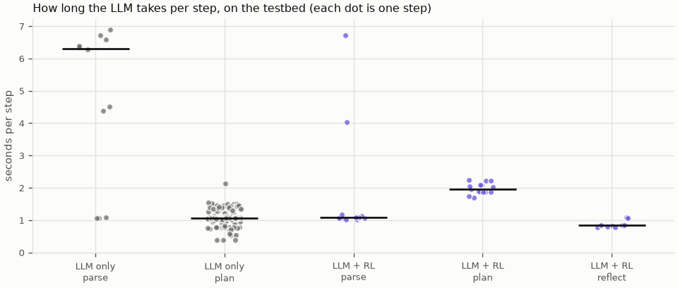

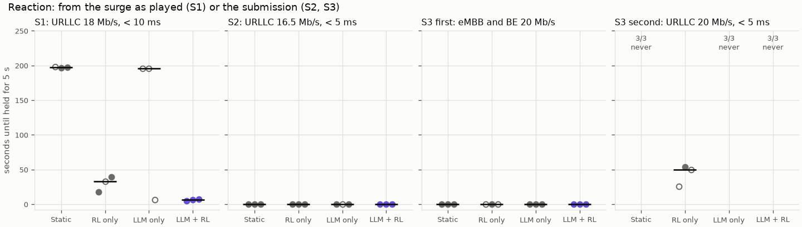

**How to read them:** one dot per step in the first, per repeat in the second; the bar is the median. "never" means the goal never held for 5 s in that run.

## 6. Choices and simplifications

- **Capacity 69 Mb/s from M07b** rather than the simulator's 75. The verifier should judge what the cell carries, and M07b's measurement was the evidence. It turned out too low, and 75 was closer. Rejected: fixed 75 with M08a's numbers, which looked like a known error then. A real system would measure capacity continuously, not once.
- **Segments start when the previous iperf3 closes,** copied from M07b. It should have been on a clock, since it makes the traffic depend on the controller. Not changed after the freeze.
- **All 36 runs count,** with the flag visible. Rejected: reporting only unflagged runs, which selects on outcome. The check itself should have measured a stuck process, not a long queue.
- **3 repeats:** what fits a session, and few. No seeds here, so the spread is the cell's and the LLM's.
- **The offered-load oracle stays on** (`traffic_target`), as in M07b, which showed the policy freezes after a surge without it. A real gNB wouldn't have it.
- **Bounds on RLC delay,** since KPM reports it; a real system would add transport and core delay.
- **rfsim:** a clean channel with one UE per slice. A real radio has varying channel quality, so this capacity is not a real cell's.
- **`eval/plot_control.py` unchanged:** M08c imports its helpers instead of giving its functions new arguments as planned, so M08a's figures can't move.
- **No tuning on these results.** Nothing in `agent/`, `verifier/` or the policy changed, and neither did the capacity.

## 7. Questions to check understanding

1. **Why does S2 give 1.00 for every controller on the testbed and not on the simulator?** The simulator's M/M/1 delay passes 5 ms at an equal split, while the real RLC delay stays near 0.6 ms until the slice saturates. Any split carrying 16.5 Mb/s meets the goal.
2. **Why isn't S3's rejection a clean result?** At 69 Mb/s the targets need 106 % of the PRBs, so the verifier rejects them. It accepts them at 75 Mb/s or more, and the cell carried about 81.
3. **Why does the traffic gap depend on the controller?** The next segment waits for iperf3 to close, which needs the slice's queue to drain. Static and LLM only leave eMBB's queue standing at 34.5 Mb/s offered, so they wait 14–28 s; RL only and LLM + RL about 2 s.
4. **Why do all 36 runs count when 8 are flagged?** The flag isn't one of the frozen validity rules, none of those fired, and it marks large queues. Dropping flagged runs would select on the outcome.
5. **What does `intent_met` miss in LLM + RL's S2 run?** The swing after the intent expires at t=300: URLLC falls to about 0.13 and its delay reaches about 3 s, outside the window being scored. Ping's p95 shows it.
