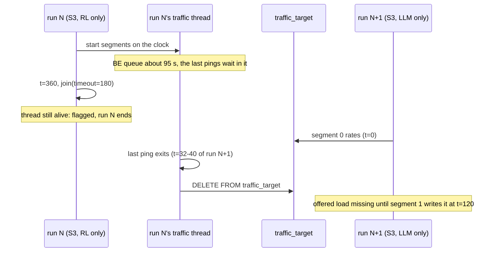
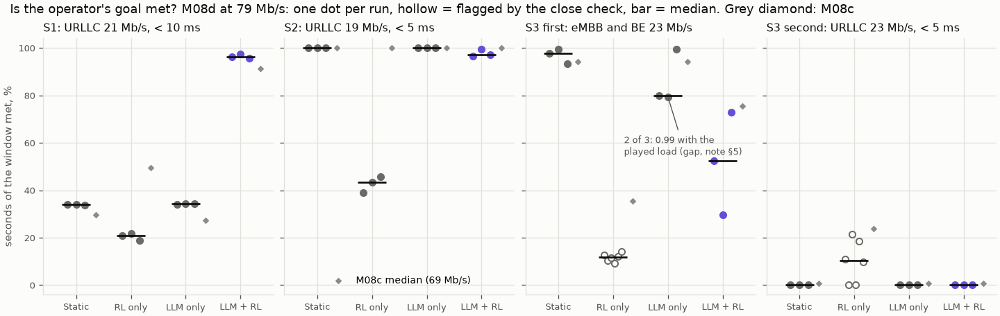
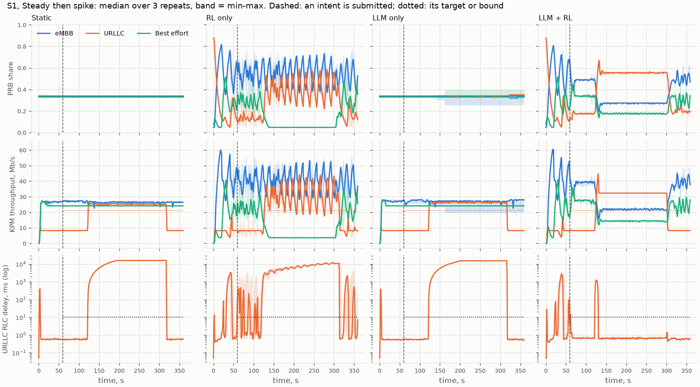
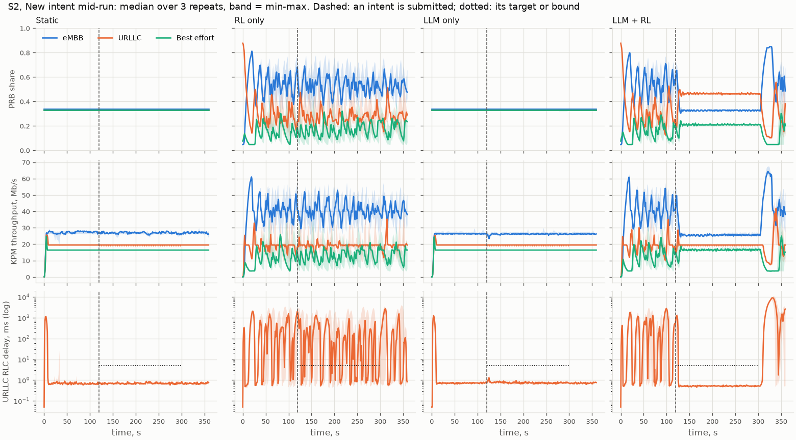
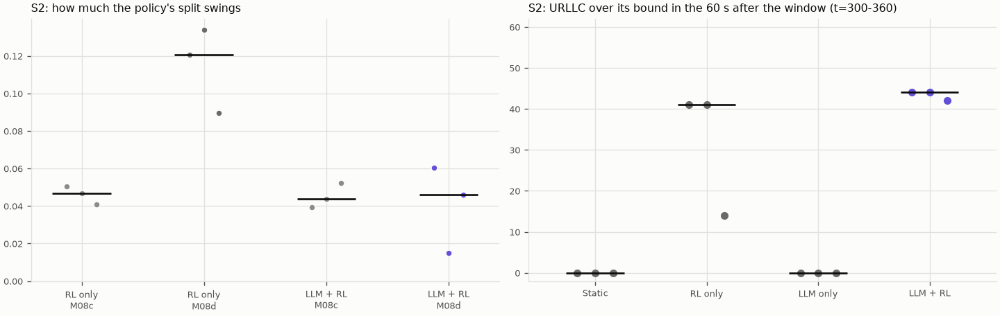
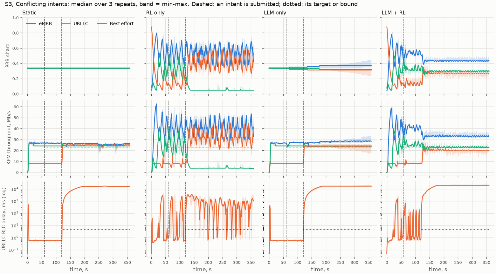
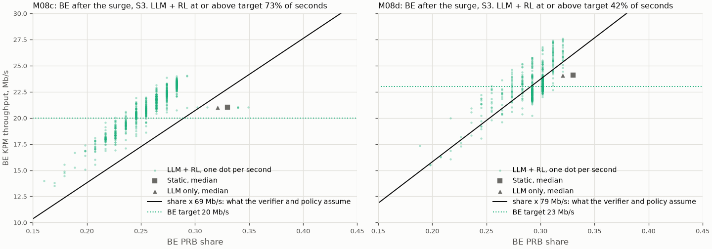
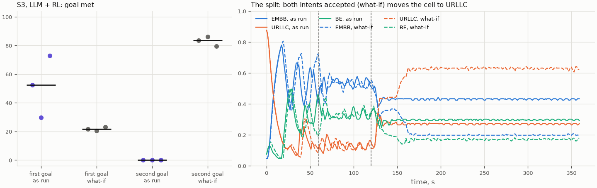
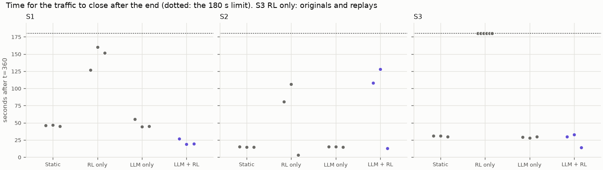
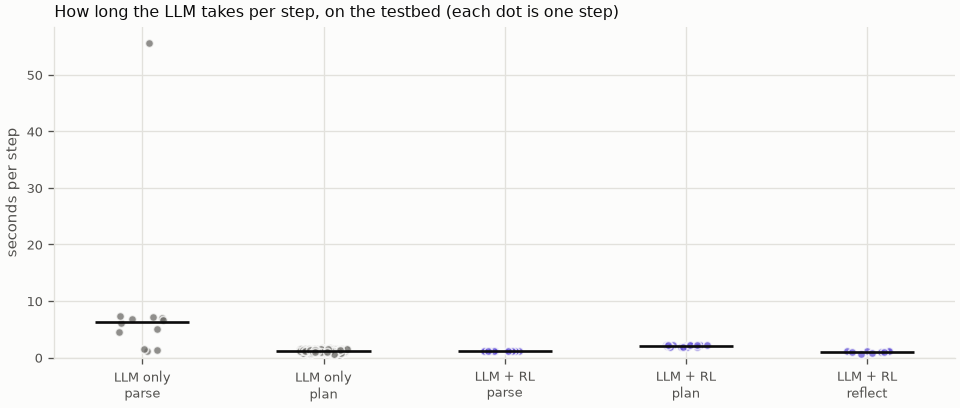

# M08d: control evaluation on the testbed, rerun

## 1. What we built

The M08c comparison (static, RL only, LLM only, LLM + RL on the real OAI gNB, 3 scenarios × 3 repeats), rerun after fixing the two harness
problems M08c exposed. The capacity given to the verifier and the policy is now 79 Mb/s, measured by a rule written before the measurement,
not 69. The traffic segments now start on the scenario's clock instead of waiting for the previous iperf3 to close. The validity rules were limited to M08c's four
frozen reasons. A new measure counts URLLC's time over its bound after an intent expires. Three exploratory S3 runs ("what-if")
tell the verifier the real URLLC base latency. 42 runs: 36, 3 replays and 3 what-if, about 5.5 hours (17:50–23:15 on 2026-11-07), all at commit 3358fb0.

**Main result:** LLM + RL still holds S1 alone (0.96 against 0.21–0.34), and the margin is wider than in M08c. **At the measured capacity,
two weaknesses that 69 Mb/s hid come out:** RL only's split swings twice as much and it fails S2 (0.43). LLM + RL's first S3 goal falls
to 0.53, because the share it gives BE is now worth just under the target on the real cell.

## 2. Where it sits in the architecture

The `eval/` box around figure 2, as M08c: `POST /intents` → LangGraph → verifier → `a1_policy` → RL xApp → E2 → gNB, KPM back. Hermes isn't in
the loop (H7). The capacity reported by `cell_info()` changed and the harness changed. `agent/`, the verifier's rules and the policy (v7) didn't.

## 3. How it works

1. **The capacity rule** ([testbed/measure_capacity_m08d.py:59](../../testbed/measure_capacity_m08d.py#L59)), frozen in `docs/DECISIONS.md` before the
   measurement: 3 splits × 3 load conditions, capacity = median over the splits of condition C's per-second KPM cell total. Result 79 (73.5–80.2 by split).
2. **The scenarios** ([eval/testbed_scenarios.py:16](../../eval/testbed_scenarios.py#L16)) keep M08a's fractions of the cell at 79 Mb/s, with
   targets rounded to whole Mb/s. M08c's scenarios are kept in `eval/testbed_scenarios_m08c.py` for its figures.
3. **The traffic thread** ([`play_segments`, eval/testbed_control.py:157](../../eval/testbed_control.py#L157)) sleeps until `t0 + at` for each
   segment ([:165](../../eval/testbed_control.py#L165)), writes the rates to `traffic_target`, and starts iperf3 on the segment's own port, `port + 10 i`
   ([testbed/traffic.py:70](../../testbed/traffic.py#L70)), plus ping. It waits for every process only after launching all of them
   ([:172](../../eval/testbed_control.py#L172)), then clears `traffic_target` ([:175](../../eval/testbed_control.py#L175)).
4. **One run** ([`play`, :220](../../eval/testbed_control.py#L220)): as M08c. For the what-if, the verifier's view of the cell is rewritten with a URLLC base
   latency of 0.6 ms after the runner's own write and before the agent starts ([:245](../../eval/testbed_control.py#L245)). At the end, the run waits at most
   180 s for the traffic thread ([:262](../../eval/testbed_control.py#L262)). If the thread is still alive, the run counts as "an iperf3 did not close" and the
   time to close is logged ([:265](../../eval/testbed_control.py#L265)).
5. **Validity** ([`problems`, :110](../../eval/testbed_control.py#L110)): a watched container restarted, the slice-control xApp exited, KPM stale over 5 s,
   or an iperf3 failed, including not closing within 180 s.
6. **The matrix** ([`play_matrix`, :346](../../eval/testbed_control.py#L346)): 3 rotated repeats with a testbed restart each. Then each invalid run is replayed
   once, after its own restart ([`replay_invalid`, :371](../../eval/testbed_control.py#L371)), and the original is kept as `repeatN_invalid`. Then the 3
   what-if runs ([:361](../../eval/testbed_control.py#L361)).
7. **The table** ([`write_table`, :299](../../eval/testbed_control.py#L299)) runs `eval.metrics` on every run directory, replays and originals included, and adds
   `over_bound_after_s` ([eval/metrics.py:61](../../eval/metrics.py#L61)): the seconds URLLC is over the intent's bound in the 60 s after its window.
8. **The figures and tables** ([eval/plot_testbed_m08d.py](../../eval/plot_testbed_m08d.py)) reuse M08c's plotting helpers. `eval/plot_testbed.py`'s
   timeline and latency functions now take the results folder as an argument, and M08c's figures regenerate byte for byte.

## 4. Diagram

The one harness problem this rerun found: how a flagged run can reach into the next one (part 5, "The offered-load gap").



## 5. How to run it and check it works

```bash
sudo modprobe sctp                                    # after a WSL restart
xapps/rl/build.sh                                     # if the code changed; --final checks the image
uv run python -m eval.testbed_control --final         # about 5.5 h with replays and what-if; resumes if stopped
uv run python -m eval.plot_testbed_m08d               # figures and the tables below
```

The matrix runs `testbed/down.sh` itself at the end. Expected: `[repeat r, i/12] testbed/sN/controller/repeatr: … s, valid True []` per run, then
`replayed …` and `[what-if r]` lines. Raw logs are in `eval/results/m08d/` (git-ignored), the table is [data/M08d-runs.csv](data/M08d-runs.csv), and the capacity
measurement is in [data/M08d-capacity.csv](data/M08d-capacity.csv).

### Is the goal met?

Median [min–max] over 3 repeats. For S3 RL only, the replays count, as the frozen rule says: "its replay counts whatever it shows". By the frozen rule,
a difference smaller than the repeats' spread isn't called a difference.

| Goal | Static | RL only | LLM only | LLM + RL | LLM + RL in M08c |
|---|---|---|---|---|---|
| S1: URLLC ≥ 21 Mb/s, < 10 ms | 0.34 [0.34–0.34] | 0.21 [0.19–0.22] | 0.34 [0.34–0.34] | **0.96 [0.96–0.97]** | 0.91 |
| S2: URLLC ≥ 19 Mb/s, < 5 ms | **1.00** | 0.43 [0.39–0.46] | **1.00** | 0.97 [0.97–0.99] | 1.00 |
| S3 first: eMBB and BE ≥ 23 Mb/s | **0.98 [0.93–0.99]** | 0.12 [0.11–0.13] | 0.80 [0.79–0.99]* | 0.53 [0.30–0.73] | 0.76 |
| S3 second: URLLC ≥ 23 Mb/s, < 5 ms | 0.00 | 0.18 [0.11–0.21] | 0.00 | 0.00 | 0.01 |

\* 0.99 [0.99–0.99] with the offered load the harness lost in 2 runs filled in from the scenario (see "The offered-load gap").



**How to read it:** each dot is a run, the bar is the median, and a hollow dot was flagged by the close check. The grey diamond is M08c's median at 69 Mb/s.
S3 RL only shows 6 dots: the 3 originals and the 3 replays, all flagged. S1 is the only goal where one controller is above all the others' ranges. In S2 and S3's first goal, LLM + RL
is below the equal split.

### S1: the design still works, more clearly



**How to read it:** rows are PRB share, KPM throughput and URLLC's RLC delay (log). Dashed lines mark a submitted intent, dotted lines its target or bound. Lines are the median over 3 repeats, bands the min–max.

- **LLM + RL** gives URLLC about 0.55 of the cell during the surge. URLLC's RLC delay has a median of 0.6 ms and a p95 of 0.8–1.0 ms. It reacts 6.7–10.6 s after the surge starts,
  against 6.3 s in M08c. **The cost:** eMBB leaves 11.4 Mb/s unmet and BE 5.8 Mb/s, with p95 RLC delays of 18–19 s and 28–30 s.
- **Static and LLM only** stay at about a third each. URLLC can't carry 31.5 Mb/s on that, so its queue grows to about 16 s.
  **LLM only no longer stops early:** with the traffic on a clock there is no gap with URLLC at 0 Mb/s, and the model kept proposing near-equal splits
  (URLLC 0.33–0.35) until the end in all 3 runs. M08c's `finish` during the gap didn't recur. LLM only also never asks for the ~0.40 URLLC needs.
- **RL only** gives BE about 0.05 and swings eMBB and URLLC. URLLC's delay sits at 6–8 s through the surge.

### S2: RL only fails once the capacity is right



M08c gave 1.00 everywhere. Now static, LLM only and LLM + RL meet it, and **RL only falls to 0.43.**



**How to read it:** left, the standard deviation of the eMBB share during S2's intent window, one dot per run, for M08c (grey) and M08d. Right, the seconds URLLC
spends over 5 ms in the 60 s after the window.

- **The swing doubled for RL only:** std 0.09–0.13 against 0.04–0.05 in M08c. Each dip in URLLC's share builds a queue: median delay 28–182 ms in
  the window, p95 1.2–2.8 s. **What I think explains it (known in part):** at 79 Mb/s S2's offered load is 74.5 Mb/s, 94 % of the cell by the policy's
  inputs and by the cell's real rate. In M08c it was 94 % by the inputs and about 80 % of the real cell, so a dip still left URLLC enough. The capacity was
  wrong in a direction that hid the swing. Why the swing itself is larger at 79 isn't explained: the policy's inputs changed, and I haven't separated the causes.
- **LLM + RL** holds URLLC at 0.46 with 0.5 ms delay during the window. Its swing stays at 0.02–0.06.
- **After the window**, URLLC is over its bound for **42–44 of the 60 s for LLM + RL** and 14–41 s for RL only, against 0 for static and LLM only. That's M08c's expiry
  swing, now measured: when the intent expires at t=300, the default objective takes URLLC's share down while eMBB's queue stands, and URLLC's delay reaches
  1.2–1.9 s median over t=300–360. `intent_met` doesn't see it, because it falls outside the window.

### S3, first goal: a near miss that 69 Mb/s hid





**How to read it:** each green dot is one second of LLM + RL's S3 run after the surge (t > 125 s), all 3 repeats. The solid line is what the verifier and the policy
assume a share carries (share × capacity), and the dotted line is BE's target. Grey markers are the equal-split controllers' medians.

- **LLM + RL gives BE a median share of 0.29.** By its capacity of 79 that's worth 23.1 Mb/s against a 23 Mb/s target. The cell gives 22.8, at this split about 78 Mb/s for the whole cell.
  BE is at or above target in 42 % of the seconds after the surge. With eMBB, which is always met, that gives 0.30, 0.53 and 0.73 over the window. The third run is higher because the agent's
  reflection revised the objective once (`revision limit reached`).
- **In M08c the same policy chose a share worth 18.2 Mb/s by its own numbers** (0.26 × 69) against a 20 Mb/s target, and the cell turned that into 21.2. The 17 % error in capacity
  covered for a policy that doesn't size a share exactly to a target. At 79 the error is about 1 %, so the cover is gone.
- **Static and LLM only** give BE a third, worth 24.1 Mb/s, well above a target set at 98 % of BE's offered load (23.5). They score higher for the same reason as in M08c:
  they over-serve BE.
- So this result tests the policy, not the verifier. The goal is feasible: static meets it. The policy's choice of share is about 1 Mb/s short, and
  the capacity's spread by split (73.5–80.2) is larger than that.

### S3, second goal, and the what-if

As run, the verifier rejected the second intent in 3 of 3 runs (`conflict`, 107 % of the PRBs with the simulator's 2 ms URLLC base latency), and the agent stopped after a repeated proposal.
**LLM only** served it only after the first intent expired: it applied a URLLC split 251–267 s after the submission, after the scenario had ended. Its worker is serial, as in M08c.



**How to read it:** left, the two goals as run and in the what-if, one dot per run. Right, the median PRB split over time: solid lines as run, dashed lines what-if; dashed verticals mark the submissions.

**Exploratory, outside the main comparison.** With URLLC's base latency at 0.6 ms (measured in M08c), the verifier accepts both intents.
**The second goal reaches 0.84 [0.79–0.86], and the first falls to 0.22 [0.20–0.23].** After about 160 s the policy gives URLLC 0.63 of the cell,
eMBB 0.20 and BE 0.17. URLLC needs about 0.40 for its full offered load and 0.29 for its target. **So accepting the pair doesn't make it held:** the
targets add up to 69 of 79 Mb/s, but the policy over-serves the slice with the tightest bound and starves the others (PLAN §8, over-serving). The conflict
moves from the verifier to the policy.

### Validity: the close check, a second protocol mistake



**How to read it:** seconds between t=360 and the traffic thread's end, one dot per run directory. The dotted line is the 180 s limit.

- **All 6 S3 RL only runs, 3 originals and 3 replays, hit the limit,** and no other run did (3–160 s). **Cause, from the logs:** RL only gives BE 0.05 of the
  cell in S3, so BE carries 3.7 Mb/s for 23.5 offered and its RLC delay reaches about 95 s. The last BE pings sit in that queue, and `ping -c` waits for them.
  The other ping files and all 6 iperf3 files per run are complete and error-free.
- **So the check measured the controller's outcome,** against the frozen principle that "a bad score alone never invalidates a run". It's the same kind of
  mistake as M08c's grace period, which I tried to remove and reintroduced through the time limit. No other validity reason fired: no container restart, no xApp exit,
  no stale KPM, no iperf3 error.
- **All runs count,** and the table uses the replays, as frozen. Originals and replays agree on the first goal: 0.10 [0.09–0.14] against 0.12 [0.11–0.13].
  The second goal differs, 0.00 [0.00–0.10] against 0.18 [0.11–0.21], within what RL only's swing produces when it passes under the bound by chance.

### The offered-load gap: a flagged run reaching into the next one

In the main matrix, the run after a flagged S3 RL only run was S3 LLM only (repeats 1 and 2). When the join gives up, the old traffic thread keeps running.
Its last ping exited 32 s and 40 s into the next run, and the thread then ran `DELETE FROM traffic_target` ([:175](../../eval/testbed_control.py#L175)), wiping the new run's
offered load until segment 1 wrote it again at t=120. The file times match to the second.

- **Effect on the score:** the metric treats a missing offered load as "not met" for t=60–120. With the load filled in from the scenario's own schedule
  ([`with_played_load`, eval/plot_testbed_m08d.py:191](../../eval/plot_testbed_m08d.py#L191)), the two runs score 0.993 and 0.990 instead of 0.799 and 0.793, like the third run (0.993).
  The table keeps the logged values, and the corrected ones are reported next to them.
- **Effect on control:** none on the split, since LLM only's xApp runs the equal-split baseline, which doesn't read `traffic_target`. The agent's `get_kpis` showed no offered load during the gap. Its
  splits were the same as the third run's (0.35/0.32/0.33), so no visible effect, though I can't exclude one.
- **Nothing else was touched:** every replay and every what-if started after a testbed restart, and no other `kpi.csv` has a missing offered load.

### Other measures



- **The LLM, seconds per step (median of run medians):** LLM + RL parse 1.16, plan 2.19. LLM only parse 5.13, plan 1.18.
- **One cold start:** the first LLM call of the matrix (S1 LLM only, repeat 1) took 55.7 s to parse, so its first split came 56.9 s after the submission instead
  of 7.5–8.3 s. Probably the model loading into VRAM after hours idle; not verified. It made no difference to that run's score (0.34, like the other two). The protocol has no warm-up step,
  which it should.
- **Parsing:** all 30 intent submissions parsed as stated, and there were zero agent errors.
- **Oscillation (movement, % of the cell per s, S1 / S2 / S3):** RL only 4.6 / 3.9–5.1 / 4.4–4.5, LLM + RL 1.8–2.0 / 2.6–2.9 / 1.5–2.2, from the table's `moved_per_s`. M08c: RL only 3.5 / 2.0 / 3.9, LLM + RL 1.8 / 3.2 / 1.3.
- **The RIC's request limit:** 8,521 controls in 42 runs, with a restart per repeat and per replay, far from ~60,000.
- **Delay definitions:** bounds are checked on KPM's RLC delay. Ping's URLLC median RTT is 20–25 ms when RLC delay is 0.5–0.7 ms.

**Read with care:** 3 repeats, a clean rfsim channel with one UE per slice, a policy that sees the offered load (`traffic_target`), and bounds on RLC delay, not end
to end. S1's result is clear. The rest depends on how close each target sits to the cell's real rate, which varies by about ±4 % with the split.

## 6. Choices and simplifications

- **Capacity 79 Mb/s by a rule written first,** not by picking the value that suits a result. Its spread by split (73.5–80.2) is reported. S3's near miss sits
  inside that spread. A real system would estimate capacity continuously and per split. A single number is a simplification that the S3 result shows the limits of.
- **Traffic on the scenario's clock, each segment on its own port.** This removed M08c's controller-dependent gap: every surge started on time. Rejected: keeping
  M08c's sequencing for comparability, because it made the traffic depend on the controller.
- **The 180 s close check was a mistake.** It should have detected a stuck process (no progress in iperf3's or ping's output), not a slow queue. I kept it
  because it was frozen and recorded what it did. All runs count. A real harness would also stop the old thread before the next run instead of letting it run on.
- **The offered-load gap is reported, not repaired in the table.** The logged values stay in `M08d-runs.csv`. The corrected values come from a function that fills only
  missing ticks with the rates iperf3 was playing, and are shown separately.
- **The what-if changes one input, URLLC's base latency in the verifier's model,** to the value M08c measured. Nothing else changes, and it isn't in the
  main table. It answers "what does accepting the pair do?", not "which controller is best".
- **No tuning on these results.** `agent/`, `verifier/`, the policy and the capacity are unchanged since the freeze.

## 7. Questions to check understanding

1. **Why does RL only pass S2 in M08c and fail it in M08d, with the same policy?** In M08c the policy's inputs said 94 % of a 69 Mb/s cell, but the real cell carried about 81, so URLLC had room even when its share dipped. At 79 the load really is 94 % of the cell, and the policy's swings (std 0.09–0.13) leave URLLC short often enough to queue.
2. **Why does LLM + RL miss S3's first goal more often than in M08c?** It gives BE about 0.29. By its capacity that's 23.1 Mb/s, but the cell gives 22.8 against a 23 Mb/s target. In M08c the policy aimed below target too, but the real cell had 17 % more capacity than assumed, which covered it.
3. **Why do all six S3 RL only runs fail the close check, and why do they still count?** RL only starves BE (0.05 of the cell), so BE's queue reaches about 95 s and the last pings can't return within 180 s. That's the controller's outcome, not a broken run. By the frozen principle a bad score never invalidates a run, and no other validity reason fired.
4. **What does the what-if show?** With the verifier told URLLC's real 0.6 ms base latency, it accepts both S3 intents. The second goal then reaches 0.84, but the first falls to 0.22, because the policy gives URLLC 0.63 of the cell when about 0.40 is needed. Accepting a pair doesn't mean the policy holds it.
5. **How did one run affect the next one, and how do you know?** A flagged run's traffic thread outlived the 180 s wait, and when its last ping exited it ran `DELETE FROM traffic_target` during the next run. That run's `kpi.csv` lacks offered load from the second the ping file was last written until t=120.
