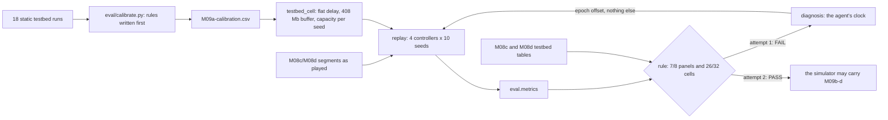
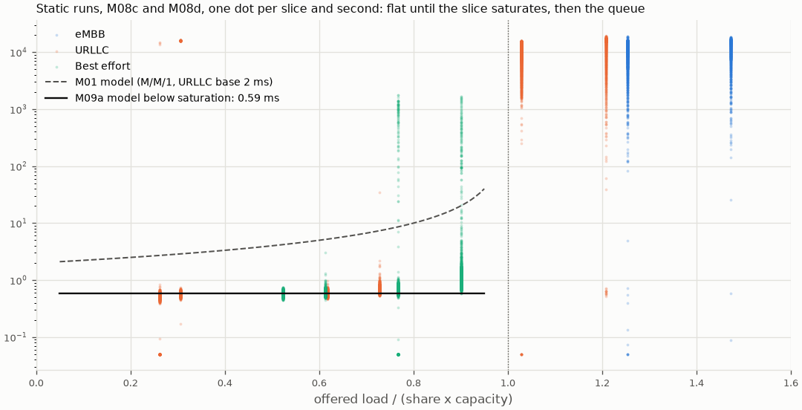
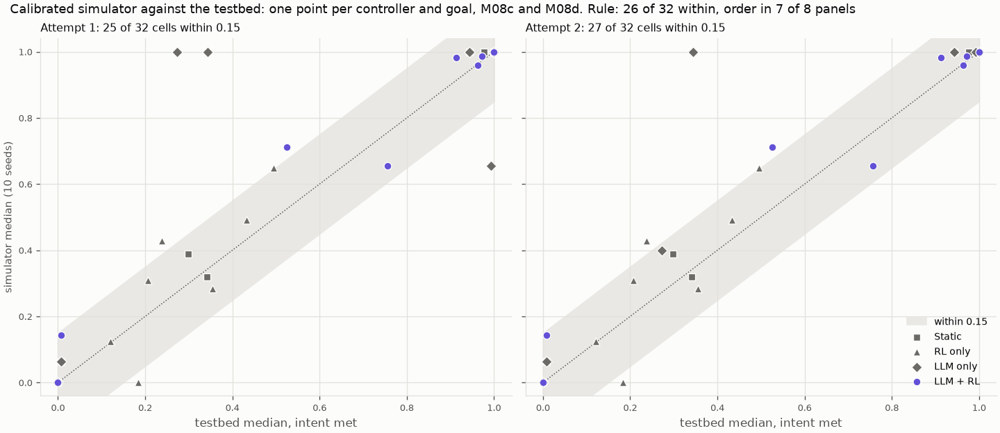
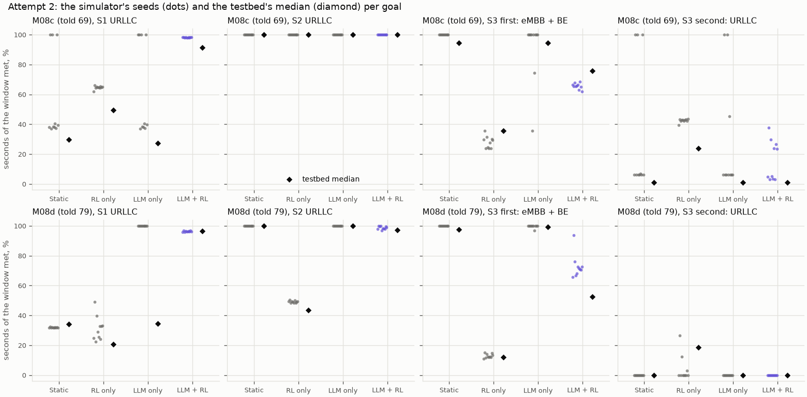

# M09a: the simulator calibrated to the testbed, and validated against it

## 1. What we built

A second profile of the simulated cell, set from what the OAI testbed showed:
- the RLC delay stays flat at about 0.6 ms until a slice saturates, then grows with the queue;
- the buffer holds about 400 Mb per slice;
- the capacity varies by seed over the range measured on the cell;
- the policy sees its KPIs 2 ticks late.

Every parameter came from static runs by rules written before computing them. The profile was then judged by replaying M08c's and M08d's scenarios: 240 simulated runs against 72 testbed runs, under a pass rule also written in advance. **The first attempt failed.** The diagnosis found the simulator showed the agent a different kind of clock. **The second and last attempt passed**: controller order matched in 8 of 8 panels and 27 of 32 cells were within 0.15. One of the remaining misses, LLM only, can't be closed by any simulator.

## 2. Where it sits in the architecture

M09a doesn't add a box to figure 2. It makes the evaluation's fast instrument trustworthy: the `SimBackend` behind the `Backend` interface, now able to stand in for `FlexRICBackend` in M09b–d.

Without it, every claim would need the testbed at 7 minutes per run. With it, a 6-minute scenario runs in seconds, and the testbed confirms a sample (M09e). The upper layers are unchanged: the same Runner, agent, verifier and policy v7.

## 3. How it works

1. **The cell model gets a second delay law** ([sim/cell.py:34](../../sim/cell.py#L34)): `delay_model="flat"` drops the M/M/1 term ([:187](../../sim/cell.py#L187)) and keeps the base delay plus drain time (backlog / slice rate). The default stays `"mm1"`, so M01–M08a reproduce unchanged.
2. **What the cell reports can differ from what it is** ([sim/cell.py:37](../../sim/cell.py#L37)): `reported_capacity_mbps` and `reported_urllc_base_latency_ms` are what the verifier and the policy are told. A replay of M08c can then tell them 69 Mb/s while the cell carries about 81, as happened on the testbed.
3. **The calibration** ([eval/calibrate.py:62](../../eval/calibrate.py#L62)) reads only the 18 static runs, whose split never moves. No controller's score enters it.
   - **Base delay:** the median delay over seconds where the slice is at most 80 % full ([`unsaturated`, :43](../../eval/calibrate.py#L43)).
   - **Buffer:** the 95th percentile of delay × throughput over saturated seconds ([`saturated`, :47](../../eval/calibrate.py#L47)).
   - **Load noise:** inside constant-rate segments ([`settled`, :51](../../eval/calibrate.py#L51)).
   - The values go to [data/M09a-calibration.csv](data/M09a-calibration.csv).
4. **The profile** ([`testbed_cell`, eval/sim_profiles.py:33](../../eval/sim_profiles.py#L33)) reads that CSV. It draws each seed's true capacity from the measured range ([:22](../../eval/sim_profiles.py#L22)) and sets what each study told the verifier ([:24](../../eval/sim_profiles.py#L24)).
5. **Traffic as iperf3 played it:** a `steps` pattern ([sim/traffic.py:61](../../sim/traffic.py#L61)). M08d's segments are on the clock. M08c's are as played: each segment starts at its median start time over the repeats, with nothing between segments ([`played_starts`, eval/validate_sim.py:61](../../eval/validate_sim.py#L61); [`replay_traffic`, :76](../../eval/validate_sim.py#L76)).
6. **The clock** (attempt 2): the backend publishes times on an epoch offset ([backends/sim.py:66](../../backends/sim.py#L66), [eval/validate_sim.py:41](../../eval/validate_sim.py#L41)), so the agent reads "1.794e+09 s" as on the testbed.
   - The cell's own clock and the scenario's still start at 0 ([`elapsed`, eval/harness.py:146](../../eval/harness.py#L146)).
   - KPIs and events are rebased on export ([:105](../../eval/harness.py#L105), [:115](../../eval/harness.py#L115)).
   - A test checks that a run with and without the offset is identical on the scenario's clock.
7. **The comparison** ([`compare`, eval/validate_sim.py:184](../../eval/validate_sim.py#L184)):
   - The testbed side is the median of each controller's runs ([`testbed_values`, :156](../../eval/validate_sim.py#L156)), and the simulator side the median of its 10 seeds.
   - A panel fails if any pair of controllers is ordered one way on the testbed and the other way in the simulator, each by more than 0.05 ([`panel_mismatches`, :173](../../eval/validate_sim.py#L173)).

## 4. Diagram



## 5. How to run it and check it works

```bash
uv run python -m eval.calibrate                       # the parameters, from the static runs
uv run python -m eval.validate_sim --dev              # 8 runs, about a minute: bugs only
uv run python -m eval.validate_sim --final            # 240 runs, about 30 min; refuses uncommitted code
uv run python -m eval.validate_sim --compare          # tables and verdict from finished runs
uv run python -m eval.plot_validate_sim               # figures and the effect checks below
uv run python -m eval.llm_repeat <run dir>            # does the same prompt give the same decision?
```

Expected from `--compare`: one line per panel ("order matches"), one per cell, then `"pass": true`. Raw runs are in `eval/results/m09a` (attempt 1) and `m09a2` (attempt 2), git-ignored. The tables: [data/M09a-validation.csv](data/M09a-validation.csv) and [data/M09a-sim-runs.csv](data/M09a-sim-runs.csv) for attempt 2, plus `-attempt1` versions.

### Why the delay model had to change



**How to read it:** one dot per slice and second of the static runs. The x axis is how full the slice is (offered / (share × capacity)); the y axis is KPM's RLC delay, on a log scale.

- **Below 1, the delay sits at about 0.6 ms;** above 1 it jumps to seconds. The M/M/1 curve of the M01 model (dashed) rises smoothly from 2 ms and predicts delay that isn't there. That's what made M08a's S2 separate the controllers when the real cell didn't (M08c).
- The vertical streaks at 0.77 and 0.90 are best effort while a queue drains, or on the edge of saturation as the cell's rate varies by split. The base value is a median, so these seconds don't move it.

| Parameter | Value | From |
|---|---|---|
| Base delay, URLLC / BE / eMBB | 0.592 / 0.631 / 0.611 ms | 3,507 and 3,922 unsaturated seconds. eMBB is never unsaturated under static, so it takes the median of the other two (a recorded deviation). |
| Buffer | 408 Mb per slice | Median of the slices' 95th percentiles (eMBB 411, URLLC 408; BE 21, from brief transients) |
| Load noise | 0.09 % | iperf3's constant rate |
| True capacity per seed | M08c 78.2–84.7, M08d 73.5–80.2 Mb/s | M08c's backlogged seconds; M08d's measurement by split |
| KPI delay | 2 ticks | M07b |

### The verdict: attempt 1 failed, attempt 2 passed



**How to read it:** each point is one controller and goal in one study (32 per panel), with the testbed's median across and the simulator's median up. The grey band is ±0.15, the rule's tolerance. Points on the dotted line agree exactly.

| | Panels in order (rule: 7 of 8) | Cells within 0.15 (rule: 26 of 32) | Without static | Verdict |
|---|---|---|---|---|
| Attempt 1 (5299153) | 6 | 25 | 17 of 24 | **FAIL** |
| Attempt 2 (3ae62a3) | **8** | **27** | 19 of 24 | **PASS** |

- **Between the attempts, one thing changed: the clock the agent reads.** In attempt 1 the simulator showed "Backend time: 61 s" where the testbed showed "1.79408e+09 s". With "61 s", qwen3:8b asked `get_kpis(window_s=61)`, reading the time as a window; with epoch times it used the default. That one step changed what it saw next.
  - **Second look:** attempt 2 rescored the same testbed data after a diagnosis. The pre-registration says so, and allowed exactly one attempt more.
- **Static's cells are nearly circular,** since the physics came from static runs. Without static, 19 of 24 cells pass (79 %), just under the rule's 81 % (26 of 32). The pass doesn't depend on static by much, but it does a little.



**How to read it:** one panel per goal and study, with the simulator's 10 seeds as dots and the testbed's median as a black diamond. The spread of the dots is the simulator's spread across seeds, mostly from the drawn capacity.

### The five cells still off, and what each means

| Cell | Testbed | Simulator | What it is |
|---|---|---|---|
| LLM only, M08d S1 | 0.34 | 1.00 | **The LLM's decision depends on details that don't matter.** See below. |
| LLM + RL, M08d S3 first goal | 0.53 | 0.71 [0.66–0.94] | The best-effort near miss of M08d, milder in the simulator: BE gets 0.312 of the cell and 23.7 Mb/s, against 0.292 and 22.8 on the testbed. The miss is about 1 Mb/s, so it depends on the capacity drawn. |
| RL only, M08c S1 | 0.49 | 0.65 | The swing; see "Effect checks" |
| RL only, S3 second goal, M08c / M08d | 0.24 / 0.18 | 0.43 / 0.00 | RL only never sees this goal. Its score is the share of seconds its swing happens to meet a 5 ms bound, which is chance in both places. The testbed's own M08d repeats gave 0.00–0.21. |

**LLM only.** `eval.llm_repeat` rebuilds a run's second planning prompt from its log and sends it five times.
- **Each prompt gives the same answer five times out of five:** URLLC 0.40 for the simulator's prompt, an equal split for the testbed's.
- **The two prompts differ only in details that don't change the right split:**
  - PRB shares are 0.333 in the simulator and 0.34/0.33 on the testbed, which applies whole PRBs.
  - URLLC's throughput reads 8.0 against 8.2 (KPM reads a few percent high).
  - Best effort's delay is 0.6 against 2.8 ms.
  - The time string has different digits.
- **The model's choice turns on them.** In a diagnostic during the analysis, one rebuilt prompt gave 0.40 on its first call and an equal split on the next four. So at temperature 0 it isn't always deterministic either.
- **In M08c's S1, attempt 2 matches the score but not the behaviour.** The simulator's LLM only called `wait_and_observe(300)` and never acted; the testbed's set URLLC to 0.40–0.50, then called `finish` during the traffic gap in 2 of 3 repeats. Both end near an equal split, for different reasons.

**What this means:** no simulator will reproduce LLM only reliably, because its decisions depend on inputs that carry no information. That's a finding about the LLM only controller, and an argument for the design. LLM + RL, where the LLM sets an objective and the policy sets the split, agrees in 7 of its 8 cells. M09's claims about LLM only will be confirmed on the testbed (M09e includes it), and M09b measures how often the same prompt gives different decisions.

### Effect checks (reported beside the verdict, as the rule asked)

| Check | Testbed | Simulator | Reading |
|---|---|---|---|
| RL only's swing in S2 (eMBB share std, t=120–300), M08d | 0.120 | 0.141 | Reproduced at 79 |
| Same, M08c | 0.047 | 0.005 | **Not reproduced.** At moderate load the real policy still swings; the simulated one barely does. Cause unknown; candidates are KPM's measurement noise and the real cell's rate varying second by second, neither of which the profile models. |
| LLM + RL's BE after S3's surge, share / Mb/s, M08d | 0.292 / 22.8 | 0.312 / 23.7 | Same mechanism, a bit more generous in the simulator |
| Same, M08c | 0.264 / 21.2 | 0.256 / 20.5 | Reproduced |
| S2: seconds over the bound in the 60 s after the window, M08d (RL only / LLM + RL / static / LLM only) | 41 / 44 / 0 / 0 | 28 / 37 / 0 / 0 | The expiry swing is reproduced, a little shorter |

## 6. Choices and simplifications

- **Calibration from static runs only.** It keeps every controller's score out of the parameters, at the cost of making static's cells nearly circular, which is why they're also reported without static. Rejected: fitting parameters to the controllers' scores, which would make the validation meaningless.
- **One delay law for every slice, flat then queue.** It's what the data shows (figure above). A real cell's RLC delay also depends on HARQ and scheduling, which the profile ignores.
- **Capacity as a random draw per seed, not a function of the split.** M08d measured 73.5–80.2 Mb/s depending on the split. A draw covers the spread without claiming to know the function. LLM + RL's S3 near miss sits inside that spread, which is why its cell is the hardest to match.
- **Replay of M08c as played, gaps included.** The simulator plays what iperf3 actually sent, not what the plan said. Rejected: M08c's nominal schedule, which would have compared different traffic.
- **The verifier is told what it was told then** (2 ms, 69 or 79 Mb/s). A correction to the pre-registration, made before any replay. Otherwise S3's second intent would be accepted in the simulator by construction.
- **A second attempt, and only one.** The diagnosis pointed at the instrument's input (the clock), not at a parameter. The fix is one line of meaning, and the pre-registration allowed exactly one retry on the same data. It's still a second look, and it's said as such.
- **The instrument isn't changed after passing.** Reporting PRB shares rounded to whole PRBs, as the testbed does, would probably move LLM only's S1 cell. It would also be a change after validation, so it's left as a known difference.
- **Not modelled:** the 15 s link-adaptation transient after idle; KPM's few percent above iperf3; the real cell's second-by-second rate variation.

## 7. Questions to check understanding

1. **Why does the flat delay model change which controllers look good?** Under M/M/1 a slice at 70 % load already has several times its base delay, so a 5 ms bound fails under an equal split (M08a's S2). On the real cell the delay stays at 0.6 ms until saturation, so any split that carries the load meets it. Only saturation separates controllers.
2. **Why calibrate only from static runs?** Their split never moves, so they show the cell's physics alone. Using controller runs would let the controllers' scores shape the parameters that are then used to judge them.
3. **What changed between attempt 1 and attempt 2, and why is that legitimate?** Only the clock the agent reads: epoch-like times instead of seconds from 0. The diagnosis showed the model treated "61 s" as a window length. It's an input the replay hadn't reproduced, not a tuned parameter. It's still a second look at the same data, so the pre-registration allowed one retry and said a second failure would stop M09.
4. **Why can't the simulator reproduce LLM only, and why does that help the design's case?** The same prompt gives the same answer, but prompts that differ in irrelevant digits (0.333 against 0.34 shares, 8.0 against 8.2 Mb/s) give different splits. A controller that acts on such details can't be predicted. LLM + RL lets the LLM set an objective that the verifier checks and the policy executes, and it agrees in 7 of 8 cells.
5. **Which cell is the hardest to match and why?** LLM + RL on M08d's S3 first goal (0.53 against 0.71). The best-effort share misses its target by about 1 Mb/s, less than the cell's rate varies by split (73.5–80.2), so the score depends on the capacity of the moment.
