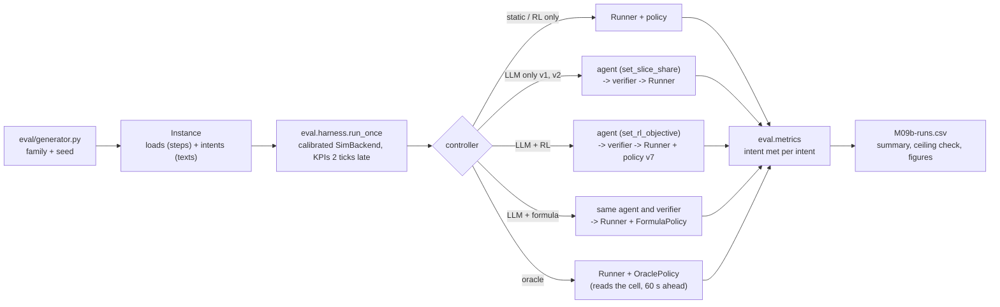
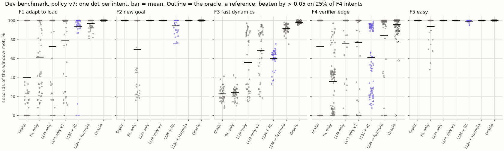
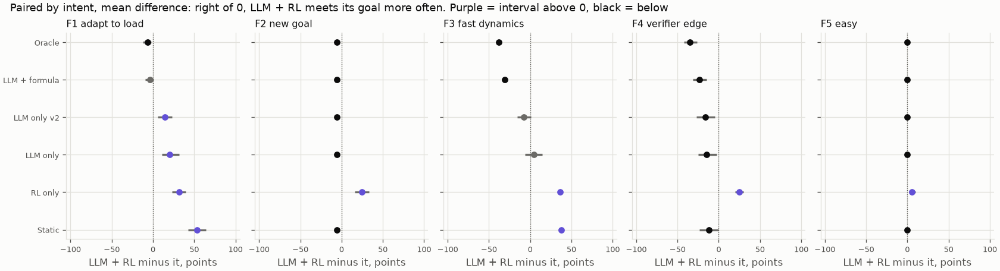
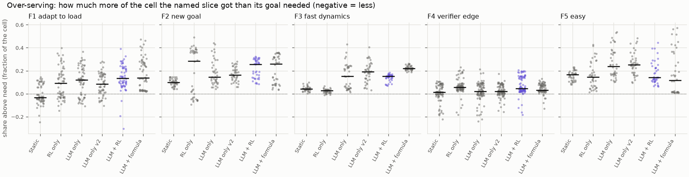

# M09b: a scenario generator and the broad dev benchmark, with policy v7

## 1. What we built

A generator of seeded scenario instances in five families, each aimed at one claim, and a benchmark that plays every controller on them in the calibrated simulator of M09a.
- **Seven controllers:** the four of M08 (static, RL only, LLM only, LLM + RL) and three references:
  - an oracle that knows the coming loads;
  - LLM + formula, the agent and verifier with arithmetic instead of RL;
  - a fairer LLM only (v2), with a revised prompt and the ability to serve a second request while it runs.

The dev set has 200 instances × 7 controllers = 1,400 runs. **These are dev results, used to build and tune; they are not a claim.** The claim comes once, on the test seeds, in M09d.

Two of the references were wrong in the first table: the oracle wasn't a ceiling and the formula was a strawman. Both were fixed and rerun before any analysis, and DECISIONS records how. What the table says about policy v7 is the input to M09c.

## 2. Where it sits in the architecture

M09b adds no box to figure 2. It is the evaluation the proposal's contribution 5 asks for, a comparison of controllers, widened from 3 hand-made scenarios to 200 generated ones. It runs the same upper layers as the testbed:
- the same LangGraph service, verifier, Runner and policy v7;
- against `SimBackend` in the profile M09a validated.

The references stand where the RL policy stands (`policy.shares(obs)`), so the Runner stays the only caller of `apply_prb_split` (hard invariant 4).

## 3. How it works

1. **An instance** ([`Instance`, eval/generator.py:40](../../eval/generator.py#L40)) is a family, a seed, the loads per slice as steps, and 1–3 intents.
   - Each intent has a time, an English or French text, and the facts it states.
   - `scenario()` and `traffic()` turn it into what the harness plays ([:53](../../eval/generator.py#L53), [:56](../../eval/generator.py#L56)).
2. **The families** ([eval/generator.py:103–177](../../eval/generator.py#L103)) follow DECISIONS' frozen ranges, with C = 79 Mb/s:
   - F1, adapt to load: a URLLC surge with a bound, or a target raised in two steps.
   - F2, a new goal: eMBB or BE, total load 0.95–1.10 C.
   - F3, fast dynamics: URLLC toggles between low and high every 10–30 s under a bounded intent.
   - F4, the verifier at and over the edge: three overlapping intents, or one request above the policy's range.
   - F5, easy goals.

   The verifier caps a change at 0.3 C, so an equal split meets any single accepted target. The families therefore test "adapt to load" through latency bounds and raised targets.
3. **Seeds** ([`seed_of`, :60](../../eval/generator.py#L60)): dev 100000 + 1000 × family + i. `generate(..., split="test")` refuses until M09d ([:179](../../eval/generator.py#L179)).
4. **The parse check** ([`parse_check`, eval/benchmark.py:54](../../eval/benchmark.py#L54)): the real model parsed all 265 intent texts as stated ([data/M09b-parse.csv](data/M09b-parse.csv)), so no instance is dropped (H7).
5. **The runs** ([`play`, eval/benchmark.py:83](../../eval/benchmark.py#L83)): every controller goes through `eval.harness.run_once` with the profile cell, KPIs 2 ticks late, and the real LLM latency charged to the cell. The oracle is the exception and reads the cell directly. A finished run is never played again.
6. **The oracle** ([`OraclePolicy`, eval/oracle.py:69](../../eval/oracle.py#L69)): every second it does three things.
   - It replays the backend's random generator to get the next 60 s of loads ([:80](../../eval/oracle.py#L80)).
   - It holds each split of a 0.025 grid over those 60 s with the batch cell model.
   - It keeps the split that meets the active intents for the most seconds ([`choose`, :51](../../eval/oracle.py#L51)).

   It knows an intent only once it is submitted.
7. **LLM + formula** ([`FormulaPolicy`, rl/baselines.py:30](../../rl/baselines.py#L30)) is the agent and verifier of LLM + RL ([eval/harness.py:154](../../eval/harness.py#L154)), with arithmetic instead of the policy:
   - each target gets min(target, load);
   - a bounded URLLC gets its peak load over the last 30 s, plus the verifier's margin;
   - every need is sized against 74 Mb/s;
   - over the bound, URLLC takes all the slack;
   - a bounded URLLC is served first if the needs exceed the cell.
8. **LLM only v2:** the prompt `LLM_ONLY_PLAN["v2"]` ([agent/graph.py:162](../../agent/graph.py#L162)) and `join_new_requests` ([:335](../../agent/graph.py#L335)), which serves every received request together instead of looping on the first.
9. **The table** ([`write_table`, eval/benchmark.py:147](../../eval/benchmark.py#L147)) has one row per run and intent ([data/M09b-runs.csv](data/M09b-runs.csv)):
   - intent met, the oracle's value, feasibility, over-serving, the verifier outcome and LLM latency.
   - [`summarise`, :192](../../eval/benchmark.py#L192) gives means with bootstrap intervals and the paired difference with LLM + RL ([data/M09b-summary.csv](data/M09b-summary.csv)).
   - [`ceiling_check`, :224](../../eval/benchmark.py#L224) counts the intents where any controller beats the oracle.

## 4. Diagram



## 5. How to run it and check it works

```bash
uv run python -m eval.benchmark --parse-check                    # 265 of 265 intents parsed as stated
uv run python -m eval.benchmark --dev                            # 1,400 runs, about 4 h (resumes; full run needs committed code)
uv run python -m eval.benchmark --dev --controllers oracle formula   # replay two controllers only
uv run python -m eval.benchmark --table                          # tables and the ceiling check
uv run python -m eval.plot_benchmark                             # three figures
uv run python -m eval.repeat_runs --play && uv run python -m eval.repeat_runs --table   # repeat plays
uv run pytest -q tests/test_benchmark.py                         # 12 tests
```

**Mean intent met.** In parentheses, LLM + RL minus that controller, paired by intent, with the 95 % bootstrap interval where it matters:

| | F1 adapt | F2 new goal | F3 fast | F4 verifier edge | F5 easy |
|---|---|---|---|---|---|
| **LLM + RL (v7)** | **0.93** | **0.94** | **0.60** | **0.61** | **1.00** |
| Static | 0.40 (+0.54 [0.43, 0.64]) | 1.00 (−0.06) | 0.23 (+0.38) | 0.73 (−0.12 [−0.23, −0.00]) | 1.00 |
| RL only | 0.62 (+0.32) | 0.70 (+0.25) | 0.24 (+0.37) | 0.36 (+0.25) | 0.94 (+0.06) |
| LLM only | 0.73 (+0.21) | 1.00 (−0.06) | 0.56 (+0.05 [−0.06, 0.14]) | 0.75 (−0.15) | 1.00 |
| LLM only v2 | 0.79 (+0.15 [0.06, 0.23]) | 1.00 (−0.06) | 0.68 (−0.08 [−0.16, 0.01]) | 0.77 (−0.16) | 1.00 |
| LLM + formula | 0.97 (−0.04 [−0.09, 0.01]) | 1.00 (−0.06) | 0.92 (−0.31 [−0.34, −0.28]) | 0.84 (−0.23) | 1.00 |
| Oracle | 1.00 | 1.00 | 0.98 | 0.95 | 1.00 |



*How to read it:*
- **Dots and bars:** one dot per intent, the bar is the mean, and the oracle is drawn as outlines.
- **F1:** LLM + RL is the only learned or LLM controller near the top. Static and LLM only split into a 0 cluster and a 1 cluster.
- **F3:** LLM + RL forms a tight band around 0.6, while the formula and the oracle sit near 1.
- **F4:** LLM + RL splits into a cluster near 0.95 (the URLLC intent) and a cluster at 0.1–0.3 (the eMBB and BE intent).



*How to read it:* a dot right of 0 means LLM + RL met its intents more often than that controller. A purple dot has its interval above 0; a black one has it below.



*How to read it:* the share each controller gave the named slice above what its goal needed (a cost to the other slices). On F2, every controller but static gives the target slice about 0.2 of the cell more than it needs, LLM + RL included (0.22). On F3, the formula over-serves most (0.22 against LLM + RL's 0.14): that's the price of its peak sizing.

**The ceiling check:**
- **The rule:** set before the rerun, it says "a reference, not a ceiling" if some controller beats the oracle by more than 0.05 on more than 5 % of intents.
- **The result:** 7.9 % of intents. That's 0 % on F1, F2, F3 and F5, and 24.7 % on F4, all of them F4a's URLLC intent.
- **The cause:** with no URLLC goal active, the oracle lets URLLC queue, because in an overloaded cell every split leaves the same total unmet. When the bound starts, draining the queue costs it 5–15 s. Static already had URLLC at a third of the cell and no queue.
- **The verdict:** the oracle is a ceiling for F1, F2, F3 and F5, and a reference on F4.

**The verifier on F4, LLM + RL:**
- **F4b:** all 10 requests above the policy's range (35–45 Mb/s) are rejected, although the oracle meets each one. That's the verifier's design: it accepts only what the policy was trained on (0.4 C). These are its 10 "feasible but rejected" intents.
- **F4a:** every intent is applied, including 12 the oracle labels infeasible. That label is unreliable on F4, as above.

**Where v7 loses (M09c's input):**
- **F4a's first intent, eMBB X and BE Y both 18–23 Mb/s: 0.27, against static's 1.00.**
  - Before the URLLC bound arrives, v7 gives eMBB 30–35 Mb/s for an 18–21 target, and BE sits just under Y.
  - After the bound arrives, it gives URLLC 0.43–0.53 of the cell, where 0.34–0.36 is needed (its load and the verifier's margin, on a 74 Mb/s cell), and BE falls to 10–18 Mb/s.
  - This is over-serving in a merged objective (the f4_00–f4_11 traces).
- **F2: 0.94, against 1.00 for static and every LLM controller.** 18 of 40 intents are under 0.99: v7 settles just below the target, the "about 1 Mb/s short" of M08.
- **F3: 0.60, against the formula's 0.92.**
  - The formula sizes URLLC to its peak load over the last 30 s, so the next rise finds the share already there.
  - v7's observation is one tick with no history, so it can only react, 2 ticks late, then drain.
  - It also gives URLLC less on average (0.43 against the formula's 0.51).
- **After expiry:** URLLC spends 13.3 s over the old bound after its intent expires, on average, the same as static (13.3) and more than the LLM controllers and the formula (7–10). This doesn't separate v7's expiry swing from the queue any controller leaves behind; M09c's mid-episode expiries in training target the swing directly.

**Decision consistency** (`eval.repeat_runs`; the 20 tuning instances, 25 intents, played 4 times with the same seed and code; [data/M09b-repeats.csv](data/M09b-repeats.csv)):

| | largest range of intent met across 4 plays | mean range | intents with range > 0.2 | intents met in some plays, not others (0.9 line) |
|---|---|---|---|---|
| LLM + RL | 0.006 | 0.000 | 0 | 0 |
| LLM + formula | 0.004 | 0.000 | 0 | 0 |
| LLM only (v1) | 0.92 | 0.07 | 2 | 3 |
| LLM only v2 | 0.99 | 0.14 | 5 | 4 |

*How to read it:*
- **What differs between plays:** only the model's answers and the real latency charged to the cell.
- **LLM + RL and LLM + formula:** the LLM chooses an objective once per intent, and the verifier and the policy or formula do the rest. The outcome repeats to within 0.006.
- **LLM only:** the LLM chooses every split. The same instance can be met or missed: v2 on f4_01's third intent went from 0.01 to 1.00, and v1 on f4_00's second intent from 0.08 to 1.00. The spread sits in F1, F3 and F4, where the LLM must keep changing the split.
- **Why it matters for the design:** keeping the LLM off the real-time path also makes the controller reproducible, not only fast. It also means any LLM only number needs repeats, as M09e plans on the testbed.

## 6. Choices and simplifications

- **Mean, not median.** Intent met is mostly exactly 0 or 1, so a median difference jumps between ties. F1 static's first median difference was 0.749 with an interval of [0.0, 0.787]. M09d pre-registers its own statistic.
- **The oracle is a receding horizon over constant splits, not an exact optimum.** The first, one-second-ahead version was trapped by any queue too big to drain in a second. It was beaten on 253 intents and fixed. The 60 s horizon still can't plan to drain a queue while keeping another intent (f4_23).
  - Rejected: a drain tie-break only, which still traps when intents compete.
  - Rejected: the best controller per intent as the ceiling, which would make P6's feasibility depend on the controllers.
  - A real study would solve the joint plan exactly over the whole run, by dynamic programming over a coarse queue grid, or label feasibility from both the oracle and the union of the controllers.
- **The formula was revised five times within LLM only's budget.**
  - Revisions 1–2 were tried on 4–10 instances and superseded.
  - Revisions 3–4 were scored on the 20 tuning instances, 3 plays each, and logged in [data/M09b-formula-revisions.csv](data/M09b-formula-revisions.csv).
  - Revision 4 was frozen at 0.945 on that set, against revision 0's 0.717.
  - Its 30 s peak memory is something the RL policy's input lacks. That is deliberate: P4 asks whether RL adds anything over the best simple rule, not over a weak one.
- **LLM only v2 was tuned the same way.** Revision 2 of 3 scored 0.870 against v1's 0.763. Its join fix is code, not prompt: v1's serial worker could never serve a second request in its window.
- **The tuning instances stay in the dev benchmark.** That is acceptable because dev results aren't reported as a claim. Test seeds stay closed.
- **The simulator stands in for the cell, and M09a validated it for policy and LLM + RL claims only.** LLM only's choices turn on tiny input differences that no simulator reproduces, so its claims go to the testbed (M09e).
- **What a real system would do differently:**
  - generate scenarios from traces of a live network;
  - include multi-cell interference;
  - label feasibility with an exact planner.

## 7. Questions to check understanding

1. **Why can't F2 or F5 show that LLM + RL "adapts", even in principle?**
   The verifier lets a target change by at most 0.3 C (23.7 Mb/s), and an equal split gives each slice about 0.33 of the cell. So any single accepted target is met by static. Only a URLLC bound under load, or a target raised in two steps, can separate the controllers.
2. **What trapped the first oracle, and why does a horizon fix most of it?**
   Once a URLLC queue was large, no split could meet the bound within one second, so every split scored 0 met and the tie-break served eMBB. Holding a split for 60 s shows that draining the queue meets the bound later, so draining wins.
3. **Why does LLM + formula beat LLM + RL on F3?**
   It sizes URLLC to its peak load over the last 30 s, so each rise finds the share already in place. v7 sees one tick of KPIs, 2 ticks late, with no history, so it reacts after the queue has formed and must then drain it.
4. **What does v7 do wrong on F4a's first intent, and what in M09c targets it?**
   When the URLLC bound arrives, it gives URLLC 0.43–0.53 of the cell against the 0.34–0.36 needed, and BE falls under its target. M09c's reward term for share above need is aimed at that over-serving.
5. **Why does LLM + RL give the same result on every play of an instance, while LLM only doesn't?**
   In LLM + RL the model speaks once per intent, to choose an objective that the verifier bounds, and the policy then acts every second deterministically. In LLM only the model chooses every split, and qwen3:8b's choices change with tiny input differences, such as latency-shifted timestamps. Repeated plays of the same instance moved its intent met by up to 0.99.
