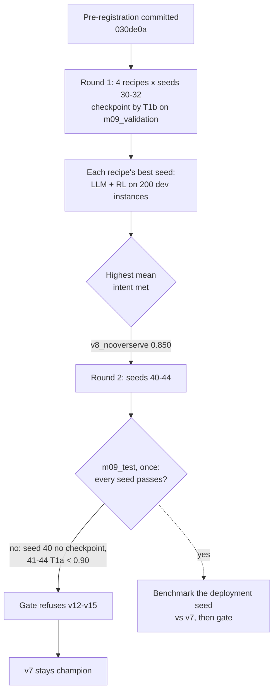
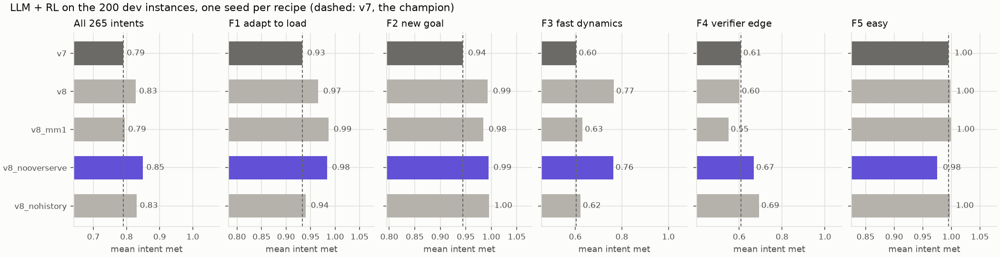
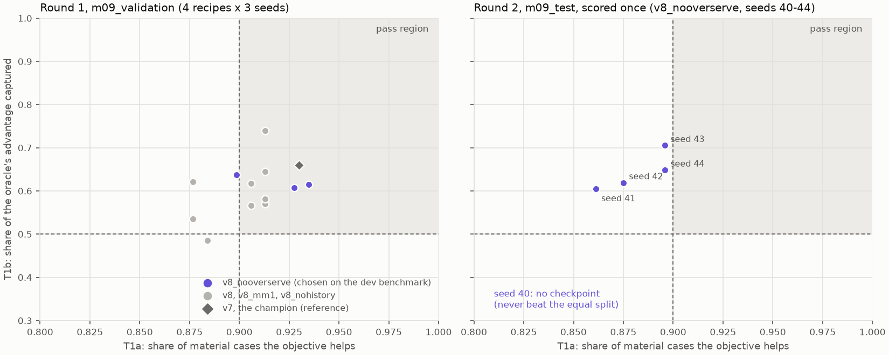
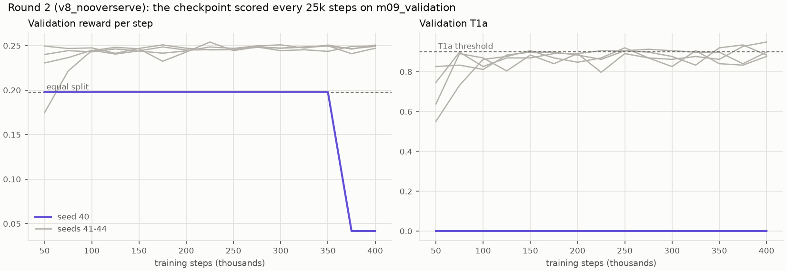

# M09c: policy v8, retrained in the calibrated setting, and not confirmed

## 1. What we built

A new training setting for the RL policy that matches how it is deployed, and the two pre-registered rounds that judged it.
- **The setting:**
  - the calibrated cell of M09a, with its true capacity redrawn every episode;
  - KPIs seen 1–3 ticks late, and the served smoothing filter in the loop;
  - objectives that switch or expire mid-episode, and on/off loads;
  - the observation gains a 30 s load history, so it grows from 22 to 25 values.
- **Round 1** compared four recipes (the full setting, and three versions each missing one change) on the M09b dev benchmark. `v8_nooverserve` won: LLM + RL met 0.85 of intents, against v7's 0.79.
- **Round 2** trained that recipe on five fresh seeds and scored them once on a held-out goal test. **It failed:**
  - one seed never learned;
  - the other four missed the T1a threshold by 0.004–0.04.
- **Outcome:** by the rule written before training, the registry's gate refused all of them and **v7 stays the champion**.

What M09c leaves is an ablation: the load history fixes fast dynamics, the calibrated cell matters, and the over-serving penalty didn't help. It also leaves a recipe that isn't yet reliable.

## 2. Where it sits in the architecture

M09c is the **RL xApp (DDPG/TD3)** box of figure 2, retrained. Nothing above it changes: the LangGraph service, the verifier and the `a1_policy` channel are the same.
- **The interface changed in one place.** The observation grew by three values, the per-slice load history. To keep v7 running unchanged, a policy reads only the inputs it was trained on ([rl/policy.py:54](../../rl/policy.py#L54), [:65](../../rl/policy.py#L65)).
- **The Runner feeds the history every tick**, whoever sets the split ([rl/runner.py:156](../../rl/runner.py#L156)), so a v8 policy would see the same features on `SimBackend` and `FlexRICBackend`.
- **The registry's promotion gate** ([mlops/registry.py:183](../../mlops/registry.py#L183)) is what kept v8 out. This is the MLOps part of the architecture working as designed.

## 3. How it works

1. **One place defines the setting** ([rl/m09.py](../../rl/m09.py)):
   - the constants: 120-step episodes, KPI delay 1–3, switch probability 0.02, half of them expiries, on/off loads on 25 % of slices, filter alpha 0.10;
   - the four `RECIPES` ([:32](../../rl/m09.py#L32));
   - `training_options` ([:58](../../rl/m09.py#L58)), shared by `rl.train`, `rl.goal_test` and `rl.sweep`.
2. **The environment** ([sim/env.py](../../sim/env.py)) gets options that are off by default, so M01–M09b episodes reproduce exactly. A test checks this.
   - `capacity_range` redraws the true capacity at reset ([:249](../../sim/env.py#L249)). `obs_cfg` stays at the told 79 Mb/s ([:212](../../sim/env.py#L212)), and the observation and reward are normalised by it, as the Runner does with `backend.info()`.
   - A queue of past KPIs, `_seen`, makes the view late: `_view` ([:327](../../sim/env.py#L327)) returns the KPIs of `kpi_delay` ticks ago. The objective stays current, as the Runner reads it from `a1_policy`.
   - At a switch, `expiry_share` returns to `DEFAULT_OBJECTIVE` ([:302](../../sim/env.py#L302)), the objective the Runner falls back to when an intent expires.
   - `toggle_prob` goes to `sample_traffic`, which then builds on/off steps with 5–40 s phases ([sim/traffic.py:115](../../sim/traffic.py#L115), [:125](../../sim/traffic.py#L125)).
3. **The load history** ([`LoadHistory`, sim/env.py:47](../../sim/env.py#L47)) keeps each slice's peak offered load over 30 s. Divided by C, the three values are appended after the objective.
   - It is fed the *late* loads the policy sees ([:325](../../sim/env.py#L325)), so training has exactly the lag deployment has.
   - The Runner uses the same class ([rl/runner.py:134](../../rl/runner.py#L134)) with `seen_loads` ([:84](../../rl/runner.py#L84)). A test checks that both give the same features.
4. **Reward v3** ([sim/reward.py:82](../../sim/reward.py#L82)) = v1 − 1.0 × `overserving` ([:90](../../sim/reward.py#L90)), where `overserving` is min(surplus, shortfall) / C.
   - Surplus is a non-short slice's capacity above its need. The need is min(target, load), its load if it has no target, or load / (1 − base/bound) for a bounded URLLC.
   - Shortfall is what targeted slices miss.
   - So surplus costs nothing until it starves someone. Relabeling ([rl/relabel.py](../../rl/relabel.py)) applies the same reward with the told capacity and base latency.
5. **Training** (`rl.train --m09 RECIPE`, [rl/train.py:216](../../rl/train.py#L216)) builds the env from the recipe. `ValidationCheckpoint` ([:124](../../rl/train.py#L124)) scores the policy every 25k steps on `m09_validation`.
   - It keeps the checkpoint with the highest T1b, then reward, among those that beat the equal split (the M02b rule, [:158](../../rl/train.py#L158)).
   - It saves `<run>_best.zip` only when one does.
6. **The goal test on the calibrated cell** ([rl/goal_test.py:157](../../rl/goal_test.py#L157), [:161](../../rl/goal_test.py#L161)) has fresh seeds: `m09_validation` from 7000, `m09_test` from 8000.
   - It plays 8 scenarios × 6 objectives as deployed: KPIs 2 ticks late, history on, filter 0.10, floor 0.05.
   - It keeps the M02b criteria: T1a ≥ 0.90 is the share of material cases where the policy's own objective beats the other one; T1b ≥ 0.50 is the share of the oracle's advantage captured; T2 is reward above the equal split.
   - `m09_test` needs `--final` and refuses a second run ([:350](../../rl/goal_test.py#L350)).
   - A seed that left no `_best` counts as failing ([`runs_without_best`, :324](../../rl/goal_test.py#L324), added before the held-out run, see §6).
7. **The launcher** ([rl/sweep.py:28](../../rl/sweep.py#L28)) runs round 1 (4 recipes × seeds 30–32) and round 2 (one recipe × seeds 40–44) in parallel, 2 threads each.
8. **Selection on the dev benchmark** (`eval.benchmark --policy ... --study ...`, then `--compare`, [eval/benchmark.py:255](../../eval/benchmark.py#L255)):
   - it plays LLM + RL with the candidate on M09b's 200 dev instances;
   - it pairs every intent with v7's run and appends a row to [data/M09c-selection.csv](data/M09c-selection.csv);
   - it records `beats_champion` in MLflow: a higher mean, and no family more than 0.02 below v7 (`FAMILY_DROP`, [:39](../../eval/benchmark.py#L39)).
9. **The gate** ([mlops/registry.py:183](../../mlops/registry.py#L183)) adds two checks:
   - the version was trained on the calibrated cell (tag `profile=m09`) and tested on `m09_test` ([:202](../../mlops/registry.py#L202));
   - the benchmark recorded it beating the champion ([:177](../../mlops/registry.py#L177)).

## 4. Diagram



## 5. How to run it and check it works

The long steps were run by Souhail. Each has a guard against running twice.

```bash
uv run python -m rl.sweep m09c-dev                                 # round 1: 12 runs, ~1.5 h, 24 threads
uv run python -m rl.goal_test --split m09_validation --min-share 0.05
uv run python -m eval.benchmark --dev --controllers proposed --policy models/m09c/dev/td3_v8_seed31_best.zip --study m09c_v8
#   ... same for the other three recipes' best seeds (~20 min each, Ollama)
uv run python -m eval.benchmark --compare m09c_v8                  # one row of data/M09c-selection.csv
uv run python -m rl.sweep m09c-confirm --recipe v8_nooverserve     # round 2: 5 runs, ~1 h
uv run python -m rl.goal_test --split m09_test --final --min-share 0.05   # ONCE: runs/m09c/test_result.json
uv run python -m mlops.registry register "models/m09c/confirm/*_best.zip"
uv run python -m mlops.registry promote --auto                     # gate: REFUSED, champion unchanged
uv run python -m rl.plot_m09c                                      # the three figures below
uv run pytest -q tests/test_m09c.py tests/test_mlops.py            # 12 + 10 tests
```

**Round 1 on validation** (138 material cases; equal split 0.198; v7 as a reference: T1a 0.93, T1b 0.66, reward 0.251). Eight of the 12 checkpoints pass, and every recipe has one seed that fails. The seed picked per recipe:

| Recipe | What it leaves out | Picked seed | T1a | T1b | Reward | Verdict |
|---|---|---|---|---|---|---|
| v8 | nothing | 31 | 0.913 | 0.740 | 0.252 | pass |
| v8_mm1 | calibrated cell (M/M/1 cell instead) | 30 | 0.877 | 0.621 | 0.252 | fails T1a |
| v8_nooverserve | over-serving term (reward v1) | 32 | 0.899 | 0.638 | 0.253 | fails T1a |
| v8_nohistory | load history (22 inputs) | 32 | 0.913 | 0.645 | 0.248 | pass |

**The selection, LLM + RL on the 265 dev intents** ([data/M09c-selection.csv](data/M09c-selection.csv)):



*How to read it:* each panel is one family, and the first panel is all intents. Each bar is one recipe's mean intent met; the dashed line is v7's.
- The chosen recipe is purple, v7 is dark grey, and the other recipes are light grey.
- **What it shows:**
  - every recipe beats v7 on F1 and F2;
  - only the two recipes with the history *and* the calibrated cell lift F3 (0.76–0.77 against 0.60–0.63);
  - v8_mm1 falls below v7 on F4 (0.55);
  - v8_nooverserve dips on F5, to 0.975 against 0.996 (6 of 40 intents at 0.75–0.95).
- **The rule picked `v8_nooverserve`**: 0.850, against v8_nohistory's 0.830, v8's 0.828 and v8_mm1's 0.795. The lead is more than the 0.01 tie margin.

**The goal test:**



*How to read it:* one dot per checkpoint. The grey area is where a checkpoint passes T1a and T1b.
- **Left (validation):** the dots sit on both sides of the T1a line at 0.90. v7, the diamond, is inside.
- **Right (held-out test, run once):** all four trained seeds land at T1a 0.861–0.896, left of the line, with T1b 0.60–0.71 and reward 0.224–0.244 against the equal split's 0.145. They pass T1b and T2 and fail T1a.
- Seed 40 has no dot: it left no checkpoint.

**Why seed 40 has no checkpoint:**



*How to read it:* the validation score of every checkpoint, every 25k steps.
- **Seed 40 (purple)** earns exactly the equal split's reward from 50k to 350k steps, then drops to 0.04. Its T1a is 0 throughout.
  - Its actor is saturated: at 400k it outputs the raw action [1, 1, 0] whatever the input.
  - Its training reward stayed around 23 per episode, which is the equal split over 120 steps.
- **The other four** reach 0.24–0.25 by 100k. Their T1a then wanders around 0.90 for the rest of training, so whether the picked checkpoint lands above or below the line is close to chance.
- **The same saturation happened once in round 1:** v8_nohistory seed 30 sat at the equal split up to 100k, but it recovered by 150k.

**The gate's output:** `v12..v15 td3_v8_nooverserve_seed4x_best: held-out goal test FAIL`, then `gate: REFUSED, champion unchanged`.

## 6. Choices and simplifications

- **The load history is a peak over 30 s, not a sequence or a recurrent network.** Three numbers are enough to size a latency bound to a burst; the formula baseline does exactly that and won F3 in M09b. A recurrent or stacked-frame policy was rejected because it costs more to train and is harder to explain. The ablation supports the choice: without the history, F3 stays at 0.62.
- **v7 is served unchanged through `n_inputs`.** The alternative, a fixed zero history fed to v7, was rejected: v7 was never trained with those inputs. A test proves that v7 acts identically on 22 and 25 inputs, and replaying 10 dev instances gave byte-identical KPIs.
- **The recipe was chosen on the dev benchmark, not on the goal test.** The benchmark measures what matters, intents met through the whole chain. The cost is that the dev benchmark is now used for selection and is no longer evidence; M09d scores fresh test seeds.
- **The pre-registered rules were applied as written, three times, even where that hurt:**
  - the seed picked per recipe in round 1 didn't have to pass, and two didn't;
  - the chosen recipe's F5 dip was a known risk for promotion, recorded before round 2;
  - one seed in five collapsing was enough to fail the recipe.

  Retraining seed 40, or switching to the runner-up recipe after seeing the test, would have turned the held-out test into another selection step.
- **A guard added before the held-out run:** without `runs_without_best`, "every seed must pass" would have been computed over the 4 seeds that left a checkpoint, and could have passed. It was added after round 2 trained but before `m09_test` was opened, and it makes the rule stricter, not looser.
- **Reward v3 didn't help, and the reason isn't established.** v8 (with the term) scored 0.60 on F4, against 0.67 for v8_nooverserve (without it). One seed per recipe can't separate the term's effect from seed noise: the round-1 seeds of a single recipe differ by up to 0.21 in T1b.
- **What a real system would do differently:**
  - Train more seeds per recipe and choose by the median seed, not the best one.
  - Detect a saturated actor during training (constant actions over a validation batch) and restart it with a recorded rule, written before the run.
  - Make the checkpoint rule look at T1a too. Under the M02b rule a checkpoint is chosen by T1b alone, and on this harder cell T1a sits close to its threshold. In M02b it was about 0.97 everywhere, so the gap never showed.
  - All three are changes to a rule, so they belong in a new pre-registration, not in a rerun of this one.
- **Also fixed in M09c:** the five round-2 runs started together and raced to create the MLflow experiment, so 4 of the 5 lost their training record (`mlops.tracking.use_experiment` now reuses one created meanwhile). Their curves are still in `runs/m09c/confirm/*/monitor.csv` and TensorBoard.

## 7. Questions to check understanding

1. **Why does the environment normalise the observation by 79 Mb/s when the episode's cell carries, say, 74?**
   Because the deployed policy only knows what the backend reports, 79. If training normalised by the true capacity, the policy would learn from information it never has on the testbed, and it would be short there, as v7 was by about 1 Mb/s on F2.
2. **v7 was trained on 22 inputs and the Runner now builds 25. Why does v7 behave exactly as before?**
   `SlicePolicy.raw_action` passes the model only its first `n_inputs` values, read from the model's own observation space. The extra three history values are cut before the actor sees them, and a test checks that the actions are identical.
3. **All four trained confirm seeds beat the equal split and captured 60–71 % of the oracle's advantage on the held-out test. Why did they still fail?**
   T1a was below 0.90 for all of them (0.861–0.896): in more than 10 % of the material cases, giving the policy the right objective didn't make it do better than the other objective. The test requires all three criteria on every seed, and seed 40 had no checkpoint at all.
4. **What does the ablation say the load history does, and how do you know it's the history?**
   It fixes fast dynamics: on F3, the two recipes that have the history and the calibrated cell score 0.76–0.77, while v8_nohistory scores 0.62, close to v7's 0.60. v8_nohistory differs from v8 only by the history. It is still one seed per recipe, so the evidence is indicative.
5. **Why not retrain seed 40, or run the confirm round with v8_nohistory, which beat v7 in every family?**
   Both choices would be made after seeing results the rule was meant to judge blind. The held-out test would then become a selection step, and its pass would no longer mean what the pre-registration said. A new recipe or retry rule needs its own pre-registration and fresh seeds.
