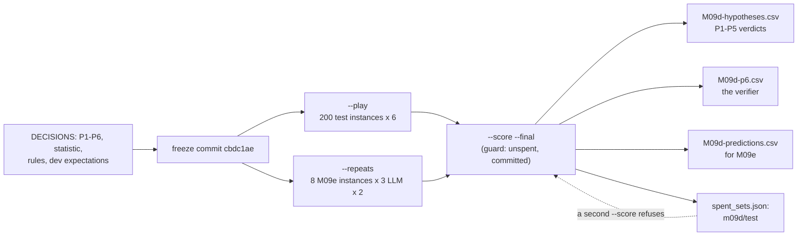
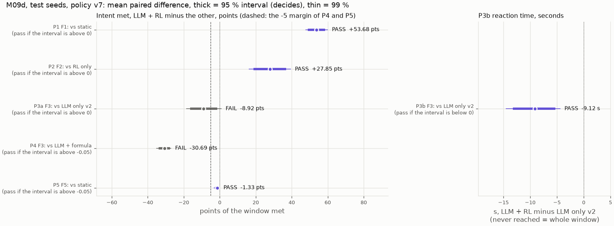
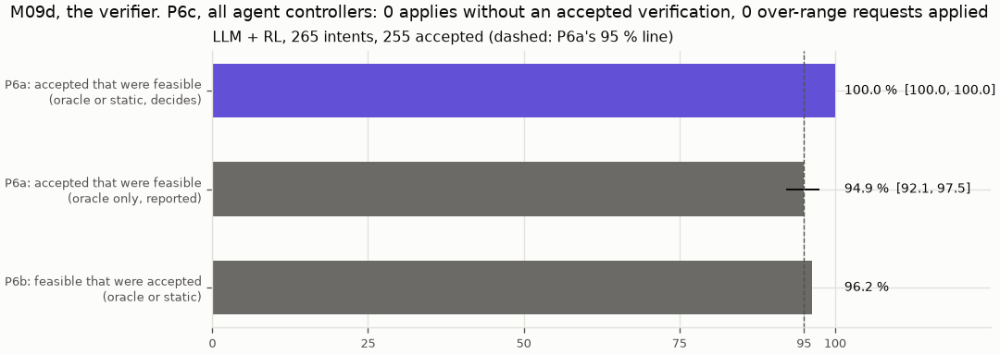

# M09d: the pre-registered result on the test seeds (policy v7)

## 1. What we built

The first result of M09 that is a claim rather than a dev reading. The six hypotheses P1–P6 were first stated on 2026-11-07 but written into the repo only now. They were frozen in `docs/DECISIONS.md` together with the statistic, the pass rules and the expectations from dev (commit cbdc1ae). Then the 200 test instances of M09b's generator were played with 6 controllers (1,200 runs). The 8 instances M09e will replay on the testbed got 2 more plays each (48 runs), and everything was scored **once**. The set `m09d/test` is now spent. The policy is v7, because v8 (M09c) and v9 (M09h) both failed their held-out goal test.

| Claim | Test (LLM + RL minus …) | Mean paired difference [95 %] | Verdict |
|---|---|---|---|
| P1 | F1, static | **+0.537** [+0.490, +0.585] | **pass** (also at 99 %) |
| P2 | F2, RL only | **+0.279** [+0.189, +0.368] | **pass** (also at 99 %) |
| P3 | F3, LLM only v2: (a) intent met, (b) reaction | (a) **−0.089** [−0.164, −0.014]; (b) −9.1 s [−13.2, −5.3] | **fail** (a fails; b passes) |
| P4 | F3, LLM + formula (no worse than −0.05) | **−0.307** [−0.340, −0.277] | **fail** |
| P5 | F5, static (no worse than −0.05) | −0.013 [−0.028, −0.003] | **pass** |
| P6 | the verifier | accepted and feasible 255/255 = 1.000; feasible accepted 0.962; 0 unverified or over-range applies | **pass** (a and c) |

Every verdict matches the expectation written down before scoring. Every intent-met estimate is within 0.04 of its dev value, and P3b is 9.1 s against 11.8 s on dev. The headline in one sentence: **the chain LLM → objective → verifier → controller works and is safe, but on this simulated cell the RL policy is not what makes it work.** Over all 265 intents LLM + RL meets 0.780 of the seconds asked, LLM only v2 0.819 and LLM + formula 0.929.

## 2. Where it sits in the architecture

M09d does not add a box to figure 2: it **measures the whole chain**, the LangGraph service, the verifier, the `a1_policy` channel and the RL xApp, on the calibrated simulator backend (M09a). Each hypothesis aims at one part:
- **P1, P3 and P4 test the RL xApp's fast loop:** against a fixed split, against an LLM that sets the split itself, and against a hand-written formula fed the same verified objective.
- **P2 tests the agent's objective change:** RL only never gets the operator's goal.
- **P6 tests the deterministic verifier box** (hard invariant 3) together with the apply path: every split or objective applied must have passed the verifier right before.
- **The predictions file is the bridge to the testbed backend** (FlexRIC, M09e). It is the same interface (`backends/`) and the same upper layers, so the simulator can make claims the testbed then checks.

## 3. How it works

1. **The test instances.** [`test_instances`, eval/generator.py:201](../../eval/generator.py#L201) draws the 200 instances (seeds 200000 + 1000 × family + i) from the same frozen families as dev. `generate(..., "test")` still refuses, so no M09b path can reach them.
2. **The guard.** [`guard`, eval/m09d.py:75](../../eval/m09d.py#L75) refuses three cases: the set is in `docs/learn/data/spent_sets.json`; the code directories have uncommitted changes; `docs/DECISIONS.md` has uncommitted changes. `--play`, `--repeats` and `--score` all call it, so the rules sit before the runs in the history.
3. **The play.** [`play_test`, :95](../../eval/m09d.py#L95) loops over the instances and the [6 controllers, :37](../../eval/m09d.py#L37) and calls M09b's own `play` with a separate results root (`eval/results/m09d`, [eval/benchmark.py:56](../../eval/benchmark.py#L56)). A finished run is skipped, so a stopped play resumes. It prints only wall times, so no result is seen before scoring.
4. **The M09e sample and its repeats.** [`m09e_sample`, :89](../../eval/m09d.py#L89) draws 2 instances per family F1, F2, F3 and F5 from a fixed seed (20261111). The result was written in DECISIONS before the play: F1 19, 38; F2 34, 38; F3 3, 27; F5 2, 31. [`play_repeats`, :107](../../eval/m09d.py#L107) plays the three LLM controllers twice more on them. static has no LLM and is deterministic, so one play is enough.
5. **One row per run and intent.** `score` calls M09b's [`table_rows`, eval/benchmark.py:160](../../eval/benchmark.py#L160). That is the same measuring code as dev (intent met, reaction, over-serving, outcome, the oracle's numbers). It then adds `static_met` and the P6 label.
6. **Pairing.** [`paired_groups`, :163](../../eval/m09d.py#L163) subtracts the other controller's value from LLM + RL's, intent by intent, and groups the differences by instance. For P3b the value is [`reaction_or_window`, :154](../../eval/m09d.py#L154): an intent never reached counts as its whole window, so a controller can't look fast by never getting there.
7. **The cluster bootstrap.** [`bootstrap_means`, :128](../../eval/m09d.py#L128) resamples **instances**, not intents, 10,000 times with seed 0. Each resample recomputes the mean over all the intents of the drawn instances. An F1b or F4a instance has 2–3 intents that share one traffic trace and one cell, so resampling them one by one would narrow the interval falsely. [`interval`, :138](../../eval/m09d.py#L138) takes the 2.5/97.5 percentiles (and 0.5/99.5 for the 99 % one).
8. **The verdict.** [`verdict`, :143](../../eval/m09d.py#L143) applies the [registered rules, :62](../../eval/m09d.py#L62):
   - superiority: lower bound > 0;
   - non-inferiority: lower bound > −0.05;
   - faster: upper bound < 0.
9. **P6.**
   - [`feasible`, :195](../../eval/m09d.py#L195): an intent is feasible if the oracle **or** static meets it in ≥ 90 % of its window.
   - [`p6`, :228](../../eval/m09d.py#L228) computes the share of accepted intents that were feasible (P6a, with a cluster interval) and the share of feasible intents that were accepted (P6b). It does both under this label and under the oracle-only label.
   - [`unverified_applies`, :202](../../eval/m09d.py#L202) reads each agent run's event log. Every `applied` must follow an accepted `reverified`. Every `shares_applied` (LLM only's `set_slice_share`) must follow an accepted `verified_shares` with the same shares. Each verification serves one apply. And no F4b over-range target may appear in an applied objective (P6c).
10. **The predictions.** [`predictions`, :267](../../eval/m09d.py#L267) works per M09e instance and controller:
    - it averages the instance's intent met over its plays;
    - it widens [min, max] by 0.15 (M09a's cell tolerance);
    - it marks "best" for any controller within 0.05 of the top;
    - it writes the sign of LLM + RL minus each other controller ("tie" within 0.05).
11. **Once.** [`score`, :304](../../eval/m09d.py#L304) refuses without `--final` and refuses a run still missing. It writes the four `docs/learn/data/M09d-*.csv` tables and `eval/results/m09d/result.json`, and only then calls `mark_spent`.



## 4. Results in detail



How to read it: each line is one claim. The dot is LLM + RL's mean advantage, in points of the window met for the left panel and in seconds for P3b on the right. The thick bar is the 95 % interval that decides; the thin bar is the 99 % one. Purple means the claim passed, grey that it failed, and the verdict is written next to the bar. The dotted line is 0; the dashed line is the −5-point margin that P4 and P5 must stay above. No verdict changes between 95 % and 99 %.



**Mean intent met per family, test (dev in brackets):**

| Family | static | RL only | LLM only v2 | **LLM + RL** | LLM + formula | oracle |
|---|---|---|---|---|---|---|
| F1a URLLC surge + bound | 0.22 | 0.20 | 0.54 | **0.86** (0.83) | 0.91 | 1.00 |
| F1b target raised twice | 0.50 | 0.81 | 0.88 | **0.99** (0.99) | 1.00 | 1.00 |
| F2 new goal | 1.00 | 0.66 | 1.00 | **0.94** (0.95) | 1.00 | 1.00 |
| F3 fast dynamics | 0.24 | 0.23 | 0.70 | **0.61** (0.61) | 0.92 | 0.98 |
| F4a conflicts | 0.83 | 0.35 | 0.81 | **0.60** (0.64) | 0.90 | 0.93 |
| F4b over range (rejected) | 0.00 | 0.36 | 0.29 | **0.36** (0.40) | 0.50 | 1.00 |
| F5 easy | 1.00 | 0.92 | 1.00 | **0.99** (1.00) | 0.97 | 1.00 |
| all 265 intents | 0.66 | 0.52 | 0.82 | **0.78** (0.79) | 0.93 | 0.98 |

What the claims mean, one at a time:
- **P1 and P2 hold strongly.** An operator goal turned into an RL objective beats a fixed split under load (+0.54) and beats an RL policy that never hears the goal (+0.28). This is the design's main bet: intent → objective works.
- **P3 fails, and in the unhelpful direction.** On F3 the LLM that sets the split itself meets 0.089 *more* of the window than LLM + RL, and the interval excludes 0. LLM + RL does reach a held target 9 s sooner (P3b passes), but it does not keep it: v7 has no load history, so it chases a URLLC load that flips every 10–30 s (the M09b finding, unchanged).
- **P4 fails by a wide margin (−0.31).** The two controllers get the same verified objective; only the split-setting part differs, and the formula wins F3 by 0.31. Across all families the formula is ahead everywhere except F5. This was the risk the 2026-11-07 roadmap named: when P4 fails, the value of the hierarchy sits in the chain LLM → objective → verifier, and RL adds nothing on this cell. It matches the 2026-11-11 review: the simulated cell is linear in PRBs and the offered load is known, so a formula that sizes each slice to its need is close to the oracle.
- **P5 holds, just.** On easy goals LLM + RL is 0.013 below static. The interval stays inside the 0.05 margin but excludes 0: a small, real cost.
- **P6 holds.**
  - All 255 accepted intents were feasible, and the verifier accepted 255 of the 265 feasible ones (0.962). The 10 it refused are F4b's over-range requests. They are feasible in the cell (the oracle meets them), but they ask for more than the verifier's step allows, which is the rule working as designed.
  - Under the oracle-only label precision would be 0.949, just below 0.95. The difference is 13 accepted F4a intents that the oracle met in less than 90 % of their window and static met fully. 11 of them are the URLLC intent the oracle fails after letting a queue build (the 2026-11-09 finding); 2 are the first, eMBB + BE intent. That is why the label was fixed before the run.
  - No controller applied anything unverified, and none applied an over-range target.

Also reported, not decisive:
- **The oracle is again a reference, not a ceiling.** Some controller beats it by more than 0.05 on 7.5 % of intents; all of them are in F4, where it happens on 23.5 % of intents.
- **Every agent controller parsed 265/265 intents.** `result.json` shows LLM only v2 at "201/265" because `parse_ok` was empty for 64 intents, and empty is not wrong. LLM only v2 *joins* a later intent into the one it is running (M09b), so the parse is logged under the first intent's id with `joined`, and `eval.metrics.parse_correct` looks only under the intent's own id. All 64 joined parses match the stated facts (checked from the logs, see §5). `parse_correct` was not changed after scoring: it also feeds M09b's dev tables.
- **LLM + RL moves the split more than the others.** Mean `moved_per_s` is 0.026 of the cell per second, against 0.002 for the formula and 0.001 for LLM only v2.
- **Over the latency bound after expiry.** In the 60 s after a bounded intent ends, LLM + RL spends 11.7 s over the bound on average. The formula spends 7.0 s and LLM only v2 7.6 s.

**The predictions for M09e** (`docs/learn/data/M09d-predictions.csv`), LLM + RL minus each other controller:

| Instance | Predicted best | vs static | vs LLM only v2 (weak) | vs formula |
|---|---|---|---|---|
| f1_19 (F1a) | LLM + RL 0.91 | + | + | + |
| f1_38 (F1b) | formula, LLM + RL 1.00 | + | + | tie |
| f2_34, f2_38 | all 1.00 | tie | tie | tie |
| f3_03 | formula 0.96 | + | + | − |
| f3_27 | formula 0.88 | + | tie | − |
| f5_02, f5_31 | all 1.00 | tie | tie | tie |

Of the 24 signs, 8 are +, 2 are − and 14 are ties. The F2 and F5 instances predict "all tie", so they can only check that the testbed does not separate the controllers either. Read the `best` column, not `rank`: among tied controllers `rank` follows the listing order. LLM only v2's spread over its 3 plays reached 0.49 on f1_38 and 0.51 on f3_03; that is why its rows are marked weak (M09a).

## 5. How to run it and check it

The scoring is spent and refuses to run again. These commands reproduce what was run and check what is on disk:

```bash
uv run pytest -q tests/test_m09d.py                  # 18 tests: rules at their boundaries, guard, P6c scanner
uv run python -m eval.m09d --score --final           # now: "m09d/test was already scored on 2026-11-11 ..."
column -s, -t docs/learn/data/M09d-hypotheses.csv    # one row per P1, P2, P3a, P3b, P4, P5
uv run python -m eval.plot_m09d                      # redraws docs/learn/img/M09d-*.png from the CSVs
uv run python -m mlops.archive --verify              # the raw runs (git-ignored) match the committed manifest
```

The original sequence (Souhail, 2026-11-11, Ollama on the GPU: `curl localhost:11434/api/ps` showed `size_vram` equal to the model's size): `--play` (1,200 runs), `--repeats` (48), then `--score --final` once. Expected output of the score is the six hypothesis lines of the table in §1, then P6 and the ceiling check.

To check the parse count yourself, look at a two-intent LLM only v2 run. The second intent's parse step carries `"joined": "i0002"` under intent `i0001`:
```bash
grep '"node": "parse"' eval/results/m09d/m09d_test/f1_20/llm_only_v2/seed200020/events.jsonl
```

## 6. Choices and simplifications

- **All instances kept (intent-to-treat).** The roadmap said a misparse drops its instance (H7). Souhail chose to keep every instance: dropping would hide a failure of the chain from the controllers that use an LLM. Here nothing was misparsed, so the choice changed no number. A real deployment has no "drop", which is why this is the honest default.
- **Cluster bootstrap by instance**, not by intent. Rejected: M09b's per-intent bootstrap, which treats the intents of one instance as independent and gives intervals that are too narrow.
- **The mean, not the median.** Intent met is mostly 0 or 1, so a median difference jumps between ties (M09b's dev lesson).
- **95 % per claim, 99 % reported.** Each claim is about a different family and was named in advance, so the per-claim interval answers each question. Bonferroni at 99 % is shown and changes nothing here. A real study claiming "all five hold at once" would decide on the joint rule.
- **P6's label: oracle or static.** Rejected: the oracle alone, which mislabels URLLC intents after its own queue trap. Also rejected: "any controller", which makes the label depend on the controllers under test. Static and the oracle use no LLM and are not what P6 tests.
- **P4 as non-inferiority with a 0.05 margin**, the same margin as P5. A stricter reading (RL must beat the formula) would fail too.
- **Two controllers left out:** LLM only v1 (superseded by v2, and ~50 min of model time) and formula_a10 (an M09g diagnostic). The comparison with them is on dev only.
- **The simulator is the instrument**, validated in M09a to 0.15 per cell. A real system would need the testbed for every claim about LLM only, because its choices turn on input details no simulator copies. M09e is that check, on 8 instances.
- **What this does not show.** The cell is linear with a known load, so it cannot show RL's possible advantage on nonlinear dynamics or hidden load. That is the review's proposed M10 (a harder cell). The result also holds for v7 only.

## 7. Questions to check understanding

1. **Why resample instances rather than intents in the bootstrap?**
   The 2–3 intents of one F1b or F4a instance share its traffic and its cell, so their outcomes are correlated. Resampling them one by one counts correlated values as independent evidence and makes the interval too narrow.
2. **P3b passes but P3 fails. What does that say about v7 on F3?**
   It reaches a held target sooner than LLM only v2 (9 s on average), but holds it for less of the window. Without load history it keeps chasing a URLLC load that flips every 10–30 s, and the window score is what P3a measures.
3. **What does P4's failure mean for the design?**
   With the same verified objective, a formula meets 0.31 more of F3 than RL. So on this cell the value comes from the chain LLM → objective → verifier → actuator, and the RL policy is replaceable. The RL claim needs a cell where a formula is not near optimal (M10).
4. **Why would the oracle-only label have made P6a fail (0.949) when nothing about the verifier changed?**
   The oracle let URLLC queue before a bounded intent arrived (11 of the 13 cases), and it failed 13 accepted intents that static met in full. Those intents counted as "infeasible but accepted". The label, not the verifier, was wrong, and it was fixed before the run.
5. **The F2 and F5 predictions say "all tie". What can M09e learn from them?**
   Only a negative check: if the testbed separates the controllers where the simulator says they are equal, the simulator misses something. Instances that predict a winner, F1 and F3, are what test the simulator's ranking.
