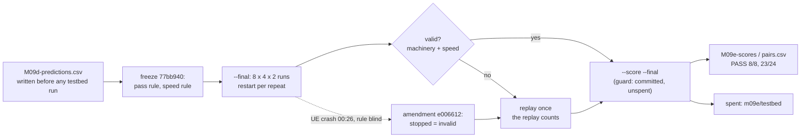
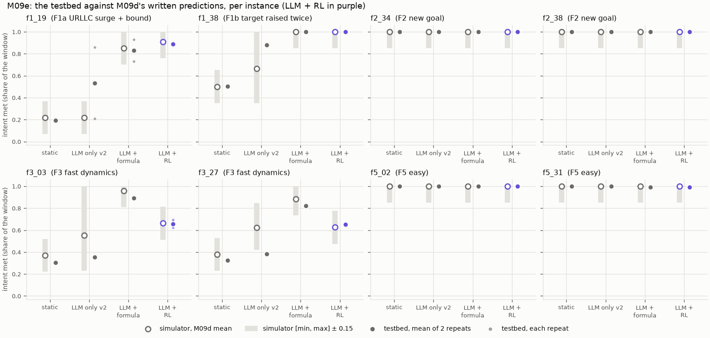
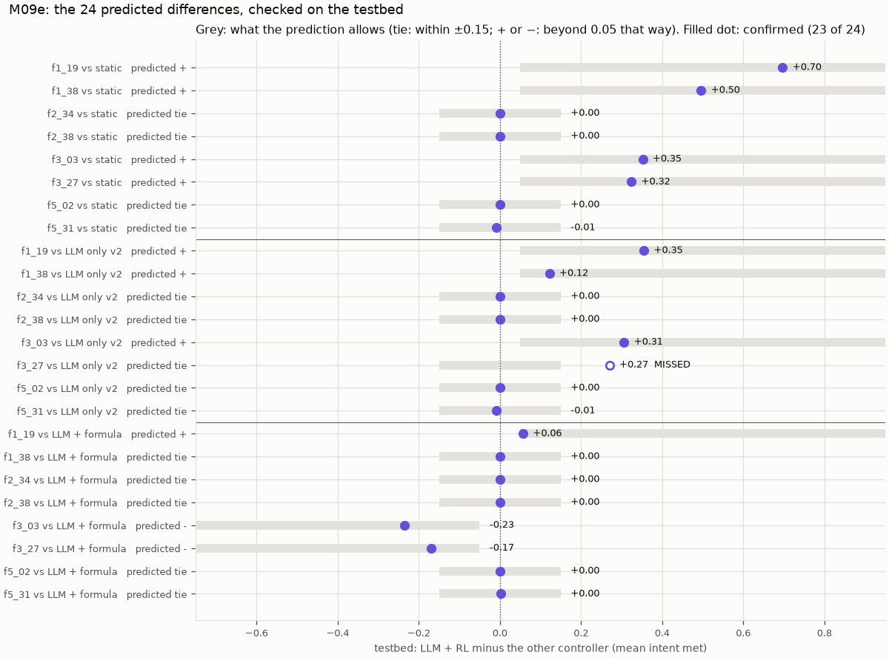

# M09e: the testbed checks M09d's written predictions

## 1. What we built

The check that M09d's simulator claims hold on the real stack. M09d wrote down, before any testbed run, how 4 controllers would score on 8 fixed test instances and the sign of LLM + RL minus each of the others. M09e played those 8 instances × 4 controllers × 2 repeats (64 runs of 360 s at real speed, one night, 2026-11-13 17:33 to 2026-11-14 02:05) on OAI gNB + 3 nrUE in rfsim + FlexRIC + OAI CN5G. It judged them against the pass rule frozen in `docs/DECISIONS.md` (commit 77bb940), and scored **once**. The set `m09e/testbed` is now spent.

| Pass rule (pre-registered) | Needed | Testbed |
|---|---|---|
| The testbed's best controller is in M09d's predicted "best" set | ≥ 6 of 8 instances | **8 of 8** |
| LLM + RL minus each other controller has the predicted sign, or stays a tie | ≥ 75 % of 24 pairs | **23 of 24 (95.8 %)**; 16 of 16 without LLM only v2 |
| **Verdict** | | **PASS** |

The headline in one sentence: **the simulator's ranking holds on the testbed, including M09d's negative result: with the same verified objective, the formula beats the RL policy on F3 on the real stack too (−0.24 and −0.17).** "Pass" means the predictions transfer. It does not mean LLM + RL is the best controller.

## 2. Where it sits in the architecture

M09e adds no box to figure 2. It runs the **same upper layers** (LangGraph service, verifier, `a1_policy` emulation, RL xApp with policy v7, formula baseline) against the **other backend**: the FlexRIC testbed instead of the Python simulator. That is the design's "one interface, two backends" requirement, used as an experiment. The simulator made predictions through `backends/SimBackend` (M09d), and the testbed checks them through FlexRIC: the KPM monitoring xApp feeds the KPI store, and the slice-control xApp applies the PRB split over E2. Nothing above the backend changed for the night.

The traffic is iperf3 inside each UE's network namespace. The score is computed from KPM (the RAN's own report), the same way as every simulator run (`eval.metrics`).

## 3. How it works

1. **The sample and the predictions.** M09d's [`m09e_sample`, eval/m09d.py:90](../../eval/m09d.py#L90) drew 2 test instances per family F1, F2, F3 and F5 with a fixed seed: F1 19, 38; F2 34, 38; F3 3, 27; F5 2, 31. M09d's [`predictions`, eval/m09d.py:268](../../eval/m09d.py#L268) wrote `docs/learn/data/M09d-predictions.csv` for them:
   - a mean intent met per controller, with its [min, max] widened by 0.15 (M09a's cell tolerance);
   - which controllers count as "best" (within 0.05 of the top);
   - the sign of LLM + RL minus each other controller ("tie" within 0.05).
2. **The guard.** `--final` and `--score --final` call [`guard`, eval/m09d.py:75](../../eval/m09d.py#L75). It refuses a spent set, uncommitted code directories and uncommitted DECISIONS, so the rule sits before the runs in the history.
3. **The matrix.** [`play_matrix`, eval/m09e.py:362](../../eval/m09e.py#L362) runs the 32 (instance, controller) pairs per repeat. The order is rotated by 5 for repeat 2 ([`order`, :117](../../eval/m09e.py#L117)), and the testbed is restarted at the start of each repeat. A pair that already has a `run.json` is skipped, which is how the night resumed after the UE crash (point 8).
4. **One run.** [`play`, :257](../../eval/m09e.py#L257):
   - It sets the controller through environment variables ([`controller_env`, :129](../../eval/m09e.py#L129)): LLM + formula is the agent in `proposed` mode with the runner's `--baseline formula`, and LLM only v2 is `llm_only` with prompt v2 and joining.
   - It checks the simulator speed ([`require_real_time`, :188](../../eval/m09e.py#L188)), then plays the instance's traffic as generated ([`play_traffic`, :223](../../eval/m09e.py#L223)). Each slice gets a new iperf3 only when its rate changes, by `docker exec` into one helper container per slice ([`start_helpers`, :140](../../eval/m09e.py#L140)).
   - The night started 560 iperf3 clients, with a start lag of at most 0.03 s.
5. **The RF simulator's speed.** rfsim has no clock of its own: on a throttled host the whole cell slows down, and it carries less per PRB. [`frame_marks`, :162](../../eval/m09e.py#L162) and [`rfsim_speed`, :172](../../eval/m09e.py#L172) compare the gNB's `Frame.Slot` log lines (one every 128 frames of 10 ms) to the wall clock:
   - Before each run, the last 15 s must reach 0.95× real time.
   - Over the scenario, the speed must reach 0.75× ([`speed_problems`, :197](../../eval/m09e.py#L197)).
   - The night ran at 0.95–1.04× idle and 0.86–0.90× under traffic.
6. **Validity: machinery only, never a score.** [`problems`, eval/testbed_control.py:118](../../eval/testbed_control.py#L118) makes a run invalid if:
   - the xApp exited;
   - KPM went stale for over 5 s;
   - a watched container restarted **or stopped** (the second case was added on 2026-11-14, see point 8 and §6);
   - an iperf3 client failed for a reason other than its own deadline.

   `play` adds the speed rule from point 5.
7. **One replay.** [`replay_invalid`, :375](../../eval/m09e.py#L375) renames each invalid run to `repeatN_invalid`, restarts the testbed and plays it again. **The replay counts, whatever it shows.** This keeps a controller that breaks the machinery from being replayed until it gets lucky.
8. **The amendment.** At 00:26 the best-effort UE segfaulted during f1_19 / LLM + RL / repeat 2, and the night stopped at the next run. The validity rule compared only restart counts (0 before, 0 after), so the crashed run read "valid".
   - Souhail chose to extend the rule before any score was computed. [`restart_counts`, :177](../../eval/testbed_control.py#L177) now gives `NOT_RUNNING` for a stopped container.
   - That run was marked invalid with its evidence (`ue_be_crash.txt`, `marked_invalid` in its `run.json`), and one more `--final` replayed it alone, at commit f13d163.
9. **The score.** [`score`, :457](../../eval/m09e.py#L457) measures every counted run with `eval.metrics.measure_run`, the same code as on the simulator.
   - [`scores`, :404](../../eval/m09e.py#L404) averages each run's intent met, then the 2 repeats.
   - [`judge`, :422](../../eval/m09e.py#L422) applies the rule. Best: any controller at the top counts, and the instance matches if one of them is in the predicted set. Pairs: [`confirmed`, :415](../../eval/m09e.py#L415) accepts a tie within ±0.15, and a sign only beyond 0.05 in that direction.
   - It writes `docs/learn/data/M09e-{runs,scores,pairs}.csv` and `eval/results/m09e/result.json`, then marks the set spent.



## 4. Results in detail



How to read it: one panel per instance and one column per controller, with intent met on a shared 0–1 axis.
- **Simulator (left of each column):** the hollow ring is M09d's mean, and the grey bar its [min, max] widened by 0.15.
- **Testbed (right of each column):** the filled dot is the mean of the 2 repeats, and the small dots are the repeats themselves. They show through only where the repeats differ.
- LLM + RL is purple.
- A filled dot inside its grey bar means the testbed landed where the simulator said it would.

**Per instance, mean intent met over 2 repeats, testbed (simulator in brackets):**

| Instance | static | LLM only v2 | LLM + formula | **LLM + RL** | best: predicted → testbed |
|---|---|---|---|---|---|
| f1_19 (F1a) | 0.19 (0.22) | 0.53 (0.22) | 0.83 (0.85) | **0.89** (0.91) | RL → RL |
| f1_38 (F1b) | 0.50 (0.50) | 0.88 (0.66) | 1.00 (1.00) | **1.00** (1.00) | formula, RL → formula, RL |
| f2_34, f2_38 | 1.00 | 1.00 | 1.00 | **1.00** | all → all |
| f3_03 (F3) | 0.31 (0.37) | 0.35 (0.55) | 0.89 (0.96) | **0.66** (0.66) | formula → formula |
| f3_27 (F3) | 0.33 (0.38) | 0.38 (0.62) | 0.82 (0.88) | **0.65** (0.63) | formula → formula |
| f5_02 | 1.00 | 1.00 | 1.00 | **1.00** | all → all |
| f5_31 | 1.00 | 1.00 | 0.99 | **0.99** | all → static, LLM only v2 (both in the predicted set) |



How to read it: one row per pair, LLM + RL minus the controller named. The grey bar is what the prediction allows: ±0.15 around 0 for a tie, and beyond +0.05 (or −0.05) for a + (or −). A filled dot inside the bar is a confirmed pair, a hollow dot a miss, and the value and verdict are written next to it.

What the result means:
- **The ranking transfers.** On the four hard instances (F1, F3) the order is the same on both backends: both LLM controllers far ahead of static and LLM only v2, and between those two, RL ahead on F1a but **the formula ahead on both F3 instances**, by 0.24 and 0.17 (the simulator said 0.29 and 0.26). M09d's P4 failure is therefore not a simulator artefact. On the real stack too, the policy's fast loop is what loses F3: v7 chases a URLLC load that flips every 10–30 s.
- **LLM + RL's only win is thin.** On f1_19 it beats the formula by 0.057, just past the 0.05 line that a "+" needs. The formula's two repeats there were 0.93 and 0.73, so one more repeat could move it either way.
- **The miss is the weak kind.** f3_27 LLM + RL vs LLM only v2 was predicted a tie (0.63 vs 0.62). On the testbed LLM only v2 scored 0.38, so RL won by 0.27. M09a already showed no simulator can reproduce LLM only, because its choices turn on input details. That is why its 8 pairs were marked weak before the run. Without them, 16 of 16 pairs hold.
- **The F2 and F5 "all tie" predictions hold.** The testbed does not separate the controllers where the simulator says they are equal (largest gap 0.01, on f5_31).

Also reported, not decisive:
- **Cell by cell, 30 of 32 testbed scores fall inside M09d's [min, max] ± 0.15.** The 2 outside are both LLM only v2: f1_19 +0.32 and f3_27 −0.24. Its f1_19 repeats were 0.21 and 0.86, the same LLM, prompt and traffic. The 24 other cells all fall inside, the largest gap 0.064. On F3, static and the formula score 0.05–0.06 lower on the testbed than on the simulator: the real cell is a little harder there, and LLM + RL is not.
- **The agent behaved as on the simulator.** All 18 intents of each LLM controller were parsed. LLM only v2's 2 empty `parse_ok` are f1_38's second intent, joined into the first as in M09d. Over the 64 runs there were 0 agent errors and 0 verifier rejections. Median LLM latency was 1.0–1.2 s for parse and 1.1–1.8 s for plan, never on the RL xApp's loop. LLM only v2 sent 250 split proposals against 26 for each objective controller.
- **LLM + RL moves the split ten times more than the formula** (0.025 against 0.003 of the cell per second; LLM only v2 0.0004), the same as M09d's 0.026 / 0.002 / 0.001.
- **Invalid runs: 10 of 74 played, all machinery.**
  - 9 were iperf3 clients that lost their end-of-test results exchange. That exchange runs over TCP through the URLLC slice, so it fails when that slice's queue reaches seconds of delay. By controller: static 4, LLM only v2 4, LLM + RL 1, LLM + formula 0.
  - The 10th was the UE crash.
  - 6 replays came out valid. 4 are still invalid and count as replayed: f3_03 static (both repeats), f3_27 static r1 and f3_27 LLM only v2 r2.
  - Their score is unaffected, because it comes from KPM, not iperf3. Their values (0.30–0.38) sit 0.3 or more from any line the rule draws.

## 5. How to run it and check it

The score is spent and refuses to run again. These commands reproduce the figures and check what is on disk:

```bash
uv run pytest -q tests/test_m09e.py tests/test_eval_testbed.py   # 23 + 36 tests: speed parsing, pass rule, stopped container
uv run python -m eval.m09e --score --final       # now: "m09e/testbed was already scored on 2026-11-14 (commit f13d163 ...)"
column -s, -t docs/learn/data/M09e-scores.csv    # per instance: predicted best, testbed best, the 4 scores
column -s, -t docs/learn/data/M09e-pairs.csv     # the 24 pairs, predicted sign, testbed difference, confirmed
uv run python -m eval.plot_m09e                  # redraws docs/learn/img/M09e-*.png from the CSVs
uv run python -m mlops.archive --verify          # the raw runs (git-ignored) match the committed manifest
```

The original sequence (Souhail, with the testbed up and Windows Energy saver off):
1. `uv run python -m eval.m09e --dev` (dry run, 2026-11-13)
2. `--final` (night of 2026-11-13, resumed once after the UE crash)
3. `--final` again after the amendment, which replayed only f1_19 LLM + RL repeat 2
4. `--score --final` once. Expected output: `"pass": true, "best_matches": 8, "pairs_confirmed": 0.9583`.

To check a single run, open its `run.json` (both rfsim speeds, start lag, validity and its reasons) and its `kpi.csv`:
```bash
cat eval/results/m09e/testbed/f3_03/formula/repeat1/run.json
cat eval/results/m09e/testbed/f1_19/proposed/repeat2_invalid/ue_be_crash.txt   # the amendment's evidence
```

To watch a testbed run live (any future one):
- **Grafana** (`monitoring/`) shows the per-slice KPIs. The "Backend clock / last KPM tick" panel turns red when KPM is more than 5 s old.
- **The agent's path:** `uv run marimo run notebooks/agent_live.py` shows each intent's route through parse → plan → act → verifier → observe → reflect.

## 6. Choices and simplifications

- **Played as generated** (Souhail's choice): the generator's loads and targets, with its C = 79 Mb/s as the testbed's told capacity, and F1a's ramp in 5 s steps. Rejected: rescaling the instances to the measured cell, which would test a different instance from the one the simulator predicted.
- **The verifier and formula were told the M09a URLLC base latency (0.592 ms)**, the value the simulator profile used, not M08's 2 ms. Telling the testbed something different from what the simulator was told would break the comparison before it starts.
- **A speed rule for the RF simulator.** Not in M08d. It was added after a dry run on 2026-11-11, when Windows Energy saver halved the cell (rfsim at 0.47×, 37 instead of 76 Mb/s per unit share) and no other rule noticed. The thresholds are 0.95× idle and 0.75× under traffic; a healthy host gives 0.83–0.90×, and Souhail chose 0.75. A real system runs a radio with its own clock and has no such problem; an emulated one needs a check.
- **The rule was amended after the night, before scoring.** The frozen rule said "a watched container restarted", meant as "the machinery failed". A UE that segfaults and stays down is the same failure, but the restart count did not see it.
  - The change was decided from container state only (exit 139, the UE's log, the ping files of every run), with no score computed or looked at. It touches only that one run.
  - The alternative, leaving the run valid by the letter of the rule, would have scored a run whose best-effort slice had no UE for its last minute.
- **Replay once, the replay counts** (as M08d). Rejected: replaying until valid, which would pick lucky runs for controllers that overload a slice. The 4 runs still invalid are counted; their only fault is iperf3's results exchange.
- **iperf3's results exchange is a weak spot.** It runs over TCP inside the slice it measures, so an overloaded URLLC queue can lose it even though the traffic was delivered. The score did not depend on it (KPM), but the validity rule did. A real measurement setup would send the control channel outside the measured slice, or count received bytes on the server side only.
- **Only 8 instances × 2 repeats**, one night of testbed time. The pass rule asks whether the predictions hold, not for an effect size with an interval; the effect sizes are M09d's, on 200 instances. The 2 repeats show the testbed's own noise: 0 to 0.2 for the objective controllers, up to 0.65 for LLM only v2.
- **Every controller reads each slice's offered load from the traffic script** (`traffic_target`), as on the simulator and in M08: KPM does not report offered load. A real deployment would estimate it from buffer status reports. This is the main reason a formula is so strong here, on both backends.
- **What this does not show.** The cell is still the same linear OAI cell under rfsim, with known load. M09e shows the simulator is a faithful instrument for the objective controllers on it. It cannot show where RL would beat a formula: that needs a harder cell (M10).

## 7. Questions to check understanding

1. **M09e passes, yet LLM + RL loses both F3 instances to LLM + formula. Why is that not a contradiction?**
   The test is whether the simulator's predictions hold on the testbed, and the simulator predicted exactly that loss ("−" on both F3 formula pairs). Passing means M09d's conclusions, the failures included, are not simulator artefacts.
2. **Why does a controller's replay count even if it is invalid again?**
   Replaying until valid would select runs. A controller that keeps a slice overloaded breaks iperf3 more often, so it would get more tries and keep only its luckiest one. One replay, then whatever it shows, treats every controller the same.
3. **Why could the BE UE crash leave a run "valid", and what in the code fixed it?**
   The rule compared each watched container's restart count before and after the run. A container that exits and is not restarted keeps count 0. `restart_counts` now asks Docker for `{{.State.Running}}` too and returns `NOT_RUNNING` when it is false, and `problems` reports that as "stopped".
4. **Why measure the RF simulator's speed from the gNB's frame counter, and why two thresholds?**
   rfsim has no clock: if the host is throttled, frames simply take longer and the cell carries less per PRB, with no error anywhere. The frame counter against wall time shows the slowdown directly. Idle, a healthy host is at about 1.0×, so a run doesn't start below 0.95×. Under traffic the same host runs at 0.83–0.90×, so the during-run limit has to be lower (0.75×), or healthy runs would be thrown out.
5. **Two cells fall outside the simulator's interval, both LLM only v2. Why was that expected, and how did the rule plan for it?**
   M09a found that LLM only's choices turn on input details no simulator copies (its f1_19 repeats here were 0.21 and 0.86 for the same input). Its 8 pairs were marked weak before the run and reported apart. The one missed pair is one of them, and without them all 16 pairs hold.
