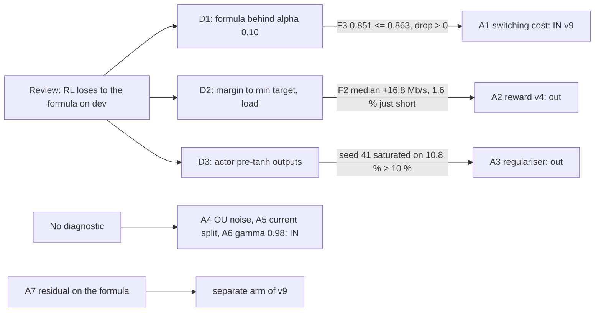
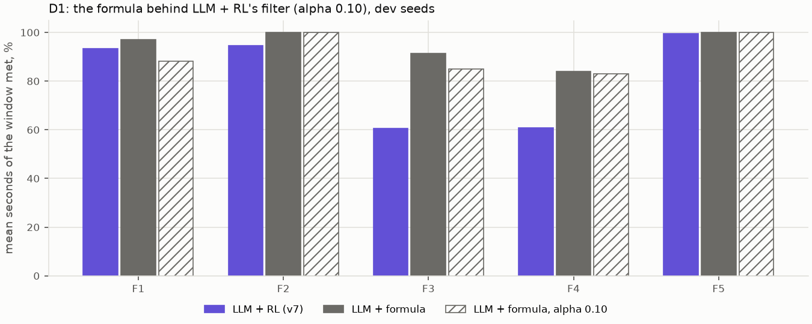
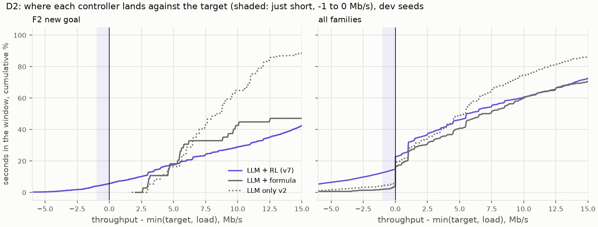
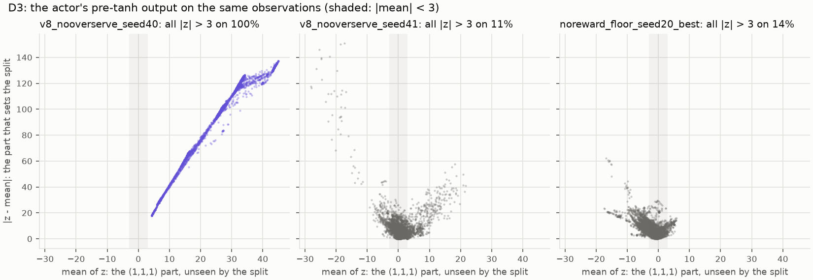

# M09g: why the formula beats the RL policy on dev, three diagnostics before v9

## 1. What we built

In M09b, LLM + formula met 0.93 of the dev intents and LLM + RL (v7) met 0.79. The project review proposed six changes to the RL policy (A1–A6) and one new arm, a residual policy on the formula (A7). Three of the changes rest on a guess about *why* the RL loses, and M09g tests those three guesses on dev seeds before any training.
- **Each diagnostic got a reading rule, written in DECISIONS and committed (a36a467) before anything ran.** The rule decides whether one change enters v9's full recipe.
- **D1, actuator fairness.** The formula is played behind the RL's served filter (alpha 0.10). **The rule holds, so A1 (a switching cost in the reward, served at alpha 0.25) enters v9.** The filter accounts for only about a fifth of the formula's F3 lead over v7, though.
- **D2, edge-aiming.** We measure how far throughput lands from min(target, load). **The rule fails, so reward v4 stays out:** the RL is rarely "just short"; when it misses, it misses by more.
- **D3, saturation.** We look at the actor's pre-tanh outputs. **The rule fails narrowly, so the action regulariser stays out:** seed 40 is fully saturated, but healthy actors are saturated on 6–29 % of observations, more than the rule assumed.

The note also covers the integrity groundwork done just before (commit 55e09e7):
- a register of spent held-out sets, kept in git;
- a fingerprinted archive of the evidence, kept off this machine;
- a post-window column in the benchmark table;
- ruff in CI.

## 2. Where it sits in the architecture

M09g changes no box of figure 2. It measures the **RL xApp** box against the formula that can stand in its place, on the M09b dev benchmark: LLM → verifier → `a1_policy` → Runner, simulator backend with KPIs 2 ticks late.
- **D1 uses one new controller, `formula_a10`.** It is the agent in "proposed" mode with `FormulaPolicy` wrapped in the RL's filter, and it sits where the RL policy sits in the Runner. The Runner still sets the split, after the per-slice floor, and no invariant is touched.
- **D2 and D3 read files already on disk:** M09b's runs and M09c's final actors.
- **The groundwork serves the evaluation box** (held-out sets, evidence) and **the MLOps box** (CI).

## 3. How it works

**Integrity groundwork (Step 0)**
1. **The spent-set register** ([eval/spent.py](../../eval/spent.py)) reads [data/spent_sets.json](data/spent_sets.json), a committed list of every held-out set already scored.
   - `refuse_if_spent` ([:31](../../eval/spent.py#L31)) stops a final run of a listed set. It is called by `rl.goal_test` ([rl/goal_test.py:368](../../rl/goal_test.py#L368)), `eval.interface` ([eval/interface.py:88](../../eval/interface.py#L88)) and `eval.extraction` ([eval/extraction.py:126](../../eval/extraction.py#L126)).
   - `mark_spent` ([:39](../../eval/spent.py#L39)) adds the set after a final run ([rl/goal_test.py:412](../../rl/goal_test.py#L412)).
   - The old guards only checked a result file in git-ignored `runs/` or `eval/results/`, so a fresh clone would have let a held-out set be scored twice.
2. **The evidence manifest** ([mlops/archive.py](../../mlops/archive.py)) treats as one unit each folder under `models/`, `runs/` and `eval/results/<milestone>/`, plus the MLflow store and the testbed DB.
   - Per unit it records file count, bytes and a tree SHA-256 ([`fingerprint`, :56](../../mlops/archive.py#L56)).
   - `--verify` ([:77](../../mlops/archive.py#L77)) lists what changed, disappeared or appeared since the committed [data/evidence_manifest.csv](data/evidence_manifest.csv).
   - `--archive` ([:89](../../mlops/archive.py#L89)) packs all of it into one tar. Today: 56 units, 14,103 files, 1.23 GB, written to `D:\backup\agentic-ric-evidence-2026-11-09.tar`, outside the WSL disk.
3. **The benchmark table** gains `mean_over_bound_after_s` ([eval/benchmark.py:229](../../eval/benchmark.py#L229)): URLLC's seconds over its bound in the 60 s after a bounded intent's window, which intent met can't see.
4. **ruff runs in CI** (`.github/workflows/tests.yml`) with bug rules only (F, E4/E7/E9, bugbear), so a style rule can't fail the build.

**D1: the formula behind the served filter**

5. **`SmoothedPolicy`** ([rl/baselines.py:87](../../rl/baselines.py#L87)) wraps any `.shares()` controller in `sim.cell.smooth_split`. That is the same function and the same place as `SlicePolicy`: inside the policy, before the Runner's floor. A test checks that it equals the filter applied by hand.
6. **The harness** builds it for `formula_a10` with the run's alpha ([eval/harness.py:157](../../eval/harness.py#L157)). The benchmark passes `SERVED_SMOOTHING_ALPHA` = 0.10, the RL's alpha.
7. **Runs go to their own folder.** `OWN_STUDY` and `study_of` ([eval/benchmark.py:42](../../eval/benchmark.py#L42), [:52](../../eval/benchmark.py#L52)) send them to `eval/results/m09b/m09g_formula_a10`, so M09b's runs and their fingerprint stay as they were. `--table` reads every controller into the same [data/M09b-runs.csv](data/M09b-runs.csv).
8. **The reading** ([eval/diag_m09g.py:46](../../eval/diag_m09g.py#L46)) pairs every intent across LLM + RL, the formula and `formula_a10`. Per family it gives the means and the paired drop formula − formula_a10 with a bootstrap interval. `d1_verdict` ([:68](../../eval/diag_m09g.py#L68)) applies the rule: F3 at or below 0.863, with the interval above 0.

**D2: the margin to the target**

9. **`margins`** ([eval/diag_m09g.py:98](../../eval/diag_m09g.py#L98)) computes throughput − min(target, load) in Mb/s, every second of every window, for every slice the intent gives a target. This is the quantity `met_mask` compares to 0.
10. **`d2`** ([:123](../../eval/diag_m09g.py#L123)) gives per family and controller:
    - the median and the 10th/90th percentiles;
    - the share of seconds *just short* (−1 ≤ margin < 0);
    - the share *short by more than 1 Mb/s*;
    - the share *met*.

**D3: inside the actor**

11. **Observations** ([rl/diag_saturation.py:48](../../rl/diag_saturation.py#L48)): seed 41's final actor plays the `m09_validation` case set (8 scenarios × 6 objectives × 120 s, as deployed), and every observation is recorded: 5,760 of them.
12. **`pre_tanh`** ([:64](../../rl/diag_saturation.py#L64)) runs the actor's layers up to, but not including, its final tanh. That gives z, with action = (tanh z + 1)/2, and an assert checks this against `model.predict`.
13. **`describe`** ([:74](../../rl/diag_saturation.py#L74)) gives, per actor:
    - the share of observations with all three |z| > 3, where tanh's slope is under 1 % of its maximum;
    - the mean slope;
    - the action's spread across observations;
    - z split in two: its mean is the (1,1,1) part, which `shares_from_action` can't see; the rest sets the split.
    It runs on all 17 M09c final actors and on v7.



## 4. How to run it and check it

```bash
uv run pytest -q tests/test_m09g.py tests/test_spent.py tests/test_archive.py   # 17 passed
uv run python -m eval.benchmark --dev --controllers formula_a10   # D1 runs: ~17 min, needs Ollama; refuses an uncommitted tree
uv run python -m eval.benchmark --table                           # adds formula_a10 to M09b-runs/summary.csv
uv run python -m eval.diag_m09g --d1      # -> data/M09g-d1.csv, img/M09g-d1.png, the verdict line
uv run python -m eval.diag_m09g --d2      # -> data/M09g-margin.csv, img/M09g-margin.png (5 s)
uv run python -m rl.diag_saturation       # -> data/M09g-saturation.csv, img/M09g-saturation.png (5 s)
uv run python -m mlops.archive --verify   # "all units match docs/learn/data/evidence_manifest.csv"
```

The last line of each diagnostic is its verdict:
```
F3: formula 0.915 -> formula_a10 0.851 (drop +0.064 [+0.051, +0.081]); rule: <= 0.863 and interval above 0 -> HOLDS: the filter explains the F3 gap, A1 enters v9
F2: LLM + RL median +16.78 Mb/s, just short 1.6%; formula median +19.58, just short 0.0% -> does not support A2: reward v4 stays out of v9
seed 40: saturated on 100.0%, spread 0.0000, slope 0.0000; seed 41: saturated on 10.8% -> does not support A3: the regulariser stays out of v9
```

**D1:**



*How to read it:* mean share of each window met, per family, over the same 265 intents.

| family | LLM + RL (v7) | formula | formula, alpha 0.10 | drop [95 %] |
|---|---|---|---|---|
| F1 adapt to load | 0.933 | 0.970 | 0.883 | +0.087 [+0.052, +0.125] |
| F2 new goal | 0.945 | 1.000 | 1.000 | 0 |
| F3 fast dynamics | 0.605 | 0.915 | **0.851** | +0.064 [+0.051, +0.081] |
| F4 verifier edge | 0.609 | 0.841 | 0.829 | +0.012 [+0.007, +0.018] |
| F5 easy | 0.996 | 1.000 | 1.000 | 0 |
| all | 0.791 | 0.929 | 0.896 | +0.033 [+0.024, +0.044] |

- **The filter costs the formula most where loads move:** F1 (load steps) and F3 (bursts). Where the cell is steady, it costs nothing.
- **It is a small part of the gap.**
  - Behind the same filter, the formula still beats v7 by 0.25 on F3 and 0.22 on F4.
  - Over all intents the drop is 0.033 of a 0.138 gap (24 %); on F3, 0.064 of 0.31 (21 %).
  - So most of the formula's lead is in *what split it asks for*, not in how fast it gets there.
- **On F1, LLM + RL beats the filtered formula** by +0.050 [−0.010, +0.108]. The interval includes 0, so they can't be told apart.
- **The splits also move very differently.** LLM + RL moves 2.65 % of the cell per second even behind its filter; the formula moves 0.16 % unfiltered and 0.08 % filtered. The RL's split jitters by itself, and that is what A1's switching cost goes after.

**D2:**



*How to read it:*
- each curve is the cumulative share of window seconds (y) whose margin is at most x;
- a curve that is high at x < 0 means many seconds short;
- the shaded band is "just short" (−1 to 0 Mb/s);
- left panel F2, right panel all families.

On F2:
- **LLM + RL's median is +16.8 Mb/s.** 94.3 % of its seconds are met, 1.6 % just short and 4.1 % short by more than 1 Mb/s.
- **The formula is never short.**

Over all families:
- LLM + RL is short by more than 1 Mb/s on 12.6 % of seconds, against 2.1 % for the formula and 4.4 % for LLM only v2.
- On F4 the figure is 29.7 %, against 5.1 % for the formula.
- The RL's misses are deep ones, on F4's eMBB/BE intents at the edge of the verifier's range and on F3's bursts. It is not settling on the hinge.

**D3:**



*How to read it:*
- one dot per observation;
- x is the mean of the three pre-tanh outputs (the (1,1,1) part, invisible to the split);
- y is the size of the rest (what sets the split);
- the shaded band is |mean| < 3.

The three panels:
- **Seed 40:** every dot is far out. The size of z runs from 18 to 140 and its median |z| is 65; it grows in proportion to the input, so the weights have blown up. The action is [1, 1, 0] everywhere, with a tanh slope of 0.0000.
- **Seed 41 and v7:** most dots sit near the origin. A tail of saturated observations remains, 11 % and 14 %: those are corners where one slice is set to its floor.

In [data/M09g-saturation.csv](data/M09g-saturation.csv):
- the 16 healthy finals and v7 are saturated on 6–29 % of observations;
- their median (1,1,1) part runs from −0.26 to 0.73 (v7: −1.58);
- there is no sign of drift along the null direction.

## 5. Choices and simplifications

- **One rule per change, fixed before the numbers.** The alternative, looking at the results and then deciding what v9 needs, would have let us read every diagnostic as support for the change we already wanted.
  - The cost shows in D3: the healthy-actor bound of 10 % was a guess, and seed 41 missed it by 0.8 points.
  - We keep the verdict. The DECISIONS line lets Souhail add a change that was left out as a one-change-on arm. That is a protocol decision, made before v9 trains, not a reinterpretation of the rule.
- **D1's bound was anchored on v8's 0.763, not v7's 0.605.** The rule's wording, "explains the F3 gap", is stronger than the result. It holds by the rule, but the filter explains about a fifth of the gap to v7 (two fifths of the gap to v8). A1 enters v9 for that fifth and for the jitter the RL shows, not because the filter is *the* explanation.
- **D2 pools seconds, not intents.** A per-intent median would weigh a 30 s intent like a 300 s one. Pooling seconds matches what `intent_met` counts. The rule reads F2, where M08 had seen "about 1 Mb/s short"; that description fits 1.6 % of F2's seconds, not the typical one.
- **D3 uses seed 41's observations for every actor.** Each actor's own rollouts would differ in which states they reach, and the comparison would mix "different states" with "different actor". Seed 40 has only a final model (no checkpoint was ever saved), so the 50k–350k period when it sat at the equal split can't be inspected.
- **`formula_a10`'s runs live in their own folder**, and `play_matrix` now writes `policy.json` only into the folders it plays into. The first D1 run had written one into M09b's folder; we moved it and checked the manifest again. A real system would keep a run registry (MLflow runs per controller) rather than a folder convention.
- **The archive is uncompressed.** Most of the bytes are model zips and MLflow artifacts, already compressed. A real system would push to object storage with versioning instead of a tar on a second drive.

## 6. What it changes for v9 (M09h)

- **The full recipe:** A1 (switching cost, trained and served at alpha 0.25), A4 (OU noise), A5 (the current split in the observation) and A6 (gamma 0.98).
- **A separate arm:** A7, the residual on the formula.
- **Out of the recipe:** A2 (reward v4) and A3 (action regulariser), unless Souhail asks for them as one-change-on arms.
- **The question for the M09h plan:** whether to keep a *saturation detector* (constant action over the validation batch → the seed is reported as collapsed). It is not a change to the learned policy; it would catch a seed 40 early instead of after 39 minutes.

## 7. Questions to check understanding

1. **Why test the formula behind alpha 0.10 instead of serving the RL unfiltered?**
   The question is whether the comparison is fair to the RL. Putting the same actuator under both isolates the actuator. Serving the RL unfiltered would change the RL too: M07b and M08a showed it jitters without the filter.
2. **D1's rule held. Why does the note say the filter is not "the" explanation?**
   Behind the same filter the formula still beats v7 by 0.25 on F3. The drop, 0.064, is about a fifth of the 0.31 gap.
3. **What would D2 have looked like if reward v1's hinge were the problem?**
   LLM + RL's margin would bunch just below 0: a median near 0 and many seconds in [−1, 0). Instead its median on F2 is +16.8 Mb/s, and its misses are mostly more than 1 Mb/s deep.
4. **Why is |z| > 3 the threshold for saturation?**
   tanh'(3) ≈ 0.0099, under 1 % of its slope at 0. Beyond it, the gradient the critic sends back through the tanh barely moves the actor.
5. **Why can a held-out set still be scored twice without the spent-set register?**
   The old guard checked a result file in a git-ignored folder. On a clean clone, or after `runs/` is deleted, the file is gone and the guard passes. The register is committed, so it travels with the code.
