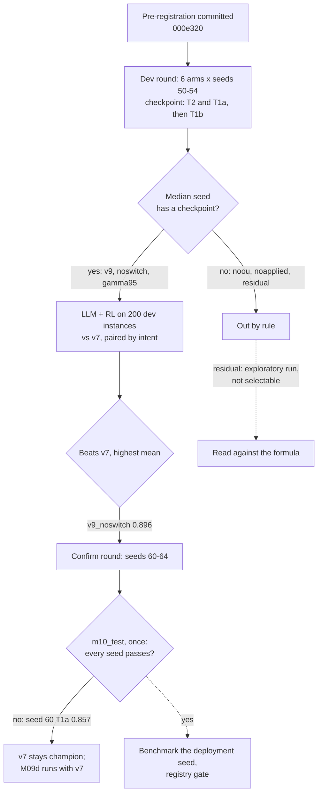
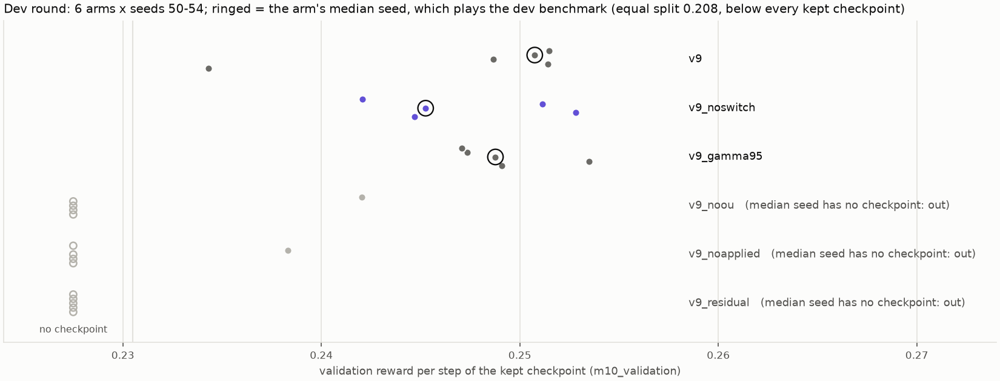
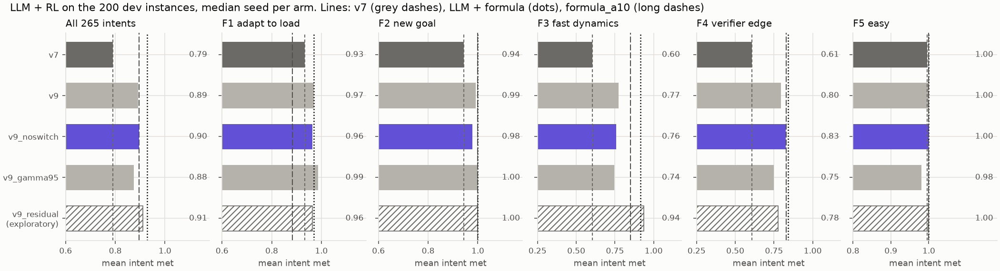
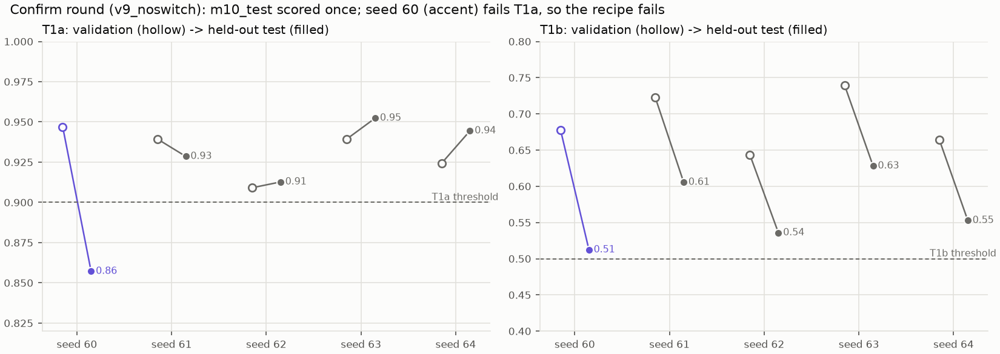

# M09h: policy v9, five changes tested one at a time, and not confirmed

## 1. What we built

A second retraining round of the RL policy on the calibrated cell, aimed at what M09c and the M09g diagnostics left open, and judged by rules committed before any training (000e320).
- **v9 adds four changes** to M09c's best setting (`v8_nooverserve`):
  - A1, a switching cost in the reward;
  - A4, temporally correlated exploration noise (Ornstein-Uhlenbeck);
  - A5, the split applied last tick as an input, so the observation grows from 25 to 28 values;
  - A6, gamma 0.98 instead of 0.95.
- **The dev round** trained six arms on seeds 50–54: the full v9, four arms each missing one change, and a residual arm (A7) that learns a bounded correction on top of the formula baseline. Each arm was judged by its *median* seed.
  - Three arms were out by rule: their median seed kept no checkpoint.
  - The other three played the dev benchmark. `v9_noswitch` won, meeting **0.896** of intents against v7's 0.791.
- **The confirm round** trained `v9_noswitch` on seeds 60–64, and the held-out goal test `m10_test` was run once. **It failed**: seed 60 reached T1a 0.857, below 0.90; seeds 61–64 passed.
- **Outcome:** by the pre-registered rule no v9 version was benchmarked for promotion or registered. **v7 stays the champion.**

What M09h leaves:
- an ablation that says which changes help the goal test;
- a dev-benchmark gain over v7 that is real but not a result (dev was used to choose);
- an RL policy that ties with the formula once the formula is filtered like the policy, and loses to the unfiltered formula;
- a second recipe in a row that fails the held-out test by one seed on T1a.

## 2. Where it sits in the architecture

M09h is the **RL xApp (DDPG/TD3)** box of figure 2, retrained again. Nothing above it changes: the LangGraph service, the verifier and the `a1_policy` channel are the same.
- **The observation grew by three values**, the split the runner applied last tick. The Runner keeps it and appends it ([rl/runner.py:140](../../rl/runner.py#L140), [:170](../../rl/runner.py#L170), [:116](../../rl/runner.py#L116)). It is the split it *sent*, so it is known at once, while the KPIs' own `prb_share` is as late as the KPIs.
- **v7 still runs unchanged**: a policy reads only the inputs it was trained on, as in M09c.
- **The residual arm is served like any policy**: `SlicePolicy.load` returns a `ResidualPolicy` when the file name carries `_residual` ([rl/policy.py:47](../../rl/policy.py#L47)), so the Runner, the harness and the goal test needed no branch.
- **The registry gate never ran.** The pre-registered rule stops before promotion when the held-out test fails, so v9 never reached `mlops.registry`.

## 3. How it works

1. **The arms live in one table** ([rl/m09.py:51-63](../../rl/m09.py#L51-L63)). `V9_DEFAULTS` turns every change off, `V9` turns them all on, and each `v9_no*` arm turns one back off. `v9_residual` is the full v9 plus the residual wrapper. The v8 recipes are untouched, so M09c reproduces.
2. **A1, the switching cost** ([sim/reward.py:97-100](../../sim/reward.py#L97-L100)): reward − `SWITCH_COST` × `moved`, where `moved` = ½ Σ |split(t) − split(t−1)| is the share of the cell that changed hands, on the split actually applied. `SWITCH_COST` = 1.0 ([rl/m09.py:48](../../rl/m09.py#L48)): at v7's 2.65 % moved per second it is about 11 % of a typical step's reward. Relabeling charges it too ([rl/relabel.py:99](../../rl/relabel.py#L99)), from the previous split stored with each transition.
3. **A4, OU noise** ([rl/m09.py:49](../../rl/m09.py#L49), [rl/train.py:114](../../rl/train.py#L114)): theta 0.1, dt 1, sigma 0.1. Each step keeps 90 % of the last noise, so a push lasts about 10 steps, long enough for its effect to clear the 2-tick delay and the filter. SB3's defaults (theta 0.15, dt 0.01) would make it close to a random walk; this is deviation (2) in DECISIONS.
4. **A5, the applied split** ([sim/env.py:76](../../sim/env.py#L76), `applied_split` at [:193](../../sim/env.py#L193)): three values appended after the load history. Without it, the policy sees its own last action only through KPIs 2 ticks late.
5. **A6, gamma 0.98** ([rl/m09.py:50](../../rl/m09.py#L50)): a horizon of about 50 steps instead of 20, past the filter's ~10 s, the 2-tick delay and the 5–15 s it takes a queue to drain.
6. **A7, the residual arm** ([rl/residual.py:39](../../rl/residual.py#L39), [:47](../../rl/residual.py#L47), [:70](../../rl/residual.py#L70)): the formula of M09b (rev 4) proposes a split, and the actor adds a correction of at most ±0.2 per slice (`RESIDUAL_BOUND`), renormalised.
7. **The checkpoint rule, stricter than M09c's** ([rl/train.py:168-177](../../rl/train.py#L168-L177)): every 25k steps the actor is scored on `m10_validation` (seeds 11000+, the 28-value observation, [rl/goal_test.py:81](../../rl/goal_test.py#L81)). A checkpoint is kept only if it passes T2 **and T1a**, then the highest T1b, then reward. M09c's note asked for T1a in this rule.
8. **The collapse flag** ([rl/train.py:66](../../rl/train.py#L66), [:191](../../rl/train.py#L191)): the spread of the actor's actions over the last 1,000 replay states. Below 0.01 the seed is reported "collapsed", like M09c's seed 40. It is reported only, never restarted, because a restart would be selection under another name.
9. **The median seed** ([rl/sweep.py:110](../../rl/sweep.py#L110)): per arm, the five seeds are ranked by their kept checkpoint's validation reward (no checkpoint ranks last) and the 3rd plays the dev benchmark. M09c played each recipe's *best* seed, which favours the luckiest recipe.
10. **Selection** is M09c's: `eval.benchmark --policy ... --study m09h_<arm>` plays LLM + RL on the 200 dev instances, `--compare` pairs it with v7 by intent and appends a row to [data/M09c-selection.csv](data/M09c-selection.csv). An arm beats v7 if its mean is higher and no family drops by more than 0.02. Among those, the highest mean wins.
11. **The held-out test** ([rl/goal_test.py:370](../../rl/goal_test.py#L370)): `m10_test` (seeds 12000+), with `--final`, refused a second time by the result file *and* by the committed register [data/spent_sets.json](data/spent_sets.json). A seed without a checkpoint fails.

## 4. Diagram



## 5. How to run it and check it works

The long steps were run by Souhail. Each final step has a guard against running twice.

```bash
uv run python -m rl.sweep m09h-dev                                # 30 runs, ~2 h 55 (2 waves of 15)
uv run python -m rl.sweep m09h-median                             # prints the 3 benchmark commands; 3 arms out
uv run python -m eval.benchmark --dev --controllers proposed \
    --policy models/m09h/dev/td3_v9_noswitch_seed52_best.zip --study m09h_v9_noswitch   # ~17 min, Ollama on the GPU
uv run python -m eval.benchmark --compare m09h_v9_noswitch        # one row of data/M09c-selection.csv
#   ... same for v9 (seed 53) and v9_gamma95 (seed 52)
uv run python -m rl.sweep m09h-confirm --recipe v9_noswitch       # 5 runs, ~1 h 35
uv run python -m rl.goal_test --split m10_test --final --min-share 0.05   # ONCE, ~1 min: runs/m09h/test_result.json
uv run python -m rl.plot_m09h                                     # the three figures below + the paired differences
uv run python -m mlops.archive --verify                           # the evidence matches the committed manifest
uv run pytest -q tests/test_m09h.py                               # 18 tests
```

Check that the champion didn't move: `uv run python -m mlops.registry status` still shows `champion` on v7.

**A void run, kept on record.** The first three dev benchmarks (2026-11-10 night) ran with Ollama on the CPU (`/api/ps` showed `size_vram` 0). LLM calls took about 30 times longer, and since the harness charges LLM latency to simulated time, every objective reached the cell 30–50 s late. The 600 runs were moved to `eval/results/m09b/superseded/m09h_llm_on_cpu/`, tagged `invalid` in MLflow, and replayed unchanged on the GPU (median LLM latency 1.07–1.11 s, as in M09b). The void numbers are not used anywhere.

### The dev round



*How to read it:* one row per arm, one dot per seed at its kept checkpoint's validation reward. The ringed dot is the arm's median seed; hollow dots on the left kept no checkpoint (none of their 15 passed T2 and T1a together). The equal split earns 0.208, below every dot.
- **v9, v9_noswitch and v9_gamma95** kept a checkpoint on all five seeds. `v9_noswitch` had the most eligible checkpoints per seed (5–8 of 15, against 1–4 for v9).
- **v9_noou** and **v9_noapplied** kept one each: without OU noise or without the applied split, T1a rarely reaches 0.90. v9_noou's seed 51 is the only collapsed run (all 15 checkpoints).
- **v9_residual** kept none: T1a stayed at 0.64–0.84.

**Why the residual arm can't pass.** Read on `m10_validation` with a scratch script (recorded in DECISIONS, not reproduced by a repo command): the formula alone scores T1a 0.720 unfiltered, and 0.667 behind the served filter (alpha 0.10), with a reward of 0.1987, *below* the equal split's 0.2079. A policy anchored on the formula starts from a point that fails T1a and T2, so the checkpoint rule can hardly admit it. Yet the same formula is the best controller on the dev benchmark. The two yardsticks disagree about it (§6).

### The arm choice, LLM + RL on the 265 dev intents



*How to read it:* each panel is one family, and the first is all intents. Bars are each arm's median seed played as LLM + RL; the hatched bar is the residual arm's exploratory run, which could not be chosen. Lines: v7 (grey dashes), LLM + formula (dots), formula_a10, the same formula behind the policy's filter (long dashes).

| | All | F1 load | F2 new goal | F3 fast | F4 verifier edge | F5 easy |
|---|---|---|---|---|---|---|
| v7 (champion) | 0.791 | 0.933 | 0.945 | 0.605 | 0.609 | 0.996 |
| v9 (seed 53) | 0.892 | 0.970 | 0.991 | 0.773 | 0.796 | 0.999 |
| **v9_noswitch (seed 52)** | **0.896** | 0.964 | 0.978 | 0.758 | 0.827 | 1.000 |
| v9_gamma95 (seed 52) | 0.875 | 0.987 | 0.999 | 0.745 | 0.749 | 0.981 |
| v9_residual, exploratory (seed 51, final model) | 0.910 | 0.964 | 1.000 | 0.937 | 0.776 | 1.000 |
| LLM + formula | 0.929 | 0.970 | 1.000 | 0.915 | 0.841 | 1.000 |
| formula_a10 | 0.896 | 0.883 | 1.000 | 0.851 | 0.829 | 1.000 |

- All three arms beat v7 and none drops a family by more than 0.02 (v9_gamma95's F5 is 0.015 below). **The rule picked `v9_noswitch`**, 0.004 ahead of v9: one seed each, so the order between those two is indicative only.
- Paired by intent, with a 95 % bootstrap interval (printed by `rl.plot_m09h`):

| Difference | Mean | 95 % interval |
|---|---|---|
| v9_noswitch − v7 | +0.106 | [+0.084, +0.132] |
| v9_noswitch − LLM + formula | −0.033 | [−0.057, −0.009] |
| v9_noswitch − formula_a10 | +0.000 | [−0.024, +0.026] |
| residual (exploratory) − LLM + formula | −0.019 | [−0.038, +0.001] |
| residual (exploratory) − formula_a10 | +0.014 | [−0.007, +0.037] |

  The means equal the ones in the DECISIONS line of the arm choice; its interval edges came from an earlier scratch computation and differ by at most 0.002.
- **What it says:** v9 closes most of v7's gap to the formula, and the remaining gap is the filter. Behind the same filter, the RL policy and the formula tie. The residual arm, the one that learns *on top of* the formula, is the best RL controller here and the only one above the formula on F3 (0.937 against 0.915), but not overall.

### The held-out test



*How to read it:* one column per confirm seed. Hollow: the kept checkpoint's score on `m10_validation`; filled: the same checkpoint on `m10_test`, scored once. Dashed: the thresholds.

| Seed | Kept at | Validation T1a / T1b | Test T1a | Test T1b | Test reward | Verdict |
|---|---|---|---|---|---|---|
| 60 | 200k | 0.947 / 0.678 | **0.857** | 0.512 | 0.241 | **FAIL** (T1a) |
| 61 | 350k | 0.939 / 0.723 | 0.929 | 0.606 | 0.256 | pass |
| 62 | 325k | 0.909 / 0.643 | 0.913 | 0.536 | 0.257 | pass |
| 63 | 300k | 0.939 / 0.739 | 0.952 | 0.628 | 0.254 | pass |
| 64 | 400k | 0.924 / 0.664 | 0.944 | 0.553 | 0.260 | pass |

126 of 240 test cases are material; the equal split earns 0.2045. All five seeds beat it and pass T1b; seed 60 fails T1a, so the recipe fails.
- **T1b drops on every seed** (by 0.11–0.17). The kept checkpoint is the one with the *highest* validation T1b among up to 15, so its validation score is biased upward, and the test shows the regression to the mean.
- **T1a moves both ways** for four seeds (±0.03) and drops by 0.09 for seed 60, the seed kept earliest (200k). One seed of five crossing the line is exactly how M09c failed (T1a 0.861–0.896 there).

## 6. Choices and simplifications

- **The median seed, not the best.** M09c chose each recipe by its best seed, which rewards luck. Here an arm is as good as its 3rd seed of 5. The cost is that three arms were out because their median kept no checkpoint, even where one seed did.
- **T1a in the checkpoint rule.** M09c's note asked for it. It made the confirm seeds' validation T1a ≥ 0.909, and it still didn't carry over to the test for seed 60. A threshold met on validation by a margin of 0.01–0.05 is not a margin.
- **The floor flag on the held-out run.** The pre-registration wrote the test command without `--min-share 0.05`. Every checkpoint had been selected with the floor, the floor is deployed, and M09c's test used it; the reading was written in DECISIONS *before* the run, with a timing check on validation only.
- **The residual arm ran once, as exploration.** The checkpoint rule shut it out for a reason unrelated to its question ("does RL correcting the formula beat the formula?"). It was played on dev with a DECISIONS line written first that made it non-selectable. Answer: not overall (−0.019, interval touching 0), better on F3.
- **The goal test and the dev benchmark disagree about the formula.** The goal test asks "does telling the policy its objective help, compared with the oracle?", scored with reward v2. The benchmark asks "were the operator's targets met?". The formula meets targets well but never reads the weights (it uses the loads, the targets and the URLLC bound, [rl/baselines.py:60](../../rl/baselines.py#L60)), and its split jumps; behind the filter it lags. So it scores low on the first and high on the second. A policy is selected on both, and that pulls it two ways. This is a property of the yardsticks, not of the policy, and it is the reason the residual arm couldn't be chosen.
- **The void CPU run** was not "fixed" by adjusting numbers: the runs were replayed unchanged under the conditions the pre-registration assumed, and the void ones are kept and labelled.
- **What a real system would do differently:**
  - Choose by *several* seeds and report the spread; one seed per arm makes the ranking of v9 and v9_noswitch indicative only.
  - Average the last checkpoints or use a held-out *checkpoint-selection* split, to avoid the upward bias of "pick the highest validation score".
  - Use one yardstick for selection and deployment: the intent-met metric the operator cares about, with the goal test as a constraint, not a second objective.
  - Most of all, question the cell. The review (`docs/REVIEW-2026-11-11.md`) found that this simulator is linear in PRBs and gives the controller the offered load, so the formula is close to the oracle. M09h confirms it from the other side: the best RL here ties with a filtered formula. RL has room to add value only where the mapping from PRBs to service is unknown or changes (M10).

## 7. Questions to check understanding

1. **Four of five confirm seeds passed, with T1b and reward well above the thresholds. Why is v9 not deployed?**
   The rule written before training requires every seed to pass T1a, T1b and T2 on the held-out test. Seed 60 had T1a 0.857 < 0.90: in 14 % of the material cases, telling it the right objective did not make it do better. A recipe that works on four seeds of five is not reliable, and accepting it after seeing the result would make the test a selection step.
2. **Why did T1b drop on every seed between validation and test?**
   Each run keeps the checkpoint with the highest validation T1b among up to 15 candidates. The maximum of noisy scores is biased upward, so on fresh cases it falls back toward the checkpoint's true level. That is a selection effect, not overfitting of the weights.
3. **v9_noswitch meets 0.896 of intents on dev, v7 0.791. Why is that not a result?**
   The dev instances were used to choose the arm. A score on the data you chose with is optimistic by construction. Only fresh test instances (M09d) can carry a claim, and M09d now runs with v7.
4. **The residual arm learns a correction on top of the formula, yet it never kept a checkpoint. Why?**
   The checkpoint rule needs T1a ≥ 0.90 and a reward above the equal split on `m10_validation`. The formula behind the filter scores T1a 0.667 and a reward *below* the equal split there, because it ignores the weights and lags behind the filter. A policy that starts at the formula starts far from the rule's pass region, though the same formula is the best controller on the dev benchmark.
5. **What does the comparison with formula_a10 tell you about where v9's remaining gap comes from?**
   formula_a10 is the formula behind the same filter (alpha 0.10) as the policy. v9_noswitch ties with it (+0.000, interval −0.024 to +0.026) and is 0.033 below the unfiltered formula. So the remaining gap is the filter's lag, not what the policy learned: on this cell, a smoothed policy can't beat the smoothed arithmetic.
