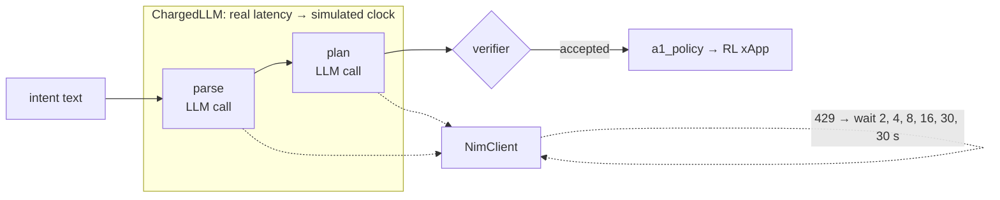
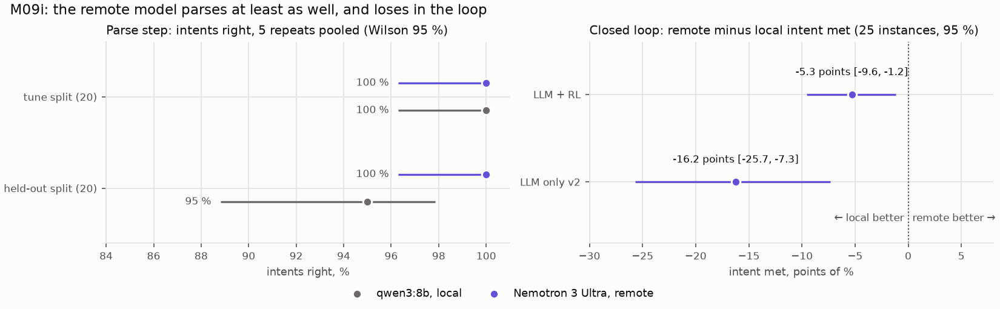
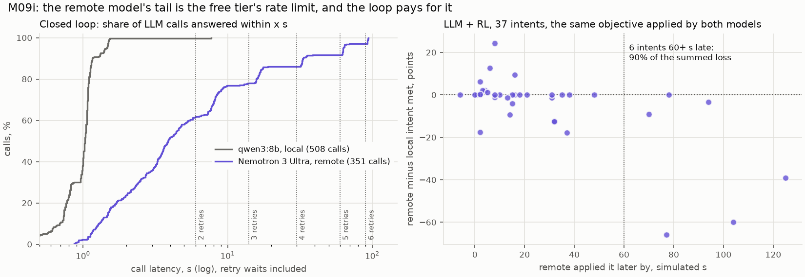

# M09i: local vs remote LLM

## 1. What we built

A comparison of the laptop's model (qwen3:8b on Ollama) with a remote one (Nemotron 3 Ultra, 550B
parameters with 55B active, on NVIDIA NIM's free tier), on the same intents and the same agent. It had
two parts:
- **The parse step:** the 40 annotated intents, 5 repeats per model, with the tune and held-out
  splits reported apart.
- **The closed loop:** 25 dev instances × LLM + RL (v7) and LLM only v2 × both models, 100 runs.

The study is descriptive, with no pass rule. The sample, the measures and the reading ("remote is
better if the 95 % interval of remote minus local is above 0") were written in `docs/DECISIONS.md`
before the first remote run. €0 was paid. The client refuses to send more than 1,500 requests.

| | qwen3:8b, local | Nemotron 3 Ultra, remote |
|---|---|---|
| parse, tune split (100 = 20 × 5) | 100 % [96.3, 100] | 100 % [96.3, 100] |
| parse, held-out split | 95 % [88.8, 97.9] (h08 missed every time) | 100 % [96.3, 100] |
| parse latency, median | 0.96 s | 1.6–2.4 s |
| LLM + RL: mean intent met | 0.803 | 0.750 |
| LLM only v2: mean intent met | 0.856 | 0.694 |
| **remote minus local, LLM + RL** | | **−5.3 points [−9.6, −1.2]** |
| **remote minus local, LLM only v2** | | **−16.2 points [−25.7, −7.3]** |
| LLM + RL: same objective applied | 37 of 37 intents | |
| loop call latency, median / p95 | 1.0 s / 1.5 s | 3.9 s / 63 s |
| decision delay (intent in → change applied), LLM + RL, median / max | 4 s / 11 s | 19 s / 128 s |

**Reading, by the rule written first:** the remote model is **worse** in the closed loop with both
controllers. **But it isn't worse at choosing.** With LLM + RL it applied the same objective as qwen3:8b
on every intent. It parsed at least as well, and better on the one held-out intent qwen3:8b gets
wrong. It loses on time: a third of its calls waited out rate-limit retries on the free tier, and the
harness charges every second of that to the simulated cell. What M09i measured is "this free endpoint
in this loop", not the model.

## 2. Where it sits in the architecture

M09i swaps the LLM inside the **LangGraph service box** of figure 2 and changes nothing else:
- the prompts, the graph and the verifier;
- the a1_policy channel and the RL xApp.

The swap is one class behind one interface: `NimClient` next to `OllamaClient` in
[agent/llm.py](../../agent/llm.py), chosen by `RIC_LLM_PROVIDER`. The gateway has no route to the
provider, and invariants 1–5 are untouched. The study answers the proposal's metric "latence et coût
du LLM du service LangGraph (modèle local vs modèle distant)", the last open item of the review's P0.

## 3. How it works

1. **The client.** [`NimClient`, agent/llm.py:143](../../agent/llm.py#L143) posts to NIM's
   OpenAI-compatible `/chat/completions` at temperature 0. It works as follows:
   - **Requests:** our tool definitions are already OpenAI-style. A schema is sent as
     `response_format: json_schema`. Tool-call arguments come back as a JSON string and are decoded;
     broken ones are dropped, not guessed.
   - **Retries:** [`_post_with_retry`, :200](../../agent/llm.py#L200) retries 429 and 5xx after 2, 4,
     8, 16, 30 and 30 s (or the server's `Retry-After`), then gives up with an error.
   - **The ceiling:** every HTTP request counts against it, retries included. Once it's reached,
     nothing is sent.
   - **The key** is read from `NVIDIA_API_KEY` or `~/.config/agentic-ric/nim_api_key`, sent only as a
     bearer header, and replaced by `***` in every error.
   - **Token counts:** both clients count calls, prompt tokens and completion tokens in a `Usage`
     object ([:50](../../agent/llm.py#L50)). Ollama reports `prompt_eval_count`/`eval_count`, NIM a
     `usage` field.
2. **No reasoning on either side.** qwen3:8b runs with `think: false`, as always. Nemotron runs with
   `chat_template_kwargs.enable_thinking: false` (`NIM_EXTRA`, [eval/m09i.py](../../eval/m09i.py)).
   With thinking on, it wrote about 1,750 tokens per LLM-only call in the dry run.
3. **The parse step.** [`extraction`, eval/m09i.py:143](../../eval/m09i.py#L143) calls M08b's
   `eval.extraction.evaluate` with the frozen prompt and the same scoring, 5 times per split and
   model. Each result file gets the client's usage, and, for the local model, the GPU's energy from
   [`GpuEnergy`, :74](../../eval/m09i.py#L74) (nvidia-smi once a second, trapezoid integral).
4. **The sample.** [`sample`, :62](../../eval/m09i.py#L62) draws 5 dev instances per family with
   seed 20261114, leaving out the ones M09b's parse check dropped. The test seeds stay closed.
5. **The loop.** [`loop`, :170](../../eval/m09i.py#L170) plays each instance with each controller
   through M09b's `eval.benchmark.play`. Its harness wraps the client in `ChargedLLM`
   ([eval/harness.py:61](../../eval/harness.py#L61)): the cell's clock advances by the real latency of
   every call, so a slow answer is a late answer. An `m09i.json` sidecar per run records the calls,
   tokens, wall time and energy.
6. **The tables.** [`run_rows`, :268](../../eval/m09i.py#L268) scores every intent with
   `eval.metrics.measure_run`, as every simulator result is scored. It adds two columns:
   - [`decision_s`, :212](../../eval/m09i.py#L212): simulated seconds from the intent's arrival to the
     first change applied for it;
   - [`applied_objective`, :223](../../eval/m09i.py#L223): the first accepted objective, written in
     one canonical form so the two models' choices compare as text. Nemotron sends some numbers as
     strings ("300.0"), which the schema reads the same way.

   [`step_rows`, :244](../../eval/m09i.py#L244) lists every timed call.
   [`paired`, :294](../../eval/m09i.py#L294) takes remote minus local intent by intent, with M09d's
   cluster bootstrap by instance.



## 4. Results in detail



**Left: the parse step.**
- On the tune split, both models get 100 of 100 right.
- On the held-out split, Nemotron gets 100 of 100 and qwen3:8b 95 of 100. qwen3:8b misses the same
  intent every time: h08, "Favour best effort traffic for 2 hours, the backups are running." It asks
  what throughput best effort needs, when the annotation reads it as a priority. This is the same miss
  as when the held-out split was scored once in M08b.
- The intervals overlap, so 40 intents can't separate the two models on parsing.
- The prompts were written and tuned for qwen3:8b, which favours it. Nemotron matched it anyway, with
  no change.

**Right: the closed loop.** Both intervals are below 0.
- With LLM + RL the loss is −5.3 points.
- With LLM only v2 it is −16.2 points. LLM only calls the LLM every few seconds to re-split. Slow
  calls mean fewer corrections in the same window: 9.0 calls per run against 15.2. One call failed
  outright (`NIM 429 after 6 retries`, f4_25).



**Left: where the time goes.**
- qwen3:8b answers 100 % of its calls within 7.7 s, and 95 % within 1.5 s.
- Nemotron's curve climbs in steps, and the steps sit exactly on the client's cumulative retry waits
  plus a 2–4 s call:

  | latency cluster | retries before success |
  |---|---|
  | 9–10 s | 2 |
  | 16–19 s | 3 |
  | 32–35 s | 4 |
  | 62–66 s | 5 |
  | 92–94 s | 6 |

- 111 of 351 remote loop calls (31.6 %) took more than 8 s. The local model had none.
- The free tier allows about 40 requests a minute. The agent bursts: parse, then plan, then LLM only's
  re-splits.
- The calls that didn't wait long had a median of 2.7 s, against qwen3:8b's 1.0 s. That is the part a
  paid, dedicated endpoint would keep.

**Right: what lateness costs.**
- Same 37 objectives, so the only difference between the two LLM + RL runs of an intent is when its
  objective was applied.
- Intents applied within about 50 s of the local model's time scatter around 0, between −18 and +24
  points. That spread is the RL's own: a different timing moves its trajectory.
- The 6 intents applied 60 s or more late carry 90 % of the summed loss. The 3 of them in F4 carry 84 %.
- F4 instances bring three goals 60–90 s apart, so a 100 s delay on one goal runs into the next.
  f4_15's last two goals were applied 104 and 125 s later than qwen3:8b's, and lost 60 and 39 points.

**Tokens, cost, energy.**
- **Tokens per intent:**
  - LLM + RL: about 2,500 local and 3,000 remote. Nemotron's tokenizer and replies run a little
    longer, at 847 tokens per call against 701.
  - LLM only: 14,900 local against 9,400 remote, because the remote model made fewer calls.
- **What it would cost at OpenRouter's list price for Nemotron 3 Ultra** ($0.50 / $2.20 per M
  input / output tokens, recorded in DECISIONS):
  - **$1.95 per 1,000 intents with LLM + RL** and $5.21 with LLM only;
  - $0.37 for everything this study sent to the remote model (555 calls).
  - Paid: €0.
- **Local energy:** the GPU drew 0.03 Wh per parsed intent (the whole board), and 0.10 Wh per intent
  above idle in the loop with LLM + RL (0.25 with LLM only). These are small next to the remote side's
  network and data-centre cost, which we can't measure.
- **Wall time for the 50 loop runs:** 9 min local and 79 min remote.

**Something seen in passing.** On these 25 dev instances, LLM only v2 beats LLM + RL with qwen3:8b
(0.856 against 0.803). This is M09d's negative result again, on dev seeds. It isn't a new claim.

## 5. How to run it and check it

The run is done, and its raw data sits in `eval/results/m09i/` (git-ignored, in the evidence
archive). These commands reproduce the tables and figures from it:

```bash
uv run pytest -q tests/test_llm_nim.py tests/test_m09i.py   # 13 + 7 tests, no network: client, key safety, tables
uv run python -m eval.m09i --table                          # rewrites docs/learn/data/M09i-*.csv, prints the summary
uv run python -m eval.plot_m09i                             # redraws docs/learn/img/M09i-*.png from the CSVs
column -s, -t docs/learn/data/M09i-summary.csv | less -S    # the table of section 1
uv run python -m mlops.archive --verify                     # the raw runs match the manifest
```

The expected `--table` output ends with
`'part': 'loop, same objective applied', ..., 'value': 1.0, 'what': '37 of 37 intents ...'`.

The original sequence (2026-11-14, Ollama up, the key in its file; steps 1–2 before the commit 69632a1, step 3 by Souhail):
1. `uv run python -m eval.m09i --check`: one plain call, one tool call and one parse on the remote
   model.
2. `uv run python -m eval.m09i --loop --limit 1`: the dry run, kept in `eval/results/m09i_dry`. It
   counts for nothing.
3. `uv run python -m eval.m09i --extraction --loop --table`: about 1.5 h, and it resumes where it
   stopped.

To see one run's path through the agent:

```bash
RIC_EVENTS=eval/results/m09i/m09i_nemotron_3_ultra/f4_15/proposed/seed103015/events.jsonl uv run marimo run notebooks/agent_live.py
```

## 6. Choices and simplifications

- **The remote model.** Nemotron 3 Ultra was the best of 10 models we probed with the key, on 4
  parses and 1 tool call written for the probe (not from the scored set).
  - Kimi K3.1 Pro, the first pick, isn't served to this key.
  - Mistral Large 4 was right too, but it reasons for up to 3 minutes per call and can't turn that off.
- **Free tier, as it comes.** We measured what we could reach for €0, rate limit included. The
  alternative was to hide the retry waits from the simulated clock. We rejected it: the agent really
  did wait, and a "fair" clock would have shown a deployment we didn't test. The note separates the
  two parts instead (calls without long waits: median 2.7 s).
- **Latency charged to the cell.** This is M09b's harness rule, and it is what makes the loop
  comparison mean something. A real system would also run the LLM off the real-time path (invariant
  5), as we do. The RL xApp keeps running the old objective while the agent waits, but the operator's
  new goal starts late.
- **One sample, 25 dev instances, one run per instance and model.** The bootstrap is over instances.
  LLM runs aren't deterministic, so another day would give slightly different numbers. The parse
  repeats show how small that is for parsing: qwen3:8b got the same 19 or 20 of 20 every time.
- **The prompts are qwen3:8b's.** Nothing was tuned for Nemotron, which favours the local model on
  accuracy. It didn't need the help on parsing.
- **Price and energy.** The price is a list price from one reseller on one date, not what NVIDIA would
  bill. Energy is the whole GPU board from nvidia-smi, not a wall meter, and isn't turned into € (no
  tariff on record).
- **A real deployment** would use a paid or self-hosted endpoint with a latency service-level target.
  It would set a per-call timeout shorter than the RL's useful horizon, and fall back to the local
  model when the remote one is slow. That is a two-line policy in `client_from_env`, which we didn't
  build because nothing here needs it.

## 7. Questions to check understanding

1. **Nemotron applied the same objective as qwen3:8b on all 37 LLM + RL intents. Why is its intent
   met lower?**
   Its objectives were applied later: median 19 s against 4 s, up to 128 s. The harness charges each
   call's real latency to the simulated clock, so the cell ran without the new goal for longer.
2. **How do we know the long calls were rate limiting and not slow inference?**
   Their latencies cluster at the client's cumulative retry waits (6, 14, 30, 60, 90 s) plus a 2–4 s
   call. One call even failed with `429 after 6 retries`. Inference time would spread smoothly, not
   in steps.
3. **Why does LLM only lose more (−16 points) than LLM + RL (−5)?**
   LLM only calls the LLM every few seconds to re-split the PRBs, so it makes more calls, hits the
   rate limit more, and makes fewer corrections in the same window (9 calls per run against 15).
   LLM + RL calls it only when an intent arrives; the RL xApp keeps adapting in between.
4. **Why is the held-out parse difference (100 % against 95 %) not called a win for the remote
   model?**
   It comes from one intent (h08) that qwen3:8b misses every time, and the two Wilson intervals
   overlap. Twenty held-out intents can't separate 95 % from 100 %.
5. **What would a deployment that wants the remote model's parsing need, according to these
   results?**
   An endpoint without the free tier's rate limit (paid or self-hosted), and a timeout with a
   fallback to the local model. Calls that didn't wait had a median of 2.7 s, about 2 s more than
   local, which these results suggest costs little with LLM + RL. The big losses came only from
   delays of a minute or more.
