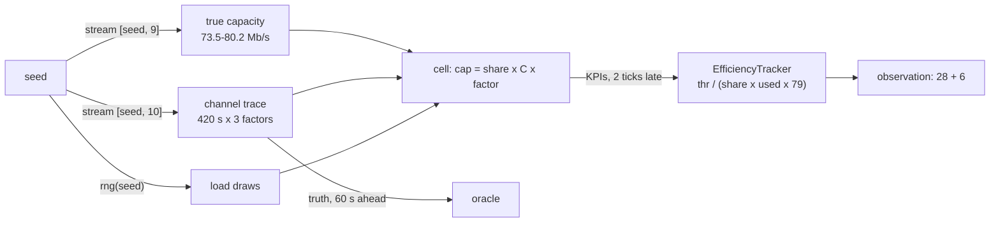
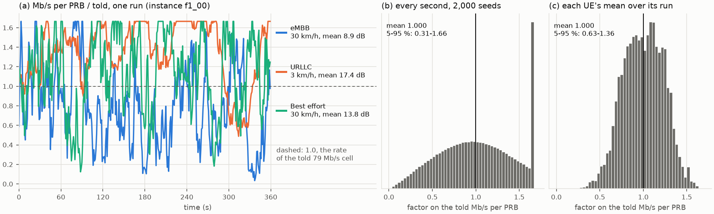
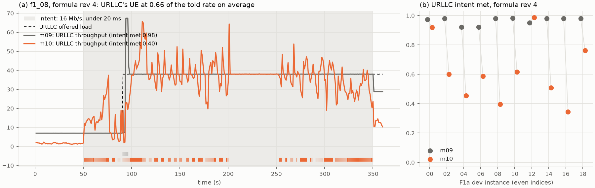

# M10a: a radio channel per slice, so Mb/s per PRB is no longer known

## 1. What we built

A new simulator profile, `m10`: the M09a calibrated cell, plus a radio channel for each slice's UE. Until now every PRB of the cell carried the same rate, so a slice's capacity was `share × C`. Now each slice's UE has its own signal quality, which drifts as the UE moves. The same share then carries a different rate per slice and per second. The channel is a short, standard model (3GPP shadowing, Shannon mapping). It is drawn before each run from its own random stream, so **every earlier run replays byte for byte** (checked). The RL runner and the training environment both gained an `EfficiencyTracker`: per slice, the Mb/s per PRB the KPIs show, as six new inputs (28 → 34). Older policies read the prefix they were trained on.

## 2. Where it sits in the architecture

M10a changes only the **RAN box** of figure 2, in its simulated form (the `SimBackend` behind the `Backend` interface), and the RL xApp's **input**. Nothing above the backend changes: the verifier is still told 79 Mb/s, and the LangGraph service and the gateway are untouched.

Why it exists: M09d and M09e showed that LLM + formula beats LLM + RL (0.929 against 0.780). The review of 2026-11-11 (§3.1) explained why. On a cell that is linear in PRBs, with a known load, the right split is arithmetic: `target / C`. M10 asks the question again on a cell where `C` is not one known number. M10a builds that cell; M10b gives the non-learned executors a fair way to estimate it; M10c trains a policy on it and runs the pre-registered comparison.

## 3. How it works

1. **The channel, one UE per slice** ([sim/channel.py](../../sim/channel.py)). [`sample_channel`, :67](../../sim/channel.py#L67) draws, in this order:
   - each UE's mean SINR, uniform in 8-18 dB (from the cell edge to well inside the cell);
   - each UE's speed, 3 or 30 km/h;
   - a starting shadowing value;
   - one innovation per second.

   Shadowing is an AR(1) process in dB with σ = 6 dB and a one-second correlation `ρ = exp(−v·1 s / 50 m)`. That gives 0.983 at 3 km/h (the shadowing lasts about a minute) and 0.846 at 30 km/h (about 6 s). The start is drawn from the stationary distribution, so every second has the same distribution.
2. **SINR to spectral efficiency** ([`spectral_efficiency`, :44](../../sim/channel.py#L44)). This is the attenuated, truncated Shannon bound of 3GPP TR 36.942 Annex A.2: `0.6·log2(1 + SINR)`, 0 under −10 dB, at most 4.4 b/s/Hz (reached at 22 dB).
3. **Normalised to the told cell.** The efficiency is divided by `MEAN_EFFICIENCY_BPS_HZ = 2.6427` ([:41](../../sim/channel.py#L41)). That constant is its mean over every UE and every second, computed by quadrature; [a test](../../tests/test_m10a.py) recomputes it on a grid. The result is a **factor**: 1 on average over the ensemble, so the cell still carries the 79 Mb/s it is told on average. One run's UE can still sit at 0.63 or 1.36 for the whole run (5-95 %). The factor is *not* divided by each trace's own mean: that would use the future, and pull every slow UE back to 1.
4. **Into the cell** ([sim/cell.py:144](../../sim/cell.py#L144)). `cap = share × C × efficiency`. With no channel, `efficiency` is 1.0, and `x × 1.0` is exact in floating point, which is why old runs stay bit-identical. The batch version used by the oracles takes a factor per slice ([:210](../../sim/cell.py#L210)).
5. **The profile** ([eval/sim_profiles.py](../../eval/sim_profiles.py)). `testbed_cell("m10", seed)` is the m09 cell, with the same capacity draw on stream 9, so a seed's m10 run pairs with its m09 run. [`channel_of`, :56](../../eval/sim_profiles.py#L56) draws the seed's 420 s trace on stream `[seed, 10]`: 360 s of run plus the oracle's 60 s horizon. On every other profile it returns None.
6. **The backend** ([backends/sim.py](../../backends/sim.py)). `SimBackend(channel=...)` reads the factor of the current second in `_tick`; `DelayedBackend` passes it through. The harness's `run_once` and the benchmark's `play(profile=...)` hand it over ([eval/benchmark.py](../../eval/benchmark.py)). A profile other than m09 must play into its own results root, since a run's folder doesn't name its profile.
7. **The oracle** ([eval/oracle.py](../../eval/oracle.py)). It already knew the next 60 s of loads. It now also reads the trace for those seconds and passes it to `step_slices_batch`. A test checks that its prediction for a held split is exactly what the cell then does.
8. **The training environment** ([sim/env.py](../../sim/env.py)).
   - `SlicingEnv(channel=True)` draws a trace per episode from `np_random.spawn(1)`. A spawned child takes no draws from its parent, so the load and objective draws are the same with or without a channel (tested).
   - `reset(options={"channel": trace})` gives one explicitly, as the goal test will in M10c.
9. **What a controller can measure: `EfficiencyTracker`** ([sim/env.py](../../sim/env.py), next to `LoadHistory`).
   - Per slice it computes `throughput / (share × PRB use × C_told)`: 1.0 when the slice's PRBs carry what the told capacity says, 0.6 when its UE's channel gives 40 % less.
   - It keeps the latest value and an exponential average (weight 0.2, about 5 ticks of memory, frozen now, before any training). A slice sending under 0.5 Mb/s keeps its last values, since an idle slice says nothing about its channel.
   - Like `LoadHistory`, there is one copy in the env and one in the runner, both fed the late KPIs the policy reads.
   - The runner always appends the 6 features ([rl/runner.py](../../rl/runner.py), `observation_from_records(..., efficiency)` and `update_efficiency`). v7 reads 22 values, v9 28, an M10 policy 34. In the simulator the latest value is exactly the true factor of 2 ticks ago (tested).
10. **The silent fallback, closed** ([rl/m09.py](../../rl/m09.py)). `cell()` used to give the M01 cell to any profile name other than "m09", so a recipe named "m10" would have trained on the wrong cell without a word. It now raises.



## 4. How to run it and check it

```bash
uv run pytest tests/test_m10a.py -q    # ~35 s; RL only's replay needs the served weights (local only)
uv run pytest -q                       # the whole suite
uv run python -m eval.plot_m10a        # the two figures below, ~5 s
```

**Earlier results replay.** `test_m09b_runs_replay_byte_for_byte` plays static, RL only (v7) and the oracle on instance 00 of each family at the current code. It checks that each `kpi.csv` is byte-identical to the M09b run on disk: 15 of 15. It also passed on HEAD before any change. It is skipped on a clean clone (no runs); CI runs everything else. *Since 2026-11-16 the originals' sha256 are committed (`tests/data/m09b_replay_sha256.json`), so static and the oracle (10 runs) replay in CI too; RL only needs the served weights, which are not in git, and replays locally only.*



How to read it:
- **(a)** One run's three UEs, dev instance f1_00. The URLLC UE walks at 3 km/h near the gNB: slow, high, often at the cap. eMBB and best effort are at 30 km/h; their factor moves by half within a few seconds. The dashed line at 1.0 is what the verifier and every controller are told.
- **(b)** Every second of 2,000 seeds: mean 1.000 by construction. The bar at 1.66 is the A.2 cap (4.4 b/s/Hz, LTE's highest rate), 8.7 % of the seconds. 0.02 % of seconds sit under −10 dB and carry nothing.
- **(c)** Each UE's mean over its run, 5-95 % from 0.63 to 1.36. This is the part an online estimate can learn and a fixed "told 79" can't.



What the new cell does to a controller sized on "target / C". This is formula rev 4, the M09d comparator, on the **even** F1a dev instances: m09 against m10, same instance, same seed.
- **(a)** f1_08, whose URLLC UE averages 0.66 of the told rate. On m09 the formula serves the URLLC surge in full (intent met 0.98). On m10 the same share carries a third less, so URLLC's capacity falls under its 38 Mb/s load and a queue builds. The 20 ms bound is then missed (ticks under the curves), although the throughput mostly stays above the 16 Mb/s target: met 0.40.
- **(b)** All ten even instances: mean 0.964 on m09 against 0.618 on m10. f1_12 improves, because its URLLC UE sits above 1.

This is an illustration: the formula is handed the stated target and bound at submission, with no agent, no verifier and no implied targets. The `Runner` still applies every split, as invariant 4 requires; a test caught an earlier version of the script that applied them itself. It shows that the cell is no longer "solved by arithmetic". It does **not** show that RL can do better: M10b asks that, with a formula that estimates the rate online.

## 5. Choices and simplifications

| Choice | Alternative rejected | Why |
|---|---|---|
| One UE per slice | 2-3 UEs per slice with a scheduler inside each | The testbed has one UE per slice; about two more days; also non-linear inside a slice, which would mix two effects |
| Shadowing only (AR(1) in dB, seconds scale) | Fast fading | At a 1 s tick fast fading averages out; what's left per second is shadowing and distance |
| TR 36.942 A.2 with its LTE values (cap 4.4 b/s/Hz) | NR CQI table (256QAM up to 7.4 b/s/Hz) | A standard, citable, one-line mapping. With NR's cap the factor would almost never saturate; the A.2 cap keeps the upside bounded, as a real MCS table does |
| Normalised by the ensemble mean (told 79 = mean capacity) | Normalised per trace; or per-slice means equal | Per trace uses the future. Equal means would make "told 79" right per slice, the one case where an online estimate isn't needed |
| Mean SINR uniform 8-18 dB, speeds 3 or 30 km/h | Wider ranges, more speeds | A first guess from usual macro-cell values, written down before any controller was run on it. M10b checks the cell isn't so hard that every controller fails (one logged revision allowed) |
| No bursty heavy-tailed traffic | Pareto ON/OFF (α 1.5) on every slice | Infinite variance moves each instance's mean load far from what its family was designed for, and a result couldn't be attributed. F3 already has on/off load |
| Load not "hidden" in the simulator | Report PDCP-like measured arrivals (whole Mb) plus a true-load column | The simulator already gives the controller the tick's arrivals 2 ticks late, which is what OAI's `DRB.PdcpSduVolumeDL` gives (`ran_func_kpm_subs.c:49`); the rounding is under 1 Mb/s. The real load oracle is on the testbed (`traffic_target`): M10d |
| Efficiency features always in the runner's observation | A flag per policy | Policies read their prefix (M09c's pattern), so nothing earlier changes, and M10b's formula reads the same values |
| EWMA weight 0.2, threshold 0.5 Mb/s, frozen now | Tune them later | They are part of the M10 policy's input: changing them after training would change what it was trained on |

What a real system would do differently: the gNB knows each UE's CQI and MCS, and an xApp could subscribe to them (KPM has per-UE measurements). Our tracker infers the rate from throughput and PRB use, which works with the three KPM fields we already have, and on the testbed too. A real cell also has many UEs per slice, so a slice's rate per PRB is an average that moves less than one UE's.

## 6. What M10b does with it

- Gives the non-learned executors this information: `formula_est`, sized on the tracker's estimate instead of the fixed 74/79, and `mpc_est`, the oracle's search fed estimates instead of the truth. They are tuned on even dev indices only.
- On the odd indices, it checks that the cell is neither too hard (the oracle meets ≥ 90 % of the window on ≥ 80 % of intents) nor too easy (the best result anyone gets minus the best non-learned executor ≥ 0.05).
- It fixes the comparator for M10c's pre-registered test.

## 7. Questions to check understanding

1. **Why does the channel use its own random stream instead of the backend's generator?**
   The oracle predicts the next 60 s of loads by copying the backend's generator. Any extra draw on that generator would shift every later load, so the oracle's prediction (and every earlier run) would change. On stream `[seed, 10]` the loads are exactly what they were.
2. **On the m09 cell, what does the tracker's "latest" value equal, and why does that make an online estimate pointless there?**
   The true-to-told capacity ratio, the same for all three slices, exact one measurement after any traffic flows: `served / (share × served / (share × C)) = C`. One number that never changes needs no estimation. That is the review's point about the linear cell.
3. **The factor's ensemble mean is 1. Why can a formula told 79 Mb/s still be wrong for a whole run?**
   The mean is over all UEs. A given UE has its own mean SINR, so its factor averages 0.63-1.36 over its run (5-95 %). Sizing it at the told rate gives it 37 % too few PRBs at the low end.
4. **Why does f1_08 miss its intent on m10 while its throughput is mostly above the 16 Mb/s target?**
   The intent has a 20 ms bound. A bound holds only while the slice carries its whole load. Its capacity at the formula's share fell under the 38 Mb/s load, so a queue built and the delay went over 20 ms.
5. **A UE moves at 30 km/h. How stale is the tracker's latest value, and how much does that matter?**
   The KPIs are 2 ticks late and the split acts on the next tick, so it is about 3 s old. At 30 km/h the shadowing keeps 0.846³ ≈ 0.61 of its correlation over 3 s. The median error of using the factor of 3 s ago is 24 % (8 % at 3 km/h). This is where predicting, or keeping a margin that depends on the UE's speed, could pay; M10b and M10c measure whether it does.
