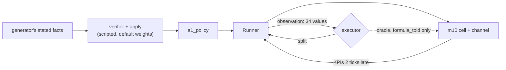
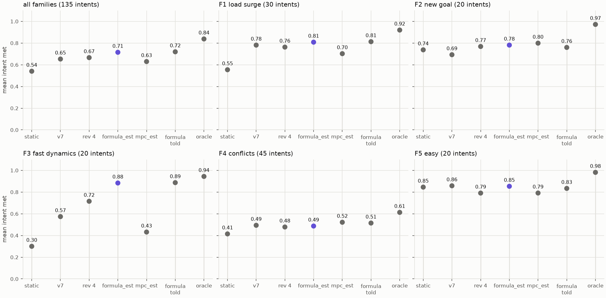
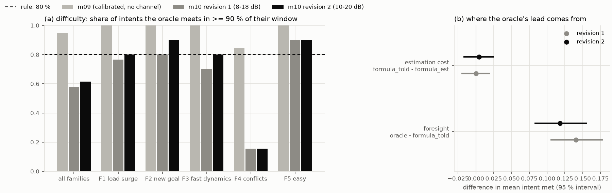

# M10b: fair non-learned executors on the varying cell, and a gate that failed twice

## 1. What we built

M10a gave each slice's UE a radio channel, so a PRB no longer carries a known rate. M10b asked two questions before training any RL on that cell: is the cell neither too hard nor too easy for the comparison to mean something, and which non-learned executor should RL be compared against? We built three new executors that turn a verified objective into a split with no learning, and an LLM-free mode that plays them all on the same objectives:
- `formula_est`: rev 4's rules, sized on each slice's measured rate;
- `mpc_est`: the oracle's search, fed only measurements;
- `formula_told`: a reference that knows the true rate now.

`formula_est` was tuned on the even dev indices; the checks then ran once on the odd ones, with rules committed first. **The difficulty check failed at cell revision 1 and again at the pre-registered revision 2, so M10 stopped at M10b, as registered.** Two findings stand on their own. Estimating each slice's rate lifts the formula by about 0.05. The oracle's whole remaining lead is foresight, not measurement: knowing the true rate *now* is worth nothing over a 2-3 s old estimate.

## 2. Where it sits in the architecture

M10b changes nothing on the path of figure 2. It adds candidates for the **RL xApp box**: controllers that stand where the policy stands, read the same observation and hand their split to the same `Runner`, which alone applies it (hard invariant 4). The objectives come from the generator's stated facts through the real **verifier** and apply step, the harness's `scripted` path, so invariant 3 holds and no LLM is needed. It is evaluation code: it decides whether the M10c comparison is worth running, and against what.

## 3. How it works

1. **A sizing hook in rev 4** ([`FormulaPolicy.rates`, rl/baselines.py:87](../../rl/baselines.py#L87)). Rev 4 divided every need by 74/79. That divisor is now a method returning one rate per slice. A test pins rev 4's outputs on 16 random observations to the values computed before the change.
2. **The rate estimate** ([`estimated_rates`, :33](../../rl/baselines.py#L33)). It reads the M10a tracker's features from the observation: latest and average Mb/s per PRB, relative to the told cell. Options:
   - the latest, the average or the min of the two;
   - a margin;
   - an extra margin per unit of the relative gap between latest and average.

   `formula_est` ([:120](../../rl/baselines.py#L120)) is rev 4 with `rates` = this estimate. With every estimate at 1.0 and rev 4's margin it *is* rev 4 (tested).
3. **mpc_est** ([`MpcEstPolicy`, eval/oracle.py:121](../../eval/oracle.py#L121)). It runs `choose`, the oracle's search: every split on the 0.025 grid, held 60 s, predicted with the cell model. It is fed only what the observation holds:
   - the measured loads, held; a bounded URLLC at its 30 s peak;
   - the estimated rates;
   - a queue inferred from latency above base;
   - the objective in force as one pseudo-intent per target ([`objective_intents`, :104](../../eval/oracle.py#L104)).

   Its "model of the cell" is what a designer knows: the told capacity and URLLC base, the measured delay model and buffer.
4. **formula_told** ([:157](../../eval/oracle.py#L157)). It is `formula_est`'s rules with the truth of now pasted into the observation: the true load of the last second, the true channel of the coming one, the true latency, and margin 0. It reads the simulated cell, like the oracle; a reference, never a candidate.
5. **The executor mode** ([eval/harness.py](../../eval/harness.py)).
   - `RunSpec.executor` names one of [7 executors, :49](../../eval/harness.py#L49) under the `scripted` controller; it is added to the run id only when set, so every earlier id is unchanged (tested).
   - [`make_policy`, :143](../../eval/harness.py#L143) replaces the old if/elif chain.
   - [`apply_scripted`, :101](../../eval/harness.py#L101) with no importance gives the default weights, as the agent keeps them for a first objective with no stated priority.
6. **Tuning on the even half** ([`tune`, eval/m10b.py:151](../../eval/m10b.py#L151)).
   - [`half(0)`, :49](../../eval/m10b.py#L49) gives the 100 even dev instances. `formula_est` plays them in 8 worker processes, about 1 minute per revision.
   - The budget is 3 revisions, each logged in `docs/learn/data/M10b-formula-revisions.csv`. The best was frozen in code (§4).
7. **The checks on the odd half** ([`check`, :170](../../eval/m10b.py#L170)). The guard refuses uncommitted code or DECISIONS, and an existing result. All 7 executors play the 100 odd instances once.
   - [`score`, :88](../../eval/m10b.py#L88) takes the verifier's answer per intent from each run's own log and checks they agree.
   - [`checks`, :107](../../eval/m10b.py#L107) applies the registered rules on accepted intents: difficulty, headroom, comparator.
   - [`paired_interval`, :126](../../eval/m10b.py#L126) gives the reported decomposition with M09d's cluster bootstrap.



## 4. How to run it and check it

```bash
uv run pytest tests/test_m10b.py -q                                  # 17 tests, ~10 s
uv run python -m eval.m10b --tune --revision N --note "..."          # spent: the budget was 3
uv run python -m eval.m10b --check --cell-revision N                 # spent: once per cell revision
uv run python -m eval.plot_m10b                                      # the two figures below
```

**Tuning, even half (cell revision 1):**

| Revision | Estimate | Margin | Mean intent met |
|---|---|---|---|
| 1 | average | 1 − 74/79 | 0.694 |
| **2 (frozen)** | **min(latest, average)** | **0.15** | **0.738** |
| 3 | min(latest, average) | 0.10 + 0.5 × spread | 0.728 |

For reference on the same half: rev 4 0.686, oracle 0.858. Revision 2's reasoning: a latency bound is all or nothing, so sizing too small costs more than sizing too big. Revision 3 tried to put the margin only where the channel moves fast; it lost on F2. No value was tried off the log.

**The checks, odd half, 135 accepted intents each time** (rules in DECISIONS, committed at 2490ca2 and 2aa977f):

| | Revision 1 (8-18 dB) | Revision 2 (10-20 dB) | Rule |
|---|---|---|---|
| Oracle meets ≥ 0.90 on | 57.8 % | 61.5 % | ≥ 80 % → **fails twice** |
| Headroom (best per intent − best candidate) | 0.192 | 0.185 | ≥ 0.05 → passes |
| Best candidate = comparator | formula_est 0.678 | formula_est 0.715 | |
| Foresight (oracle − formula_told) | +0.141 [+0.105, +0.178] | +0.118 [+0.082, +0.156] | reported |
| Estimation cost (formula_told − formula_est) | +0.000 [−0.020, +0.020] | +0.005 [−0.017, +0.025] | reported |



How to read it (revision 2, mean intent met on accepted intents, by family):
- `formula_est` (purple) is the best non-learned executor overall: 0.715 against rev 4's 0.666.
- Its lead is in F3, where URLLC flips on and off: 0.88 against 0.72. Each slice is sized on its measured rate, so a slow, low-SINR URLLC UE gets the PRBs it needs.
- `mpc_est` loses F3 badly (0.43). Holding the measured load for 60 s is the wrong forecast for a load that flips every 10-30 s; the formula's 30 s peak is the right one. It wins F2 and F4 narrowly, where loads are steady.
- v7, never trained on a channel, is close to rev 4 (0.65). The oracle leads everywhere, most in F2 and F5, where a single target is easy given foresight.



- **(a)** Why the gate failed. On the calibrated m09 cell the oracle meets nearly every intent (1.00 in four families, 0.84 in F4). On m10 F1, F2, F3 and F5 sit at 0.70-0.90, near the 80 % line. F4 falls to 0.16 at both revisions. F4's intents put two or three targets on a cell sized to hold them at full capacity, so a fade on one UE makes the combination impossible for any controller, even with foresight. F4 is a third of the intents, and it alone drags the total under 80 %.
- **(b)** Where the oracle's lead over the formula comes from. Estimation costs nothing measurable: the interval sits on 0 at both revisions. Knowing the true rate now (formula_told) does no better than the 2-3 s old estimate. The whole lead, +0.12 to +0.14, is foresight: knowing the next 60 s of the channel and the load.

## 5. Choices and simplifications

| Choice | Alternative rejected | Why |
|---|---|---|
| Scripted objectives, no LLM | The full LLM chain as in M09d | Only the executor differs between runs; no GPU; 2 min instead of hours. No agent revisions or LLM delay, the same for every executor |
| Tune on even, check on odd | Tune and check on the same instances | The comparator's result must not be measured on what it was tuned on |
| 3 revisions, best one frozen | Free tuning; or none | Same rule as rev 4's (M09b): a fair effort, logged, with a stop |
| `mpc_est` untuned, using `formula_est`'s estimate | Its own tuning budget | It has no knob of its own beyond the estimate; a second budget would favour it over the formula |
| Gate on the oracle's share of intents ≥ 0.90 | Gate on the spread between controllers | Written to stop a comparison where everyone fails alike. Here it fired although controllers are well separated (static 0.54 → oracle 0.84): the rule's premise and its threshold disagree. Kept as registered |
| One cell revision, the one written in advance | Search the channel values until the gate passes | That would be tuning the cell to the test |
| Stop after the second failure, plan a separate M10c′ | Continue M10c anyway as a labelled deviation | Souhail's choice: M10b stays a failed gate in the history; any new experiment is pre-registered on its own and says that F4 was dropped after seeing this result |

What a real system would do differently: a real operator would not accept conflicting guarantees that only fit at peak radio conditions. Admission control would size targets against a pessimistic capacity, which is the "verifier with one told capacity" limit the review raised (§3.4), now measured.

## 6. What comes next

M10c′ (Souhail's choice): a new plan with its own pre-registration, on F1, F2, F3 and F5 only. It will state openly that F4 was excluded after M10b's result, and why: the oracle meets 0.16 of F4 at both revisions. The comparator stays `formula_est` rev 2, as fixed here. The RL arm is as in the roadmap.

## 7. Questions to check understanding

1. **Why is `formula_told` − `formula_est` ≈ 0 so informative?**
   It says the estimate is as good as the truth of now. A policy can't win by measuring better: the only thing left to gain is predicting the next seconds, which is what the oracle's foresight buys (+0.12).
2. **Why does `mpc_est`, which searches every split over 60 s, lose F3 to a formula?**
   Its forecast is "the measured load stays as it is for 60 s". In F3 URLLC flips every 10-30 s, so the forecast is wrong most of the horizon. The formula sizes a bounded URLLC to its 30 s peak, which is right for a flipping load. A better search can't fix a wrong forecast.
3. **Why did raising every UE's mean SINR by 2 dB barely move the difficulty share (57.8 → 61.5 %)?**
   The failure is in F4 (0.16 at both revisions). Its conflicting targets fill the cell, so any fade breaks them, and 2 dB more on average doesn't remove fades of σ = 6 dB.
4. **Why count only intents the verifier accepted?**
   The executors only get accepted objectives. The oracle reads every stated intent, including the over-range F4b ones the verifier refuses, so counting those would credit the oracle with intents nobody else was allowed to try.
5. **The gate failed while headroom was 0.18. Is that a contradiction?**
   No. The checks measure different things: difficulty is about how often even the oracle succeeds, headroom about the gap between the best and the non-learned candidates. Their disagreement says the difficulty threshold was set without knowing how hard a varying cell makes the conflict family. That is why the registered result stands, and why the follow-up is a new experiment rather than a reinterpreted one.
