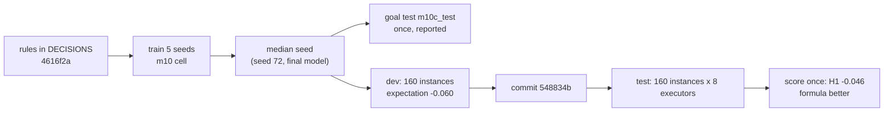
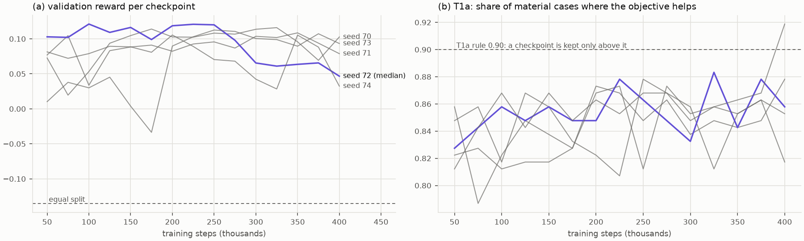
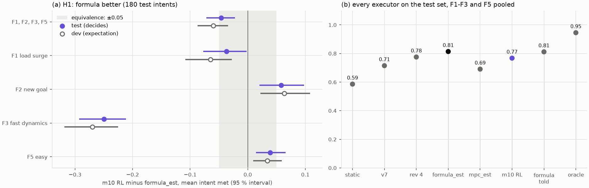

# M10c′: RL trained on the varying cell against the estimating formula, pre-registered

## 1. What we built

The experiment M10 was built for, run as a new one after M10b's gate failed. An RL policy was trained on the m10 cell, where each slice's UE has its own radio channel. It is the v9_noswitch recipe with the measured efficiency as 6 more inputs and the filter at alpha 0.25. Five seeds; the median seed by the pre-registered rule became the policy. It was compared with `formula_est`, the best non-learned executor M10b found, on 160 fresh test instances of F1, F2, F3 and F5. F4 was dropped openly after M10b. The rules were committed before training; the dev expectation before the test; the test was scored once. **Result: "formula better", −0.046 [−0.072, −0.022]**, as the dev run predicted (−0.060). RL wins the families where the load is steady (F2 +0.058, F5 +0.039) and loses F1 (−0.037) and above all F3, where URLLC's load flips (−0.250).

## 2. Where it sits in the architecture

M10c′ tests the **RL xApp box** of figure 2 against a rule-based executor in the same place, behind the same **verifier** and the same apply step (the harness's `scripted` mode, no LLM, as in M10b). It is the question the proposal's §9 fallback ("a simple rule-based executor under the LLM") raised and M09d left open: on a cell where the rate per PRB is unknown and moves, does learning the actuator pay? The upper layers (LangGraph, gateway, Hermes) are unchanged: they hand the executor an objective, whichever executor it is.

## 3. How it works

1. **The recipe** ([rl/m09.py](../../rl/m09.py), `RECIPES["m10c"]`). It is v9_noswitch's options (reward v1, load history, applied split, OU noise, gamma 0.98) with:
   - `profile: "m10"`: `env_options` adds `channel=True`, so every training episode draws a new channel on a generator spawned off the episode's own;
   - `efficiency: True`: 34 inputs;
   - `alpha: 0.25`;
   - `validation: "m10c_validation"`.

   [`strict_checkpoint` and `validation_split`](../../rl/m09.py) replace the old guesses from the recipe's name. `rl/train.py` reads alpha and the split from the recipe.
2. **The goal test on the new cell** ([rl/goal_test.py](../../rl/goal_test.py)).
   - `m10c_validation` / `m10c_test` use seeds 13000 / 14000.
   - Each scenario has its own channel (`CaseSet.channels`, stream `[base + i, 10]`). `rollout` passes it explicitly, because the rollout resets with seed 0 and would otherwise give every case the same one.
   - The greedy oracle ([rl/oracle.py](../../rl/oracle.py)) predicts with the env's channel.
3. **Training** (`uv run python -m rl.sweep m10c`): 5 seeds (70-74) in parallel, 400k steps, a checkpoint every 25k from 50k by M09h's rule (T2 and T1a ≥ 0.90 required, then T1b, then reward). It took 42 minutes.
4. **The choice** ([`choose`, eval/m10c.py](../../eval/m10c.py)). [`median_seeds`](../../rl/sweep.py) ranks seeds by their kept checkpoint's validation reward; a seed with none ranks last. If the median seed has none, its final model is used: the pre-registered fallback.
5. **The executors** (eval/harness.py): M10b's seven, plus `m10_rl` = `SlicePolicy` on the chosen file at alpha 0.25. It reads the 34 values the Runner builds; the Runner applies every split.
6. **The test set** ([`m10c_test_instances`, eval/generator.py](../../eval/generator.py)). Seeds 300000 + 1000 × family + i, 40 per family, F1/F2/F3/F5. `generate()` refuses the split, so only `eval.m10c` can reach it.
7. **Dev, play, score** (eval/m10c.py).
   - `--dev` plays the 160 dev instances: the written expectation.
   - `--play` is behind M09d's guard (code and DECISIONS committed, set unspent).
   - `--score --final` scores per accepted intent, with M09d's cluster bootstrap by instance, then [`reading`](../../eval/m10c.py) in the registered order (superior, formula better, equivalent, inconclusive), then marks `m10c/test` spent.



## 4. How to run it and check it

```bash
uv run pytest tests/test_m10c.py -q             # 14 tests
uv run python -m rl.sweep m10c                  # the 5 seeds, ~42 min on 10 threads (done)
uv run python -m eval.m10c --choose             # the median seed (done: M10c-policy.json)
uv run python -m eval.m10c --dev                # the expectation, ~5 min (done: M10c-dev.json)
uv run python -m eval.m10c --play               # the test, ~4.5 min (done; refuses now: the set is spent)
uv run python -m eval.m10c --score --final      # scored once (done: M10c-result.json)
uv run python -m eval.plot_m10c                 # the two figures below
```

**Training and the choice.** Only seed 74 kept a checkpoint (T1a 0.919 at 400k). The other four beat the equal split at every check, but their T1a stayed between 0.79 and 0.88, under the 0.90 the checkpoint rule asks. The four tie for last; the committed code sorts them by seed, so the median is seed 72, and the policy tested is **seed 72's final model**.



How to read it:
- **(a)** Every seed is far above the equal split's −0.135 from 50k steps on. Seed 72 (purple) drifts down after 250k, which is why its final model has its lowest validation reward (0.047).
- **(b)** T1a, the share of material cases where telling the objective helps, hovers at 0.82-0.88 for every seed. It crosses 0.90 once (seed 74, at the last check).

**The held-out goal test** (`m10c_test`, once, reported): every seed fails T1a (0.79-0.86). The tested policy gets T1a 0.86, T1b 0.54 (passes) and reward 0.085 against the equal split's −0.058 (passes). It uses the objective, but not in 90 % of the material cases. The runner's message "no checkpoint (never beat the equal split)" is wrong for these seeds: they beat it and missed T1a only.

**H1 on the test set** (180 accepted intents, 160 instances):

| | m10 RL − formula_est | 95 % | Dev (expectation) |
|---|---|---|---|
| **F1, F2, F3, F5** | **−0.046** | [−0.072, −0.022] (99 %: [−0.080, −0.015]) | −0.060 [−0.087, −0.034] |
| F1 load surge | −0.037 | [−0.077, −0.002] | −0.065 |
| F2 new goal | **+0.058** | [+0.020, +0.098] | +0.063 |
| F3 fast dynamics | **−0.250** | [−0.293, −0.211] | −0.270 |
| F5 easy | **+0.039** | [+0.014, +0.065] | +0.034 |



- **(a)** Filled: test; hollow: dev. Every family's sign is the dev one, and every test interval overlaps its dev one. The pooled interval sits left of 0 and partly inside the ±0.05 band; by the registered order "formula better" comes before "equivalent".
- **(b)** Pooled means on the test set:
  - **formula_est 0.814** (dark), formula_told 0.812, rev 4 0.775;
  - **m10 RL 0.767** (purple), v7 0.715, mpc_est 0.691, static 0.586;
  - oracle 0.945.

  The policy closes none of the foresight gap: (RL − formula_told) / (oracle − formula_told) = −0.33.

**Why F3** (read from the scored test runs, F3's 40 instances, inside the intent window):

| | URLLC over its bound | URLLC short of its target | URLLC's share of the cell | Cell moved per second |
|---|---|---|---|---|
| formula_est | 16 % of seconds | 2 % | 0.625 | 3.0 % |
| m10 RL | **42 %** | 8 % | **0.415** | 4.7 % |
| oracle | 11 % | 2 % | 0.65 | 0.7 % |

The policy gives URLLC two thirds of the share the formula and the oracle keep, so each time the load flips up URLLC's queue builds and its delay crosses the bound. The formula sizes a bounded URLLC to its 30 s peak; the policy sees the same peak in its inputs (`LoadHistory`) but has not learned to keep that headroom. This is v7's F3 failure on m09 (M09b), unchanged by a new cell, a new recipe and the efficiency inputs.

**Where RL wins against the comparator**: F2 (a new target on one slice in an overloaded cell; 0.846 against formula_est's 0.788) and F5 (easy goals; 0.867 against 0.828). On F5 it beats every non-learned executor, formula_told included. On F2 rev 4 and mpc_est do as well (0.853): there `formula_est`'s safety margin over-sizes the targeted slice, and the margin was tuned for bounded URLLC on the even dev half.

## 5. Choices and simplifications

| Choice | Alternative rejected | Why |
|---|---|---|
| One arm, v9_noswitch's options | Several recipes and a selection | A comparison, not a tuning round; M09h's dev choice |
| alpha 0.25 trained and served | 0.10, as v7 | A 10 s lag is slower than a 30 km/h UE's channel; the policy trains with the 1-3 tick delay that motivated 0.10 |
| Median seed, fallback to its final model | Best seed; or no test when the median has no checkpoint | Best seed is optimistic. Without the fallback, M10 would have ended undecided a third time over T1a (it was needed: 4 of 5 seeds kept nothing) |
| Ties among seeds without a checkpoint broken by seed number | Any other order | It is what the committed code does; it was written before training and is stated here, not chosen after |
| Goal test reported, not blocking | Block as in M09c/M09h | The question is "RL or formula", not "does this seed pass T1a" |
| Scripted objectives (Souhail's choice) | The LLM chain | Only the executor differs; the comparator was chosen in this mode; 4.5 min, no GPU |
| Not in the MLflow registry (Souhail's choice) | Register as `slice-policy-m10` | Never served; training runs are tracked |
| F4 left out, said so | Keep it | M10b: the oracle meets 16 % of F4; decided before M10c′ ran, written in DECISIONS |

What a real system would do differently: it would not choose between the two. The policy wins where loads are steady and the formula where a bounded slice's load flips. A deployed xApp could use the formula as a floor for a bounded slice (the review's runtime monitor, P2) and let the policy share out the rest. That is a new design and would need its own test.

## 6. What it means for the project

The question M09d left open now has a pre-registered answer on a cell built to give RL a chance. With an unknown, moving rate per PRB, F4 excluded, and the best non-learned executor tuned fairly, **a formula that estimates each slice's rate still beats the RL policy overall (−0.046)**. RL wins only where loads are steady. Combined with M10b, the oracle's lead is foresight, not estimation, and neither the formula nor this policy captures any of it.

The claim the project can defend: **the value is in the chain intent → objective → verifier → executor**, which is safe (M09f) and holds on the real cell (M09e). The executor can be a formula. RL is competitive, and better on steady loads, but not needed.

## 7. Questions to check understanding

1. **Four of five seeds kept no checkpoint. Why did the test still run, and on which model?**
   The pre-registration said that if the median seed has no checkpoint, its final model is used. The four tied seeds rank last, in seed order as the committed code sorts them, so the median is seed 72 and its final model was tested.
2. **The pooled interval [−0.072, −0.022] overlaps the ±0.05 band. Why is the reading "formula better", not "equivalent"?**
   The readings were registered in an order: superior, then formula better (upper bound < 0), then equivalent. The upper bound is below 0, so it is "formula better". That was fixed before the test.
3. **The policy sees URLLC's 30 s peak load in its inputs. Why does it still lose F3?**
   Seeing the peak isn't sizing to it. Its reward trades URLLC's bound against the other slices' throughput, and it learned to keep URLLC at about 0.42 of the cell instead of the 0.63 the formula keeps. Each upward flip then builds a queue that crosses the bound.
4. **Why compare against formula_est and not rev 4?**
   M10b fixed formula_est as the comparator by a rule written before its check: the best of three non-learned executors on the odd dev half. Comparing with rev 4 (0.775) would have flattered the policy.
5. **What does foresight_closed = −0.33 say?**
   The gap from formula_told (knows the present) to the oracle (knows the future) is what prediction could win. The policy sits below formula_told, so it closes none of that gap: its learned picture of the channel and load does not predict better than the present measurement.
