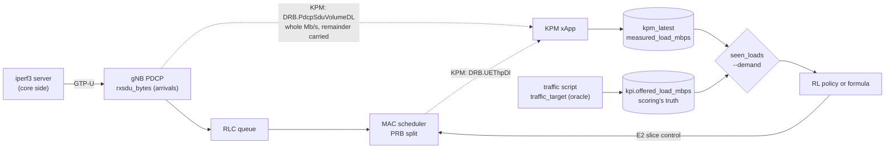
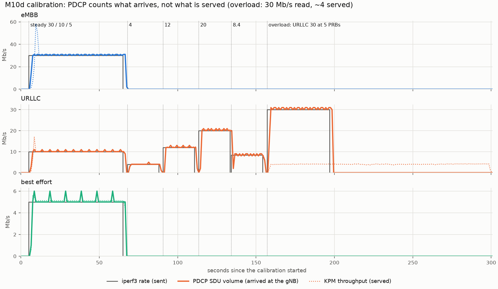
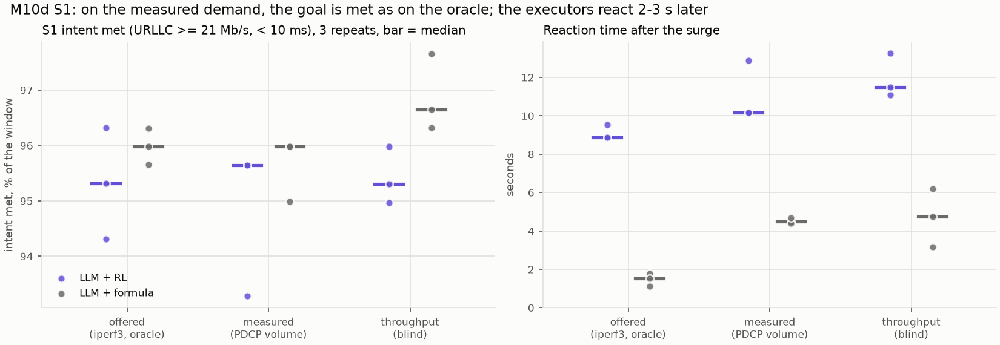
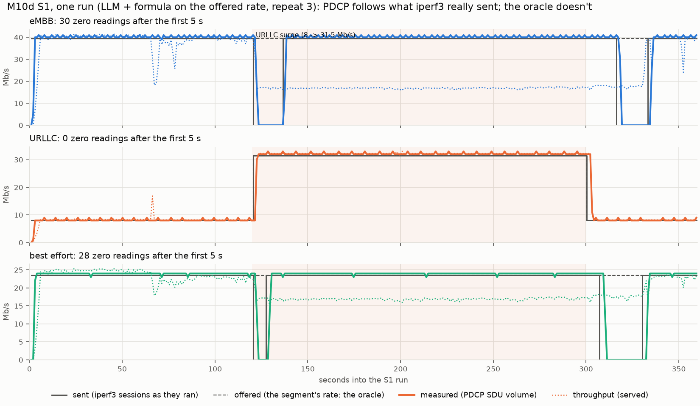

# M10d: the controller on the demand the gNB measures (PDCP volume), not the traffic script's rate

## 1. What we built

On the testbed, the controller used to be told each slice's offered rate by the iperf3 script, which a real gNB can't know. Now the gNB measures it: the KPM measure `DRB.PdcpSduVolumeDL` counts the bytes that reach each UE's PDCP from the core, i.e. arrivals, whatever the scheduler serves.

Getting there took a gNB patch: stock OAI v3.0.0 shares this counter between UEs (the M07a bug again) and drops the remainder under 1 Mb every period. With the patch:
- **The calibration passed** after one logged revision. In the overload, PDCP read 31 Mb/s while URLLC was served 4.
- **S1 (pre-registered H-d) holds.** LLM + RL on the measured demand meets the goal like it does on the oracle: 0.956 against 0.953, a gap of +0.003 against the 0.05 margin.

Two findings came on the side:
- **The oracle itself was wrong** for 15–35 s after a segment change on slices with long queues (the next iperf3 session starts late), and PDCP was right there.
- **The "blind" mode (throughput as demand) didn't fail** on S1, against the expectation written first.

## 2. Where it sits in the architecture

- **The RAN box of figure 2:** the gNB's KPM service model (the patch).
- **The KPM monitoring xApp:** subscribes to one more measure.
- **The KPI store:** a `measured_load_mbps` column.
- **The RL xApp:** reads the demand through one function, `seen_loads`, with `--demand offered|measured|throughput`.

Nothing above the RL xApp changes. The agent, the verifier and the gateway don't see loads. It closes the review's §3.2 ("the controller is told the offered load by the traffic generator") and the matching line in CLAIMS' "what is not claimed".

## 3. How it works

1. **The gNB counts arrivals per UE** ([testbed/gnb/kpm-per-ue.patch](../../testbed/gnb/kpm-per-ue.patch), first hunk). OAI counts `rxsdu_bytes` on entry to `nr_pdcp_entity_process_sdu` (`nr_pdcp_entity.c:230` in the pinned tree), before RLC can refuse anything. The patch makes two changes:
   - **Per-UE counters.** The previous counter is kept per UE in `pdcp_prev[]`, keyed by `rrc_ue_id` (PDCP has no RNTI). Stock OAI keyed it by the UE's place in one subscription's list, so our three one-UE subscriptions shared slot 0.
   - **The remainder is carried.** `take_whole_mb` reports the whole Mb in `counter - reported` and advances `reported` by exactly those Mb, so the remainder goes to the next report instead of being dropped. The uint32 arithmetic also survives a counter wrap.
2. **The KPM xApp subscribes to it** ([xapps/kpm/xapp_kpm_slices.c:51](../../xapps/kpm/xapp_kpm_slices.c#L51)), last in the list, because the order of the RLC measures matters.
3. **The monitor turns it into Mb/s** ([xapps/kpm_monitor.py:119](../../xapps/kpm_monitor.py#L119)). `to_record` sums the slice's UEs and divides by the 1 s period (line 135). A value above twice the cell's capacity is a wrapped or corrupt counter: it logs `pdcp_implausible` and blanks only this measure (line 185).
4. **The store keeps the truth apart** ([store/db.py:131](../../store/db.py#L131)). `measured_load_mbps` is a new column in `kpi` and `kpm_latest`, added by the existing migration. `offered_load_mbps` stays the iperf3 rate, the column scoring reads. `kpi.csv` lists its columns, so earlier runs' files stay byte-identical (the M09b replay test checks it). [backends/flexric.py:187](../../backends/flexric.py#L187) passes both.
5. **The runner picks one demand** ([rl/runner.py:103](../../rl/runner.py#L103)). `seen_loads(records, demand)` returns, per slice:
   - the offered rate (`offered`, the default, as before);
   - the measured one, or throughput where the measure is missing (`measured`);
   - throughput only (`throughput`, M07b's "blind" mode).

   The observation and the load history both go through it, so RL and the formula always see the same demand. A test runs 150 ticks in `measured` mode with sentinel offered rates and checks none reaches the observation.
6. **Calibration, rules first** ([testbed/pdcp_check_m10d.py](../../testbed/pdcp_check_m10d.py), scored by [eval/m10d.py:96](../../eval/m10d.py#L96)):
   - steady 30 / 10 / 5 Mb/s;
   - URLLC steps 4 → 12 → 20 → 8.4;
   - an overload: URLLC offered 30 at 5 PRBs.

   Revision 1 ([`in_run`, :83](../../eval/m10d.py#L83)) cut each run's window to iperf3's sending time, after the first run failed on the backlog's drain (below).
7. **S1, 18 runs** ([`play_matrix`, :160](../../eval/m10d.py#L160)). The matrix is {LLM + RL, LLM + formula} × {offered, measured, throughput} × 3 repeats, with the cells rotated per repeat. M08d's player runs them ([eval/testbed_control.py:270](../../eval/testbed_control.py#L270), with `extra_args` added to the runner's command). [`score_runs` / `summarise`, :191](../../eval/m10d.py#L191) give the median intent met per cell and H-d.
8. **What iperf3 really sent** ([`sent_windows`, :217](../../eval/m10d.py#L217)). Each session's start comes from iperf3's own JSON, when its handshake completed. `export_demand_series` puts it next to the three demand sources for one run.



## 4. How to run it and check it

```bash
testbed/gnb/build.sh                                 # the gNB with the patch (image tags unchanged)
docker build -t agentic-ric/xapp-kpm-slices:v3.0.0 xapps/kpm   # the KPM xApp, subscribing to the PDCP measure
xapps/rl/build.sh                                    # the runner with --demand
testbed/up.sh
uv run python testbed/pdcp_check_m10d.py             # ~5 min; raw data in testbed/results/m10d/
uv run python -m eval.m10d --calibration             # 9 checks, PASSES (docs/learn/data/M10d-calibration.json)
uv run python -m eval.m10d --final                   # 18 S1 runs, ~2.2 h, resumes if stopped
uv run python -m eval.m10d --score                   # docs/learn/data/M10d-s1-runs.csv and M10d-s1.json
uv run python -m eval.m10d --demand-series eval/results/m10d/m10d_formula_offered/s1/proposed/repeat3 \
    eval/results/m10d/m10d_formula_offered/s1/proposed/repeat3/ric-testbed.db
uv run python -m eval.plot_m10d                      # the three figures below
uv run pytest tests/test_m10d.py -q                  # 20 tests
```

### The calibration



Grey is what iperf3 sent, solid is PDCP, dotted is the served throughput.
- **Steady and steps.** PDCP sits on the target, about 0.5–1 Mb/s high. That is the IP/UDP headers, which are in the PDCP SDU while iperf3's `-b` counts payload; it was predicted before the run. Median errors: eMBB 1.0, URLLC 0.0, BE 0.0 Mb/s. Each step is right by its third report (the largest error is 1.0, at 20 Mb/s, exactly the limit).
- **Overload (right).** iperf3 sends 30 Mb/s into URLLC held at 5 PRBs. PDCP reads 31 while the gNB serves 4.05. This is the property the whole checkpoint rests on: the measure is demand, not service.
- **Why the first run failed.** After the sender stops at ~198 s, the slice keeps draining its backlog at 4 Mb/s for 100 s, and PDCP rightly reads 0 there (nothing arrives). The first run's window ran until `traffic.run` returned, so it included those 100 s, and the median was 0. Revision 1 scores the sending time only. That failed run is kept in `testbed/results/m10d/r0_failed/` and was not rescored.

### S1: the pre-registered result



| intent met (median of 3) | offered (oracle) | measured (PDCP) | throughput (blind) |
|---|---|---|---|
| LLM + RL | 0.953 | 0.956 | 0.953 |
| LLM + formula | 0.960 | 0.960 | 0.966 |
| median reaction, RL / formula | 8.9 s / 1.5 s | 10.2 s / 4.5 s | 11.5 s / 4.7 s |

- **H-d holds:** RL measured − offered = +0.003 (margin 0.05), and all 18 runs are valid.
- **The formula's gap is 0.000.**
- **The cost is time.** On the measured demand, both executors react 1–3 s later. The measure trails the real arrivals by about 2 reports: the 1 s KPM period, then the store, then the next tick (the next figure shows it). The goal still holds because S1's window is 300 s and the URLLC queue never builds.
- **Blind didn't fail.** It was expected to, as in M07b, where eMBB froze at 24.9 of 37.5 Mb/s after a surge. Here it doesn't:
  - S1's scored goal has a latency bound. When URLLC saturates, its delay rises, and both executors answer the delay directly: the formula's step 4 gives URLLC all the slack, and the RL policy reads latency in its observation. So the scored slice carries its own feedback, whatever its seen load.
  - On the slices without a goal, RL served eMBB 35.4 Mb/s after the surge blind, against 35.2 on the oracle.

  M07b's freeze came from a different setting: the default objective without a latency bound, an older policy and another cell. We didn't retest it.

### What the gNB saw in one S1 run



This run is LLM + formula on the oracle, repeat 3. The measure was recorded but not used; it is the only S1 run whose measured series exists (step 4 of §5 says why). The lines:
- **solid grey** is what iperf3 really sent;
- **dashed** is the oracle (the segment's rate);
- **colour** is PDCP;
- **dotted** is the served throughput.

What it shows:
- **URLLC.** PDCP follows the surge 2 reports late, and URLLC's sessions always start on time.
- **eMBB and BE.** Their RLC queues hold 15–20 s of data during the surge, and the next segment's iperf3 session can only start once its control handshake has crossed that queue:
  - at 120 s, eMBB's session started at 136.2 s and BE's at 127.2 s;
  - at 300 s, they started at 333.2 s and 330.2 s.

  Each session then runs its full length, so the previous one ends late too (eMBB's surge session stops at 316 s). In those gaps nothing arrives: PDCP reads 0, and the oracle says 39.5 and 23.5.
- **Agreement with what was sent,** within max(1 Mb/s, 5 %):
  - PDCP, allowing its 2-report lag: 98.9 % of ticks for eMBB, 99.4 % for URLLC, 98.3 % for BE;
  - the oracle: 90.7 %, 100 % and 91.5 %, wrong on 33 eMBB ticks and 30 BE ticks.
- **How to read the throughput line during the gaps.** It stays at ~17 Mb/s because the queue is draining old data. A slice can be served while nothing new arrives.

**One cost of the true zeros.** In all three formula/measured repeats, URLLC held 0.43 of the cell for 10–15 s after the surge, and best effort got 13.6 Mb/s of 23.5 in the last minute (20.8 on the oracle). That is the formula's arithmetic on two zero demands:
- step 6 shares the slack in proportion to each slice's load beyond its need;
- with eMBB and BE both at 0, it splits the slack equally, so URLLC gets 0.13 + 0.87 / 3 ≈ 0.42.

Earlier in the same window, while the 30 s peak still held the surge, the same arithmetic gives 0.56 + 0.44 / 3 ≈ 0.71, and repeat 1 shows 0.70. The arithmetic is right; the demand it was given was "nothing arrives", while both slices still had a 15 s backlog.

## 5. Choices and simplifications

- **The truth stays in `offered_load_mbps`; the measure gets its own column.** Scoring must not depend on the thing under test.
  - Rejected: replacing the oracle with the measure, because scoring would lose its reference.
  - We now know that reference is wrong for some seconds on saturated slices (§4). S1's score reads URLLC only, whose sessions start on time, so H-d is unaffected.
  - Earlier testbed results that score eMBB or BE targets (M08d S3's first goal, the M09e instances with eMBB/BE targets) may count up to ~15–35 s per segment change as "offered but not served" when nothing was sent. That is a bias against every controller alike, not rescored (the results were registered as they are); it is logged in DECISIONS.
- **Whole Mb with the remainder carried, not fractional Mb.** OAI reports this measure as an integer in Mb, and any other consumer reads it that way. The carry removes the bias (stock truncation reads ~0.5 Mb/s low: 800 Mb instead of 840 over 100 s at 8.4 Mb/s, in a C test). It keeps the 1 Mb/s resolution, the steps visible in the figures.
  - Rejected: `real_val` in Mb, which changes the measure's type for every consumer.
- **Arrivals, not demand.** PDCP counts what arrives; it doesn't know what is queued. The zero windows show the difference: the slice still has 15 s of backlog while arrivals are 0. A real controller would add the RLC buffer occupancy (`buffer_bytes`, which the simulator has and our KPM subscription doesn't report). Here the formula took "0 arriving" for "0 needed".
- **Fixed for future runs, after M10d (2026-11-17).** The player ([eval/testbed_control.py](../../eval/testbed_control.py), `SentRates`, `follow_session`) now runs iperf3 with `--json-stream` and writes a slice's `traffic_target` when its session really starts. The rate comes out after the session's `-t` seconds, or when its process ends. Overlapping sessions are summed, and the real windows are logged as `session_start` / `session_stop`.
  - The `seg*_*.json` files are rebuilt from the events (`traffic.assemble`) and read exactly as before.
  - Each run also writes `kpi_measured.csv` beside an unchanged `kpi.csv`.
  - The sessions still start late on a saturated slice (that is iperf3's handshake). What changes is that the record says so.
  - Not yet checked on the testbed. The check: `uv run python -m eval.testbed_control --dev --scale 1 --scenarios s1 --controllers static` (~7 min), then compare the run's `session_start` events with the first non-zero rows of `kpi_measured.csv`.
- **The measured series of the S1 runs wasn't kept.** `kpi.csv` lists its columns so earlier files stay byte-identical, and the testbed database holds only the last run. So only one run's series exists, saved right after the matrix (`--demand-series`). Next time, the player should write the measured column to its own file per run. We didn't change the player after the runs, because the matrix was frozen with it.
- **Descriptive, one scenario.** S1 only, 3 repeats per cell, as registered. The 0.003 gap is well inside run-to-run spread (RL on the oracle: 0.943–0.963).
- **Upstream.** The per-UE fix for the PDCP counters and the remainder carry could go to OAI as a follow-up to the M07a pull request (duranta-project/openairinterface5g#1124). Whether to propose it is your call.

## 6. Questions to check understanding

1. **Why does `DRB.PdcpSduVolumeDL` measure demand while `DRB.UEThpDl` measures service?**
   PDCP counts SDUs on entry, as they arrive from the core (`nr_pdcp_entity.c:230`), before RLC queues or drops them. Throughput counts what the MAC scheduler sends over the air, which is capped by the slice's PRBs. The overload phase shows both: 31 Mb/s arrived, 4 served.
2. **What does carrying the remainder fix, and what doesn't it?**
   It fixes the bias: stock OAI drops the bytes under 1 Mb each period, so it reads ~0.5 Mb/s low on average. With the carry, the reports add up to the real volume. It doesn't fix the resolution: each 1 s report is still whole Mb, off by under 1 Mb/s.
3. **Why did the first calibration run fail, and why wasn't it rescored after the fix?**
   Its overload window included ~100 s of drain after iperf3 stopped, where PDCP correctly read 0, so the median was 0. Scoring the same data again under a rule written after seeing it would fit the rule to the data. So the revision required a new run, and the old one is kept as a failure.
4. **Why didn't blind mode (demand = throughput) fail on S1?**
   S1's goal has a latency bound, and a saturated URLLC shows up as rising delay. Both executors react to delay directly, so they give URLLC more PRBs without knowing its demand. The scored slice never depended on the load estimate.
5. **In the demand figure, eMBB's PDCP reads 0 at 320–333 s while the oracle says 39.5. Which is right, and how do we know?**
   PDCP. iperf3's own JSON says eMBB's surge session stopped at 316 s and the next one started at 333.2 s: its handshake waited behind the slice's 15–20 s queue. Nothing was sent in between. The throughput line is still at ~17 Mb/s because the queue is draining old data.
