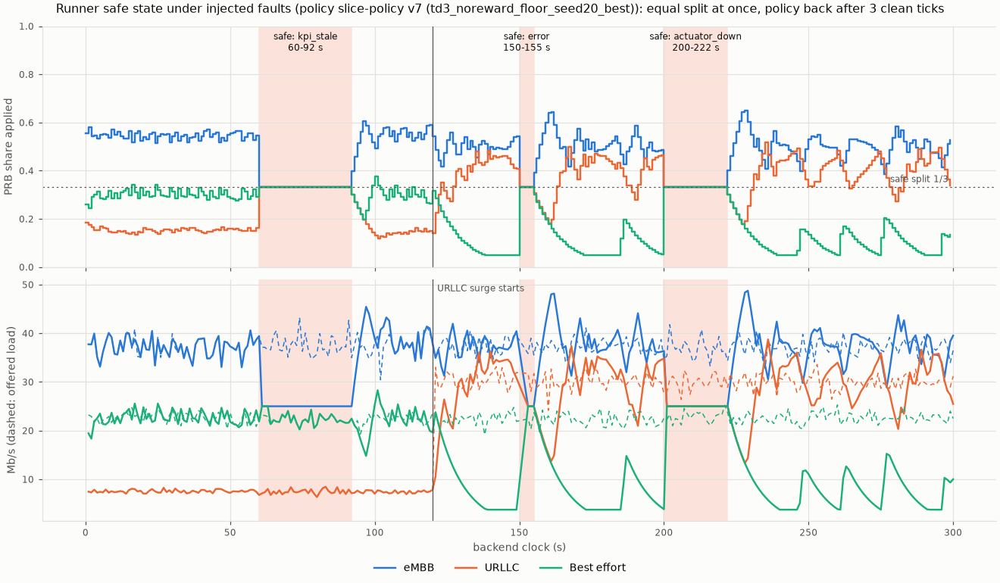

# M11a: the runner's safe state

## 1. What we built

The RL runner, the only process that sets the PRB split, now has a **safe state**. It enters it at once in three cases:
- the KPIs are stale (no report for 5 s);
- the actuator is down (the slice-control xApp died);
- the backend or the policy raises an exception.

In the safe state it stops asking the policy and applies the **equal split** (1/3 per slice, the static controller's split). It logs `safe_mode_enter` and writes a `runner_state` row, which `get_status`, Prometheus and Grafana show. After **3 clean ticks in a row** it hands the split back to the policy, with the policy's smoothing filter restarted from the equal split so the hand-back doesn't jump.

On the testbed, the backend also **restarts a dead slice-control xApp**, at most 3 times and at least 10 s apart.

On the simulator the backend is always healthy, so nothing changes there: every earlier run replays byte for byte (checked).

## 2. Where it sits in the architecture

M11a is inside the **RL xApp box** of figure 2 (the fast loop) and the **Backend interface** below it. It also adds one read-only field to what `get_status` returns. It doesn't touch the LLM, the verifier or the objective path. No LLM is on the path (invariant 5), the split is still applied by one call in [rl/runner.py](../../rl/runner.py) (invariant 4), and Hermes still has exactly three tools (invariant 1).

Why it exists: the review of 2026-11-11 (§3.3, "the real-time loop has no safe state") found three ways the runner could leave the cell with no sensible controller:
- With stale KPM reports, the policy kept deciding on frozen values.
- With a dead xApp, every `apply_prb_split` returned silently and nothing restarted it.
- An exception ended the runner, leaving the gNB on its last split.

M11a is the first part of the review's P2, "close the safety story". M11b adds the runtime monitor with formula fallback (§3.4) and M11c the threat model.

## 3. How it works

1. **The backend says whether it can be trusted** ([backends/base.py:20](../../backends/base.py#L20)). `BackendHealth` has two fields: `kpi_age_s` (age of the newest KPI report; `None` = nothing yet) and `actuator_ok`. Every Backend now has `health()` ([:51](../../backends/base.py#L51)).
   - `SimBackend.health()` always returns `(0.0, True)` ([backends/sim.py:115](../../backends/sim.py#L115)). `DelayedBackend` inherits it: a view that is 2 ticks late is late, not stale.
   - `FlexRICBackend.health()` ([backends/flexric.py:119](../../backends/flexric.py#L119)) returns the report age that `read_kpis` already computes ([:163](../../backends/flexric.py#L163)) and whether the xApp process is alive.
2. **What counts as a problem** ([`health_problem`, rl/runner.py:142](../../rl/runner.py#L142)). `actuator_down` comes first: if nothing reaches the radio, fresh KPIs don't help. Next is `kpi_stale`: no report yet, or the newest one older than `SAFE_KPI_AGE_S = 5.0` s ([:63](../../rl/runner.py#L63)), five missed 1 s reports and FlexRIC's own `kpm_stale` threshold. Any exception is `error`.
3. **One tick** ([`Runner.tick`, :206](../../rl/runner.py#L206)). The split starts as `SAFE_SPLIT` ([:62](../../rl/runner.py#L62)). Inside one `try`, the runner then:
   1. reads the KPIs and feeds the load history and efficiency trackers (every tick, as before);
   2. asks `health()`;
   3. calls `update_mode`;
   4. if the mode is still `normal`, asks the policy (or takes a `direct_share` row).

   Any exception in that block sets the reason `error` and keeps `SAFE_SPLIT` ([:227](../../rl/runner.py#L227)). After that, as before: the 5 % floor, then the single `apply_prb_split` call. If that call raises, the error is kept and the *next* tick enters the safe state ([:239](../../rl/runner.py#L239)), because this tick's split is already decided.
4. **The mode** ([`update_mode`, :259](../../rl/runner.py#L259)).
   - A problem enters the safe state at once, or changes its reason if it is already safe. Either way it logs `safe_mode_enter` with the reason, the previous reason and, for an error, `"Type: message"`, and queues the `runner_state` row.
   - A clean tick while safe counts toward `RESUME_AFTER_TICKS = 3` ([:64](../../rl/runner.py#L64)). On the third it logs `safe_mode_exit` with the time spent safe, and calls `SlicePolicy.restart_from(applied)` ([rl/policy.py:58](../../rl/policy.py#L58)).
   - Without that restart, the filter `split_t = 0.1·new + 0.9·split_{t−1}` would continue from its last output *before* the outage. The first resumed split would then jump back to a decision made on data that was already going bad.
5. **The row and its readers.**
   - `runner_state` ([store/db.py:43](../../store/db.py#L43)) holds one row: `mode`, `reason`, `since_backend`. It is written at startup and on every change, inside the same transaction as the KPI rows ([`flush`, rl/runner.py:291](../../rl/runner.py#L291)), so the zero busy timeout still holds; a busy database only delays it.
   - `GET /status` adds `"runner"` ([agent/service.py:75](../../agent/service.py#L75)). Hermes' `get_status` passes it through unchanged.
   - The exporter publishes `ric_runner_safe_mode{reason}` ([monitoring/exporter.py:149](../../monitoring/exporter.py#L149)). It skips the series on a database from before M11a, which has no such table.
   - The Grafana dashboard has a new "RL runner mode" stat: green `normal`, red `SAFE`, with the reason.
6. **Evaluation runs still crash on a bug.** `Runner(on_error="raise")` ([:171](../../rl/runner.py#L171)) lets exceptions through. [eval/harness.py:198](../../eval/harness.py#L198) passes it, so a bug ends a benchmark run instead of quietly scoring the equal split.
7. **The xApp comes back** ([backends/flexric.py:106](../../backends/flexric.py#L106)).
   - When the next split finds the xApp dead, `_restart_if_due` starts it again through `_start_xapp` ([:85](../../backends/flexric.py#L85)), at most `MAX_XAPP_RESTARTS = 3` times and `XAPP_RESTART_S = 10` s apart ([:37](../../backends/flexric.py#L37)). After that it logs `xapp_restart_gave_up` and stops trying, since a fourth failure means the RIC or the gNB is broken.
   - `last_prbs` is reset, so the same split is sent again to the new process.
   - Each process has its own reader thread. Only the current process's exit marks the actuator down, so an old process ending late can't kill a fresh one's status.
   - `Popen` returns at once, so the tick never waits (invariant 5).
8. **Faults on demand** ([backends/faults.py](../../backends/faults.py)). `FaultyBackend` is the simulated cell with chosen seconds of stale KPIs, dead actuator or failing reads. It doesn't override `apply_prb_split`: the invariant-4 test flags any call to it outside `rl/runner.py`, so the failing-apply fault lives in a subclass inside [tests/test_safe_state.py](../../tests/test_safe_state.py), where the check doesn't look.

```mermaid
stateDiagram-v2
    [*] --> normal
    normal --> safe: kpi_stale / actuator_down / error<br/>(at once, equal split)
    safe --> safe: problem (counter back to 0;<br/>new reason logged)
    safe --> safe: clean tick 1, 2<br/>(still equal split)
    safe --> normal: clean tick 3<br/>(filter restarted from 1/3)
```



## 4. How to run it and check it

```bash
uv run pytest tests/test_safe_state.py tests/test_flexric_backend.py -q   # 25 tests, ~6 s
uv run pytest tests/test_runner_realtime.py -q                            # invariants 4 and 5, unchanged
uv run pytest tests/test_m10a.py -q    # includes the M09b byte-for-byte replay (needs the runs on disk)
uv run pytest -q                       # the whole suite: 686 passed
uv run python -m rl.plot_safe_state    # the figure below, ~3 s
```

`rl.plot_safe_state` prints:

```
safe    60-   92 s  ( 32 s)  kpi_stale
safe   150-  155 s  (  5 s)  error
safe   200-  222 s  ( 22 s)  actuator_down
safe ticks: 59 of 300
```



**How to read it.** This is the served policy (v7, alpha 0.10) on the `demo` scenario (the URLLC surge starts at 120 s), with three faults injected by `FaultyBackend`: stale KPIs over 60–89 s, a store that can't be read over 150–152 s, and a dead actuator over 200–219 s.
- **Top panel, the PRB share applied.** Each shaded band is a safe period. The split snaps to 1/3 at the band's first second. The band ends 2 s after the fault: those two clean ticks are still safe, and the third one hands back. From there each slice moves away from 1/3 at the filter's pace, not in one step.
- **Bottom panel, throughput (solid) and offered load (dashed).** This is the price of the safe state.
  - In the first band, eMBB is capped near 26 Mb/s (a third of 79) while it offers about 38.
  - In the last band, URLLC gets less than its surge load and its throughput falls to a third of the cell.

  A safe split is safe for the controller, not optimal for the traffic. M11b is the step that keeps targets met when the *policy* is the problem.
- **The missing point at 150 s** is the KPI record of the tick whose read failed. Nothing was recorded rather than something invented.

**On the testbed (optional, you run it).** The rl-xapp image carries the runner code, so rebuild it first with `xapps/rl/build.sh`. Then start a closed loop as in M07b (`testbed/run_loop_m07b.sh <run> rl`) and, from another WSL shell while it plays:

```bash
pkill -STOP -f "kpm_monitor --for-runner"; sleep 20; pkill -CONT -f "kpm_monitor --for-runner"
docker exec rl-xapp pkill -f xapp_slice_ctrl     # if pkill is missing in the image: kill $(pidof ...) via sh -c
grep -E '"safe_mode_|"xapp_restart' var/events.jsonl | tail
curl -s localhost:8000/status | jq .runner         # if the agent service is up
```

Expected:
- after about 5 s of pause, `safe_mode_enter kpi_stale`, and the gNB log shows the 36/35/35 PRB split;
- about 3 s after `CONT`, `safe_mode_exit`;
- after the kill, `xapp_exited`, `safe_mode_enter actuator_down`, `xapp_restart` within 10 s, then `xapp_ready` and `safe_mode_exit`.

## 5. Choices and simplifications

- **The equal split, not "the last good split".** The last split was chosen by the policy on data that may already have been going bad (staleness is only detected after 5 s). The equal split needs no KPI and no objective, and keeps every slice far above the 5 % floor. **Not the formula** either: it needs fresh KPIs too, and the formula fallback is M11b's job, with its own trigger.
- **Enter at once, leave after 3 clean ticks.** Entering late costs radio time on bad decisions. Leaving on the first fresh report would flap when reports come and go. Three seconds is short next to the policy's own 10 s filter time constant. Rejected: a longer hold (10 s) that would pay the safe split's cost for longer after every glitch.
- **Safe mode overrides a `direct_share` row** (the LLM-only baseline). The safe state must be one known split whatever is in force. `direct_share` exists only for a baseline, never in the proposed controller.
- **The testbed starts in the safe state** until the first KPM report: `kpi_age_s` is `None`. Before M11a the policy decided on zeros there.
- **The trackers keep being fed** while safe (load history, efficiency). That is unchanged behaviour, so replays stay identical. On the testbed, a stale stretch shows in the history as a flat segment, and the history window forgets it within its own length.
- **An exception is caught at the tick, not at the process.** Exceptions outside a tick (startup, the CLI) still end the process; a real deployment would put the runner under a supervisor (systemd or Docker `restart: on-failure`) and an external watchdog that applies the safe split if the runner itself stops ticking. We have neither: the gNB then keeps the last split, as before.
- **The alert is an event, a status field and a Prometheus gauge.** A real xApp would raise an O1 alarm to the SMO. There is no SMO in this stack.
- **Only three xApp restarts.** More would hide a broken RIC or gNB behind a loop of restarts. The counter never resets during a run, which is a simplification: a long-lived runner would reset it after an hour of good health.
- **`on_error="raise"` in evaluation.** The served runner must survive a bug. An evaluation must not, or a crash would be scored as "the equal split's performance".

## 6. Questions to check understanding

1. **Why doesn't M11a change any simulator result?**
   `SimBackend.health()` always returns a 0 s report age and a working actuator, and the simulator never raises, so `update_mode` never leaves `normal`. The decision path is the same code in the same order. `test_m09b_runs_replay_byte_for_byte` and `test_m09b_rl_only_replays_byte_for_byte` (tests/test_m10a.py) check the KPI files are byte-identical, and `test_the_simulator_never_enters_the_safe_state` checks 600 ticks of the demo.
2. **KPIs come back after 30 s of staleness. At which tick does the policy decide again, and what is its first split?**
   On the third clean tick (the first two still apply 1/3). Its first split is `0.1·policy + 0.9·(1/3)` per slice, because `restart_from` seeded the filter with the equal split. So it is at most 0.067 away from 1/3.
3. **Why is a failed `apply_prb_split` handled on the next tick, not the current one?**
   The split of the current tick has already been decided and the call is the last step before the tick ends. The runner records the error, and the next tick starts with problem `error`, so it applies the safe split and logs `safe_mode_enter` with the exception's text.
4. **Why does `FaultyBackend` not inject apply failures itself?**
   Invariant 4's test scans every module outside `tests/` for a call to `apply_prb_split` and allows only `rl/runner.py`. Overriding it in `backends/faults.py` means calling `super().apply_prb_split`, which the test flags. The fault lives in a test-only subclass instead, and the invariant check stays strict.
5. **The xApp dies and its restart dies too, three times. What does the cell do, and what does the operator see?**
   The gNB keeps the last split it received: nothing else can change it. The runner stays in `safe` with reason `actuator_down` for as long as it runs. The operator sees `xapp_restart` ×3, then `xapp_restart_gave_up` in the event log, `runner.mode = "safe"` in `get_status`, and a red SAFE stat with `actuator_down` in Grafana.
