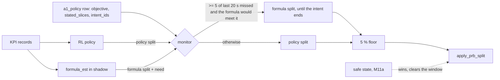
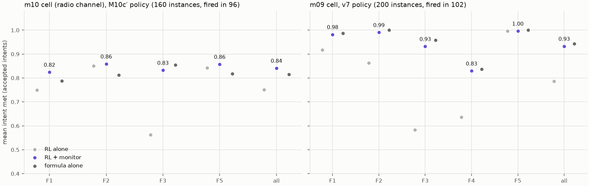
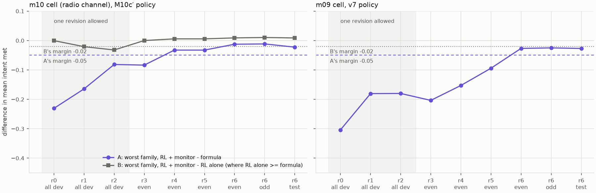
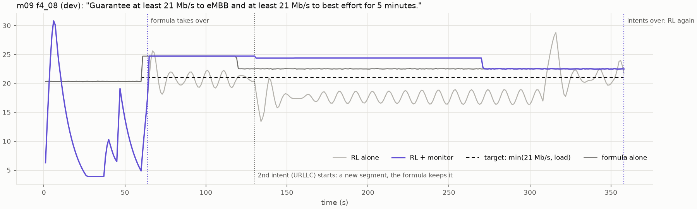
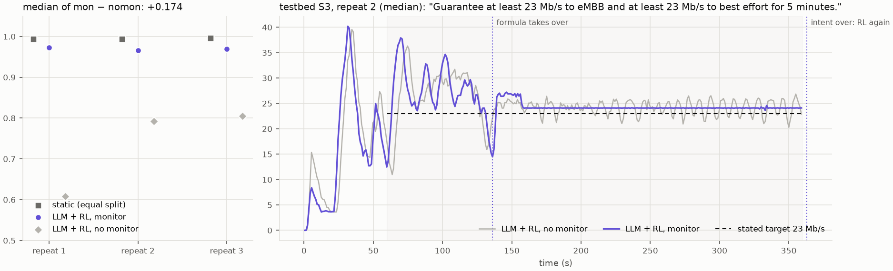

# M11b: the runtime monitor with formula fallback

## 1. What we built

The verifier checks that an objective is feasible. It can't check that the RL policy then meets it, and sometimes the
policy doesn't (M08d's S3, M09b's F4a, M10c′'s F3). M11b adds a deterministic monitor to the fast loop. The formula
executor runs in shadow every tick. When a stated target keeps being missed while the formula's split would meet it,
the formula takes over that intent until the intent ends, and the switch is logged and shown in `get_status` and
Grafana. The first trigger (M11b: N seconds in a row) failed its pre-registered rule twice. A second, pre-registered
experiment (M11b′) changed only the trigger, tuned it on half of the dev set, checked it on the other half, and then
played it once on a fresh test split. **On that test split, LLM + RL with the monitor is within 0.05 of LLM + formula
on every family of both cells, and never more than 0.02 under the RL alone where the RL was the better executor.**
On the testbed (S3, three paired repeats on the same cell, rule written first), LLM + RL with the monitor meets the
intent better than without it in every repeat (median +0.174).

## 2. Where it sits in the architecture

It is inside the **RL xApp** box of the proposal's figure 2 (`rl/runner.py`), between the policy's output and the
one call that applies the split. It doesn't add a path from the LLM to the radio: the monitor reads the KPIs the
runner already reads and the a1_policy row the runner already reads, and the formula's split goes through the same
5 % floor and the same `apply_prb_split` call (hard invariant 4). It makes no LLM or network call and doesn't wait on
anything (invariant 5). The verifier stays the gate for *objectives*. The monitor is the check on *outcomes* that
the review (§3.4) asked for: the proposal's §9 "exécutant à règles simples sous le LLM", made automatic.

## 3. How it works

1. **The apply step records which targets were stated.** `agent/apply.py:97` computes, for each segment, the slices
   whose throughput target an intent stated, before the verifier adds the implied ones (`with_fair_shares`). It's
   stored in the new nullable column `a1_policy.stated_slices` (`store/db.py:72`, migrated at `store/db.py:138`). NULL
   means unknown: every target is then watched.
2. **The runner hands each segment to the monitor first.** `rl/runner.py:258`: `monitor.segment(policy_id,
   intent_ids)` notes the segment. If the formula had taken over an intent that is no longer in force, the policy
   decides again and its filter restarts from the applied split (`end_fallback`, `rl/runner.py:376`), as after M11a's
   safe state.
3. **The policy decides, the formula decides in shadow.** `rl/runner.py:277` calls `monitor.step` with the policy's
   split. `rl/monitor.py:177` computes `FormulaEstPolicy`'s split on the same observation, every tick, so its 30 s
   URLLC peak window stays fed.
4. **Missed?** `missed_slices` (`rl/monitor.py:98`): a watched slice is missed when its throughput is under
   min(target, seen load) by more than the trigger's tolerance, or URLLC's latency is over the bound. The served
   trigger uses the scorer's own rule (tolerance 1e-9) and only the stated targets.
5. **Would the formula fix it?** `rl/monitor.py:187`: the miss *qualifies* only if the formula's split covers the
   slice's need, less the formula's own 0.15 sizing margin (`last_need`, `rl/baselines.py:112`), **and** gives the slice
   at least one PRB more than the policy. Otherwise switching wouldn't help (the cell, not the policy, is short).
6. **Enough of the window?** `rl/monitor.py:191` appends this tick's qualifying flag to a 20 s window. When at least
   5 of the last 20 s qualified, the formula takes over (`rl/monitor.py:196`) for the intents in force.
7. **Logged and shown.** `start_fallback` (`rl/runner.py:364`) logs `executor_fallback` (slice, reason, seconds
   missed, both shares) and writes `runner_state` mode `'fallback'` with reason `target_missed:<slice>`.
   `shown_mode` (`rl/runner.py:349`) puts the safe state first. The exporter adds `ric_runner_formula_fallback`
   (`monitoring/exporter.py:161`).
8. **Precedence.** A safe tick or an LLM-only row calls `hold()` (`rl/runner.py:284`), which clears the window: the
   misses counted must be the policy's own. A fallback already running survives a safe episode.
9. **Every version is one mechanism with parameters.** `Trigger` (`rl/monitor.py:38`) holds the window, the count,
   the tolerance, stated-only, per-intent and the need margin. M11b's "N in a row" is k = W = N. Each revision is a
   named preset (`rl/monitor.py:65-89`), so any of them can be replayed. `SERVED_TRIGGER` (`rl/monitor.py:95`) is the
   one that passed the test split. Evaluation runs pass a preset by name (`RunSpec.monitor`, `eval/harness.py:201`);
   with none, the runner is exactly as before M11b, so every earlier run replays byte-identical.



## 4. How to run it and check it

```
uv run pytest -q tests/test_m11b.py           # 31 tests: the rule, each trigger, the runner on the cell, status, gauge
uv run python -m demo                         # ~21 s; run_start logs "monitor": "m11b_prime_meets"; nothing fires
uv run python -m eval.m11b --probe            # ~1 s per run
uv run python -m eval.m11b --dev --half even  # the dev runs of the current revision (r6), a few minutes
uv run python -m eval.m11b --score --half even
uv run python -m eval.plot_m11b               # the three figures below
```

The test split (`--play`, `--score --final`) is spent: `eval.m11b` refuses it now.

**The result on the test split** (m11b_test: 160 fresh m10 instances, 200 fresh m09 instances, scripted mode, played
once with r6 frozen at `2ea6c81`):

| cell | RL alone | RL + monitor | formula alone | fired in |
|---|---|---|---|---|
| m10 (radio channel, M10c′ policy) | 0.751 | **0.841** | 0.815 | 96 / 160 runs |
| m09 (v7, the champion) | 0.786 | **0.933** | 0.943 | 102 / 200 runs |



How to read it: one dot per label and family. The purple dot (RL + monitor) must sit within 0.05 under the dark one
(formula alone) in every family (rule A), and must not fall more than 0.02 under the light one (RL alone) where the
light one is above the dark one (rule B: m10 F2 and F5). On m10, the monitor beats both executors overall: the RL
keeps the intents it serves better, the formula takes the ones it misses.



How to read it: each point is the worst family's gap for one revision. Purple is rule A (RL + monitor − formula),
grey is rule B (RL + monitor − RL alone, only where the RL alone was the better one). A rule passes when its line is
above its dashed margin. The shaded part is M11b and M11b′'s first run, under the one-revision limit; r3-r6 were tuned
on the even half; r6 was then checked on the odd half and the test split.



How to read it: m09 F4 instance f4_08, the intent "21 Mb/s to eMBB and 21 Mb/s to best effort". The RL alone (light
grey) keeps best effort under its target (dashed) for most of the window. With the monitor (purple), the formula takes
over at 64 s, keeps the intent when a second intent starts at 130 s (a new segment), and gives the policy back when
the intents end.

**On the testbed** (rules in DECISIONS 2026-11-21, before the runs). S3 on the OAI cell, the LLM in the loop, the
rl-xapp image with the served trigger. Each repeat plays static (the cell's reference), LLM + RL with the monitor
(`mon`) and LLM + RL with `--no-monitor` (`nomon`), order rotated, the same session. A repeat counts when its three
runs are valid and each carried ≥ 0.68 Mb/s per PRB. The first pass had a slow run in every repeat (cell noise, kept
as `repeatN_lowcap`, not scored); the replays all count.

```
uv run python -m eval.m11b_testbed --play     # 9 runs, ~6 min each, resumes if stopped (needs the testbed up)
uv run python -m eval.m11b_testbed --score    # -> the JSON committed as docs/learn/data/M11b-testbed.json
```

| S3 intent 1 met | static | LLM + RL, monitor | LLM + RL, no monitor | mon − nomon |
|---|---|---|---|---|
| repeat 1 | 0.993 | 0.973 | 0.609 | +0.365 |
| repeat 2 | 0.993 | 0.966 | 0.792 | +0.174 |
| repeat 3 | 0.997 | 0.970 | 0.805 | +0.165 |

Median mon − nomon **+0.174 > 0: the monitor helps** (the registered reading). In every `mon` run it fired once, on
best effort's stated target, at 127-136 s, held the intent until it ended (363-364 s) and gave the policy back; no
safe state. Two things the table also shows: static meets this intent better still (0.99), so with the monitor LLM +
RL comes close to the reference but not past it, the ~70 s before the takeover being what it loses; and the agent's
own reflection revised the objective (same targets, higher weights) in two `nomon` runs and none of the `mon` runs,
which is part of the system under test in both arms.



How to read it: left, one marker per arm and repeat; the violet dot (monitor) sits under the dark square (static) and
well above the light diamond (no monitor) every time. Right, best effort's throughput in the median repeat: without
the monitor (grey) the RL keeps it around the 23 Mb/s target and dips under it every few seconds; with the monitor
(violet) the formula takes over at 136 s and holds it flat just above the target until the intent ends.

## 5. Choices and simplifications

- **Two experiments, both reported.** M11b (N in a row, M10d's tolerance, every target) failed rule A at N = 20 s
  and again at N = 10 s, its one allowed revision; it was stopped as registered (DECISIONS 2026-11-20). M11b′ kept the
  rule and changed the trigger. After its first run (r2) failed both A and B, the pre-registration had no answer for
  "both fail"; Souhail lifted the one-revision limit and the protocol was tightened instead: tune on the even dev half,
  check once on the odd half, then a fresh split once.
- **What each revision fixed, from the data:** r2, a 20 s window instead of "in a row" (misses came in short runs)
  and the scorer's met rule (half the misses on m09 F2 hid inside a 1 Mb/s tolerance); r3, stated targets only (on
  m10 F2, 28 of 33 fallbacks fired on URLLC's *implied* target, which nobody stated or scores, and that broke B);
  r4, k = 5 (the time before the handoff was what A still lost); r5, the handoff lasts for the intent (a second
  intent made a new segment and gave the policy back); r6, "would meet" allows the formula's own sizing margin (an
  overload scaled its split down a hair under its need, so it never qualified). *Rejected:* changing rule A or B;
  more revisions after r6 passed.
- **Dev was used for tuning.** Seven revisions saw the dev set (r0-r2 all of it, r3-r6 the even half), so the dev
  numbers are optimistic. The odd half was a check, and the fresh test split is the evidence.
- **The formula is the fallback, not the equal split.** The equal split is the safe state (M11a), for when the KPIs
  can't be trusted. Here the KPIs are fine and the problem is the policy, so the better executor takes over.
- **Sticky for the intent, no handing back.** It can't flap. The cost: a policy that would recover stays replaced
  until the intent ends. *Rejected:* handing back after the formula meets the target for a while.
- **Evidence: the simulator for breadth, the testbed for one scenario.** The test split is scripted mode (no LLM, the
  real verifier and apply step) over 360 instances; the testbed check is one scenario (S3), three paired repeats,
  with the LLM. The testbed result says the monitor works on a real cell and helps where M08d saw the RL miss, not
  that rules A and B hold there. *Rejected:* comparing one testbed run with M08d's numbers (the first session's
  cell carried 0.50 Mb/s per PRB, against 0.72-0.75): same cell, same day, paired, or nothing.
- **A real system** would watch every executor this way, with the KPIs it trusts, would report each takeover to the
  Non-RT RIC (here: the event log and the gauge), and would re-evaluate the policy offline from the takeovers.

## 6. Questions to check understanding

1. *Why can't the verifier alone guarantee that an accepted intent is met?* It judges the objective (feasible, in
   range) before anything runs; whether the policy meets it is only known from the KPIs afterwards.
2. *Why does the monitor ask whether the formula gives at least one PRB more than the policy?* If the policy already
   gives the slice as much, the miss comes from the cell (channel, load), and handing over wouldn't fix it.
3. *Why watch only stated targets?* Implied targets are the verifier's fair-share guard for slices nobody asked
   about. On m10 F2 they made the formula take over intents the RL served better, and rule B failed.
4. *What happens if the KPIs go stale while the formula has an intent?* The safe state wins (equal split) and clears
   the window. When the KPIs come back, the formula keeps the intent it had taken over.
5. *Why is the test split result stronger than the dev results?* The trigger was tuned on dev through seven
   revisions; the test split's instances were never seen, and it was played once with the trigger frozen first.
