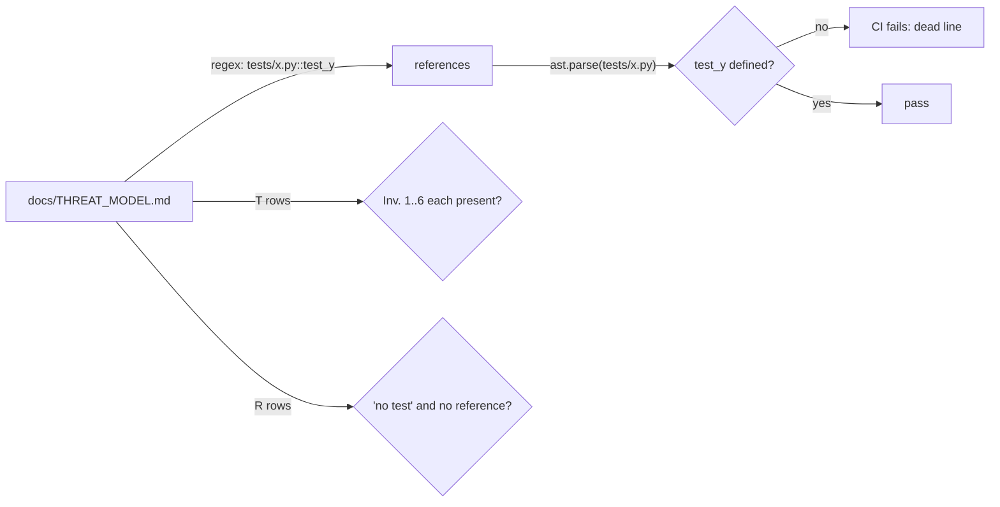

# M11c: the threat model, one page, each line with its test

## 1. What we built

[docs/THREAT_MODEL.md](../THREAT_MODEL.md) answers the review's question: who can reach what, what each could do at worst, and which test shows it can't. It has four parts:
- a table of every listening port and its bind address;
- a trust-boundary diagram;
- 21 threats, each with its defence and the tests that cover it;
- 9 residual risks that are stated rather than defended.

A new test, [tests/test_threat_model.py](../../tests/test_threat_model.py), keeps the page true: every cited test must exist and each of the six hard invariants must have a row. Writing the page also found one real gap: a corrupt `a1_policy` row ended the RL runner. It is fixed and tested.

## 2. Where it sits in the architecture

It covers every box of figure 2 at once. Its job is to show how the boxes are separated: the operator and Hermes on one side, the store and the radio on the other, and the verifier and the console as the only doors between them. It is M11c, the last part of the review's P2 ("close the safety story", REVIEW-2026-11-11 §3.7). The review noted that the agent API has no authentication and asked for this page to say why that is acceptable here, and what isn't.

## 3. How it works

1. **The trust boundary is the Unix account** (THREAT_MODEL §1). The operator and the processes of that account are trusted. The LLM's output, Hermes, network ports and the operator's text *as an instruction* are not. Everything else follows from that line.
2. **Who can reach what** (§2). Each listener has its bind address, read from the code:
   - the agent API is on uvicorn's default 127.0.0.1;
   - the gateway uses `--host 127.0.0.1` by default ([gateway/__main__.py](../../gateway/__main__.py));
   - the exporter uses `--host 0.0.0.0` ([monitoring/exporter.py](../../monitoring/exporter.py));
   - Prometheus and Grafana are on 127.0.0.1 ([monitoring/compose.yml](../../monitoring/compose.yml));
   - Hermes is on an internal network with two relays ([gateway/hermes/docker-compose.yml](../../gateway/hermes/docker-compose.yml)).
3. **Threats T1–T21** (§4). Each row names an actor, what it could try, the defence, and the tests as `` `tests/<file>.py::<test>` ``. Most rows cite tests that already existed: the hard invariants were each given a test when they were built (M03, M04a, M05a/b, M09f, M11a). The page gathers them; it doesn't re-prove them. Where a measurement exists, it is quoted (M09f: 76/76 dangerous proposals blocked).
4. **Residual risks R1–R9** (§5). Each says what could go wrong at worst, why it is accepted in this project, and what a real system would do. Each also says "no test" in so many words, so it can't be mistaken for a covered row.
5. **The gap found and fixed (T19).** `Runner.read_policy` ([rl/runner.py](../../rl/runner.py)) runs before the tick's `try` and caught only `sqlite3.Error`. But each row's objective is parsed by `RLObjective.model_validate_json` ([store/a1_policy.py:93](../../store/a1_policy.py#L93)). A row that fails the schema raised pydantic's `ValidationError` and ended the runner, which is the very failure M11a set out to remove, through a path M11a didn't cover. `read_policy` now also catches `ValueError` (the parent of `ValidationError` and of `json.JSONDecodeError`). It keeps the segment it read before, as it already did for an unreadable database, and logs `a1_policy_invalid` once until a read succeeds again. [The test](../../tests/test_safe_state.py) was run against the old runner first: it failed with the `ValidationError`.
6. **The page checks itself** ([tests/test_threat_model.py](../../tests/test_threat_model.py)).
   - It collects every `` `tests/…py::test_…` `` reference with a regex and looks the function up with `ast`, so the module is never imported.
   - It checks that every T row cites at least one test, that `Inv. 1` … `Inv. 6` each appear in a T row, and that every R row says "no test" and cites none.



## 4. How to run it and check it

```bash
uv run pytest tests/test_threat_model.py -v    # 61 checks, < 1 s: one line per cited test
uv run pytest tests/test_safe_state.py -q      # includes the corrupt-row test (T19)
uv run pytest -q                               # the whole suite
```

**The visualization** is the trust-boundary diagram in [THREAT_MODEL §3](../THREAT_MODEL.md#3-trust-boundaries), together with the `-v` output above, which reads as the coverage map:

```
tests/test_threat_model.py::test_every_cited_test_exists[tests/test_agent.py::test_confirmation_reverifies_against_what_is_applied_now] PASSED
...
tests/test_threat_model.py::test_every_hard_invariant_has_a_row[1] PASSED
...
tests/test_threat_model.py::test_every_residual_risk_says_it_has_no_test PASSED
```

How to read the diagram: every arrow into `var/ric.db` that can change the objective comes from the console, after the verifier. Hermes and the gateway have no arrow to the store, the runner or the testbed bridge. Only the runner has an arrow to E2.

**Checking that the check works.** Rename a cited test in the page (for example `test_step_limit` to `test_step_limit_renamed`) and remove "no test" from R1. `test_threat_model.py` then fails on both:

```
FAILED tests/test_threat_model.py::test_every_cited_test_exists[tests/test_graph.py::test_step_limit_renamed]
FAILED tests/test_threat_model.py::test_every_residual_risk_says_it_has_no_test
```

## 5. Choices and simplifications

- **The Unix account as the trust boundary.** It is the honest boundary of a one-machine lab. It makes R1 explicit: anything running as that account can write `a1_policy` directly. Rejected: an API token on the agent service. The token would be stored under the same account, so it would stop no process that the account boundary doesn't already stop, and it would add a secret to manage.
- **Residual risks are stated, not fixed.** Each fix belongs to a real deployment (signed A1 policies, E2 over IPsec, images pinned by digest) and would change the design or the testbed, which CLAUDE.md says to ask about first. The page says what a real system would do, so a reader sees the gap and its remedy together.
- **One gap fixed in code** (T19), because it was small, inside the existing design (the same rule as an unreadable store), and the failure mode M11a was meant to remove. Rejected: entering the safe state on a corrupt row. The objective channel failing isn't the radio loop failing, and the last verified objective is still the best thing to follow.
- **The page cites tests, it doesn't contain them.** The meta-test checks names, not behaviour; the cited tests check behaviour. Rejected: generating the page from test docstrings. That would be harder to read, and the "could try / defence" columns are judgment, not code.
- **A real threat model would also cover** physical access, the Windows host, Docker daemon privileges (the docker group is root-equivalent), and the operator as an insider. They are outside this project's scope and are named here so their absence is visible.

## 6. Questions to check understanding

1. **Why is an unauthenticated agent API acceptable here, and what would change that?**
   It binds 127.0.0.1, it can only create requests (no confirm or apply endpoint, T4), and every request is verified and, in demo mode, confirmed by the operator in a separate console. Exposing it beyond localhost, or running untrusted processes under the same account, would require authentication.
2. **What is the worst a fully compromised Hermes can do?**
   Call the three tools: create intent requests and read KPIs and status. It has no other tool (T1, T2), no network route but the two relays (T3), and `submit_intent` applies nothing (T4). Every request still goes through the verifier and the operator's confirmation.
3. **Why did a corrupt `a1_policy` row end the runner even after M11a?**
   M11a's `try` wraps the decision part of the tick, but `read_policy` runs before it and caught only `sqlite3.Error`. The parse error is a pydantic `ValidationError`, a `ValueError`, so it escaped. Now `read_policy` catches `ValueError` too and keeps the previous segment.
4. **What does `tests/test_threat_model.py` guarantee, and what doesn't it?**
   It guarantees that the page's references are alive: each cited test exists, each invariant has a row, and each residual risk is labelled. It doesn't guarantee that a cited test really covers the threat in its row; that is a reviewer's judgment, made once when the row is written.
5. **Which residual risk does M11b address, and how?**
   R6, an accepted objective that the policy then misses. The verifier checks the objective, not the outcome. M11b adds a runtime monitor: if a stated target is missed for N seconds while the formula's split would meet it, the formula takes over that intent, and the event is logged.
