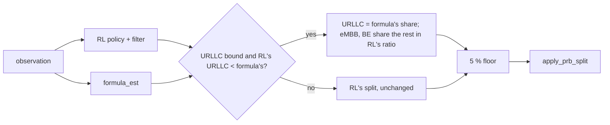
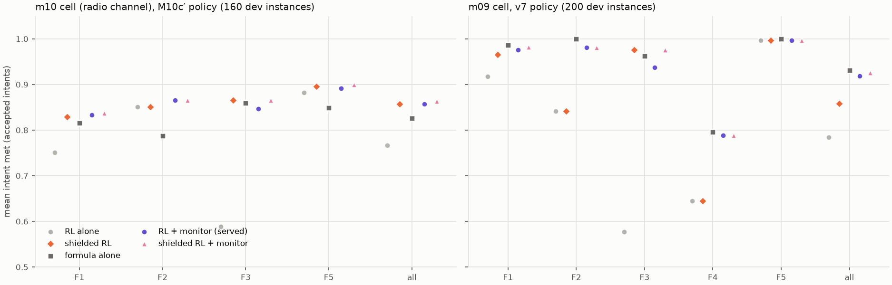
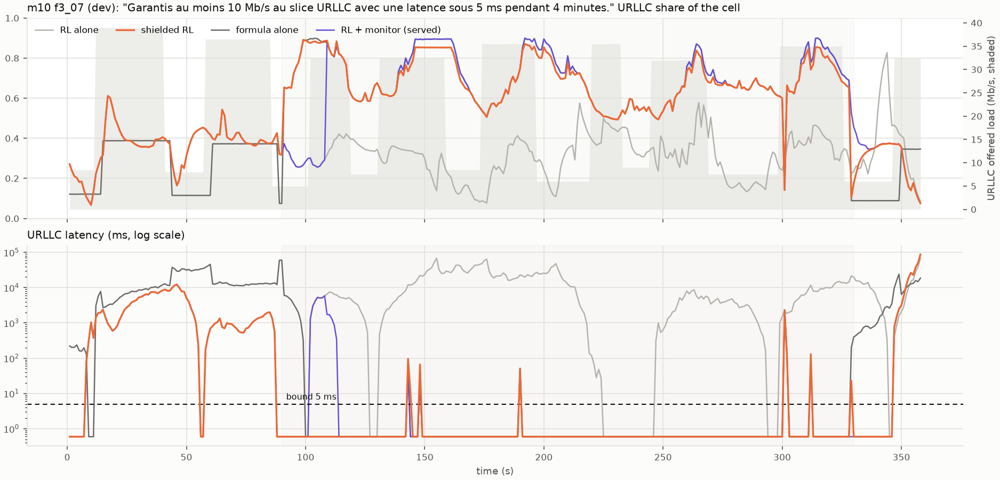

# M11d: the shielded RL executor

## 1. What we built

A thin layer around the RL policy (`rl/shield.py`): when the objective has a URLLC latency bound, URLLC never gets a
smaller share than the formula would give it, and the RL splits the rest between eMBB and best effort in its own
ratio. With no bound, the RL's split goes through unchanged. It fixes the RL's known weakness, under-sizing URLLC
when its load flips (F3): on the m10 dev set the shielded RL meets F3's intents as well as the formula does and keeps
the RL's lead on steady loads, and over all families it beats both (0.857 against the RL's 0.766 and the formula's
0.826). But on top of the M11b′ monitor we already serve it adds only +0.007, under the +0.01 we registered as worth
serving, so **it is reported and not served**. This was the task delegated to a coworker on 15 Nov; we did it
ourselves.

## 2. Where it sits in the architecture

Inside the **RL xApp** box of figure 2: it stands where the policy stands, with the same `shares(obs)` call, and the
runner's 5 % floor and its one `apply_prb_split` call come after (invariant 4). It reads only the observation, so
nothing new reaches the fast loop (invariant 5). Compared with the M11b monitor: the shield is **proactive and
partial** (every tick, URLLC only), the monitor is **reactive and whole** (after misses, the whole intent).

## 3. How it works

1. **The bound is read where the formula reads it.** `urllc_bound_ms` (`rl/shield.py:30`) takes it from the
   observation's objective features, as `FormulaPolicy.shares` does.
2. **Both executors decide every tick.** `ShieldedPolicy.shares` (`rl/shield.py:58`) asks the RL for its split, then
   the formula (`rl/shield.py:60`), every tick even without a bound, so the formula's 30 s URLLC peak window stays fed.
3. **The rule.** `shield` (`rl/shield.py:36`): with a bound and the RL's URLLC share under the formula's, URLLC gets the
   formula's share and eMBB and BE get the rest in the RL's ratio (equal halves if the RL gave them nothing).
   Otherwise the RL's split stands.
4. **Restarts.** `restart_from` (`rl/shield.py:64`) passes the split in force to the RL's filter, and the runner now
   restarts any policy that has the method (`rl/runner.py:343`), so a shielded policy restarts cleanly after the safe
   state or a monitor fallback.
5. **In evaluation.** The harness executor `shielded_rl` (`eval/harness.py:152`) wraps the run's policy file;
   `eval/m11d.py` plays five labels per instance (`spec_of`, `eval/m11d.py:42`), measures the URLLC over-bound share
   (`eval/m11d.py:88`) and applies the frozen rules (`eval/m11d.py:130`).



## 4. How to run it and check it

```
uv run pytest -q tests/test_shield.py      # 10 tests: no-bound equality, the rule, ratios, restarts, the harness
uv run python -m eval.m11d --reproduce     # the brief's step 1: m10 dev 0.766 (RL), 0.826 (formula), else stop
uv run python -m eval.m11d --dev           # 1800 runs, ~4 min on 8 workers
uv run python -m eval.m11d --score         # -> docs/learn/data/M11d-dev.json, M11d-dev-runs.csv
uv run python -m eval.plot_m11d
```

**Result (dev, scored once, rules written first):**

| m10 (160 instances) | RL alone | shielded RL | formula | RL + monitor (served) | shielded RL + monitor |
|---|---|---|---|---|---|
| F1 | 0.751 | 0.829 | 0.816 | 0.834 | 0.837 |
| F2 | 0.851 | 0.851 | 0.788 | 0.866 | 0.866 |
| F3 | 0.589 | **0.866** | 0.859 | 0.847 | 0.866 |
| F5 | 0.882 | 0.895 | 0.848 | 0.892 | 0.900 |
| all | 0.766 | **0.857** | 0.826 | 0.857 | 0.864 |
| F3, URLLC over its bound | 41 % | **13 %** | 14 % | 15 % | 13 % |

- The brief's criteria, all pass: **S1** F3 over-bound 13 % against the formula's 14 % (rule: within 5 points);
  **S2** F2 0.851 = RL's, F5 0.895 ≥ RL's; **S3** pooled shield − formula +0.031 ≥ 0.
- **D** (serve it?), fails: shield + monitor is within 0.02 of the monitor alone on every family of both cells, but
  gains only +0.007 pooled on each cell (m10 0.864 / 0.857, m09 0.926 / 0.919), under the registered 0.01.
- m09 (v7, reported): shield 0.858 against RL 0.784 and formula 0.931; F3 0.976 (RL 0.578). F2 and F4 have no URLLC
  bound, so the shield leaves v7 alone there, and the formula keeps its lead.



How to read it: one marker per label and family. On m10, orange (shielded RL) sits with or above the dark square
(formula) everywhere, and far above the light circle (RL alone) on F3. The violet and pink markers (with the monitor)
are almost on top of each other: the monitor alone already gets nearly all of it.



How to read it: m10 f3_07, the dev instance where the shield gains most. Top: URLLC's share of the cell (lines) and
its offered load (grey shading, right axis), flipping between ~5 and ~35 Mb/s; the intent's window is lightly shaded.
The RL alone (light grey) gives URLLC 0.1-0.4 and stays there through the high phases; the shielded RL (orange) jumps
with each flip, on top of the formula's line (hidden under it in the window, by construction). Bottom: URLLC latency
on a log scale against the 5 ms bound: the RL alone sits at 10³-10⁴ ms for most of the window, the shielded RL is
under the bound except for single-second spikes at the flips.

## 5. Choices and simplifications

- **No parameter, so no tuning.** One run on all of dev, rules written first (DECISIONS 2026-11-20). The fresh split
  was to be played only if D passed; it didn't, so nothing was spent.
- **D asks the serving question, not the brief's.** The brief asked whether the shield fixes F3 without hurting the
  rest: yes (S1-S3). Since then the monitor became the served safety layer, so the question for the running system is
  whether adding the shield helps; +0.007 is too little to justify a second mechanism. *Rejected:* serving the shield
  instead of the monitor; on m09 it doesn't cover F2 and F4, whose targets aren't URLLC bounds.
- **What the shield does buy:** with it, the monitor fires in far fewer runs (26 against 91 on m10), so the RL keeps
  control more often for the same result. Not a criterion, but worth knowing if takeovers turn out to be costly on
  the testbed.
- **URLLC only.** The shield covers the one decision the RL gets wrong most (sizing a bounded URLLC); throughput
  targets on eMBB and BE are left to the RL and the monitor.
- **Two cells, as in M11b,** though the brief named m10 only: the serving question needs both.
- **A real system** would train the policy with the shield in the loop (a "shielded RL" in the strict sense), so the
  policy learns the constraint instead of being corrected, as SafeSlice does (the 15 Nov literature review).

## 6. Questions to check understanding

1. *Why does the RL lose F3 in the first place?* It gives URLLC about 0.4 of the cell, below its high-phase load, so
   every upward flip overloads the slice and the latency bound breaks; the formula sizes URLLC to its 30 s peak.
2. *Why is the formula called every tick, even with no bound?* Its URLLC sizing uses the peak of the last 30 s of
   load, which only stays right if it sees every tick.
3. *How is the shield different from the monitor?* The shield corrects one share every tick before anything is missed;
   the monitor waits for misses, then hands the whole intent to the formula.
4. *The shield passes all of the brief's criteria. Why isn't it served?* The rule for serving asked for a gain over
   what we already serve (the monitor); it added +0.007, under the 0.01 registered.
5. *Why is the shielded RL's split identical to the RL's outside an intent window in the F3 figure?* Outside the
   window the objective has no URLLC bound, and with no bound the shield returns the RL's split exactly.
