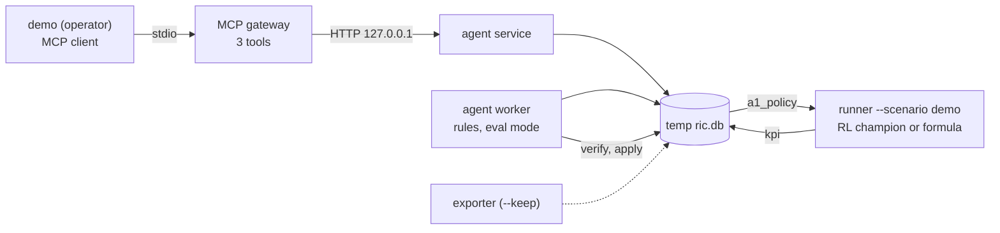
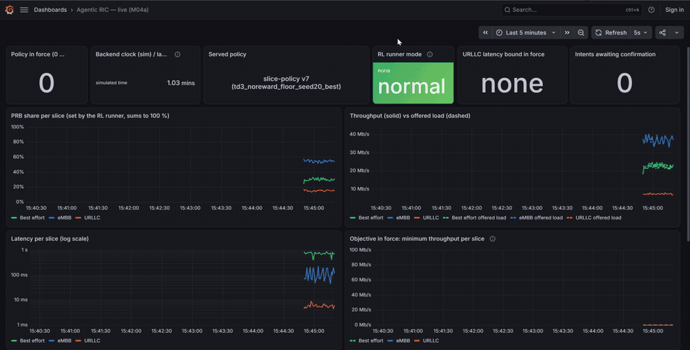

# M12: presentable: the one-command demo, the claims table, the notes index, the licence

## 1. What we built

`uv run python -m demo` runs the whole proposed chain on the simulator in about 30 seconds, with no GPU and no LLM. The controller, the agent service, the agent worker and the MCP gateway each run as their own process, and the demo plays the operator through the gateway's three tools only.

Three new documents give a reader the rest:
- [CLAIMS.md](../CLAIMS.md): 23 claims, each with its experiment, kind of evidence, number with interval, verdict and note; the negative results stay as rows.
- [learn/README.md](README.md): every note in reading order.
- `LICENSE` (Apache-2.0) and `NOTICE`.

Two tests keep it all true: the demo runs in CI, and every link in the entry pages must resolve, with every note listed in the index once.

## 2. Where it sits in the architecture

The demo touches every box of figure 2 except Hermes and the testbed: the operator (played by the demo, through MCP), the gateway, the LangGraph service (here with its rule-based parser), the verifier, `a1_policy`, the RL xApp and the RAN (the simulator). The confirmation console is skipped on purpose, and the demo says so (§5). This is the review's P3, "make it presentable" (REVIEW-2026-11-11 §4). The three documents don't add a box: they are the map of the boxes and of what each one proved.

## 3. How it works

1. **Which executor** ([`executor_args`, demo/__main__.py:46](../../demo/__main__.py#L46)). If the machine has a served champion (`var/policy_cache/served.json`, written when the runner last loaded one from MLflow), the runner gets `--policy-file` and that label. A clean clone has none, and then it gets `--baseline formula`, the M09b executor. MLflow isn't touched either way. The choice is printed.
2. **The processes** ([`main`, :152](../../demo/__main__.py#L152)).
   - Everything runs in a fresh temporary directory: `RIC_DB` and `RIC_EVENTS` point there, so `var/ric.db` is never touched.
   - Environment: `RIC_MODE=eval` (confirm automatically), `RIC_AGENT=rules` (the rule-based parser), `RIC_OBSERVE_S=0`.
   - The runner plays the `demo` scenario at `--speed 10`: URLLC surges from 10 % to 40 % of the cell at t = 120 s.
   - Then the agent service (bound to 127.0.0.1) and the worker start. With `--keep`, the Prometheus exporter starts too.
   - [`wait_for`, :60](../../demo/__main__.py#L60) polls `/status` and stops with the process's log if one dies while starting.
3. **The operator, through MCP only** ([`operator`, :108](../../demo/__main__.py#L108)). The MCP client starts the gateway over stdio, the way Hermes' MCP client would, with the gateway's own log sent to `gateway.out` (`stdio_client(..., errlog=...)`). From here on, the demo can do only what Hermes could do.
4. **Before, intent, after** ([`play`, :133](../../demo/__main__.py#L133)).
   1. `wait_clock` ([:96](../../demo/__main__.py#L96)) polls `get_kpis` until the cell's clock reaches 150 s, 30 s into the surge. Its time limit follows `--speed`, so `--speed 1` works too.
   2. `urllc_window` ([:84](../../demo/__main__.py#L84)) reads the last 20 s of URLLC through `get_kpis`.
   3. `submit_intent` sends the README's intent.
   4. `follow` ([:117](../../demo/__main__.py#L117)) prints each new state from `get_status`, with the verifier's reason once applied.
   5. 40 cell seconds after the apply time it reads the KPIs again and prints the two side by side.
5. **The documents.**
   - **CLAIMS.md** quotes each number from the note that produced it. Nothing is recomputed; the link is in the row.
   - **The index** groups the notes by phase and starts with five to read first.
   - **The README** now says how to run the demo, links the claims, the threat model and the index, and states the licence.
6. **What keeps them true.**
   - [tests/test_demo.py](../../tests/test_demo.py) runs the demo as a user would (a subprocess, a free port, the formula executor, `--speed 30`, about 11 s). It asserts: the intent applied, the verifier accepted, URLLC over 100 ms mean latency before, p95 under 10 ms after, and a larger share after.
   - [tests/test_docs.py](../../tests/test_docs.py) checks that every relative link in the README, CLAIMS and the index resolves, and that "All notes" lists every `docs/learn/M*.md` exactly once.



## 4. How to run it and check it

```bash
uv run python -m demo                                   # ~25 s here (RL champion); ~10 s at --speed 30
uv run python -m demo --executor formula                # what a clean clone runs
uv run pytest tests/test_demo.py tests/test_docs.py -q  # 5 tests, ~11 s
```

**The visualization is the demo's own before/after printout.** This is a run on this machine with the RL champion (2026-11-16):

```
executor: RL champion slice-policy v7 (td3_noreward_floor_seed20_best)
confirmation: automatic (RIC_MODE=eval; the live demo waits for `python -m console confirm`)
agent: rule-based parser, no LLM

t=151 s, URLLC surge under the default objective; the operator types:
  "garantir 20 Mb/s au slice URLLC avec une latence de 10 ms pendant 5 minutes"
  i0001: received
  i0001: applied  (verifier: accepted; once applied, the RL xApp follows the merge of i0001)

URLLC, mean over 20 s     before (t=151 s)   after (t=197 s)
  throughput (Mb/s)           32.77          30.15
  latency mean (ms)          799.29           6.90
  latency p95 (ms)          1622.07           7.77
  PRB share                    0.44           0.57
  target: >= 20 Mb/s or the whole load if less, latency < 10 ms
```

How to read it:
- **Before.** Under the default objective, the surge overloads URLLC: its queue grows and the delay reaches seconds. Throughput is a little *above* the load because the slice is draining its backlog.
- **After.** With the intent in force, the policy gives URLLC 57 % of the cell. The delay settles under the 10 ms bound and throughput equals the offered load (about 30 Mb/s, which is above the 20 Mb/s target, so "met").
- **With the formula** (`--executor formula`), the same story: 2,029 ms → 6.4 ms in our run.
- **Run to run.** The numbers move a little between runs: the cell's seed is fixed, but the demo samples the clock in real time, so the 20 s windows don't land on exactly the same seconds.

**The Grafana GIF (you record it).** The commands:

```bash
docker compose -f monitoring/compose.yml up -d           # Prometheus scrapes :9108 every 1 s; Grafana on :3000
uv run python -m demo --keep --speed 2                   # ~2 min; prints the kill command at the end
# open http://localhost:3000, dashboard "Agentic RIC — live (M04a)"; record from t ≈ 120 s (surge) to ≈ 200 s (after)
kill <the PIDs it printed>; docker compose -f monitoring/compose.yml down
```

Speed 2 is a compromise: Prometheus scrapes once a second, so each scrape sees two ticks, and the 80 s of cell time worth showing take 40 s.

**Recorded 2026-11-16** (RL champion, `--keep --speed 2`, Grafana on "Last 5 minutes", a second take after a first one on "Last 10 minutes" left the run squeezed to the panels' right edge). Converted with a static ffmpeg run through `uv run --no-project --with imageio-ffmpeg`, so no system package was installed:
- 0:10 to 4:20 of the 4 min 24 s screen recording, minus 0:33-0:38, where one Grafana refresh failed and every panel showed "No data" (found by the share of coloured pixels per frame, then checked by eye);
- the browser bar cropped off;
- played at 8×, 8 frames/s, 1000 px wide, a 96-colour palette;
- 31 s and 2.6 MB in all.



Read it in four phases:
1. **No objective** (policy 0, bound "none"): the split stays at the default objective's.
2. **The URLLC surge** (orange) at cell t ≈ 120 s: its offered load jumps from about 8 to about 30 Mb/s, and its delay climbs to about a second (log scale).
3. **The intent in force** (policy 1, bound 10 ms, a 20 Mb/s target in the bottom-right panel): URLLC's share goes from about 15 % to about 57 %, and its delay falls to about 5 ms. The other slices pay for it: eMBB drops to about 20 Mb/s against about 37 offered, and the delays of eMBB and best effort rise to about 1 s and about 10 s. This is the over-serving the evaluations measured (M08d S3, CLAIMS C9).
4. **Expiry** five minutes later (policy 0 again): the default objective returns while the surge is still on, and URLLC's delay starts to swing again.

**Checking that the checks work.** Rename a link target in CLAIMS.md and `test_docs.py` fails. The first run of `test_docs.py` failed on purpose: the index already listed this note before it existed.

## 5. Choices and simplifications

- **Confirmation is automatic in the demo** (`RIC_MODE=eval`). Hard invariant 6 makes demo mode wait for an operator in a separate console, and a one-command demo can't be that operator without pretending. So it uses the evaluation mode, which skips confirmation by design, and prints that it does. The live demo with the console is in the M04b note.
- **The rule-based parser instead of the LLM.** No GPU and no Ollama on a clean clone. The parser reads this intent correctly, and the LLM's accuracy is a separate, measured claim (C1).
- **The formula stands in when no policy is on the machine.** The champion's weights aren't in git (CLAUDE.md), and you chose not to publish them for now. The formula is the executor M09d and M10c′ found at least as good, so the demo still shows the chain working. It says which executor ran.
- **Through MCP, not through Python calls.** Reading KPIs and submitting through the gateway costs a few milliseconds per call, but it shows the property that matters: an operator, or Hermes, with only these three tools gets the cell to change, and only through the verifier.
- **CLAIMS.md copies numbers rather than computing them.** One source of truth per number: the note that produced it. Rejected: generating the table from result files, since the experiments' outputs differ in shape and a generator would be more code than the table. `test_docs.py` checks the links, not the numbers.
- **Apache-2.0** (your choice): permissive with an explicit patent grant, common in O-RAN and telecom open source. The text was fetched from apache.org and is byte-identical to the copy six installed packages ship. The copyright line is in `NOTICE`.
- **Not done from the review's P3:** the weights as a release asset (your choice), and the GIF (yours to record, commands above).

## 6. Questions to check understanding

1. **Why does the demo confirm automatically, and doesn't that break hard invariant 6?**
   Invariant 6 says that in demo mode an accepted objective waits for the operator in a separate console, and that automated evaluation runs skip it. The one-command demo runs in evaluation mode (`RIC_MODE=eval`) and prints that it does. Demo mode is unchanged and still waits.
2. **How does the demo know the intent is applied without reading the database?**
   It calls `get_status` through the MCP gateway every 0.2 s and prints each new state. The gateway calls the agent service, which reads the store. The demo process itself only reads its own temporary directory's logs.
3. **On a clean clone, what executes the split, and why is that a fair stand-in?**
   The formula executor (`--baseline formula`, rl.baselines.FormulaPolicy), because the trained weights aren't in git. It sits behind the same agent and verifier, and the pre-registered results found it at least as good as the RL policy (C14, C19).
4. **Why does `wait_clock` compute its time limit from `--speed`?**
   At speed 10, reaching t = 150 s takes 15 s; at speed 1, 150 s. A fixed limit either stops slow runs or waits too long on a broken one. The limit is the remaining cell time divided by the speed, plus a minute for start-up.
5. **What would `tests/test_docs.py` catch, and what wouldn't it?**
   It catches a renamed or deleted note, figure or document that one of the entry pages links to, and a note missing from the index. It doesn't catch a wrong number in CLAIMS.md: each number's source is the linked note, and checking them is a reviewer's job.
