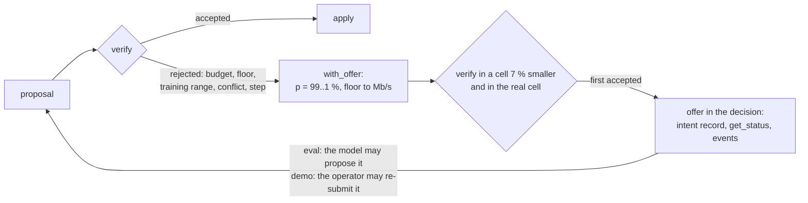
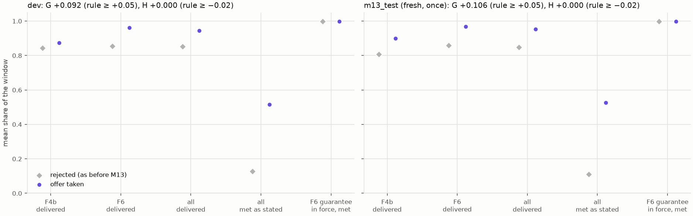
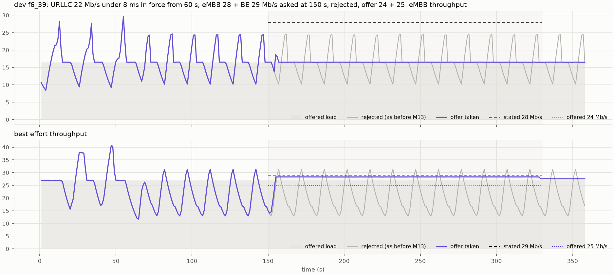

# M13: the verifier answers a rejection with what would fit

## 1. What we built

When the verifier rejects a request that does not fit, it now also computes an **offer**. The offer is the largest
scaled-down version of the request that would be accepted, with the same latency bound, window and weights, sized
to fit a cell 7 % smaller than the one the verifier is told about (`verifier/counter.py`).

The offer is information, not an action:
- it travels with the decision to the intent record, so `get_status` shows it;
- in demo mode the operator reads it in the rejection's reason, and can submit it as a new request;
- in eval mode the LLM sees it after the rejection, and can propose it;
- in every case it is applied only after a new `verify()` and the usual apply step.

On the simulator, with rules written first, an operator who takes the offer gets more of what they asked for
without harming the guarantee already in force. On the fresh test split, the share of the request delivered rose
from **0.848 to 0.954**, and the guarantee in force was met 0.999 of the time in both arms. Offers are therefore on
by default (`RIC_OFFERS=1`).

## 2. Where it sits in the architecture

It lives in the **deterministic verifier** box of figure 2, plus a small change in how the **LangGraph agent**
reports a rejection.
- `with_offer` is plain Python: no LLM, no randomness, no clock. `tests/test_verifier_purity.py` now scans
  `counter.py` with the rest of the verifier.
- `verify()` itself is unchanged.
- Invariant 3 holds: an offer is never applied directly; it is a new proposal, verified like any other.
- Invariants 1 and 2 hold: the gateway keeps its three tools, and the offer reaches the operator through
  `get_status`.
- Invariant 6 holds: in demo mode the stated values are still never relaxed by the agent. The operator decides.

## 3. How it works

1. **The search.** `with_offer` (`verifier/counter.py:47`) runs only for the checks a smaller target can fix:
   budget, floor, training range, conflict and step. For p = 99 %, 98 % … 1 %, `scaled` (`verifier/counter.py:35`)
   multiplies every stated target by p and rounds down to whole Mb/s. Each stated slice must keep at least 1 Mb/s.
2. **Two verifications per candidate.** The first candidate that `verify()` accepts in a cell `OFFER_MARGIN`
   smaller (`verifier/counter.py:32`, `:52`) **and** in the real cell (`:61-62`) is the offer. The margin is
   1 − 73.5/79: the testbed measured 73.5-80.2 Mb/s depending on the split (M08d), against the 79 the verifier is
   told. An offer sized to the told cell would squeeze the guarantees already in force whenever the real cell is
   smaller.
3. **Where it is stored.** `Offer` and the new field `Decision.offer` are in `verifier/verify.py:75` and `:98`.
   `propose_objective` always attaches an offer when one exists (`agent/tools.py:160`), and `decision_dict` stores
   and logs it (`agent/apply.py:69`).
4. **What the agent does with it** (only with `Settings.offers`, env `RIC_OFFERS`, `agent/worker.py:35`):
   - in eval mode, the model's `VERIFIER REJECTED` line ends with "the largest that fits: set_rl_objective with
     {…}", so an 8B model can copy it (`agent/graph.py:296`, arguments built by `offer_arguments`, `:432`);
   - when the intent ends rejected, its reason ends with `offer_text`, e.g. "what fits now: urllc 16 Mb/s with
     latency below 5 ms (about 73% of the request), for the same duration" (`agent/graph.py:119`).
5. **The evaluation.**
   - `apply_scripted` plays an operator who takes the offer: it proposes the offer again, then applies it, and logs
     `offer_taken` (`eval/harness.py:127-132`).
   - The new family F6 (`eval/generator.py:185`) is a URLLC guarantee followed by an eMBB + best-effort request
     that does not fit beside it. Together with F4b it forms the set (`m13_instances`, `:261`).
   - `eval/m13.py` scores `delivered` (`:127`) per run (`row_of`, `:176`), checks that both arms got the same answer
     (`same_offers`, `:223`) and applies the frozen rules (`verdict`, `:233`).



## 4. How to run it and check it

```
uv run pytest -q tests/test_counter.py        # 19 tests: S3's offer, 400 random cases, no offer where it can't help,
                                              # the agent with offers on and off, the scripted operator, F6
uv run python -m eval.m13 --dev && uv run python -m eval.m13 --score   # ~1 min; -> docs/learn/data/M13-dev*
uv run python -m eval.m13 --score --final     # refused now: m13/test is spent
uv run python -m eval.plot_m13
```

**Result (rules in DECISIONS 2026-11-21, written and committed at baa2c81 before any scored run):**

| first-rejected intent | dev: reject | dev: offer | test: reject | test: offer |
|---|---|---|---|---|
| F4b delivered (10) | 0.844 | 0.874 | 0.807 | 0.900 |
| F6 delivered (40) | 0.854 | 0.961 | 0.858 | 0.967 |
| **all delivered (50)** | 0.852 | **0.944** | 0.848 | **0.954** |
| met as stated | 0.127 | 0.515 | 0.110 | 0.526 |
| met against the offer ("kept") | | 0.940 | | 0.942 |
| F6 guarantee in force, met | 0.999 | 0.999 | 0.999 | 0.999 |

- **G** (gain ≥ +0.05): +0.092 on dev, **+0.106** on test.
- **H** (no harm ≥ −0.02): 0.000 on both.
- Every first proposal was rejected with an offer, and both arms got the same one.
- The offer was taken and applied in 50 of 50 runs.



How to read it: one marker per arm and measure.
- The violet dot (offer taken) sits above the grey diamond (rejected) for every delivered measure, and far above it
  for "met as stated".
- On the right, the two markers coincide: the guarantee already in force loses nothing.



How to read it: dev f6_39, where the offer gains most.
- The window of the rejected request is lightly shaded, and the offered load is the grey area.
- Before 150 s both arms are the same run, so the violet line hides the grey one.
- Rejected (grey): neither eMBB nor best effort has a target, and the policy swings capacity between them, so each
  falls under its load every few seconds.
- Offer taken (violet): both slices have a target (24 and 25 Mb/s, under the stated 28 and 29) and are served flat
  at their full load.
- This is why "met as stated" jumps: the stated target counts as min(target, load), and the load here sits under
  the offer.

**LLM on the simulator, and the testbed's S3:** pending; Souhail's runs (`--llm-dev`, `eval/m13_testbed.py`).

## 5. Choices and simplifications

- **Same bound, smaller throughput.** *Rejected:* also offering the same throughput under a looser bound. On the
  testbed's S3 that would fit (23 Mb/s under 10 ms needs 36 % of the cell, not 49 %), but the bound is what makes
  a request URLLC; trading it away is the operator's call. A next step is a second offer, "the full request with
  this bound", or "the full request when i0001 ends".
- **A margin of 7 %, fixed before any run**, from a measurement (M08d's lowest capacity), not tuned. *Rejected:*
  no margin. The offer would then fill the told cell exactly, and the guarantee in force would pay whenever the
  real cell is smaller. With the margin, H held at 0.000.
- **Proportional scaling, whole Mb/s.** All stated targets shrink by the same factor, so a two-slice request keeps
  its own balance. Rounding down keeps the offer in the operator's units and on the safe side.
- **Offers off for earlier studies.** The harness passes `offers` explicitly, and `eval.testbed_control.play` sets
  `RIC_OFFERS=0` unless told otherwise, so every earlier run replays as it was.
- **F6's order is the reverse of S3's.** With the simulator's URLLC base latency (0.59 ms) the bound costs little
  headroom, and the step rule caps first guarantees at 0.3 C. So "URLLC second" only conflicts at 30-31 Mb/s under
  5 ms. The testbed's S3 (told base latency 2 ms) keeps S3's order.
- **The scripted operator always says yes.** It measures what taking the offer is worth, not how often an operator
  would. In the LLM arm, the model decides.
- **F4b's offer is bounded by the step rule** (0.3 of the smaller cell, about 22 Mb/s from an idle cell), not by
  the training range. That is why its gain is the smaller one.
- **A real system** would let the operator accept the offer in one click on the console, would offer the "later"
  and "looser bound" alternatives, and would record which offers operators accept.

## 6. Questions to check understanding

1. *Why is the offer computed in the verifier and not by the LLM?* The verifier is the only place that knows
   exactly what fits (budget, floor, conflicts, steps). An LLM guess would still need verifying, and an 8B model
   doesn't do this arithmetic reliably; the testbed runs showed it repeating the rejected proposal.
2. *Why is every candidate verified twice?* In the smaller cell, so the offer keeps the 7 % margin; in the real
   cell, because that is the check the offer will face when it is proposed.
3. *Can an offer break invariant 3?* No. It is only data in the decision. To run, it is proposed and passes
   `verify()` again, then `apply_intent`, as `test_the_scripted_operator_takes_the_offer_through_the_verifier`
   checks.
4. *Why is there no offer for a latency bound under 2 ms on the testbed?* A smaller throughput target can't make
   a bound below the empty slice's latency reachable: that rejection is `latency_physics`, which isn't in
   `OFFER_CHECKS`.
5. *Why did "met as stated" rise from 0.11 to 0.53 when the offer asks for less than was stated?* Met counts a
   target as min(target, load). In many F6 runs the real load is under the offer, so a slice that now has a target
   is served its whole load. Rejected, it had no target and the policy left it short.
