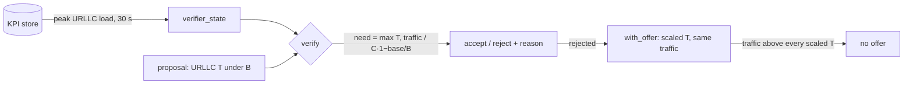
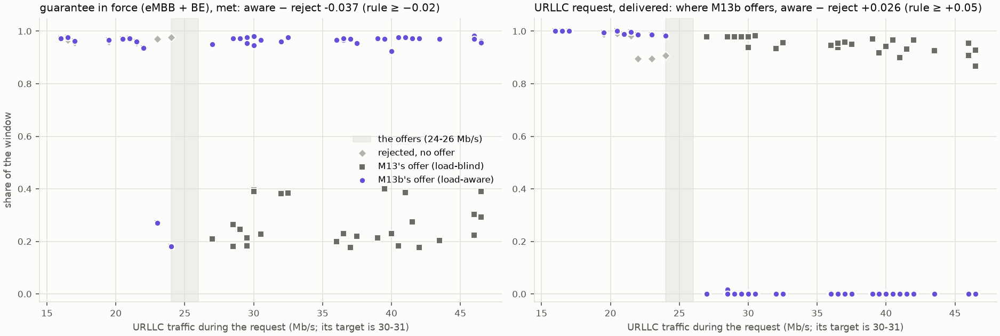

# M13b: the verifier sizes a latency bound from the traffic (a negative result)

## 1. What we built

M13's testbed check showed a hole in the verifier. It sized a URLLC latency bound from the stated target only, so
"16 Mb/s under 5 ms" passed while URLLC carried 31.5 Mb/s. A bound can only be held by serving the whole queue, so
the executor gave URLLC 0.76 of the cell, and the guarantee already in force fell from 0.96 to 0.22.

M13b gives the verifier the traffic. With `RIC_BOUND_FROM_LOAD=1`, the verifier's state carries URLLC's peak load
over the last 30 s, and a bounded URLLC target is sized from max(target, traffic). Under that rule the offer no longer
exists when the traffic is above it, and S3's request gets no offer at all.

The rules were written and committed first (DECISIONS 2026-11-21). **Both failed on dev:**
- **Harm remains.** The guarantee in force was met 0.930 of the time with M13b's offer, against 0.966 when
  rejecting (rule ≥ −0.02). M13's own offer gave 0.418.
- **Little gain.** Where M13b still offers, taking it delivered only +0.026 more of the request (rule ≥ +0.05).

So the fresh split was not played, and both switches stay off. Offers stay off by default, as since M13's testbed
check.

## 2. Where it sits in the architecture

The change is in the **deterministic verifier** box of figure 2:
- one new number in its input, URLLC's recent peak load;
- one change in how a bounded URLLC target is sized.

The verifier stays pure: the load is read from the KPI store by `agent.apply.verifier_state`, outside the verifier,
as the clock and the cell already were. No invariant changes:
- the gateway keeps its three tools;
- the LLM still never sets a split;
- every objective still goes through `verify()`.

## 3. How it works

1. **The traffic, read once per decision.** `verifier_state` (`agent/apply.py:78`) fills
   `VerifierState.urllc_load_mbps` (`verifier/verify.py:75`) with `store.kpi.peak_load` (`store/kpi.py:98`): the
   highest URLLC load over the last 30 s (`LOAD_WINDOW_S`, `agent/apply.py:55`, the formula's own peak window).
   - Per tick, the load is the offered load, else the measured one, else the throughput: the order the controller
     itself uses (`rl.runner.seen_loads`).
   - It is filled only when `bound_from_load()` (`agent/apply.py:58`) reads `RIC_BOUND_FROM_LOAD=1`. Because the
     state is built in one place, the proposal, `submit_intent`'s pre-check and `apply_intent`'s re-verification
     always use the same rule.
2. **The sizing.** In `required_shares` (`verifier/verify.py:172`), a URLLC target with a bound carries
   max(target, traffic) (`:187`), then the same headroom as before, 1/(1 − base/B). The other checks are unchanged:
   - a bound with no URLLC target keeps the old sizing;
   - an unbounded target stays a throughput target.
3. **Everywhere the sizing is used.** Budget, floor, conflict (each merge), the implied fair shares and the offer
   search all call `required_shares`. So two things follow:
   - an *active* bounded URLLC that carries more than its target now protects itself against a new request;
   - `with_offer` finds no candidate when the traffic is above every scaled target.
4. **The reason says why.** `sized_from_load` (`:193`) adds, for example, "urllc sized from its traffic, 31.5 Mb/s,
   above its 23 Mb/s target: a 5 ms bound must serve the whole queue" (`:211`).
5. **The evaluation.**
   - `RunSpec.bound_from_load` sets the switch per run (`eval/harness.py:209-211`), and `eval.testbed_control.play`
     pins it to 0 for earlier studies.
   - F7 (`eval/generator.py:216`) is S3's shape on the simulator.
   - `eval/m13b.py` plays three arms (reject, M13's offer, M13b's offer) and scores them (`row_of` `:93`, `verdict`
     `:152`).
   - `--regress` (`:171`) replays M13's dev set load-aware.



## 4. How to run it and check it

```
uv run pytest -q tests/test_bound_from_load.py   # 13 tests: S3 -> no offer, S3b -> 16 Mb/s, nothing changes under the
                                                  # target (400 random states), peak_load, the switch, F7
uv run python -m eval.m13b --regress             # M13's dev set load-aware: identical except 2 explained
uv run python -m eval.m13b --dev && uv run python -m eval.m13b --score   # ~3 min; -> docs/learn/data/M13b-dev*
uv run python -m eval.plot_m13b
```

**Regression.** On M13's 50 dev instances, 48 are identical. The other 2 have the same decisions and offers, with
delivered shares equal to 4 decimals. Both are F6 instances whose URLLC load was drawn at exactly its target, where
the simulator's 0.09 % noise puts the 30 s peak just above it.

**F7 dev** (40 instances × 3 arms, every first answer a conflict, the two load-blind arms given the same offer):

| | reject | M13's offer | M13b's offer |
|---|---|---|---|
| offers made / applied | (40 computed, none taken) | 40 / 40 | 11 / 11 |
| guarantee in force, met (H) | 0.966 | **0.418** | 0.930 |
| ... where M13b offers (11) | 0.964 | 0.831 | 0.831 |
| ... where it doesn't (29) | 0.967 | 0.262 | 0.967 |
| request delivered, where M13b offers (G) | 0.968 | 0.994 | 0.994 |

- **H** = −0.037 (rule ≥ −0.02): **fails**.
- **G** = +0.026 (rule ≥ +0.05): **fails**.
- So `m13b_test` stays unplayed (unspent), and `RIC_BOUND_FROM_LOAD` and `RIC_OFFERS` stay 0.



How to read it: one marker per instance and arm, against URLLC's traffic.
- **Left panel.**
  - M13's offers (dark squares) leave the guarantee in force at 0.2-0.4 as soon as the traffic is above the offer
    band (24-26 Mb/s): the simulator now reproduces the testbed's harm.
  - M13b's (violet) sit with the rejections at 0.92-0.98 everywhere except two points, just under the band.
- **Right panel.**
  - Above the band, M13b makes no offer, so its request is delivered as a rejected one: 0, since the bound is broken.
  - Under the band, the rejection already delivers 0.9-1.0, so there is little to gain.

**Where the remaining harm comes from:** f7_33 (traffic 23 Mb/s, offer 24) and f7_38 (traffic 24, offer 25). The
offer fills the cell up to the 7 % margin, and the executor adds its own margin on a bounded slice:
- in f7_33, RL alone gives URLLC 0.48 of the cell to carry 23 Mb/s;
- in f7_38, the monitor's formula gives it 0.43.

eMBB or BE then falls 1.5-7 Mb/s under its 22-23 Mb/s target (f7_33: BE 16.2 against 23; f7_38: both, by
1.5 Mb/s), and "met" counts each such second as missed.

**Why the gain is small:** on this cell, a rejected URLLC request whose traffic fits is still served by its implied
fair share (`with_fair_shares`, about 24 Mb/s), at low latency. The offer adds a bound and a target to traffic that
was already carried.

**Testbed S3 smoke run** (`uv run python -m eval.m13b_testbed --smoke`, one run, load-aware, offers on; reported;
data `docs/learn/data/M13b-testbed-smoke.json`): **passes.**
- The run is valid, at 0.74 Mb/s per PRB.
- The verifier saw URLLC's 31.5 Mb/s on the real KPI path and rejected the request as a conflict, with **no offer**.
  Its reason: "the minimum targets need 125% of the PRBs (embb 29%, urllc 66%, be 29%; urllc sized from its traffic,
  31.5 Mb/s, above its 23 Mb/s target: a 5 ms bound must serve the whole queue)".
- The model repeated its proposal, and the intent ended rejected.
- Intent 1 was met 0.970 of the time (rule ≥ 0.907; M13's runs without an offer: 0.957-0.980, with it: 0.20-0.24).
- The one monitor fallback (best effort's throughput, at 114 s) came before the URLLC request, under intent 1 alone,
  as in M13's runs without an offer. The paired S3b study was not run: once dev failed it could no longer
change a default (DECISIONS).

## 5. Choices and simplifications

- **Max(target, traffic), not the traffic alone.** The target is still a promise for traffic that may come later.
  *Rejected:* sizing from the traffic only, which would let a bounded slice shrink below what the operator asked for.
- **The peak over 30 s, the formula's window.** *Rejected:* the last value only, which reacts to one quiet tick and
  is late by the KPI delay. A peak is the usual sizing for a latency bound under bursty load.
- **A bound with no URLLC target keeps the old sizing.** Sizing it from the traffic would also have to change how
  implied targets are given to that slice. It is not needed for M13's offers, and left open.
- **Verifier only.** Traffic that rises *after* acceptance still makes the executor serve the whole queue at the
  other guarantees' cost (THREAT_MODEL R10). A real system polices URLLC to its guaranteed rate at the gNB
  (GBR/MBR), so a bound applies to conforming traffic; OAI's MAC in our setup does not.
  - *Rejected:* capping the served monitor, which would swap which guarantee breaks and reopen M11b.
- **The 7 % margin is too thin for a bounded offer.** It covers the cell's measured capacity spread, not the
  executor's own margin for a latency bound. A bounded offer would need that headroom too, measured first. Not tried:
  the gain where such an offer can exist is small (G), so we closed M13b instead (Souhail, 2026-11-21).
- **What M13 still shows:** offers for requests with no latency bound (F4b, F6) gained +0.106 with no harm on the
  simulator. Every harm we saw came from a bounded URLLC offer. That suggests "no offer under a bound" as a future
  rule, not tested here.
- **A real system** would police URLLC at the gNB, give the verifier the traffic it already measures (as here), and
  keep the executor's margin for bounded slices in the admission arithmetic.

## 6. Questions to check understanding

1. *Why does a latency bound depend on the traffic, while a throughput target doesn't?* A throughput target is met
   by min(target, traffic): serving more than the target is optional. A bound is about every packet in the queue:
   if the traffic is above the slice's service rate the queue grows without limit, whatever the target says.
2. *Why is the load read in `agent/apply.py` and not in the verifier?* The verifier must stay pure (no database, no
   clock read). The state builder already reads the clock and the cell from the KPI store; the load joins them.
   `tests/test_verifier_purity.py` still passes.
3. *Why does S3 get no offer at all under M13b?* Scaling the target down doesn't change the 31.5 Mb/s of traffic.
   Every candidate needs 31.5 / (79 × 0.6) = 66 % of the cell for URLLC, next to the 58 % intent 1 needs.
4. *H failed with only 2 harmed instances of 40. Why so much?* "Met" is all or nothing per second. In those 2 runs
   eMBB or BE was a few Mb/s under its target for most of the window, so intent 1 fell from 0.97 to about 0.2
   each, and the mean over 40 moved by 0.037, past the 0.02 margin.
5. *Why is the gain where M13b offers so small on the simulator?* When URLLC's traffic fits, a rejected URLLC
   request is still served by its implied fair share, at low latency. Taking the offer only turns traffic that was
   already carried into a stated guarantee.
